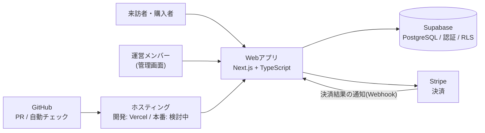

# 天空の森エミュー牧場 Webサイト・ネットショップ

静岡県森町の「天空の森エミュー牧場」のための、Webサイトとネットショップです。
エミューを入口に、過疎の集落へ人と仕事を呼び戻す取り組み(村おこし)を支えるサイトを作ります。

> ステータス: **要件定義フェーズ(v1.0、承認待ち)**。実装は未着手です。
> 要件定義書にある「要確認」「未確定」と書かれた項目は、事実が未確認のものです。推測で埋めず、確認してから確定します。

## 技術構成(予定)

| 領域 | 技術 | 状態 |
|---|---|---|
| アプリケーション | Next.js(App Router)、TypeScript | 決定([ADR-0001](docs/adr/0001-tech-stack.md)) |
| データベース・認証 | Supabase(PostgreSQL、Auth、行レベルセキュリティ) | 決定([ADR-0001](docs/adr/0001-tech-stack.md)) |
| 決済 | Stripe | 決定([ADR-0001](docs/adr/0001-tech-stack.md)) |
| ホスティング | 開発・試作: Vercel / 本番: 検討中 | [ADR-0002](docs/adr/0002-hosting-and-ownership.md) |
| ソース管理・自動チェック | GitHub(PR、Actions) | 予定 |
| テスト | 型チェック、単体テスト、E2Eテスト | 予定([品質目標](docs/01-requirements.md#7-非機能要件)) |

## 構成図(予定)

技術構成と構成図は、要件定義の時点での方針です。基本設計で詳細化します。

## このリポジトリの目的

- 牧場のWebサイトとネットショップを、**実際に運営する方々のために**作る。
- 開発の過程(要件定義、設計、技術判断、レビュー、テスト、運用)を、**公開して残す**。

## 読み方

| 順番 | ファイル | 内容 |
|---|---|---|
| 1 | [docs/01-requirements.md](docs/01-requirements.md) | 目的、課題、スコープ、機能一覧、非機能要件と品質目標、フェーズ計画 |
| 2 | [docs/02-data-design.md](docs/02-data-design.md) | データ設計。最初から複数の生産者に対応できる形にする方針 |
| 3 | [docs/adr/0001-tech-stack.md](docs/adr/0001-tech-stack.md) | 技術の選定と、その理由 |
| 4 | [docs/adr/0002-hosting-and-ownership.md](docs/adr/0002-hosting-and-ownership.md) | ホスティング、ドメイン、引き渡しの方針 |
| 5 | [CONTRIBUTING.md](CONTRIBUTING.md) | ブランチ、コミット、PRの進め方 |

## 背景(出典あり)

- 牧場は、静岡県森町三倉の大河内地区にある。2025年3月に開設された([中日新聞](https://www.chunichi.co.jp/article/1046875))。
- 新聞は、地区の住民を「20戸余り」と報じ、CAMPFIREのページ(2026年10月23日閲覧)は「6世帯・小学生1名」と記している。数字が異なるため、出典を併記する。
- 飼育は9羽から始まり、ヒナは33羽に増えた(出典: CAMPFIREの活動報告、2026年10月23日閲覧)。
- CAMPFIRE(2026/5/30〜8/17)で、プロジェクトを実施した。
- 商品(エミューオイル、エミュー石鹸など)はすでにあるが、**まだ広く知られていない**ことが最大の課題。

## 進め方の原則

1. **認知を最優先**: 売る仕組みより先に、「見つけてもらい、連絡先を残してもらう」入口を作る。
2. **段階ごとに承認**: 企画 → 要件定義 → 設計 → 開発 → 確認・公開の順に進め、各段階の終わりに主催者の承認を得る。
3. **規模に見合った設計**: 1つのアプリを機能別に整理する(モジュラーモノリス)。
4. **土台だけ先に広げる**: 最初は牧場だけを扱うが、データ設計は、複数の生産者に対応できる形にする。
5. **決めたことは記録する**: 技術判断は `docs/adr/` に残す。
6. **変更はPR経由**: レビューと承認の履歴を残す。

## 権利とライセンス

- 現時点では、**ライセンスを付けていません**。このリポジトリの内容は、閲覧できますが、再利用の許可は出していません(All rights reserved)。
- 牧場の名前、商品情報、写真、ロゴの権利は、牧場にあります。写真とロゴは、使用範囲が決まるまで、このリポジトリに含めません。
- コードのライセンスは、権利の取り決めとあわせて、あとで決めます。
