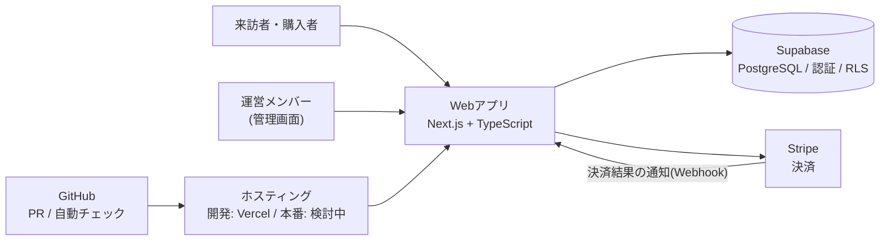

# 天空の森エミュー牧場 マーケットプレイス

生産者が出店し、購入者が生産者から直接買うマーケットプレイスです。代金は、購入者から各生産者の Stripe のアカウントに直接入り、管理者はアプリケーション手数料だけを受け取ります。

> ステータス: **作り直し中**。要件定義書([01-requirements.md](docs/01-requirements.md))を、マーケットプレイスの要件定義書として書き直します。基本設計書([03-basic-design.md](docs/03-basic-design.md))とデータ設計([02-data-design.md](docs/02-data-design.md))は、要件定義書が確定したあとに書き直します。実装は未着手です。各文書の版と状態は、下の「工程と成果物」の表のとおりです。

## 工程と成果物

このリポジトリの文書の目次です。工程は、開発の進め方([CONTRIBUTING.md](CONTRIBUTING.md#工程とゲート))の「工程とゲート」の順に進め、ゲートを満たすまで次の工程に入りません。この表は、各文書の版と状態の正本です。文書の版か状態を変える PR で、その文書の行も直します。

| 工程 | 成果物 | 状態 |
|---|---|---|
| 文書の地図 | 工程とゲート([CONTRIBUTING.md](CONTRIBUTING.md#工程とゲート)) | 確定 |
| 要件定義 | 要件定義書 v2.0([01-requirements.md](docs/01-requirements.md))、要件からテストへの対応表の最初の版(04-test.md。要件の ID と検証方法) | 要件定義書は作成中(直前の確定版は v1.6。タグ requirements-v1.6)。対応表は未着手 |
| 基本設計 | 基本設計書 v0.1([03-basic-design.md](docs/03-basic-design.md))、データ設計 v0.1([02-data-design.md](docs/02-data-design.md)) | 作成中。要件定義書が v2.0 として確定したあとに、02-basic-design.md として書き直す。データ設計は、その論理データの章にまとめる |
| 詳細設計 | 詳細設計書(03-detailed-design.md) | 未着手 |
| 開発基盤の準備 | 設定ファイル、開発の進め方([CONTRIBUTING.md](CONTRIBUTING.md))に足す「開発環境の作り方」の節 | 未着手 |
| 実装・単体テスト | コード、単体テスト | 未着手 |
| テスト・品質確認 | テスト仕様書と結果、対応表のテストの列(04-test.md) | 未着手 |
| リリース・運用 | 運用設計書と操作手順書(05-operations.md) | 未着手 |

工程をまたぐ技術の判断は、ADR に残しています: ADR-0001([0001-tech-stack.md](docs/adr/0001-tech-stack.md))(技術の選定)、ADR-0002([0002-hosting-and-ownership.md](docs/adr/0002-hosting-and-ownership.md))(ホスティングと引き渡し)、ADR-0003([0003-ai-review.md](docs/adr/0003-ai-review.md))(AI のレビュー)、ADR-0004([0004-stripe-connect-direct-charges.md](docs/adr/0004-stripe-connect-direct-charges.md))(ダイレクト支払い)、ADR-0005([0005-stripe-account-holds-and-refunds.md](docs/adr/0005-stripe-account-holds-and-refunds.md))(生産者のアカウント、仮押さえと返金)、ADR-0006([0006-one-product-per-order.md](docs/adr/0006-one-product-per-order.md))(1回の注文は1つの商品)、ADR-0007([0007-ai-review-model.md](docs/adr/0007-ai-review-model.md))(AI のレビューのモデル)。[決定事項の記録](docs/decisions.md)は過去の記録で、今後は書き加えません。

## 技術構成(予定)

| 領域 | 技術 | 状態 |
|---|---|---|
| アプリケーション | Next.js(App Router)、TypeScript | 決定(ADR-0001([0001-tech-stack.md](docs/adr/0001-tech-stack.md))) |
| データベース・認証 | Supabase(PostgreSQL、Auth、行レベルセキュリティ) | 決定(ADR-0001([0001-tech-stack.md](docs/adr/0001-tech-stack.md))) |
| 決済 | Stripe(Connect のダイレクト支払い) | 決定(ADR-0001([0001-tech-stack.md](docs/adr/0001-tech-stack.md))、ADR-0004([0004-stripe-connect-direct-charges.md](docs/adr/0004-stripe-connect-direct-charges.md))、ADR-0005([0005-stripe-account-holds-and-refunds.md](docs/adr/0005-stripe-account-holds-and-refunds.md))) |
| ホスティング | 開発・試作: Vercel / 本番: 検討中 | ADR-0002([0002-hosting-and-ownership.md](docs/adr/0002-hosting-and-ownership.md)) |
| ソース管理・自動チェック | GitHub(PR、Actions) | 予定 |
| テスト | 型チェック、単体テスト、E2Eテスト | 予定(品質目標は、要件定義書([01-requirements.md](docs/01-requirements.md))の非機能の要件) |

## 構成図(予定)

技術構成と構成図は、要件定義の時点での方針です。基本設計で詳細化します。

## このリポジトリの目的

- マーケットプレイスを、**実際に運営する方々のために**作る。
- 開発の過程(要件定義、設計、技術判断、レビュー、テスト、運用)を、**公開して残す**。

## 進め方の原則

1. **工程はウォーターフォール型、合意は議事録で**: 主催者は多忙なため、承認の手続きは設けない。工程と成果物はウォーターフォール型で進め、合意と承認に関しては、会議の議事録で記録する。毎日の会議で決めながら進めることで、主催者の時間を使わずに、手戻りを防ぐ。
2. **規模に見合った設計**: 1つのアプリを機能別に整理する(モジュラーモノリス)。
3. **決めたことは記録する**: 会議で合意したことと、議事録で報告したことは、そのPRの説明文にある「合意の記録」の欄に、議事録の名前を書く。そのPRで文書の版か状態を変えた場合は、その文書の改訂履歴にも、議事録の名前を書く。技術判断の理由は、`docs/adr/` に残す。手順は、開発の進め方([CONTRIBUTING.md](CONTRIBUTING.md#設計書の確定と合意の記録))に書いている。
4. **変更はPR経由**: 変更の理由と、合意した議事録の名前を、PRに残す。
5. **進み具合をいつでも見えるようにする**: [工程と成果物](#工程と成果物)の状態を常に最新にし、作成中の文書は下書きのPRとして出す。

## 権利とライセンス

- 現時点では、**ライセンスを付けていません**。このリポジトリの内容は、閲覧できますが、再利用の許可は出していません(All rights reserved)。
- 牧場の名前、商品情報、写真、ロゴの権利は、牧場にあります。写真とロゴは、使用範囲が決まるまで、このリポジトリに含めません。
- コードのライセンスは、権利の取り決めとあわせて、あとで決めます。
