# 基本設計書

| 項目 | 内容 |
|---|---|
| 版 | v0.1 |
| 状態 | **作成中** |
| 合意の記録 | 会議の議事録に記録する。どの議事録に記録したかは、下の改訂履歴に記載する |

### 改訂履歴

| 版 | 状態 | 内容 | 合意の記録 |
|---|---|---|---|
| v0.1 | 作成中 | 「システム構成と技術の分担」、「状態遷移と、決済と送金の流れ」、「論理データ」を書いた | 議事録_2026_1121、議事録_2026_1122 |

この文書は、個人情報や秘密情報を含まない。

## この文書の書き方

書くものと書かないものは、開発の進め方([CONTRIBUTING.md](../CONTRIBUTING.md#工程とゲート))の「工程とゲート」のとおりにする。要件は、要件定義書([01-requirements.md](01-requirements.md))の ID で指す。

## システム構成と技術の分担

### システム構成図

MVP のシステムは、Vercel で動かす1つの Next.js のアプリと、外部のサービス(Supabase、Stripe、メールを送るサービス、アクセス解析)でできている。技術の選定と、本番の置き場所は、ADR-0010([0010-tech-stack-hosting-and-db-functions.md](adr/0010-tech-stack-hosting-and-db-functions.md))で決めた。

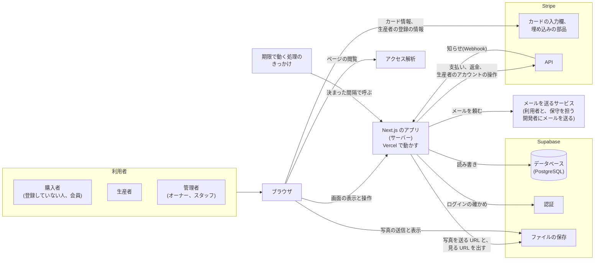

- 矢印は、つなぎ始める側から、つながれる側へ引いている。
- ブラウザがつなぐ相手は、Next.js のアプリ、Stripe、Supabase のファイルの保存、アクセス解析の4つである。データベースには、ブラウザから直接つながない。理由は、「技術の分担」に書く。認証へのつなぎ方は、「認証と認可」で決める。
- カード情報と、生産者が Stripe に登録する情報(本人確認、銀行口座)は、ブラウザから Stripe に直接送られ、Next.js のアプリを通らない(NFR-012、ADR-0009)。
- Stripe は、支払い、返金、不審請求、生産者のアカウントの出来事を、知らせ(Webhook)で Next.js のアプリに送る。
- 期限で動く処理(期限での取り消し、停止、知らせ、消すこと、Stripe との突き合わせ)は、決まった間隔で Next.js のアプリを呼んで動かす。処理の中身は、Next.js のアプリにある。

この章で決めず、ほかの章と工程で決めるもの:

| 決めること | 決める場所 |
|---|---|
| ログインと2段階認証の方式、認証のメールの送り方 | 「認証と認可」 |
| メールを送るサービス、アクセス解析のツール、受ける Stripe の知らせ、購入手続きの画面の作り | 「外部連携と知らせ」 |
| 期限で動く処理を動かす仕組みと、止まったときの知らせ | 「非機能と運用の方式」 |
| 開発・検証・本番の環境の分け方 | 開発基盤の準備の工程 |

### 構成要素の受け持ち

構成要素ごとに、受け持つことと、持つ鍵を決める。秘密の鍵を持つのは、Next.js のアプリだけである(NFR-014)。

| ID | 構成要素 | 受け持つこと | 持つ鍵 | 要件 |
|---|---|---|---|---|
| SYS-001 | ブラウザ | 画面を表示し、利用者の操作を Next.js のアプリに送る。カード情報と、生産者が Stripe に登録する情報を、Stripe の入力欄と埋め込みの部品に入れる。写真を、Supabase のファイルの保存に送る | 公開してよい鍵だけ(Stripe の公開可能キー)。秘密の鍵は持たない | NFR-012、NFR-014 |
| SYS-002 | Next.js のアプリ(Vercel で動かす) | 画面を作る。利用者の求めを受け、だれの求めかと、その人に許された操作かを確かめる。お金の額を計算する。データベースを読み書きする。Stripe に操作を頼み、Stripe の知らせを受ける。メールを頼む。期限で動く処理の中身を持つ | Stripe の秘密鍵、Stripe の知らせの署名の鍵、データベースの管理用の鍵、メールを送るサービスの鍵。Vercel の環境変数に置き、リポジトリには置かない | NFR-010、NFR-011、NFR-014 |
| SYS-003 | Supabase のデータベース | サイトの記録を保存する。いくつかの行を一度に変える書き込みを、全部行うか、全部行わないかのどちらかにする。行ごとに、読み書きできる人を限る(二重の守り)。バックアップを取る | なし | NFR-011、NFR-020 |
| SYS-004 | Supabase の認証 | アカウント、パスワード、2段階認証の手段を保存し、ログインを確かめる | なし | NFR-001、NFR-013 |
| SYS-005 | Supabase のファイルの保存 | 商品の写真と、メッセージ、返金の申し出の写真を保存する | なし | FR-020、FR-083、FR-118 |
| SYS-006 | Stripe | カード情報を受け取り、本人認証を行う。仮押さえ、代金の確定、返金を実行する。生産者のアカウント(本人確認、銀行口座、残高、入金)を持つ。不審請求を受け付ける。領収書を出す | — | FR-006、FR-046、NFR-012 |
| SYS-007 | メールを送るサービス | Next.js のアプリが頼んだメールを、購入者、生産者、管理者、保守を担う開発者に届ける | — | FR-116、NFR-022 |
| SYS-008 | アクセス解析 | ページの閲覧と、表示の速さを集める | — | FR-259、NFR-015〜NFR-017 |
| SYS-009 | 期限で動く処理のきっかけ | 決まった間隔で、Next.js のアプリを呼ぶ。処理の中身は持たない | — | NFR-022、NFR-023 |

置く地域:

| ID | 決まり | 理由 |
|---|---|---|
| SYS-010 | Next.js のアプリのサーバーの処理と、Supabase は、どちらも東京の地域に置く | サーバーの処理は、1つの画面を作る間に、データベースを何度も読む。Vercel の初めの設定では、サーバーの処理はアメリカの東海岸で動く(Vercel の公式ページ「Configuring regions for Vercel Functions」)。データベースと離れていると、読むたびに往復の時間がかかり、表示の速さ(NFR-017)を満たせない |

記録の正本(同じ事実を2か所が持つとき、どちらを正しいとするか):

| ID | 記録 | 正本 | もう一方の扱い |
|---|---|---|---|
| SYS-011 | 支払い、返金、不審請求と照会、生産者の Stripe のアカウントの状態 | Stripe | データベースは、写しを持つ。Stripe の知らせと、定期の突き合わせで、Stripe に合わせる(NFR-009)。食い違ったときは、データベースを直す |
| SYS-012 | 購入手続き、注文、商品、在庫、メッセージ、返金の申し出、会員と役割 | データベース | Stripe には持たせない。支払いには、購入手続きを見分ける ID だけを付ける。仮押さえの支払いは、注文ができる前に作るためである(TRN-002、TRN-003)。注文は、購入手続きから作るため、支払いから、購入手続きを通して、注文をたどれる |
| SYS-013 | カード情報、生産者の本人確認の書類、銀行口座 | Stripe | サイトは、受け取らず、保存しない(NFR-012、ADR-0009) |
| SYS-014 | パスワード、2段階認証の手段 | Supabase の認証 | データベースの表には、保存しない |
| SYS-015 | 写真 | Supabase のファイルの保存 | データベースは、写真の場所だけを持つ |

### 技術の分担

処理ごとに、行う場所を決める。ブラウザから届く値は、書き換えられることがあるものとして扱い、お金と権限に関わる判断は、ブラウザに任せない(NFR-011)。

| ID | 処理 | 行う場所 | 決まり | 要件 |
|---|---|---|---|---|
| SYS-016 | 画面を作る | Next.js のアプリ | 商品の一覧、商品ページ、生産者のページは、サーバーで作って送る。ブラウザでデータを取りに行ってから描く形にしない。表示の速さを満たすためである | NFR-017、NFR-018、NFR-019 |
| SYS-017 | 入力の確かめ | ブラウザと、Next.js のアプリ | ブラウザの確かめは、利用者がすぐに気づけるようにするためのものである。Next.js のアプリは、ブラウザの確かめを信じず、すべての入力を確かめ直す | NFR-011 |
| SYS-018 | だれの求めかと、許された操作かの確かめ | Next.js のアプリ。二重の守りとして、データベース | Next.js のアプリは、求めを受けるたびに、ログインしている人と、その人の役割、その注文や商品の持ち主かを確かめる。データベースも、行ごとに、読み書きできる人を限る。方式は、「認証と認可」で決める | NFR-011 |
| SYS-019 | お金の額の計算 | Next.js のアプリだけ | 下の「お金の額の計算」のとおり | FR-040、FR-042、FR-043、FR-063、FR-090、FR-093、NFR-011 |
| SYS-020 | Stripe にお金の操作を頼む | Next.js のアプリだけ | 下の「Stripe に頼むお金の操作」のとおり。Stripe の秘密鍵を使うコードは、「モジュールの境界」の「Stripe の窓口」だけに置く | FR-006、NFR-014 |
| SYS-021 | カード情報と、生産者が Stripe に登録する情報の入力 | ブラウザから、Stripe に直接 | Stripe の入力欄と埋め込みの部品を使う。Next.js のアプリは、受け取らない | NFR-012、ADR-0009 |
| SYS-022 | いくつかの行を一度に変える書き込み | データベースの関数 | 注文を作ることと在庫を減らすことのように、片方だけが行われると記録がずれる書き込みは、データベースの関数にまとめ、Next.js のアプリは、その関数を1回呼ぶ。関数の呼び出しは1つのトランザクションで行われ、全部行われるか、全部行われないかのどちらかになる(PostgREST の公式ページ「Transactions」) | FR-050、FR-051、FR-052 |
| SYS-023 | Stripe の知らせを受ける | Next.js のアプリ | 署名を確かめ、確かめられない知らせは受け付けない。同じ知らせを何度受けても、順番が入れ替わっても、同じ結果になるように処理する。受ける知らせと、処理の細部は、「外部連携と知らせ」で決める | NFR-009、NFR-010 |
| SYS-024 | 期限で動く処理 | Next.js のアプリ | 期限で動く処理のきっかけ(SYS-009)だけが呼べるようにし、ほかからの呼び出しは受け付けない。処理は、何度呼ばれても、遅れて呼ばれても、同じ結果になるように作る | NFR-022、NFR-023 |
| SYS-025 | 写真の送信と表示 | ブラウザから、Supabase のファイルの保存に直接。送る URL と見る URL は、Next.js のアプリが出す | Vercel で動かすサーバーの処理は、4.5 MB を超える本文を受け取れない(Vercel の公式ページ「Vercel Functions Limits」)。スマートフォンの写真はこれを超えることがあるため、写真は Next.js のアプリを通さない。Next.js のアプリは、送ってよい人かを確かめてから、その写真だけを送れる URL を出す。メッセージと返金の申し出の写真は、見てよい人にだけ、期限のある URL を出す | FR-020、FR-083、FR-118、NFR-011 |
| SYS-026 | メールを送る | Next.js のアプリから、メールを送るサービスへ | ブラウザからは送らない。メールを送るサービスの鍵は、Next.js のアプリだけが持つ | FR-116、NFR-014 |

お金の額の計算(SYS-019):

- ブラウザから受け取るのは、商品、数量、送り先、返金の区分と、生産者が入力する返金の額(FR-093)だけである。代金、送料、アプリケーション手数料、返金の額は、ブラウザから受け取らず、Next.js のアプリが、データベースの値(価格、運賃表、アプリケーション手数料の率)から計算する。生産者が入力した返金の額は、範囲(FR-093)を Next.js のアプリで確かめる。
- 購入者が「購入を確定する」を押すたびに(仮押さえに失敗したあとのやり直しを含む)、額を、そのときのデータベースの値から計算し直す。計算した額が、購入手続きの画面に最後に示した額(FR-041。購入手続きに持つ)と同じときに限り、その額で、Stripe に仮押さえを頼む。違うときは、仮押さえを頼まず、新しい額を購入手続きの画面に示し、購入者が確かめてから、もう一度押す。購入者が、見ていない額で支払わないようにするためである。アプリケーション手数料の率は、購入者が支払う額を変えないため、変わっていても、購入者に確かめを求めない。
- 「購入を確定する」が押されたときに決めた値(代金、送料、アプリケーション手数料の率と額、商品の名前、消費税の税率)を、購入手続きに持ち、注文を作るときに、そのまま注文に記録する(TRN-002、FR-257)。購入手続きで進んでいる仮押さえの回は、いつも1つだけにする。前の回の結果(成功か失敗か)が決まらないうちに、もう一度押されたときは、前の回を終わらせてから、新しい回を始める(「注文と支払い」の節)。購入手続きが持つ値を書き換えるのは、前の回を失敗と記録したあとである。そのため、仮押さえに成功する回は、いつも、購入手続きが持つ値を決めた回である(SYS-029 の、試みの回の進め方と同じ)。Stripe の支払いの額は、押したときに決めた額と同じにし、注文を作るときに、Stripe が仮押さえした額が、購入手続きに持つ支払いの総額と同じことを確かめる(「注文を受け付ける条件」)。代金の確定と返金では、計算し直さず、注文に記録した額と、Stripe が記録した決済手数料(FR-064)を使う。注文のあとに価格、運賃表、率が変わっても、その注文の額を変えないためである(FR-042、FR-043)。

Stripe に頼むお金の操作(SYS-020)。二重の確定と二重の返金は、重大な不具合であり(開発の進め方([CONTRIBUTING.md](../CONTRIBUTING.md#重大な不具合))の「重大な不具合」)、次の決まりで防ぐ:

| ID | 決まり | 理由 |
|---|---|---|
| SYS-027 | 仮押さえの支払いは、Next.js のアプリが額を決めて、生産者の Stripe のアカウントの上に作る。ブラウザは、カード情報を Stripe に送り、本人認証を行うだけである | ブラウザが額を決められると、書き換えた額で支払いを作れるため |
| SYS-028 | Stripe に頼む前に、データベースの状態で、その操作ができるかを確かめる(基本設計書の「状態遷移と、決済と送金の流れ」の、遷移の条件)。返金では、その前に、その支払いの返金の一覧を Stripe から読み、データベースにない返金を記録してから(TRN-014、TRN-017、TRN-020)、確かめる | 確定した注文をもう一度確定する、返金した注文にもう一度返金する、といった求めを、Stripe に送る前に止めるため。返金は、1つの支払いに、全額に届くまで何度でも行えるため(Stripe の公式ページ「Create a refund」)、Stripe は、二重の返金を止めない。返金の記録は Stripe が正であり(SYS-011)、知らせが届いていない返金や、結果が分からなかった返金があっても、頼む直前に読めば、二重にならない |
| SYS-029 | Stripe に頼むお金の操作(仮押さえ、代金の確定、仮押さえの取り消し、返金)には、注文(仮押さえと、注文になる前の仮押さえの取り消しでは、購入手続き)、操作、その操作の何回目の試みかから決まる鍵を付ける。試みの回は、前の試みの結果(Stripe が受け付けた、受け付けなかった)をデータベースに記録したときにだけ進める。結果を記録するまでは、何度頼んでも、同じ鍵になる。返金には、注文と、試みの回を付け、Stripe から読んだ返金が、サイトのどの試みによるものかを見分けられるようにする | ボタンが2回押されたとき、通信が切れてやり直したときに、同じ求めが2回届いても、Stripe は、同じ鍵の求めを1回しか行わない(Stripe の公式ページ「Idempotent requests」)。Stripe が鍵を覚えているのは24時間以上の間で、そのあとは、同じ鍵でも、新しい求めとして行われる。そのあとの求めは、返金では SYS-028、代金の確定と仮押さえの取り消しでは Stripe の支払いの状態と SYS-031 で止める。Stripe は、受け付けなかった結果も鍵と一緒に覚えるため、やり直し(TRN-016、TRN-020、TRN-021)では、試みの回を進めて、新しい鍵にする |
| SYS-030 | Stripe の結果を記録するときは、データベースの状態が、頼む前から変わっていないときにだけ、状態を変える。在庫の増減と知らせは、状態を変えたときにだけ行う | 同じ結果が2つの経路(操作の返事と、Stripe の知らせ)から届いても、在庫を二重に戻さず、知らせを二重に送らないため |
| SYS-031 | 結果が分からないときは、成功とも失敗とも決めず、Stripe で確かめる(SYS-011)。Stripe が、その状態ではできないと返したときと、同じ鍵の求めが重なっていると返したときも、失敗と決めず、Stripe の支払いと返金を読んで、その結果を記録する。代金の確定では、結果が分からないとき、確かめ中(TRN-006)にする。返金では、状態を変えず、Stripe の知らせ、突き合わせ、次に返金を頼む前の読み取り(SYS-028)で記録する | 通信が切れたときは、Stripe が行ったかどうかが分からない。失敗と決めてやり直すと、二重になることがあるため。Stripe が鍵を消したあとに届いたやり直しは、すでに行われた操作でも、その状態ではできないと断られる。これを失敗と記録すると、確定できていた注文を取り消して、代金を受け取ったまま注文がなくなるため |
| SYS-032 | お金に関わる処理の続きを、ブラウザに任せない。仮押さえのあと、注文にするか取り消すか(FR-257)は、ブラウザが戻ってこなくても、Stripe の知らせと期限で動く処理で、Next.js のアプリが続ける | 購入者は、本人認証のあとに画面を閉じることがある。ブラウザが戻ることを前提にすると、カードの利用枠が押さえられたまま残るため |

### モジュールの境界

Next.js のアプリのサーバーの処理を、10個のモジュールに分ける。モジュールは、操作する人ではなく、持つデータで分ける。同じデータの決まりを、1か所で守るためである。要件ごとに、どのモジュールが受け持つかは、対応表([04-test.md](04-test.md))に書く。

| ID | モジュール | 受け持つこと | 変える状態(基本設計書の「状態の持ち方」) |
|---|---|---|---|
| SYS-033 | 会員とログイン | 会員の登録、ログイン、パスワードの再設定、2段階認証(会員の分も、管理者の分も)。期限のあるリンク(NFR-002)を出すことと、確かめること。そのうち、一度だけ使えるリンク(FR-150、FR-171、FR-217)は、使われたことも確かめる。保存した送り先の住所。会員の退会 | — |
| SYS-034 | 生産者 | 生産者の招待、生産者の役割、Stripe のアカウントの登録と状態、特定商取引法に基づく表記、生産者のページ、アプリケーション手数料の率、停止、生産者の退会、売上と入金の確かめ | 生産者 |
| SYS-035 | 商品と送料 | 商品、在庫、運賃表、送料の計算、販売の停止と非公開、商品の一覧と商品ページに出すかどうか | — |
| SYS-036 | 注文と支払い | 購入手続き、仮押さえ、注文、代金の確定、「発送を知らせる」、取り消し、注文の画面、注文の履歴 | 注文と支払い |
| SYS-037 | 返金 | 返金の申し出、「返金しない」の答え、答える期限、返金、返金のやり直し、返金の記録 | 返金、返金の申し出 |
| SYS-038 | 不審請求と照会 | 不審請求と照会の記録、証拠を出すこと、生産者の役割が外れた生産者が証拠を出すページ | 不審請求と照会 |
| SYS-039 | メッセージ | 注文ごとのメッセージと写真、メッセージを送れる期間、管理者がメッセージを読める注文 | — |
| SYS-040 | 知らせ | メールと、管理者の画面の知らせを送ること。文面と、送った記録 | — |
| SYS-041 | 管理者の機能 | オーナーとスタッフ(招待、外すこと、引き継ぎ)、問い合わせと開示の請求、措置のページと規約のページ、管理者の画面の一覧 | — |
| SYS-042 | Stripe の窓口 | Stripe を呼ぶこと(お金の操作、生産者のアカウント、埋め込みの部品を使う許可、不審請求の証拠、読み取り)。鍵を付けること(SYS-029)。Stripe の知らせの署名を確かめること | —(データベースを書かない) |

ほかのモジュールの状態を変えるときに、頼む向き。矢印の元が頼み、先が自分の状態を変える:

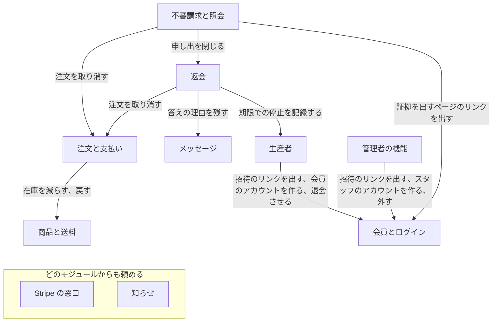

「知らせ」と「Stripe の窓口」は、どのモジュールからも頼めるため、図では線を省いた。この2つは、ほかのモジュールに頼まない。

| ID | 決まり | 理由 |
|---|---|---|
| SYS-043 | データベースのデータを書くのは、そのデータを持つモジュールだけである。ほかのモジュールは、持つモジュールが用意した処理を呼んで頼む。読むときも、持つモジュールが用意した読み取りを使う | 状態を変える条件(基本設計書の「状態遷移と、決済と送金の流れ」)を、1か所で確かめるため。別のモジュールが直接書くと、条件を確かめずに状態が変わる |
| SYS-044 | 状態を変えるよう頼む向きは、上の図の向きだけにする。逆の向きには頼まない。読み取りは、どの向きでもよい | 頼む向きが輪になると、1つの直しが、どこまで影響するかを追えなくなるため |
| SYS-045 | 2つのモジュールの書き込みを、同時に行うとき(返金して、注文を取り消し、在庫を戻すなど)は、1つのデータベースの関数にまとめる(SYS-022) | 片方だけが行われて、記録がずれることを防ぐため |
| SYS-046 | Stripe を呼ぶのは、「Stripe の窓口」だけである。「Stripe の窓口」は、データベースを書かず、Stripe の返事を、頼んだモジュールに返す。データベースの状態の確かめ(SYS-028)と、結果の記録(SYS-030)は、頼んだモジュールが行う | Stripe の秘密鍵を使うコードを1か所に集め(SYS-020、NFR-014)、鍵の付け方(SYS-029)をそろえるため。「Stripe の窓口」が状態を持つと、状態を変える場所が2つになる |
| SYS-047 | メールと、管理者の画面の知らせを送るのは、「知らせ」だけである。いつ、だれに、何を知らせるかは、出来事が起きたモジュールが決める | 送る手段(FR-116)と、二重に送らない仕組み(SYS-030)を、1か所に置くため |
| SYS-048 | 管理者の操作も、データを持つモジュールが受け持つ。生産者の停止(FR-018)は「生産者」、商品の非公開(FR-177)と運賃表(FR-029)は「商品と送料」、2段階認証の手段の登録を消すこと(FR-234、FR-235)は「会員とログイン」が受け持つ | 管理者の停止と、答える期限での停止のように、同じ状態を変える操作を、同じモジュールに置くため |
| SYS-049 | 期限のあるリンク(NFR-002)は、「会員とログイン」が出し、確かめる。そのうち、一度だけ使えるリンク(FR-150、FR-171、FR-217)は、使われたことも、「会員とログイン」が確かめる。いつ、だれに送るかは、使うモジュールが決める(生産者の招待は「生産者」、スタッフの招待は「管理者の機能」、証拠を出すページは「不審請求と照会」) | リンクの期限と、一度だけ使える仕組みを、リンクごとに別々に作らないため |
| SYS-050 | 画面と、求めを受ける入口(ブラウザの求め、Stripe の知らせ、期限で動く処理)は、モジュールに入れない。入口は、だれの求めかを確かめ(SYS-018)、モジュールを呼ぶだけにし、状態を変える条件を持たない。Stripe の知らせは、「Stripe の窓口」で署名を確かめてから、知らせの種類で決まるモジュールに渡す | 同じ操作が、画面、Stripe の知らせ、期限で動く処理のどこから来ても、同じ条件で処理するため(SYS-030) |

モジュールに割り当てない要件は、システムの全体に関わるものである。使われ方の計測(FR-259、NFR-015、NFR-016)は「外部連携と知らせ」、表示の速さと使いやすさ(NFR-017〜NFR-019)は、この章の「技術の分担」(SYS-016)、データの保全と復旧、期限で動く処理の運用(NFR-020〜NFR-023)は「非機能と運用の方式」で扱う。権限の確かめ(NFR-011)は、入口(SYS-018)と、すべてのモジュールが受け持つ。

## 状態遷移と、決済と送金の流れ

### 状態の持ち方

注文の状態を1つの値にまとめず、次の5つを別々に持つ。発送済みの注文が、同時に、返金した注文で、不審請求で負けた注文であることがあるように、5つは互いに独立に変わるためである。1つの値にまとめると、組み合わせの数だけ状態が要る。

| 状態を持つもの | 状態 | 書く節 |
|---|---|---|
| 注文と支払い | 確定待ち、確かめ中、発送待ち、発送済み、取り消し | 「注文と支払い」 |
| 返金 | なし、結果待ち、成功、失敗に変わった | 「返金」 |
| 返金の申し出 | なし、開いている、閉じた | 「返金の申し出」 |
| 不審請求と照会 | なし、照会、照会が閉じた、結果待ち、勝ち、負け | 「不審請求と照会」 |
| 生産者 | 生産者の役割、Stripe の支払いの受け付け、管理者の停止、答える期限での停止の4つを、別々に持つ | 「生産者のアカウント」 |

期限や期間で決まる扱いは、状態として保存せず、記録した日時から、そのつど求める。処理が遅れて動いても、期限どおりに動いたときと同じ結果にするためである(NFR-023)。

| ID | 求めるもの | もとにする日時 | 要件 |
|---|---|---|---|
| TRN-056 | 返金の申し出のボタンが使える期間 | 「発送を知らせる」が押された日時、代金を確定した日時 | FR-079 |
| TRN-057 | メッセージを送れる期間 | 注文、取り消し、申し出が閉じたこと、「返金しない」の答え、返金が失敗に変わったこと、不審請求と照会の結果の日時 | FR-121〜FR-123、FR-222、FR-269、FR-274 |
| TRN-058 | 答える期限での停止 | 返金の申し出があった日時と、申し出が閉じた日時 | FR-115 |
| TRN-059 | 生産者が退会できるか | 最後の発送と、最後の返金の日時 | FR-159、NFR-003 |
| TRN-060 | 注文が終わった日 | 発送を知らせた日、取り消した日、返金した日、不審請求の結果が出た日 | NFR-004 |

期限がきっかけの遷移(下の表で、きっかけが「期限」のもの)は、Stripe に行う操作、在庫の増減、知らせを伴うものだけである。

### 注文と支払い

注文は、仮押さえが成功したときに作る。購入手続きの途中は、注文の状態にしない。

購入手続きは、次のどれかで終わる。終わった購入手続きは、続きから進められない。注文にならずに終わったときは、購入者は、商品ページからやり直す。

| 終わり方 | 遷移 |
|---|---|
| 注文になった | TRN-002 |
| 仮押さえを取り消して、注文にしなかった | TRN-003 |
| 購入手続きの期限(購入手続きを作ってから1時間)を過ぎた | TRN-061 |

仮押さえに失敗したとき(TRN-001)は、購入手続きは終わらない。購入者は、期限までの間、同じ購入手続きのまま、カードを替えてやり直せる。本人認証の途中で画面を閉じたときも、同じである。購入者は、もう一度「購入を確定する」を押すだけでよい。やり直しの「購入を確定する」でも、額と、注文に記録する値を、押したときの値で決め直す(SYS-019)。期限を過ぎた購入手続きでは、期限の処理がまだ動いていなくても、「購入を確定する」を受け付けない(NFR-023)。TRN-002 と TRN-003 は、購入者の「購入を確定する」で始まり、ブラウザが戻らないときは、Stripe の知らせと、購入手続きの期限の処理が、続きを行う(SYS-032)。

| 状態 | 意味 | Stripe の支払い |
|---|---|---|
| 確定待ち | 注文を受け付け、生産者が「代金を確定する」を押すのを待っている | 仮押さえ |
| 確かめ中 | 「代金を確定する」が押されたが、結果が分からず、Stripe で確かめている | 仮押さえか、確定 |
| 発送待ち | 代金を確定し、「発送を知らせる」が押されるのを待っている | 確定 |
| 発送済み | 「発送を知らせる」が押された | 確定 |
| 取り消し | 注文を取り消した。理由は、生産者の取り消し、仮押さえの期限、確定の失敗、発送の前の返金、発送の前の不審請求の負けの5つ | 仮押さえの取り消しか、確定 |

発送済みと取り消しからは、ほかの状態に変わらない。発送済みの注文の返金と不審請求は、注文の状態を変えず、「返金」と「不審請求と照会」の状態を変える。

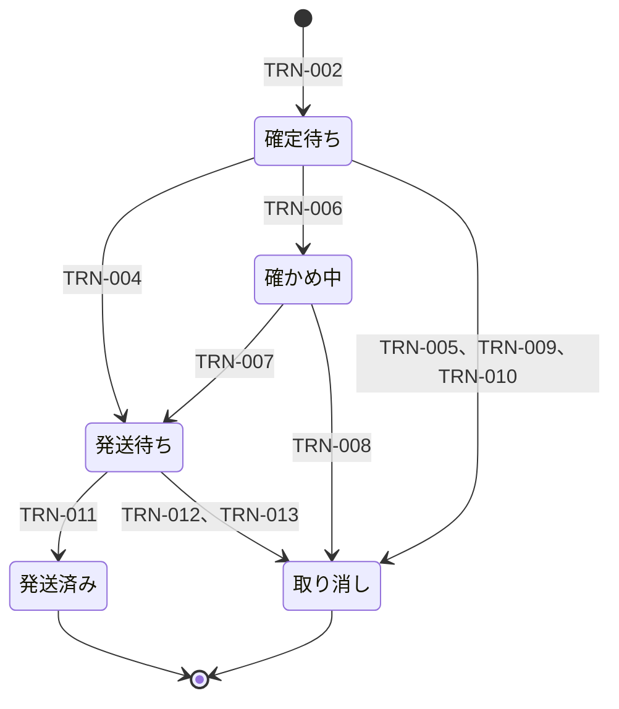

| ID | 遷移 | きっかけ | 条件 | Stripe に行う操作 | 在庫 | 知らせ | 要件 |
|---|---|---|---|---|---|---|---|
| TRN-001 | 購入手続き → 購入手続き(終わらない。やり直せる) | 購入者の「購入を確定する」(続きは、Stripe の知らせが行うことがある) | 仮押さえに失敗した(結果が決まらないうちに、もう一度押されて、前の回の支払いを取り消したときを含む。その取り消しと重なって成功していた仮押さえも、取り消しで外れているため、失敗に含む) | なし(前の回の支払いを取り消したときは、その取り消し) | 変えない | なし(購入手続きの画面に示す) | FR-053 |
| TRN-002 | 購入手続き → 確定待ち(購入手続きは終わる) | 購入者の「購入を確定する」(続きは、Stripe の知らせか、購入手続きの期限の処理が行うことがある) | 仮押さえに成功し、「注文を受け付ける条件」を満たし、在庫が数量以上ある | なし(仮押さえは済んでいる)。仮押さえの期限、代金、アプリケーション手数料の率と額、商品の名前と税率を、注文に記録する | 数量だけ減らす | 購入者に注文の確認、生産者に注文の知らせ | FR-006、FR-026、FR-042、FR-043、FR-047、FR-049〜FR-051、FR-063、FR-124、FR-130、FR-261 |
| TRN-003 | 購入手続き → 終わり(注文にしない) | 購入者の「購入を確定する」(続きは、Stripe の知らせか、購入手続きの期限の処理が行うことがある) | 仮押さえに成功したが、注文にできない(TRN-002 の条件を、仮押さえのあとで満たさなくなった。仮押さえに成功したのが、購入手続きの期限のあとだった。成功した仮押さえが、期限の処理(TRN-061)の取り消しと重なって、取り消された。注文を作る処理が終わらなかった) | 仮押さえを取り消す(すでに取り消されていれば、何もしない) | 変えない | 購入者に、注文できなかった知らせ | FR-257、FR-258 |
| TRN-004 | 確定待ち → 発送待ち | 生産者の「代金を確定する」 | 確定に成功した | 仮押さえした全額で、代金を確定する。Stripe が記録した決済手数料を、注文に記録する | 変えない | なし(生産者の画面に、発送を促す表示) | FR-054、FR-055、FR-064 |
| TRN-005 | 確定待ち → 取り消し(確定の失敗) | 生産者の「代金を確定する」 | 確定に失敗した | 代金の確定(失敗)。仮押さえが残っていれば、取り消す | 数量だけ戻す | 購入者に、取り消しの知らせ(生産者の画面に、発送しないよう促す表示) | FR-011、FR-052、FR-056、FR-057、FR-128 |
| TRN-006 | 確定待ち → 確かめ中 | 生産者の「代金を確定する」 | 確定の結果が分からない | 代金の確定(結果が届かない) | 変えない | なし | FR-069 |
| TRN-007 | 確かめ中 → 発送待ち | システムが Stripe で結果を確かめた | Stripe で、確定している | なし(確かめるだけ)。決済手数料を、注文に記録する | 変えない | なし(生産者の画面に、発送を促す表示) | FR-055、FR-064、FR-069 |
| TRN-008 | 確かめ中 → 取り消し(確定の失敗) | システムが Stripe で結果を確かめた | Stripe で、確定していない | 仮押さえが残っていれば、取り消す | 数量だけ戻す | 購入者に、取り消しの知らせ(生産者の画面に、発送しないよう促す表示) | FR-052、FR-056、FR-057、FR-069、FR-128 |
| TRN-009 | 確定待ち → 取り消し(生産者の取り消し) | 生産者の取り消しの操作 | 確定待ちである | 仮押さえを取り消す | 数量だけ戻す | 購入者に、取り消しの知らせ | FR-052、FR-072、FR-075、FR-076、FR-208 |
| TRN-010 | 確定待ち → 取り消し(仮押さえの期限) | 期限(仮押さえの期限) | 確定待ちのまま、期限を過ぎた | 仮押さえを取り消す(Stripe がすでに解いていれば、何もしない) | 数量だけ戻す | 購入者と生産者に、取り消しの知らせ | FR-052、FR-062、FR-129 |
| TRN-011 | 発送待ち → 発送済み | 生産者の「発送を知らせる」 | 伝票番号が入っている | なし。伝票番号を、注文に記録する | 変えない | 購入者に、発送の知らせ | FR-061、FR-070、FR-071、FR-125 |
| TRN-012 | 発送待ち → 取り消し(発送の前の返金) | 返金した注文になった(TRN-014、TRN-015、TRN-017) | 発送待ちである | 「返金」の節のとおり | 数量だけ戻す | 「返金」の節のとおり | FR-052、FR-092、FR-095、FR-101 |
| TRN-013 | 発送待ち → 取り消し(発送の前の不審請求の負け) | 不審請求で負けた(TRN-032) | 発送待ちである | なし | 数量だけ戻す | 購入者に、取り消しの知らせ | FR-052、FR-265、FR-277 |
| TRN-061 | 購入手続き → 終わり(購入手続きの期限) | 期限(購入手続きを作ってから1時間) | 購入手続きが終わっておらず、Stripe から読んだ支払いも、取り消した支払いも、仮押さえに成功していない(支払いがないときを含む) | Stripe の支払いを読み、仮押さえに成功していない支払いが残っていれば、取り消す | 変えない | なし(お金を押さえていないため) | NFR-023 |

- 確かめ中の間は、生産者の取り消し(TRN-009)と、期限での取り消し(TRN-010)を行わない。確定できていた注文を取り消すと、代金を受け取ったまま注文がなくなるためである(FR-069)。確かめ中に仮押さえの期限を過ぎたときも、Stripe で確かめた結果で、TRN-007 か TRN-008 に進む。
- 確定に失敗したとき(TRN-005、TRN-008)に、仮押さえが残っていれば取り消すのは、取り消した注文の代金が、購入者のカードの利用枠に押さえられたまま残らないようにするためである(FR-128 の「代金は請求されない」)。
- 確定待ちの注文の仮押さえが、サイトの操作によらずに Stripe の側で取り消されていたときは、「代金を確定する」が押されたときの確定の失敗(TRN-005)か、仮押さえの期限(TRN-010)で、取り消しになる。
- 仮押さえの期限が近い知らせ(FR-132)と、「発送を知らせる」が押されていない知らせ(FR-133)は、状態を変えない。
- 購入者が注文を取り消す遷移はない(FR-072)。購入者は、取り消しをメッセージで生産者に頼み(FR-073)、生産者が、取り消す(TRN-009)か、返金する(TRN-012)。購入者の会員の退会は、進んでいる注文を変えない(FR-158)。

購入手続きで起きる出来事と、その扱い。進んでいる仮押さえの回は、いつも1つだけである。進んでいる回がある購入手続きは、その回の支払いの結末(注文にした、または、取り消しを Stripe が受け付けた)を記録するときにだけ、終わらせる。終わった購入手続きに、仮押さえは残らない(FR-257)。購入者がすることは、うまくいかなかったら、もう一度「購入を確定する」を押すことだけである。

| 出来事 | 進んでいる回がないとき | 回が進んでいるとき(仮押さえの結果を待っている) | 購入手続きが終わっているとき |
|---|---|---|---|
| 購入者が「購入を確定する」を押す | 期限の前なら、額を計算し直して(SYS-019)、新しい回を始める。期限を過ぎていれば、受け付けない | 期限を過ぎていれば、受け付けない(期限の処理が扱う)。期限の前なら、Stripe の支払いを読む(SYS-031)。仮押さえに成功していれば、新しい回を始めず、下の行の「今の回の仮押さえに成功した」の扱いに進む。成功していなければ、その回の取り消しを頼み、失敗と記録してから(TRN-001)、新しい回を始める。読んだあと、取り消すまでの間に成功した仮押さえも、取り消しで外れているため、失敗として扱う | 受け付けない |
| 今の回の仮押さえに成功した(Stripe の返事か、知らせ) | —(前の回の支払いの知らせは、その回の結果を記録するだけで、注文を作らない) | 「注文を受け付ける条件」を満たせば、注文を作る(TRN-002)。満たさなければ、仮押さえを取り消して、購入者に知らせる(TRN-003)。どちらでも、購入手続きは終わる | 何もしない(同じ知らせが、もう一度届いたとき。取り消しのあとに、知らせが届いたとき)。その支払いの扱いと、購入者への知らせは、購入手続きを終わらせたときに済んでいる |
| 今の回の仮押さえに失敗した(Stripe の返事か、知らせ) | —(同じ) | 失敗と記録する(TRN-001)。購入手続きは終わらず、購入者は、やり直せる | 何もしない |
| 期限の処理が動く(購入手続きの期限を過ぎている) | 購入手続きを終わらせる(TRN-061。取り消す支払いはない) | Stripe の支払いを読む(SYS-031)。仮押さえに成功していれば、上の行の「今の回の仮押さえに成功した」の扱いに進む(期限のあとの成功は、「注文を受け付ける条件」を満たさないため、TRN-003 になる)。成功していなければ、その回の取り消しを頼む(すでに取り消されていれば、頼まない)。取り消した支払いが、仮押さえに成功していなかったときは、購入手続きを終わらせる(TRN-061。知らせはない)。読んだあと、取り消すまでの間に成功していたときは、期限のあとの成功であり、仮押さえは取り消しで外れているため、購入者に知らせて、購入手続きを終わらせる(TRN-003) | 何もしない |

- 取り消す前に Stripe の支払いを読むのは、サイトの記録だけで決めると、成功した仮押さえを、結果を記録する前に取り消すことがあるためである。期限の前に成功した仮押さえは、処理が期限のあとになっても、注文に進む。どちらになるかは、処理が動いた時刻ではなく、仮押さえに成功した時刻で決まる(NFR-023)。
- 回の取り消しは、Stripe に頼む前に、試み(ENT-015)として記録する。記録するときに、同じ書き込みの中で、購入手続きが終わっていないことを確かめ、終わっていれば(その回が、すでに注文になっていれば)、取り消しを頼まない(SYS-028)。取り消しを頼んだ回に届いた、仮押さえに成功した知らせは、その回の結果を記録するだけで、注文を作らない。その回の続きは、取り消しを頼んだ処理が、上の表のとおりに行う。
- 取り消した支払いが、仮押さえに成功していたかどうかは、取り消しの返事で返る支払いで確かめる。あとから届く Stripe の知らせを待たない。取り消しの返事が届かないときは、購入手続きを終わらせず、Stripe の支払いを読んで確かめる(SYS-031)。購入者への知らせ(TRN-003)は、購入手続きを終わらせるときに、1回だけ送る(SYS-030)。購入手続きの個人情報を消すのは、そのあとである。
- Stripe の知らせが、今の回のものか、前の回のものかは、知らせの支払いの ID を、購入手続きが持つ ID(ENT-013)と、試みが持つ ID(ENT-015)と比べて見分ける。
- ボタンの二度押しで、求めが続けて届いたときも、上の表のとおりに扱う(仮押さえの二度押しは、SYS-029 の同じ鍵ではなく、この扱いで受ける)。進んでいる回は1つのままで、仮押さえが二重になることはない。

### 返金

| 状態 | 意味 |
|---|---|
| なし | その注文に、返金がない |
| 結果待ち | Stripe が受け付け、結果が出ていない返金がある |
| 成功 | 結果待ちの返金がなく、成功した返金がある(Stripe に返金を出さない0円の返金を含む) |
| 失敗に変わった | Stripe が受け付けた返金が、すべて失敗に変わった。お金は購入者に届かず、生産者の Stripe の残高に戻る |

「なし」以外の注文が、返金した注文(FR-087)である。

サイトから行える返金は、1つの注文に1回だけである(FR-087)。ただし、Stripe の側で返金が行われると(FR-095)、1つの支払いに、2件以上の返金があることになる。そのため、Stripe の返金1件ごとに、結果待ち、成功、失敗に変わった、を記録し、注文の返金の状態は、上の表のとおり、その注文の返金の全体から決める。

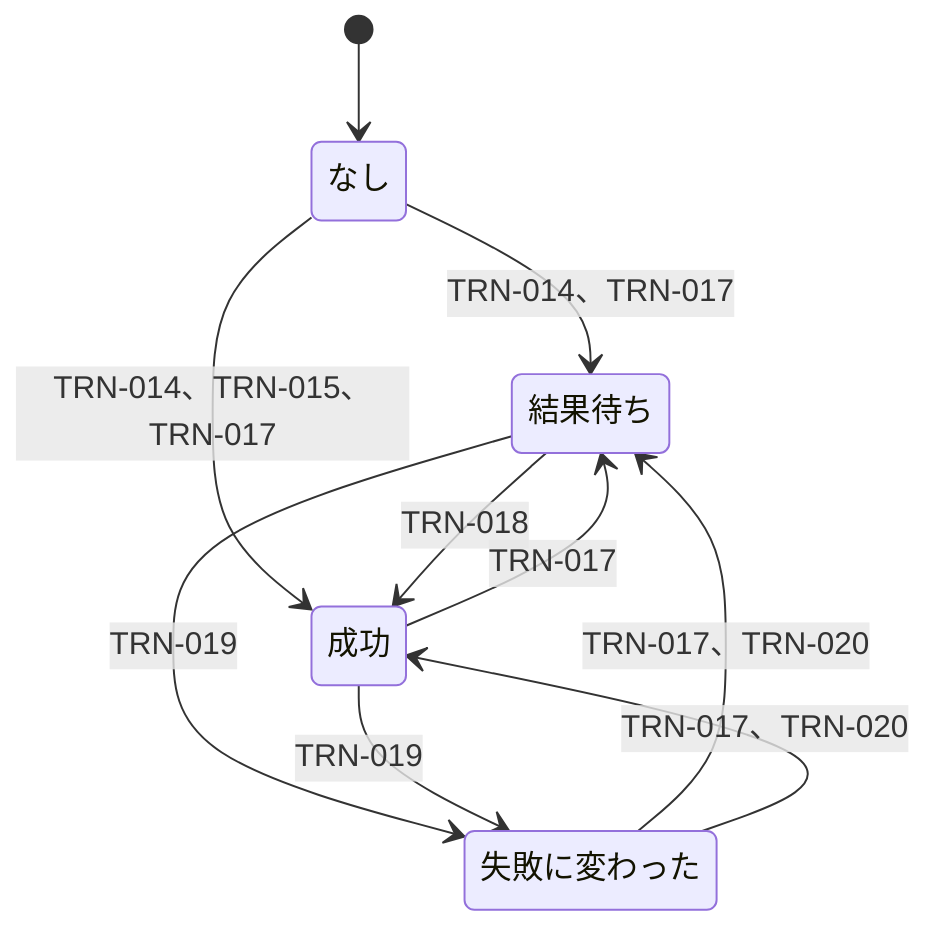

| ID | 遷移 | きっかけ | 条件 | Stripe に行う操作 | 知らせ | 要件 |
|---|---|---|---|---|---|---|
| TRN-014 | なし → 結果待ちか成功 | 生産者の返金の操作 | 「返金できる条件」を満たし、返金の額が1円以上で、Stripe が返金を受け付けた | 返金を作る(アプリケーション手数料の返金は指示しない) | 購入者に、返金の額 | FR-077、FR-084、FR-086、FR-087、FR-089〜FR-091、FR-093、FR-094、FR-103、FR-104、FR-111、FR-126 |
| TRN-015 | なし → 成功 | 生産者の返金の操作 | 「返金できる条件」を満たし、区分が購入者の都合で、求めた額が0円以下である | なし | 購入者に、返金の額(0円) | FR-092、FR-111、FR-126 |
| TRN-016 | なし → なし | 生産者の返金の操作 | Stripe が返金を受け付けなかった | 返金を作る(受け付けられない) | なし(生産者の画面に示し、やり直せる) | FR-011、FR-087、FR-088 |
| TRN-017 | どの状態からも → 結果待ちか成功 | Stripe の知らせ(サイトの操作によらずに、Stripe の側で行われた返金) | — | なし | 購入者と生産者に、返金の額 | FR-095、FR-111、FR-126、FR-264 |
| TRN-018 | 結果待ち → 成功 | Stripe の知らせ(返金の成功) | 結果待ちの返金がなくなった | なし | なし | FR-095 |
| TRN-019 | 結果待ちか成功 → 失敗に変わった | Stripe の知らせ(返金の失敗。Stripe の側での返金の取り消しを含む) | 結果待ちの返金も、成功した返金も、なくなった | なし | 購入者と生産者に、返金が届かなかった知らせ | FR-088、FR-095、FR-268、FR-269 |
| TRN-020 | 失敗に変わった → 結果待ちか成功 | 生産者の、返金のやり直しの操作 | 不審請求の状態が、結果待ちでも負けでもなく、Stripe が返金を受け付けた。額は、サイトから行った返金があれば、その返金と同じ。なければ、最後に失敗に変わった返金と同じ | 同じ額の返金を作る | 購入者に、返金の額 | FR-088、FR-100、FR-126 |
| TRN-021 | 失敗に変わった → 失敗に変わった | 生産者の、返金のやり直しの操作 | Stripe が返金を受け付けなかった | 返金を作る(受け付けられない) | なし(生産者の画面に示し、やり直せる) | FR-088 |

返金できる条件(TRN-014、TRN-015):

- 代金を確定した注文である(発送待ち、発送済み、発送の前の不審請求の負けで取り消した注文)(FR-084)。
- 返金の状態が「なし」である(FR-087)。
- 不審請求の状態が、結果待ちでも負けでもない(FR-100)。照会は、返金を妨げない(FR-270)。
- 返金の申し出の期限、生産者の停止、Stripe の支払いの受け付けが無効であることは、返金を妨げない(FR-011、FR-018、FR-086)。

返金した注文になったとき(TRN-014、TRN-015 と、返金の状態が「なし」だったときの TRN-017)に、あわせて行うこと:

- 注文が発送待ちなら、取り消しにする(TRN-012)。
- 開いている返金の申し出を閉じる(「返金の申し出」の節)。
- 返金を、注文に記録する(FR-111)。返金した日は、Stripe が返金を受け付けた日とする。0円の返金(TRN-015)は、生産者が退会できるまでの期間(FR-159)に数えない。

失敗に変わったとき(TRN-019)は、注文の状態、戻した在庫、閉じた返金の申し出を、元に戻さない(FR-088)。

- 結果待ちの間に、その支払いに不審請求が起きると、Stripe は、その返金を失敗にする(Stripe の公式ページ「Refund and cancel payments」)。このときは TRN-019 になり、やり直し(TRN-020)は、不審請求で勝つまでできない(FR-100)。
- 返金した注文に、Stripe の側でさらに返金が行われたときも、TRN-017 のとおり、その返金を注文の記録に足し、注文の返金の状態を、上の表のとおりに決め直し、購入者と生産者に、返金の額を知らせる(FR-095)。失敗に変わった注文で、Stripe の側の返金が受け付けられると、状態は結果待ちか成功になり(TRN-017)、やり直し(TRN-020)はできなくなる。同じ注文に、二重に返金しないためである。
- 返金の1件が失敗に変わっても、ほかに結果待ちか成功の返金があるときは、注文の返金の状態を変えず、やり直しもできない。このときも、返金が届かなかった知らせ(FR-268)を行い、メッセージを送れるようにする(TRN-054)。

### 返金の申し出

| 状態 | 意味 |
|---|---|
| なし | 申し出がない |
| 開いている | 購入者が申し出て、まだ閉じていない |
| 閉じた | 申し出が終わった。理由は、返金、「返金しない」の答え、購入者の取り下げ、不審請求の4つ |

申し出は、1つの注文に1回だけである(FR-080)。閉じた申し出は、開いている状態に戻らず、閉じた注文では、もう一度申し出られない。

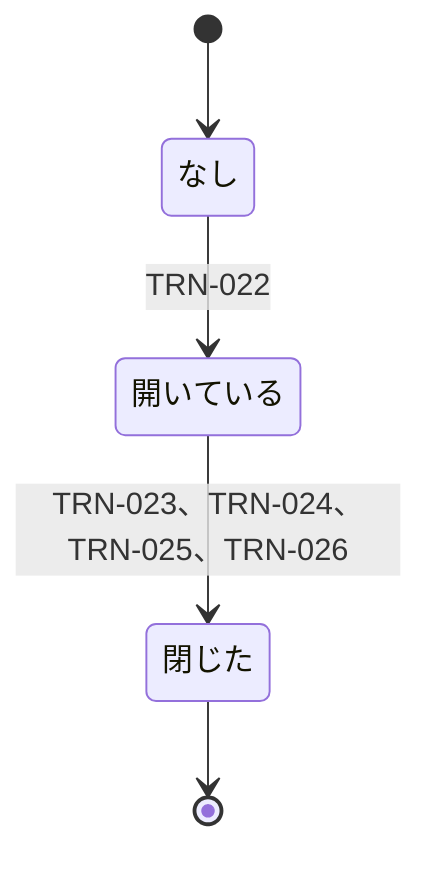

| ID | 遷移 | きっかけ | 条件 | 知らせ | 要件 |
|---|---|---|---|---|---|
| TRN-022 | なし → 開いている | 購入者の申し出 | 「申し出られる条件」を満たし、理由を選んでいる。理由が「商品の不具合」なら、写真が付いている | 生産者に、申し出の知らせ | FR-078〜FR-083、FR-131 |
| TRN-023 | 開いている → 閉じた(返金) | 返金した注文になった(TRN-014、TRN-015、TRN-017) | — | 「返金」の節のとおり | FR-114 |
| TRN-024 | 開いている → 閉じた(「返金しない」の答え) | 生産者の「返金しない」の答え | 理由が入っている | なし(理由を、生産者のメッセージとして注文に残す。購入者には、メッセージの知らせで届く) | FR-113、FR-114、FR-127、FR-275 |
| TRN-025 | 開いている → 閉じた(購入者の取り下げ) | 購入者の取り下げの操作 | — | 生産者に、取り下げの知らせ | FR-102、FR-114、FR-262 |
| TRN-026 | 開いている → 閉じた(不審請求) | その注文に不審請求が起きた(照会が不審請求に進んだときを含む。照会だけでは閉じない) | — | 購入者に、申し出を閉じたことと理由 | FR-096、FR-114、FR-270〜FR-272 |

どの遷移も、Stripe に行う操作と、在庫の増減はない。申し出を受けても、返金は自動では行わない(FR-081)。

申し出られる条件(TRN-022):

- 申し出のボタンが使える期間である。期間は、「発送を知らせる」が押された時点と、代金を確定してから48時間たった時点の、早いほうで始まり、その日の翌日から数えて14日目の日本時間23時59分(申し出の期限)で終わる(FR-079)。
- 返金の状態が「なし」である(FR-079)。
- 不審請求の状態が、なし、照会、照会が閉じた、のどれかである。不審請求が起きた注文では、結果が出たあとも申し出られない(FR-079、FR-270)。
- 返金の申し出の状態が「なし」である(FR-080)。

閉じたあとも、生産者は、「返金できる条件」(「返金」の節)を満たせば返金できる(FR-086)。「返金しない」と答えたあとと、取り下げられたあとも同じである。

答える期限:

- 答える期限は、申し出があった日の翌日から数えて14日目の日本時間23時59分である(FR-115)。
- 答える期限を過ぎても開いている申し出が、その生産者に1つでもある間、その生産者は、答える期限で停止されている。停止は状態として保存せず、申し出の日時と、閉じた日時から求める(「状態の持ち方」)。停止と解除で行う知らせと記録は、「生産者のアカウント」の節に書く。

メッセージを送れる期間:

次のどれかに当たる間、購入者と生産者は、その注文のメッセージを送れる。どれにも当たらなくなると、履歴を見るだけになる。

| ID | 当たる間 | もとにする状態と日時 | 要件 |
|---|---|---|---|
| TRN-050 | 注文が取り消しでなく、申し出の期限を過ぎていない(申し出の期限がまだ決まっていない間を含む) | 注文の状態、「発送を知らせる」が押された日時、代金を確定した日時 | FR-121 |
| TRN-051 | 注文が取り消しで、取り消した日の翌日から数えて14日目の日本時間23時59分を過ぎていない | 注文の状態、取り消した日時 | FR-123 |
| TRN-052 | 返金の申し出が開いている | 返金の申し出の状態 | FR-122 |
| TRN-053 | 「返金しない」と答えた日の翌日から数えて14日目の日本時間23時59分を過ぎていない | 返金の申し出の状態(閉じた理由)、答えた日時 | FR-222 |
| TRN-054 | 返金が失敗に変わった日の翌日から数えて14日目の日本時間23時59分を過ぎていない(生産者の役割が外れた生産者の注文を除く) | 返金1件ごとの記録の、失敗に変わった日時(最後のもの) | FR-269 |
| TRN-055 | 不審請求か照会が起きていて、結果が出ていない(生産者の役割が外れた生産者の注文を除く) | 不審請求と照会の状態 | FR-274 |

### 不審請求と照会

| 状態 | 意味 |
|---|---|
| なし | 不審請求も照会も起きていない |
| 照会 | カード会社が、不審請求の前に、支払いについて説明を求めている |
| 照会が閉じた | 照会が、不審請求に進まずに閉じた(勝ちでも負けでもない結果) |
| 結果待ち | 不審請求が起き、結果が出ていない |
| 勝ち | 不審請求で勝った |
| 負け | 不審請求で負けた |

状態は、不審請求(照会を含む)ごとに持つ。1つの支払いに、2つ以上の不審請求が起きることが、まれにある(Stripe の公式ページ「How disputes work」)。ほかの節の条件は、次のように読む。

- 「不審請求の状態が、結果待ちでも負けでもない」(「返金」の節)は、その注文のどの不審請求も、結果待ちでも負けでもないことをいう。
- 「不審請求が起きた注文」(「返金の申し出」の節)は、照会を除く不審請求が、1つでも起きた注文をいう。
- 「不審請求か照会が起きていて、結果が出ていない」(「返金の申し出」の節)は、照会か結果待ちの状態のものが、1つでもあることをいう。

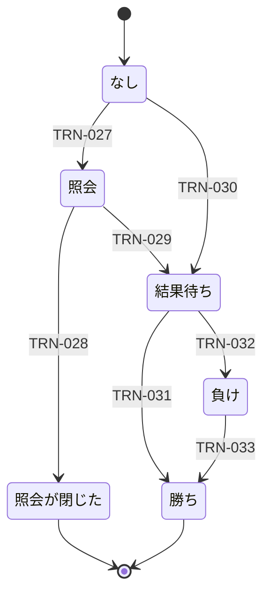

きっかけは、どの遷移も、生産者の Stripe のアカウントからの Stripe の知らせである。サイトの中から Stripe に行う操作は、証拠を出すことと、争わずに負けを認めることである。ログインした生産者は、どちらも、不審請求の部品から行う。生産者の役割が外れた生産者の証拠のページでは、証拠を出すことだけができる(FR-239、ADR-0009)。

| ID | 遷移 | きっかけ | あわせて行うこと | 知らせ | 要件 |
|---|---|---|---|---|---|
| TRN-027 | なし → 照会 | 照会が起きた | 注文に記録する。証拠を出す期限を記録する | 生産者と管理者に、照会が起きた知らせ | FR-096、FR-097、FR-136、FR-238、FR-266、FR-270 |
| TRN-028 | 照会 → 照会が閉じた | 照会が、不審請求に進まずに閉じた | 注文に記録する | 生産者に、結果 | FR-099、FR-242、FR-267、FR-271 |
| TRN-029 | 照会 → 結果待ち | 照会が、不審請求に進んだ | 注文に記録する。証拠を出す期限を記録し直す。開いている返金の申し出を閉じる(TRN-026) | 生産者と管理者に、不審請求が起きた知らせ | FR-096、FR-097、FR-136、FR-238、FR-266、FR-271 |
| TRN-030 | なし → 結果待ち | 不審請求が起きた | 注文に記録する。証拠を出す期限を記録する。開いている返金の申し出を閉じる(TRN-026) | 生産者と管理者に、不審請求が起きた知らせ | FR-096、FR-097、FR-136、FR-238、FR-266 |
| TRN-031 | 結果待ち → 勝ち | 不審請求で勝った | 注文に記録する。返金できる状態に戻る | 生産者に、結果 | FR-099、FR-100、FR-242、FR-267 |
| TRN-032 | 結果待ち → 負け | 不審請求で負けた(証拠を出して負けた、争わずに負けを認めた、証拠を出す期限を過ぎた、のどれも同じ) | 注文に記録する。注文が発送待ちなら、取り消しにする(TRN-013) | 生産者に、結果 | FR-099、FR-100、FR-242、FR-265、FR-267 |
| TRN-033 | 負け → 勝ち | 負けた不審請求が、あとで勝ちに変わった | 注文に記録する。返金できる状態に戻る。TRN-013 で取り消した注文は、取り消しのままとし、在庫を変えない | 生産者に、結果。TRN-013 で取り消した注文では、注文は取り消してあることと、商品を送っていなければ返金することを入れる | FR-099、FR-100、FR-242、FR-267 |

- 生産者の役割が外れた生産者には、不審請求と照会が起きた知らせを、証拠を出すページへのリンクを入れて、登録したメールアドレスに送り(FR-238)、結果も、登録したメールアドレスに知らせる(FR-242)。
- 証拠を出すこと(FR-098、FR-239)は、状態を変えない。照会か結果待ちの間で、証拠を出す期限を過ぎていないときに限り、受け付ける(FR-241、FR-266)。
- 照会の間は、返金と返金の申し出の扱いを変えない(FR-270)。照会の間にお金は動かず、不審請求に進んだとき(TRN-029)に、額と不審請求の手数料が、生産者の残高から引かれる(「決済と送金の流れ」の節)。
- 照会は、不審請求に進まないまま120日たつと、Stripe が閉じる(Stripe の公式ページ「How disputes work」)。それまでは、照会の状態が続く。
- カード会社が証拠を受け付けない不審請求は、起きたときに、すでに負けで閉じている(同じ公式ページ)。このときは、TRN-030 に続けて TRN-032 を行う。
- 負けた不審請求が勝ちに変わること(TRN-033)は、カード会社が、通常の流れの外でお金を動かしたときに、まれに起きる(同じ公式ページ)。返金するかどうかは、ほかの返金と同じく、生産者が決める(FR-084)。システムは、自動では返金しない。「発送を知らせる」を押し忘れたまま、商品を送っている場合があるためである。勝ちに変わっても、メッセージを送れる期間は変えない。TRN-013 で取り消した注文で、生産者が返金しないときの購入者の手段は、注文の画面にある生産者の連絡先(FR-164)と、カード会社である。管理者は関わらない。

### 生産者のアカウント

生産者について、次の4つを別々に持つ。互いに独立に変わるためである。

| 持つもの | 値 | 変えるもの |
|---|---|---|
| 生産者の役割 | なし、あり、外れた | 本人の同意、本人の退会 |
| Stripe の支払いの受け付け | 無効、有効 | Stripe の知らせ |
| 管理者の停止 | なし、あり | 管理者の操作 |
| 答える期限での停止 | なし、あり | 答える期限と、返金の申し出が閉じること(保存せずに求める。「返金の申し出」の節) |

管理者の停止か、答える期限での停止の、どちらかが「あり」の間、その生産者は停止されている(FR-115)。2つの停止は、互いを変えない。生産者の役割が付いたときは、Stripe の支払いの受け付けは無効、2つの停止は「なし」である。

| ID | 持つもの | 遷移 | きっかけ | 条件 | Stripe に行う操作 | あわせて行うこと | 知らせ | 要件 |
|---|---|---|---|---|---|---|---|---|
| TRN-034 | 生産者の役割 | なし → あり | 招待された本人の、生産者向けの利用規約への同意 | 招待が使える(期限の前で、取り消されておらず、まだ使われていない)。招待されたメールアドレスが、管理者のアカウントのものでない | 生産者の Stripe のアカウントを作る(設定は ADR-0009) | 会員のアカウントがなければ作る。その会員のログインの状態を、すべて終わらせる | なし | FR-002、FR-003、FR-005、FR-007〜FR-009、FR-206、FR-217、FR-218、FR-233、FR-243、FR-253、FR-255 |
| TRN-035 | Stripe の支払いの受け付け | 無効 → 有効 | Stripe の知らせ(生産者のアカウントの状態が変わった) | Stripe から取得したアカウントの状態で、支払いの受け付けが有効である | なし(状態を取得するだけ) | なし | なし | FR-010、FR-011 |
| TRN-036 | Stripe の支払いの受け付け | 有効 → 無効 | Stripe の知らせ(生産者のアカウントの状態が変わった) | Stripe から取得したアカウントの状態で、支払いの受け付けが無効である | なし(状態を取得するだけ) | なし | 生産者に、受け付けが止まった知らせ(情報を出す期限があれば、期限とともに) | FR-011、FR-260 |
| TRN-037 | 管理者の停止 | なし → あり | 管理者の停止の操作 | 理由が入っている | なし | 操作した管理者、日時、理由を記録する | 生産者に、理由とともに知らせる | FR-018、FR-209、FR-214、FR-215 |
| TRN-038 | 管理者の停止 | あり → なし | 管理者の、停止を解く操作 | 理由が入っている | なし | 操作した管理者、日時、理由を記録する | 生産者に、理由と、答える期限での停止が残っていれば、まだ停止されていることを知らせる(生産者の役割が外れた生産者には知らせない) | FR-019、FR-214、FR-215、FR-223 |
| TRN-039 | 答える期限での停止 | なし → あり | 期限(答える期限) | 答える期限を過ぎても、返金の申し出が開いている | なし | どの申し出で停止したかを記録する。管理者の画面に、まだ確かめていないものとして示す | 生産者に、停止のもとになった申し出の注文とともに知らせる。購入者に、期限までに答えがなかったことを知らせる | FR-115、FR-135〜FR-138、FR-276 |
| TRN-040 | 答える期限での停止 | あり → なし | 返金の申し出が閉じた(TRN-023〜TRN-026) | 答える期限を過ぎて開いている申し出が、その生産者に1つもなくなった | なし | 停止が解けた日時を記録する | 生産者に、この停止が解けたことと、管理者の停止が残っていれば、まだ停止されていることを知らせる | FR-115、FR-137、FR-273 |
| TRN-041 | 生産者の役割 | あり → 外れた | 本人の退会の操作 | 「退会できる条件」を満たす | なし(Stripe のアカウントは閉じない) | そのアカウントでログインできないようにする。特定商取引法に基づく表記は、その時点のまま残す(ENT-005)。登録したメールアドレスを、生産者(ENT-005)に写す | なし | FR-159〜FR-161、FR-166、FR-237、NFR-003、NFR-008 |

- 生産者の役割を付けたのに、Stripe のアカウントを作る処理が終わらなかったときは、作る処理をやり直す。Stripe のアカウントができるまで、支払いの受け付けは無効のままで、その生産者の商品は注文できないため(「注文を受け付ける条件」の節)、お金は動かない。
- Stripe が生産者に情報を求めているときと、入金を止めたときは、状態を変えず、生産者に知らせる(FR-260)。
- すでに答える期限で停止されている生産者で、別の申し出が答える期限を過ぎたときは、状態は変わらないが、その申し出について、TRN-039 と同じ記録と知らせを行う。停止が解けるには、その申し出も閉じる必要があるためである。
- 管理者は、答える期限での停止を解けない(FR-019)。

退会できる条件(TRN-041。FR-159):

| 条件 | もとにする状態と日時 |
|---|---|
| 発送も取り消しもしていない注文がない | 注文の状態が、確定待ち、確かめ中、発送待ちの注文がない |
| 閉じていない返金の申し出がない | 返金の申し出の状態が「開いている」の注文がない |
| 結果が出ていない不審請求がない | 不審請求の状態が「結果待ち」のものがない |
| メッセージを送れる期間が終わっていない注文がない | 「返金の申し出」の節の「メッセージを送れる期間」の表の、どれにも当たらない(照会の間は、退会できない) |
| 最後の発送からの期間がたった | 最後に「発送を知らせる」が押された日時(NFR-003) |
| 最後の返金からの期間がたった | 最後に Stripe が返金を受け付けた日時 |

生産者の役割が外れたあと:

| 項目 | 扱い | 要件、ADR |
|---|---|---|
| その生産者の商品 | 商品の一覧に出さず、商品ページと生産者のページを開けないようにする。注文を受け付けない | FR-163、FR-165 |
| 新しい支払い | 作らない。支払いを作るのはサイトだけのため、Stripe の側で止める操作は行わない | FR-165 |
| Stripe の部品を使う許可 | 出さない | ADR-0009 |
| Stripe の知らせ | 受け続け、不審請求、Stripe の側で行われた返金、返金の失敗を、役割がある生産者と同じ遷移で処理する。知らせは、登録したメールアドレスに送る | FR-238〜FR-242、FR-264、FR-268 |
| Stripe の残高の入金 | Stripe が、登録済みの銀行口座へ続ける。サイトは操作しない | FR-237 |
| Stripe のアカウントを閉じる操作 | 作らない | FR-237 |
| 同じ人が、もう一度生産者になるとき | 新しい会員のアカウントに、新しい Stripe のアカウントを作る | FR-005、FR-206 |
| 管理者の停止 | 役割が外れても、値は変えない。管理者は解けるが、生産者には知らせない | FR-223 |

### 注文を受け付ける条件

システムは、次のすべてを満たすときに限り、注文を受け付ける(TRN-002)。

- 生産者の役割が「あり」で、Stripe の支払いの受け付けが有効で、管理者の停止も、答える期限での停止も「なし」である。
- 商品が、出品されていて、生産者が販売を止めておらず、管理者が非公開にしていない。
- 在庫が数量以上あり、数量が、その商品の数量の上限以下である(FR-026、FR-050)。
- 仮押さえに成功したのが、購入手続きの期限(購入手続きを作ってから1時間)の前である。
- Stripe が仮押さえした額が、購入手続きに持つ支払いの総額と同じである(SYS-019)。

条件は、購入者が「購入を確定する」を押したあと、注文を作る時点で確かめる。商品ページを開いたあとで条件を満たさなくなったときは、仮押さえの前なら購入手続きの画面に示し、仮押さえのあとなら、注文にせずに仮押さえを取り消す(TRN-003)。

条件を満たさない状態ごとの扱いは、次のとおりである。どの状態も、すでにある注文を変えない。

| ID | 状態 | 新しい出品 | 注文の受け付け | 商品の表示 | すでにある注文 | その状態になったときの知らせ | 要件 |
|---|---|---|---|---|---|---|---|
| TRN-042 | 生産者: Stripe の支払いの受け付けが無効 | できる | 受け付けない | 商品の一覧と商品ページに出し、商品ページに「販売停止中」と表示する | 対応を続けられる。Stripe が代金の確定か返金を受け付けなかったときは、TRN-005、TRN-016 になる | 有効から無効に変わったとき、生産者に知らせる(TRN-036) | FR-011、FR-034、FR-035、FR-260 |
| TRN-043 | 生産者: 管理者の停止 | できない | 受け付けない | 商品の一覧と商品ページに出し、商品ページに「販売停止中」と表示する | 対応を続けられる | 生産者に、理由とともに知らせる(TRN-037) | FR-018、FR-034、FR-035、FR-209 |
| TRN-044 | 生産者: 答える期限での停止 | できない | 受け付けない | 商品の一覧と商品ページに出し、商品ページに「販売停止中」と表示する | 対応を続けられる | 生産者と購入者に知らせ、管理者の画面に示す(TRN-039) | FR-018、FR-034、FR-035、FR-115、FR-135、FR-136、FR-276 |
| TRN-045 | 生産者: 生産者の役割が外れた | できない(ログインできない) | 受け付けない | 商品の一覧に出さず、商品ページと生産者のページを開けない | 「生産者のアカウント」の節の「生産者の役割が外れたあと」のとおり | なし | FR-161、FR-163、FR-165 |
| TRN-046 | 商品: 出品の条件が足りない(箱のサイズ、数量の上限、発送元の都道府県、消費税の税率のどれかがない) | —(出品できない) | 受け付けない | 出さない | — | なし | FR-036 |
| TRN-047 | 商品: 生産者が販売を止めた | — | 受け付けない | 商品の一覧と商品ページに出し、商品ページに「販売停止中」と表示する | 変えない | なし | FR-033〜FR-035、FR-216 |
| TRN-048 | 商品: 管理者が非公開にした | —(生産者は、その商品を更新できる) | 受け付けない | 商品の一覧に出さず、商品ページを開けない | 変えない | 生産者に、理由とともに知らせる | FR-177〜FR-184、FR-203、FR-221、FR-224 |
| TRN-049 | 商品: 在庫が0 | — | 受け付けない | 商品の一覧と商品ページに出し、商品ページに「在庫切れ」と表示する | 変えない | なし | FR-034、FR-035、FR-050 |

- 2つ以上の状態が重なるときの商品の表示は、出さない(TRN-045、TRN-046、TRN-048)、「販売停止中」(TRN-042〜TRN-044、TRN-047)、「在庫切れ」(TRN-049)の順に、先に当たるものにする(FR-034 の「それ以外で在庫が0」)。
- 状態を解いたときは、解いた状態だけがなくなり、重なっているほかの状態は残る。非公開を解けるのは管理者だけで、理由を入れて解き、解いたことを記録し、生産者に理由とともに知らせる(FR-184、FR-203、FR-221、FR-224)。管理者が非公開を解いても、生産者の役割が外れた生産者の商品は公開に戻らず、非公開の間に生産者が変えた中身(販売を止めたかどうか、在庫を含む)は、変えたあとのままである(FR-183)。
- 停止されている生産者は、新しい出品はできないが、すでにある商品の更新、すでにある注文の対応、会員としての買い物はできる(FR-018)。
- 「対応を続けられる」は、代金の確定、発送、メッセージ、返金、返金の申し出への答え、不審請求の証拠を出すことをいう(FR-011、FR-018)。

### 決済と送金の流れ

お金は、状態が変わるときにだけ動く。場面ごとに、だれのお金がどう動くかを、遷移の ID で示す。

- 支払いは、生産者の Stripe のアカウントの上に作る(ダイレクト支払い。FR-006、ADR-0004)。代金は、管理者(プラットフォームのアカウント)を通らない。
- サイトが Stripe に行うお金の操作は、仮押さえ(支払いを作る)、代金の確定、仮押さえの取り消し、返金の4つだけである。アプリケーション手数料の返金、送金、入金の操作は行わない。
- 表の「総額」は支払いの総額(商品の小計と送料の合計)、「決済手数料」は Stripe が記録した実際の決済手数料(FR-064)、「アプリケーション手数料」は注文に記録した額(FR-063)である。

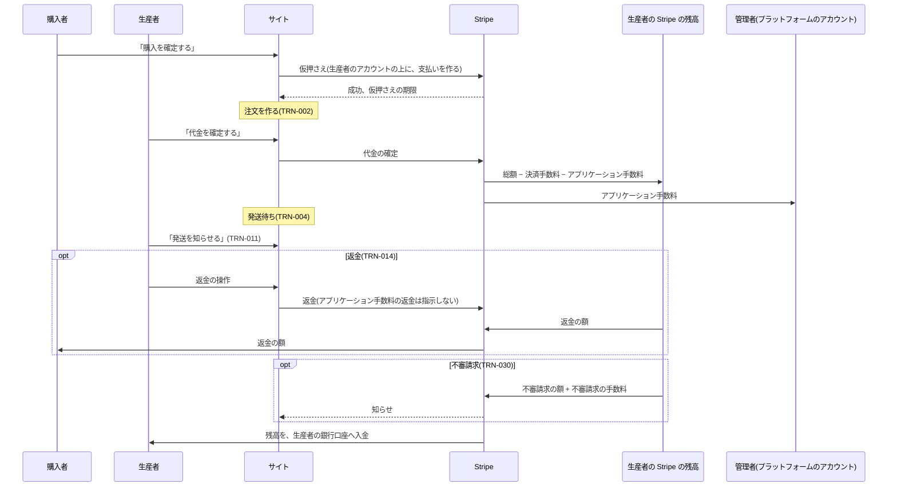

| 場面 | 遷移 | 購入者 | 生産者の Stripe の残高 | 管理者(プラットフォームのアカウント) | 要件、確かめた事実 |
|---|---|---|---|---|---|
| 仮押さえ | TRN-002 | カードの利用枠から、総額を押さえる。請求はしない | 動かない | 動かない | FR-047、ADR-0005 |
| 仮押さえの取り消し | TRN-003、TRN-005、TRN-008〜TRN-010 | 押さえた利用枠が戻る。請求はない | 動かない | 動かない(アプリケーション手数料は生まれない) | FR-076、ADR-0005 |
| 代金の確定 | TRN-004、TRN-007 | 総額を請求する | 総額 − 決済手数料 − アプリケーション手数料が入る | アプリケーション手数料が入る | FR-054、FR-063、FR-064、ADR-0005 |
| 返金(生産者の都合、発送の前) | TRN-014 | 総額が戻る | 総額が出る。確定からの差し引きは、−(決済手数料 + アプリケーション手数料) | 動かない | FR-077、FR-094、ADR-0005、ADR-0009 |
| 返金(生産者の都合、発送のあと) | TRN-014 | 生産者が入力した額(1円以上、総額まで)が戻る | 入力した額が出る | 動かない | FR-093、FR-094、ADR-0005 |
| 返金(購入者の都合、発送の前) | TRN-014 | 総額 − 決済手数料 − アプリケーション手数料が戻る | 同じ額が出る。確定からの差し引きは、0円 | 動かない | FR-090、FR-094、ADR-0005 |
| 返金(購入者の都合、発送のあと) | TRN-014 | 総額 − 決済手数料 − アプリケーション手数料 − 送料が戻る | 同じ額が出る。確定からの差し引きは、送料の額(生産者が払った送料に当たる) | 動かない | FR-090、FR-094 |
| 0円の返金 | TRN-015 | 動かない | 動かない | 動かない | FR-092 |
| Stripe の側で行われた返金 | TRN-017 | 返金の額が戻る | 返金の額が出る | 動かない | FR-094、FR-095 |
| 返金が失敗に変わった | TRN-019 | 返金が届かない | 返金の額が戻る | 動かない | FR-088、Stripe の公式ページ「Refund and cancel payments」 |
| 返金のやり直し | TRN-020 | 同じ額が戻る | 同じ額が出る | 動かない | FR-088 |
| 照会 | TRN-027、TRN-028 | 動かない | 動かない | 動かない | FR-270、ADR-0009 |
| 不審請求が起きた | TRN-029、TRN-030 | カード会社が決める | 不審請求の額と、不審請求の手数料が出る | 動かない | FR-094、ADR-0009、Stripe の公式ページ「Disputes on Connect platforms」 |
| 不審請求で勝った | TRN-031、TRN-033 | カード会社が決める | 不審請求の額が戻る。不審請求の手数料は戻らない | 動かない | ADR-0009 |
| 不審請求で負けた | TRN-032 | カード会社が決める | 動かない(起きたときに出ている) | 動かない | ADR-0009、Stripe の公式ページ「How disputes work」 |
| 入金 | —(状態を変えない) | — | 残高が、生産者の銀行口座へ出る。残高がマイナスの間は止まる | 動かない | FR-207、ADR-0005 |

- 不審請求の額は、支払いの総額と違うことがある(一部だけの不審請求など。Stripe の公式ページ「How disputes work」)。
- 返金と不審請求で、生産者の残高が足りないときは、残高がマイナスになるか、返金が結果待ちになる(TRN-014 の「結果待ち」。ADR-0009 の「影響とリスク」)。マイナスの分は、その生産者のその後の売上から引かれ、回収できない分は Stripe が負う(FR-009、ADR-0005)。管理者は負担しない。

管理者の残高から出るお金がないこと(FR-094):

| 確かめること | 根拠 |
|---|---|
| 管理者のお金が動くのは、代金の確定でアプリケーション手数料が入るときだけである | 上の表の「管理者」の列 |
| 返金で、アプリケーション手数料は戻らない | サイトは、アプリケーション手数料の返金を指示しない。指示しなければ、全額の返金でも一部の返金でも戻らなかった(ADR-0005) |
| 返金のお金は、生産者の残高から出る | ADR-0005、ADR-0009 |
| 不審請求の額は、生産者の残高から出る | ADR-0009。ダイレクト支払いでは、不審請求の額は生産者のアカウントの残高から引かれる(Stripe の公式ページ「Disputes on Connect platforms」) |
| 不審請求の手数料は、生産者が持つ | ADR-0009。Stripe の手数料を生産者が負担する設定(FR-008)では、不審請求の手数料も生産者のアカウントから引かれる(同じ公式ページ) |
| 不審請求で、アプリケーション手数料は戻らない | Stripe は、不審請求の結果に関わらず、アプリケーション手数料を自動では返さない(同じ公式ページ)。サイトも返さない |
| 生産者の残高がマイナスになっても、管理者は負担しない | 回収できない損失を Stripe が負う設定(FR-009、ADR-0009) |

管理者のアカウントの残高そのものは、方式検証では読んでいない(ADR-0009 の「影響とリスク」)。実装のテストで、返金と不審請求の前後に、管理者のアカウントの残高が変わらないことを確かめる。

## 論理データ

データベースが持つ実体と、そのつながりを決める。テーブルの列の定義と RLS は、詳細設計のマイグレーションで書く。カード情報、本人確認の書類、銀行口座、パスワード、2段階認証の手段、写真そのものは、データベースに持たない(SYS-013〜SYS-015)。

### 実体の一覧

実体ごとに、データを書くモジュールは1つである(SYS-043)。「状態」の列は、「状態の持ち方」の5つと、購入手続きの終わり方(「注文と支払い」の節)のうち、その実体に保存するものである。「個人情報」の列が「あり」の実体の、残す期間と消し方は、「残す期間と消し方」の節に書く。

| ID | 実体 | 持つもの | 持つモジュール | 状態 | 個人情報 | 要件 |
|---|---|---|---|---|---|---|
| ENT-001 | 会員 | 会員のアカウント1つにつき1件。購入者向けの利用規約とプライバシーポリシーに同意した日時、退会した日時。メールアドレスとパスワードは、Supabase の認証が持つ(SYS-014) | 会員とログイン(SYS-033) | — | あり | FR-141、FR-161、FR-212 |
| ENT-002 | 送り先の住所 | 会員が保存した送り先(氏名、住所、電話番号)と、いつもの送り先の印 | 会員とログイン(SYS-033) | — | あり | FR-153、FR-154 |
| ENT-003 | 期限のあるリンク | 用途(生産者の招待、スタッフの招待、証拠を出すページ、2段階認証の手段の登録)、指す先、期限、使われた日時、使えなくした日時。登録の確認とパスワードの再設定のリンクを、この実体に持つかは、「認証と認可」で決める | 会員とログイン(SYS-033) | — | — | NFR-002、FR-171、FR-217、FR-240、FR-247、FR-249 |
| ENT-004 | 2段階認証の手段を消した記録 | 消された人、操作した管理者、日時 | 会員とログイン(SYS-033) | — | — | FR-254 |
| ENT-005 | 生産者 | 会員1人につき1件まで。生産者向けの利用規約に同意した日時、Stripe のアカウントの ID、アプリケーション手数料の率、発送元の都道府県、特定商取引法に基づく表記、生産者のページの情報、役割が外れた日時、役割が外れるときに写す、登録したメールアドレス | 生産者(SYS-034) | 生産者の役割、Stripe の支払いの受け付け、管理者の停止 | あり | FR-002、FR-005、FR-012、FR-014、FR-015、FR-028、FR-160、FR-196 |
| ENT-006 | 生産者の招待 | 招待されたメールアドレス、招待した管理者、受けられた日時、取り消された日時 | 生産者(SYS-034) | — | あり | FR-001、FR-230、FR-231 |
| ENT-007 | 管理者の停止の記録 | 停止と、停止を解いたことの、1回ごと。操作した管理者、日時、理由 | 生産者(SYS-034) | — | — | FR-215 |
| ENT-008 | 答える期限での停止の記録 | 返金の申し出1つにつき1件まで。もとになった返金の申し出、停止した日時、解けた日時。停止されているかどうかは、この記録からではなく、返金の申し出から求める(TRN-058) | 生産者(SYS-034) | — | — | FR-137 |
| ENT-009 | 商品 | 名前、説明、写真の場所、価格、在庫の数、商品の表示、箱のサイズ、数量の上限、消費税の税率、生産者が販売を止めているか、管理者が非公開にしているか | 商品と送料(SYS-035) | — | — | FR-020、FR-022、FR-024、FR-025、FR-033、FR-037、FR-177 |
| ENT-010 | 運賃表の地域 | 地域と、その地域の都道府県 | 商品と送料(SYS-035) | — | — | FR-029 |
| ENT-011 | 運賃表の送料 | 箱のサイズ、発送元の地域、送り先の地域ごとの送料 | 商品と送料(SYS-035) | — | — | FR-029 |
| ENT-012 | 商品の非公開の記録 | 非公開にしたことと、非公開を解いたことの、1回ごと。操作した管理者、日時、理由 | 商品と送料(SYS-035) | — | — | FR-184 |
| ENT-013 | 購入手続き | 作った日時、商品、数量、購入者と送り先(氏名、住所、メールアドレス、電話番号)、ログインしていた会員、購入手続きの画面に最後に示した額、「購入を確定する」が押されたときに決めた値(額、アプリケーション手数料の率、商品の名前、消費税の税率)、Stripe の支払いの ID(最後の回のもの)、終わり方(終わっていない、注文になった、注文にならずに終わった) | 注文と支払い(SYS-036) | 購入手続きの終わり方 | あり | FR-039、FR-040、FR-156、FR-257 |
| ENT-014 | 注文 | 購入手続き1つにつき1件まで。「注文に記録し、あとで変えない値」の節の値、購入者と送り先、ログインしていた会員、仮押さえの期限、伝票番号、注文の画面を開くリンクの値、代金を確定した日時、「発送を知らせる」が押された日時、取り消した日時と理由 | 注文と支払い(SYS-036) | 注文と支払い | あり | FR-042、FR-043、FR-049、FR-066、FR-071、FR-156、FR-261 |
| ENT-015 | 支払いの操作の試み | 購入手続きか注文、操作(仮押さえ、代金の確定、仮押さえの取り消し)、何回目の試みか、結果。仮押さえの回は、その回の Stripe の支払いの ID | 注文と支払い(SYS-036) | — | — | FR-257(SYS-029) |
| ENT-016 | 返金 | 返金1件ごと(Stripe の返金か、Stripe に返金を出さない0円の返金)。注文、Stripe の返金の ID、額、区分、返金した人(サイトの操作によらない返金では、その印)、Stripe が受け付けた日時、失敗に変わった日時、どの試みによるか。返金した人、区分、額、Stripe が受け付けた日時は、書き換えない(FR-112)。状態と、失敗に変わった日時は、Stripe の知らせで書く | 返金(SYS-037) | 返金(1件ごとに、結果待ち、成功、失敗に変わった。注文の返金の状態は、その注文の返金の全体から求める) | — | FR-087、FR-088、FR-092、FR-095、FR-111、FR-112 |
| ENT-017 | 返金の試み | 注文、何回目の試みか、額、区分、結果 | 返金(SYS-037) | — | — | FR-088(SYS-029) |
| ENT-018 | 返金の申し出 | 注文1つにつき1件まで。理由、本文、申し出た日時、閉じた日時と理由、「返金しない」と答えた日時。申し出たあとは、理由と本文を変えられない | 返金(SYS-037) | 返金の申し出 | あり | FR-080、FR-082、FR-083、FR-113、FR-114 |
| ENT-019 | 返金の申し出の写真 | 写真1枚ごと。返金の申し出、写真の場所、送った日時、システムが消した日時。送ったあとは、差し替えも削除もできない | 返金(SYS-037) | — | あり | FR-083、NFR-005 |
| ENT-020 | 不審請求と照会 | 不審請求(照会を含む)1件ごと。注文、Stripe の不審請求の ID、額、証拠を出す期限、起きた日時、結果が出た日時 | 不審請求と照会(SYS-038) | 不審請求と照会 | — | FR-096、FR-099、FR-266 |
| ENT-021 | メッセージ | 注文、送った人、日時、本文。送ったあとは、本文を変えられず、消せない | メッセージ(SYS-039) | — | あり | FR-118、FR-119、FR-275 |
| ENT-022 | メッセージの写真 | 写真1枚ごと。メッセージ、写真の場所、送った日時、システムが消した日時。送ったあとは、差し替えも削除もできない | メッセージ(SYS-039) | — | あり | FR-118、NFR-005 |
| ENT-023 | 送った知らせ | 知らせの種類、もとになった出来事、宛先(会員、生産者、購入手続き、注文、招待、問い合わせのどれかを指す。メールアドレスは写さない)、送った日時 | 知らせ(SYS-040) | — | — | FR-116、NFR-023 |
| ENT-024 | 管理者の画面の知らせ | 種類(問い合わせ、不審請求と照会、答える期限での停止)、指す先、管理者が確かめた日時 | 知らせ(SYS-040) | — | — | FR-136 |
| ENT-025 | 管理者 | 管理者のアカウント1つにつき1件。オーナーかスタッフか、外された日時、スタッフが外されるときに写す、登録したメールアドレス。メールアドレスとパスワードは、Supabase の認証が持つ(SYS-014) | 管理者の機能(SYS-041) | — | あり | FR-167、FR-170、FR-173、FR-175、FR-204 |
| ENT-026 | スタッフの招待 | 招待されたメールアドレス、受けられた日時、取り消された日時 | 管理者の機能(SYS-041) | — | あり | FR-168、FR-230、FR-232 |
| ENT-027 | 問い合わせ | 結び付く注文(注文の画面と、生産者の画面の注文から送られたものだけ)、送った人(注文に結び付く問い合わせでは、その注文の購入者か生産者で示し、氏名とメールアドレスは持たない。結び付かない問い合わせでは、会員か、氏名とメールアドレス)、本文、届いた日時。開示の請求では、請求の理由、開示を求める項目、不正に使わない誓約 | 管理者の機能(SYS-041) | — | あり | FR-185〜FR-189、FR-194、FR-195 |
| ENT-028 | 問い合わせの返事 | 問い合わせ、返事をした管理者、日時、本文 | 管理者の機能(SYS-041) | — | あり | FR-193 |
| ENT-029 | 措置のページの中身 | 措置のページに示す文 | 管理者の機能(SYS-041) | — | — | FR-197、FR-198 |

- 「Stripe の窓口」(SYS-042)は、実体を持たない(SYS-046)。
- 答える期限での停止は、保存せず、返金の申し出(ENT-018)の日時から求める(TRN-058)。ENT-008 は、管理者が見るための記録である(FR-137)。
- 注文の返金の状態は、保存せず、その注文の返金(ENT-016)の全体から求める。返金が1件もない注文が、「なし」である。
- 生産者の役割が外れた時点の表記(FR-166)は、写しを作らず、生産者(ENT-005)の表記を使う。役割が外れた生産者は、ログインできず(FR-161)、表記を変えられないため、役割が外れた時点のまま残る。
- 写真そのものは、Supabase のファイルの保存に置く(SYS-015)。商品の写真は、生産者がいつでも差し替えられるため、商品(ENT-009)が場所だけを持つ。返金の申し出とメッセージの写真は、購入者と生産者が問題を解決するときと、生産者が不審請求の証拠を出すときの証拠になるため、1枚ごとの実体にし(ENT-019、ENT-022)、送ったあとは、送った人も、相手も、管理者も、差し替えと削除ができないようにする。残す期間を過ぎてシステムが写真を消したあとも(NFR-005)、だれがいつ送ったかの記録は残す。メッセージの本文と、返金の申し出の理由と本文も、同じ理由で、送ったあとは変えられない。
- 購入者向けの利用規約、生産者向けの利用規約、プライバシーポリシーのページ(FR-211)の中身は、データベースに持たず、リポジトリに置く。管理者が画面から変える要件がないためである。
- 使われ方の計測(FR-259)の記録は、アクセス解析(SYS-008)が持ち、データベースに持たない。
- 受けた Stripe の知らせを記録する実体が要るかは、「外部連携と知らせ」で決める。

### ER 図

実体のつながりを、4つの図に分けて示す。線の端の記号は、相手の側から見た数である。縦の線2本は「ちょうど1つ」、丸と縦の線は「0か1つ」、丸と3本の線は「0以上」を表す。実体の持つものは、「実体の一覧」に書き、図には書かない。

注文と、注文に付く記録:

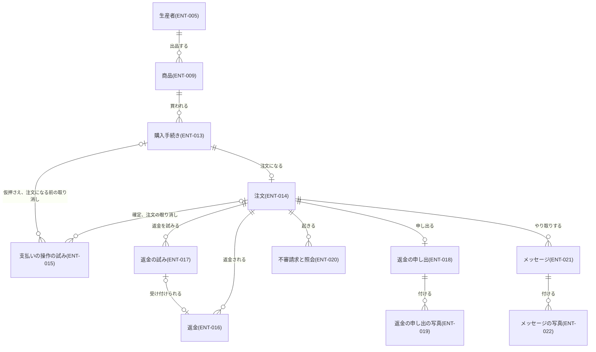

- 注文(ENT-014)は、購入手続き(ENT-013)から作る。購入手続き1つから、注文は1つまでである(TRN-002)。注文の商品と生産者は、購入手続きを通してたどる。1回の注文は、1人の生産者の1つの商品のため(FR-038)、注文の明細の実体は持たない。
- 支払いの操作の試み(ENT-015)は、仮押さえと、注文になる前の仮押さえの取り消し(TRN-001、TRN-003、TRN-061)では購入手続きに、代金の確定と、注文の仮押さえの取り消し(TRN-005、TRN-008〜TRN-010)では注文に付く(SYS-029)。
- 返金の試み(ENT-017)のうち、Stripe が受け付けたものと、0円の返金(TRN-015)が、返金(ENT-016)になる。Stripe の側で行われた返金(TRN-017)は、試みを持たない返金である。

会員、生産者、管理者のアカウントと、招待:

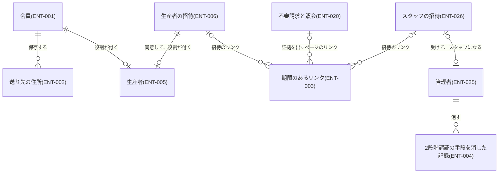

- 生産者(ENT-005)は、会員(ENT-001)に付く役割である。招待(ENT-006)への同意で付く(TRN-034)。
- 招待(ENT-006、ENT-026)は、受けられるか取り消されるまで残り(FR-230)、期限のあるリンク(ENT-003)は、送り直すたびに新しく作る(FR-229、FR-249)。そのため、1つの招待に、リンクは2つ以上あることがある。

生産者、商品、運賃表:

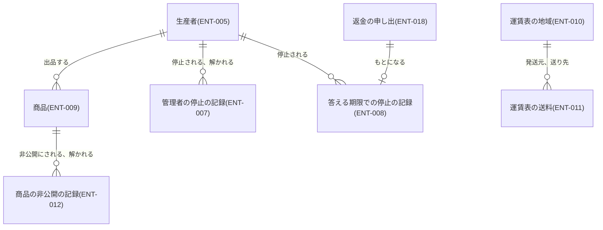

- 運賃表の送料(ENT-011)は、発送元と送り先の2つの地域(ENT-010)を指す。

問い合わせ:

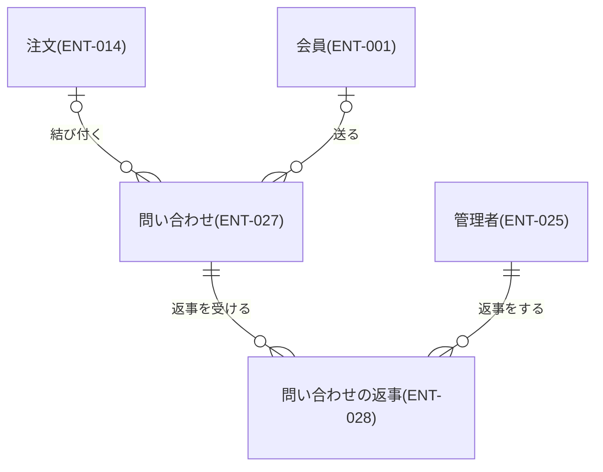

- 問い合わせ(ENT-027)は、注文に結び付くものと、結び付かないものがある(FR-189)。注文に結び付く問い合わせは、送った人を、その注文の購入者か生産者で示し、氏名とメールアドレスを持たない。結び付かない問い合わせで、送った人が会員でないときは、氏名とメールアドレスを持つ(FR-188)。

図に線を引いていないつながり:

| 実体 | 指す先 |
|---|---|
| 購入手続き(ENT-013)、注文(ENT-014) | ログインしていた会員(ENT-001)。登録せずに買った人の注文では、指さない(FR-156) |
| 2段階認証の手段を消した記録(ENT-004) | 消された人(会員(ENT-001)か、管理者(ENT-025)) |
| 期限のあるリンク(ENT-003)のうち、2段階認証の手段の登録のリンク | 登録する人(会員(ENT-001)か、管理者(ENT-025)) |
| 生産者の招待(ENT-006)、管理者の停止の記録(ENT-007)、商品の非公開の記録(ENT-012) | 操作した管理者(ENT-025) |
| 返金(ENT-016) | 返金した人のアカウント(会員(ENT-001))。Stripe の側で行われた返金では、指さない(FR-111) |
| メッセージ(ENT-021) | 送った人(購入者か、生産者(ENT-005)) |
| 送った知らせ(ENT-023) | 宛先(会員(ENT-001)、生産者(ENT-005)、購入手続き(ENT-013)、注文(ENT-014)、招待(ENT-006、ENT-026)、問い合わせ(ENT-027)のどれか)と、もとになった出来事の実体 |
| 管理者の画面の知らせ(ENT-024) | 問い合わせ(ENT-027)、不審請求と照会(ENT-020)、答える期限での停止の記録(ENT-008)のどれか |

措置のページの中身(ENT-029)は、ほかの実体とつながらない。

### 注文に記録し、あとで変えない値

次の値は、注文(ENT-014)に記録し、そのあとは変えない。注文のあとに、生産者が商品の名前、価格、税率を変えても、管理者が運賃表やアプリケーション手数料の率を変えても、会員が保存した送り先の住所を変えても、その注文の額と中身を変えないためである(FR-042、FR-043、FR-261)。

| 値 | 記録する時点 | もとにする値 | 使うところ | 要件 |
|---|---|---|---|---|
| 商品の名前 | 注文を作るとき(TRN-002) | 商品(ENT-009)の名前 | 注文の画面、注文の確認、領収書 | FR-261 |
| 消費税の税率 | 注文を作るとき(TRN-002) | 商品(ENT-009)の消費税の税率 | 税率ごとの消費税(FR-067、FR-068) | FR-261 |
| 価格(消費税を含む総額)と数量 | 注文を作るとき(TRN-002) | 商品(ENT-009)の価格と、購入者が選んだ数量 | 商品の小計 | FR-042 |
| 商品の小計 | 注文を作るとき(TRN-002) | 価格と数量の積 | アプリケーション手数料の額、購入手続きの画面と注文の画面の表示(FR-041) | FR-042、FR-063 |
| 送料 | 注文を作るとき(TRN-002) | 運賃表(ENT-010、ENT-011)、商品の箱のサイズ、生産者の発送元の都道府県、送り先の住所 | 購入者の都合の返金の額(FR-090) | FR-040、FR-042 |
| 支払いの総額 | 注文を作るとき(TRN-002) | 商品の小計と送料の合計 | 仮押さえと代金の確定の額(FR-047、FR-054)、返金の額(FR-077、FR-090、FR-093) | FR-042 |
| アプリケーション手数料の率 | 注文を作るとき(TRN-002) | 生産者(ENT-005)の率 | アプリケーション手数料の額 | FR-043 |
| アプリケーション手数料の額 | 注文を作るとき(TRN-002) | 商品の小計に率をかけ、円未満を切り捨てた額 | 代金の確定で管理者が受け取る額、購入者の都合の返金の額(FR-090) | FR-063 |
| 購入者と送り先(氏名、住所、メールアドレス、電話番号) | 注文を作るとき(TRN-002) | 購入手続きで入力された値。会員が保存した送り先(ENT-002)を選んだときは、その時点の値の写し | 発送、購入者への知らせ | FR-155 |
| 仮押さえの期限 | 注文を作るとき(TRN-002) | Stripe が、その支払いに示した期限 | 期限での取り消し(TRN-010)、期限が近い知らせ(FR-132) | FR-049 |
| 決済手数料 | 代金を確定したとき(TRN-004、TRN-007) | Stripe が記録した実際の額(処理手数料と、その消費税) | 購入者の都合の返金の額(FR-090)、返金の前に示す内訳(FR-104) | FR-064 |
| 伝票番号 | 「発送を知らせる」が押されたとき(TRN-011) | 生産者が入力した値 | 購入者への発送の知らせ(FR-125)、不審請求の証拠(ADR-0009) | FR-071 |

- 注文を作るときに記録する値は、仮押さえの期限を除き、購入者が「購入を確定する」を押したときの値である(FR-257。何度か押されたときは、仮押さえに成功した回の値)。押したときに、購入手続き(ENT-013)に持ち、注文を作るときに、そのまま注文に記録する(SYS-019)。注文を作るときに、商品、運賃表、生産者の率を読み直さない。仮押さえした額と、注文に記録する額、商品の名前、税率が、ずれないようにするためである。
- 代金の確定と返金では、ここに記録した値を使い、商品、運賃表、生産者の率を読み直さない(SYS-019)。
- 残す期間を過ぎたときに、購入者と送り先の氏名、住所、メールアドレス、電話番号を消すこと(NFR-005)は、この節の「変えない」の例外である。金額と日付は、消さない。
- 伝票番号は、荷物を見分ける番号であり、「発送を知らせる」で記録したあとは変えない。要件に、伝票番号を直す操作はない。
- これらの値を、あとから変えられないようにする方法は、詳細設計のマイグレーションで決める。

### 残す期間と消し方

個人情報を持つ実体(「実体の一覧」の「個人情報」の列が「あり」のもの)ごとに、残す期間と、消すものを決める。消すのは、個人を特定できる項目と、本文と写真であり、金額、日付、状態、だれがいつ送ったかの記録は残す(NFR-005)。

| 実体 | 消すもの | 消す時期 | 要件 |
|---|---|---|---|
| 会員(ENT-001) | アカウントのメールアドレス(Supabase の認証が持つ) | 退会したとき。生産者の役割を持っていた会員のメールアドレスは、役割が外れるときに、生産者(ENT-005)に写し(TRN-041)、登録の情報として残す | NFR-008 |
| 送り先の住所(ENT-002) | すべて | 会員が消したとき(FR-153)と、退会したとき | NFR-008 |
| 生産者(ENT-005) | 登録の情報(メールアドレスを含む)と、特定商取引法に基づく表記 | 役割が外れた生産者の、最後の注文が終わった日の翌日から数えて5年を過ぎたとき。役割が外れたときに、注文が1件もないか、最後の注文が終わった日の翌日から数えて5年を過ぎていれば、役割が外れたときに消す | NFR-006 |
| 生産者の招待(ENT-006)、スタッフの招待(ENT-026) | 招待されたメールアドレス | 招待が受けられたときと、取り消されたとき | FR-230 |
| 購入手続き(ENT-013) | 購入者と送り先の氏名、住所、メールアドレス、電話番号 | 購入手続きが終わったとき(「注文と支払い」の節の、購入手続きの終わり方)。注文になったときは、注文(ENT-014)に写したあと。仮押さえを取り消して、注文にしなかったときは、購入者に知らせたあと(FR-258) | —(下の説明) |
| 注文(ENT-014) | 購入者と送り先の氏名、住所、メールアドレス、電話番号 | 退会した会員の注文と、登録せずに買った人の注文で、注文が終わった日(TRN-060)の翌日から数えて5年を過ぎたとき | NFR-004、NFR-005 |
| 返金の申し出(ENT-018)、返金の申し出の写真(ENT-019)、メッセージ(ENT-021)、メッセージの写真(ENT-022) | 本文と、写真そのもの | その注文の個人情報を消すとき | NFR-005 |
| 管理者(ENT-025) | アカウントのメールアドレス(Supabase の認証が持つ) | スタッフが外されたとき。外されるときに、登録したメールアドレスを、管理者(ENT-025)に写す。管理者(ENT-025)の1件と、写したメールアドレスは、消さない | FR-204、FR-205 |
| 問い合わせ(ENT-027)、問い合わせの返事(ENT-028)のうち、注文に結び付くもの | 本文(開示の請求では、請求の理由、開示を求める項目、誓約を含む) | その注文の個人情報を消すとき | NFR-005 |
| 問い合わせ(ENT-027)、問い合わせの返事(ENT-028)のうち、注文に結び付かないもの | 本文(開示の請求では、請求の理由、開示を求める項目、誓約を含む)と、送った人の氏名とメールアドレス | 届いた日の翌日から数えて5年を過ぎたとき | NFR-007 |

- 会員である間は、その会員の注文の個人情報を消さない。注文の履歴から注文の画面を開けるようにするためである(FR-065)。会員が退会したときに、注文が終わった日の翌日から数えて5年を過ぎている注文は、退会のときに消す。
- 購入者と送り先の個人情報は、注文になったあとは、注文(ENT-014)だけが持つ。同じ個人情報を2か所に持つと、片方を消し忘れるためである。注文に結び付く問い合わせ(ENT-027)が、送った人の氏名とメールアドレスを持たないのも、同じ理由である。返事のメール(FR-192)は、注文が持つ購入者のメールアドレスか、生産者のアカウントのメールアドレスに送る。
- 購入手続き(ENT-013)と招待(ENT-006、ENT-026)の消す時期と、注文が1件もない生産者(ENT-005)の消す時期は、要件定義書が決めていないため、この章で決めた。目的を終えた個人情報を、持ち続けないためである。注文が1件もない生産者の登録の情報は、開示の請求(FR-194)にも、不審請求と返金の知らせにも使わないため(NFR-006)、役割が外れたときに消す。購入手続きの期限(作ってから1時間)は、メールのリンクの期限(NFR-002)と同じ長さである。在庫は、注文ができるまで減らさないため(TRN-002)、期限でやり直しになっても、だれの在庫も押さえない。仮押さえに失敗した購入手続きは、期限までやり直せるため(TRN-001)、期限で終わったときに消す。購入手続きの終わり方と、期限を過ぎた購入手続きの支払いの扱いは、「注文と支払い」の節のとおりである。仮押さえを取り消して、注文にしなかったとき(TRN-003)は、購入者への知らせを送ったあとに消す。メールアドレスを先に消すと、知らせを送れないためである。
- 外したスタッフのメールアドレスを、Supabase の認証から消すのは、同じメールアドレスで、もう一度スタッフに招待でき、会員にも登録できるようにするためである(FR-205)。退会した会員(FR-162)と同じ扱いである。管理者(ENT-025)の1件と、写したメールアドレスを消さないのは、操作の記録で、どの管理者が行ったかを示し続けるためである(FR-204)。操作の記録(ENT-004、ENT-006、ENT-007、ENT-012、ENT-028)は、メールアドレスではなく、管理者(ENT-025)の1件を指す。外した人と、もう一度招待した人は、別の1件になる。写したメールアドレスは、管理者の画面の操作の記録にだけ示し、購入者と生産者には示さない。
- 消す処理は、期限で動く処理(SYS-024)が、実体を持つモジュールを呼んで行う(SYS-043)。消す時期は、処理が動いた時刻ではなく、もとにする日時から求める(NFR-023)。
- 写真は、Supabase のファイルの保存から、写真そのものを消し、実体(ENT-019、ENT-022)に、システムが消した日時を記録する。
- 消したデータは、データベースのバックアップに、直近7日の間は残る(NFR-020)。
- この節が扱うのは、データベースが持つ情報である。サイトは、支払いを作るときに、購入者の個人情報を Stripe に渡さない。支払いに付けるのは、購入手続きを見分ける ID だけである(SYS-012)。カード情報は購入者が、本人確認の情報と銀行口座は生産者が、Stripe の入力欄と埋め込みの部品に、自分で直接入れる(SYS-021)。その情報は、Stripe が、Stripe の決まりで持つ。
