# 基本設計書

| 項目 | 内容 |
|---|---|
| 版 | v1.0 |
| 状態 | **確定** |
| 合意の記録 | 会議の議事録に記録する。どの議事録に記録したかは、下の改訂履歴に記載する |

### 改訂履歴

| 版 | 状態 | 内容 | 合意の記録 |
|---|---|---|---|
| v0.1 | 作成中 | 「システム構成と技術の分担」、「状態遷移と、決済と送金の流れ」、「論理データ」、「認証と認可」、「外部連携と知らせ」、「画面一覧と画面遷移」、「非機能と運用の方式」、「結合テストの方針」を書いた | 議事録_2026_1121、議事録_2026_1122、議事録_2026_1123、議事録_2026_1124 |
| v1.0 | 確定 | 全体を確かめ、確定した。すでに決まっているのに「で決める」と書いていた文を、決まった先の ID を指す文に直した。設計の中身は変えていない | 議事録_2026_1125 |

この文書は、個人情報や秘密情報を含まない。

## この文書の書き方

書くものと書かないものは、開発の進め方([CONTRIBUTING.md](../CONTRIBUTING.md#工程とゲート))の「工程とゲート」のとおりにする。要件は、要件定義書([01-requirements.md](01-requirements.md))の ID で指す。

## システム構成と技術の分担

### システム構成図

MVP のシステムは、Vercel で動かす1つの Next.js のアプリと、外部のサービス(Supabase、Stripe、メールを送るサービス、アクセス解析、監視のサービス)でできている。技術の選定と、本番の置き場所は、ADR-0010([0010-tech-stack-hosting-and-db-functions.md](adr/0010-tech-stack-hosting-and-db-functions.md))で決めた。

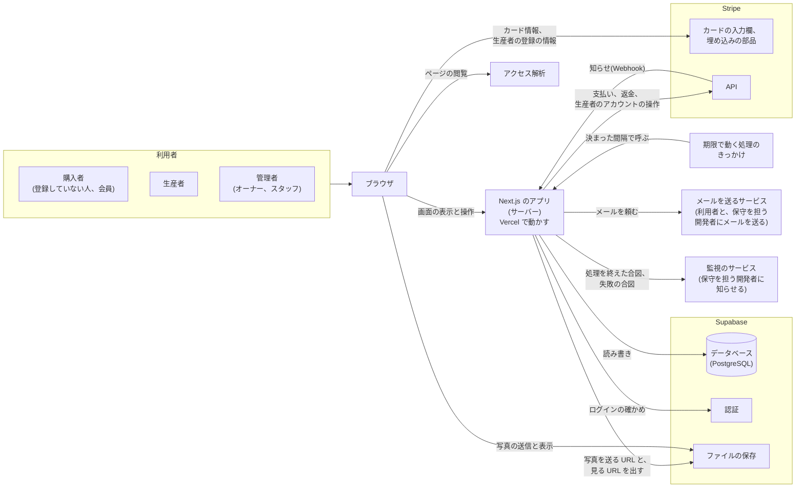

- 矢印は、つなぎ始める側から、つながれる側へ引いている。
- ブラウザがつなぐ相手は、Next.js のアプリ、Stripe、Supabase のファイルの保存、アクセス解析の4つである。データベースには、ブラウザから直接つながない。理由は、「技術の分担」に書く。認証へのつなぎ方は、「認証と認可」で決める(AUTH-001、AUTH-005)。
- カード情報と、生産者が Stripe に登録する情報(本人確認、銀行口座)は、ブラウザから Stripe に直接送られ、Next.js のアプリを通らない(NFR-012、ADR-0009)。
- Stripe は、支払い、返金、不審請求、生産者のアカウントの出来事を、知らせ(Webhook)で Next.js のアプリに送る。
- 期限で動く処理(期限での取り消し、停止、知らせ、消すこと、Stripe との突き合わせ)は、決まった間隔で Next.js のアプリを呼んで動かす。処理の中身は、Next.js のアプリにある。
- 監視のサービスは、期限で動く処理が止まったことと、処理の失敗を、保守を担う開発者に、メールでない手段で知らせる。仕組みは、「非機能と運用の方式」の章で決める(OPS-044〜OPS-049)。

この章で決めず、ほかの章で決めるもの:

| 決めること | 決める場所 |
|---|---|
| ログインと2段階認証の方式、認証のメールの送り方 | 「認証と認可」 |
| メールを送るサービス、アクセス解析のツール、受ける Stripe の知らせ、購入手続きの画面の作り | 「外部連携と知らせ」 |
| 期限で動く処理を動かす仕組みと、止まったときの知らせ | 「非機能と運用の方式」 |
| 開発・検証・本番の環境の分け方 | 「非機能と運用の方式」 |

### 構成要素の受け持ち

構成要素ごとに、受け持つことと、持つ鍵を決める。秘密の鍵を持つのは、Next.js のアプリだけである(NFR-014)。

| ID | 構成要素 | 受け持つこと | 持つ鍵 | 要件 |
|---|---|---|---|---|
| SYS-001 | ブラウザ | 画面を表示し、利用者の操作を Next.js のアプリに送る。カード情報と、生産者が Stripe に登録する情報を、Stripe の入力欄と埋め込みの部品に入れる。写真を、Supabase のファイルの保存に送る | 公開してよい鍵だけ(Stripe の公開可能キー)。秘密の鍵は持たない | NFR-012、NFR-014 |
| SYS-002 | Next.js のアプリ(Vercel で動かす) | 画面を作る。利用者の求めを受け、だれの求めかと、その人に許された操作かを確かめる。お金の額を計算する。データベースを読み書きする。Stripe に操作を頼み、Stripe の知らせを受ける。メールを頼む。期限で動く処理の中身を持つ | Stripe の秘密鍵、Stripe の知らせの署名の鍵、データベースの管理用の鍵(Supabase の秘密の鍵)、Supabase の公開してよい鍵(AUTH-005)、メールを送るサービスの鍵と、その知らせの署名の鍵(IF-107)、期限で動く処理のきっかけが付ける秘密の値(OPS-029)、監視のサービスに合図を送る宛先(OPS-045)。Vercel の環境変数に置き、リポジトリには置かない | NFR-010、NFR-011、NFR-014 |
| SYS-003 | Supabase のデータベース | サイトの記録を保存する。いくつかの行を一度に変える書き込みを、全部行うか、全部行わないかのどちらかにする。行ごとに、読み書きできる人を限る(二重の守り)。バックアップを取る | なし | NFR-011、NFR-020 |
| SYS-004 | Supabase の認証 | アカウント、パスワード、2段階認証の手段を保存し、ログインを確かめる | なし | NFR-001、NFR-013 |
| SYS-005 | Supabase のファイルの保存 | 商品の写真と、メッセージ、返金の申し出の写真を保存する | なし | FR-020、FR-083、FR-118 |
| SYS-006 | Stripe | カード情報を受け取り、本人認証を行う。仮押さえ、代金の確定、返金を実行する。生産者のアカウント(本人確認、銀行口座、残高、入金)を持つ。不審請求を受け付ける。領収書を出す | — | FR-006、FR-046、NFR-012 |
| SYS-007 | メールを送るサービス | Next.js のアプリが頼んだメールを、購入者、生産者、管理者、保守を担う開発者に届ける | — | FR-116、NFR-022 |
| SYS-008 | アクセス解析 | ページの閲覧と、表示の速さを集める | — | FR-259、NFR-015〜NFR-017 |
| SYS-009 | 期限で動く処理のきっかけ | 決まった間隔で、Next.js のアプリを呼ぶ。処理の中身は持たない。仕組みと間隔は、「非機能と運用の方式」で決める(OPS-029、OPS-030) | — | NFR-022、NFR-023 |

置く地域:

| ID | 決まり | 理由 |
|---|---|---|
| SYS-010 | Next.js のアプリのサーバーの処理と、Supabase は、どちらも東京の地域に置く | サーバーの処理は、1つの画面を作る間に、データベースを何度も読む。Vercel の初めの設定では、サーバーの処理はアメリカの東海岸で動く(Vercel の公式ページ「Configuring regions for Vercel Functions」)。データベースと離れていると、読むたびに往復の時間がかかり、表示の速さ(NFR-017)を満たせない |

記録の正本(同じ事実を2か所が持つとき、どちらを正しいとするか):

| ID | 記録 | 正本 | もう一方の扱い |
|---|---|---|---|
| SYS-011 | 支払い、返金、不審請求と照会、生産者の Stripe のアカウントの状態 | Stripe | データベースは、写しを持つ。Stripe の知らせと、定期の突き合わせで、Stripe に合わせる(NFR-009)。食い違ったときは、データベースを直す |
| SYS-012 | 購入手続き、注文、商品、在庫、メッセージ、返金の申し出、会員と役割 | データベース | Stripe には持たせない。Checkout Session と、その支払いには、購入手続きを見分ける ID と、商品の ID だけを付ける。仮押さえの支払いは、注文ができる前に作るためである(TRN-002、TRN-003)。商品の ID は、本番のデータベースを戻したあとに、注文を作り直すときに使う(OPS-026)。注文は、購入手続きから作るため、支払いから、購入手続きを通して、注文をたどれる |
| SYS-013 | カード情報、生産者の本人確認の書類、銀行口座 | Stripe | サイトは、受け取らず、保存しない(NFR-012、ADR-0009) |
| SYS-014 | パスワード、2段階認証の手段 | Supabase の認証 | データベースの表には、保存しない |
| SYS-015 | 写真 | Supabase のファイルの保存 | データベースは、写真の場所だけを持つ |

### 技術の分担

処理ごとに、行う場所を決める。ブラウザから届く値は、書き換えられることがあるものとして扱い、お金と権限に関わる判断は、ブラウザに任せない(NFR-011)。

| ID | 処理 | 行う場所 | 決まり | 要件 |
|---|---|---|---|---|
| SYS-016 | 画面を作る | Next.js のアプリ | 商品の一覧、商品ページ、生産者のページは、サーバーで作って送る。ブラウザでデータを取りに行ってから描く形にしない。表示の速さを満たすためである | NFR-017、NFR-018、NFR-019 |
| SYS-017 | 入力の確かめ | ブラウザと、Next.js のアプリ | ブラウザの確かめは、利用者がすぐに気づけるようにするためのものである。Next.js のアプリは、ブラウザの確かめを信じず、すべての入力を確かめ直す | NFR-011 |
| SYS-018 | だれの求めかと、許された操作かの確かめ | Next.js のアプリ。二重の守りとして、データベース | Next.js のアプリは、求めを受けるたびに、ログインしている人と、その人の役割、その注文や商品の持ち主かを確かめる。データベースも、行ごとに、読み書きできる人を限る。方式は、「認証と認可」で決める(AUTH-030、AUTH-039〜AUTH-041) | NFR-011 |
| SYS-019 | お金の額の計算 | Next.js のアプリだけ | 下の「お金の額の計算」のとおり | FR-040、FR-042、FR-043、FR-063、FR-090、FR-093、FR-104、NFR-011 |
| SYS-020 | Stripe にお金の操作を頼む | Next.js のアプリだけ | 下の「Stripe に頼むお金の操作」のとおり。Stripe の秘密鍵を使うコードは、「モジュールの境界」の「Stripe の窓口」だけに置く | FR-006、NFR-014 |
| SYS-021 | カード情報と、生産者が Stripe に登録する情報の入力 | ブラウザから、Stripe に直接 | Stripe の入力欄と埋め込みの部品を使う。Next.js のアプリは、受け取らない | NFR-012、ADR-0009 |
| SYS-022 | いくつかの行を一度に変える書き込み | データベースの関数 | 注文を作ることと在庫を減らすことのように、片方だけが行われると記録がずれる書き込みは、データベースの関数にまとめ、Next.js のアプリは、その関数を1回呼ぶ。関数の呼び出しは1つのトランザクションで行われ、全部行われるか、全部行われないかのどちらかになる(PostgREST の公式ページ「Transactions」) | FR-050、FR-051、FR-052 |
| SYS-023 | Stripe の知らせを受ける | Next.js のアプリ | 署名を確かめ、確かめられない知らせは受け付けない。同じ知らせを何度受けても、順番が入れ替わっても、同じ結果になるように処理する。受ける知らせと、処理の細部は、「外部連携と知らせ」で決める(IF-042〜IF-053) | NFR-009、NFR-010 |
| SYS-024 | 期限で動く処理 | Next.js のアプリ | 期限で動く処理のきっかけ(SYS-009)だけが呼べるようにし、ほかからの呼び出しは受け付けない。処理は、何度呼ばれても、遅れて呼ばれても、同じ結果になるように作る | NFR-022、NFR-023 |
| SYS-025 | 写真の送信と表示 | ブラウザから、Supabase のファイルの保存に直接。送る URL と見る URL は、Next.js のアプリが出す | Vercel で動かすサーバーの処理は、4.5 MB を超える本文を受け取れない(Vercel の公式ページ「Vercel Functions Limits」)。スマートフォンの写真はこれを超えることがあるため、写真は Next.js のアプリを通さない。Next.js のアプリは、送ってよい人かを確かめてから、その写真だけを送れる URL を出す。メッセージと返金の申し出の写真は、見てよい人にだけ、期限のある URL を出す | FR-020、FR-083、FR-118、NFR-011 |
| SYS-026 | メールを送る | Next.js のアプリから、メールを送るサービスへ | ブラウザからは送らない。メールを送るサービスの鍵は、Next.js のアプリだけが持つ | FR-116、NFR-014 |

お金の額の計算(SYS-019):

- ブラウザから受け取るのは、商品、数量、送り先、返金の区分、返金の内訳を示したときに「発送を知らせる」が押されていたかどうかと、生産者が入力する返金の額(FR-093)だけである。代金、送料、アプリケーション手数料、返金の額は、ブラウザから受け取らず、Next.js のアプリが、データベースの値(価格、運賃表、アプリケーション手数料の率)から計算する。生産者が入力した返金の額は、範囲(FR-093)を Next.js のアプリで確かめる。
- 生産者が返金を確定するときも、額を、そのときの注文の状態から計算し直す。「発送を知らせる」が押されたかどうかが、返金の画面に内訳を示したとき(FR-104)と違えば、返金を頼まず、新しい内訳を返金の画面に示し、生産者が確かめてから、もう一度確定する。返金は、1つの注文に1回であり(FR-087)、生産者が、見ていない額で返金しないようにするためである。
- 購入者が「購入を確定する」を押すたびに(仮押さえに失敗したあとのやり直しを含む)、額を、そのときのデータベースの値から計算し直す。計算した額が、購入手続きの画面に最後に示した額(FR-041。購入手続きに持つ)と同じときに限り、その額で、Stripe に仮押さえを頼む。違うときは、仮押さえを頼まず、新しい額を購入手続きの画面に示し、購入者が確かめてから、もう一度押す。購入者が、見ていない額で支払わないようにするためである。アプリケーション手数料の率は、購入者が支払う額を変えないため、変わっていても、購入者に確かめを求めない。
- Checkout Session を作るとき(作り直すときを含む)に決めた値(代金、送料、アプリケーション手数料の率と額、商品の名前、消費税の税率)を、購入手続きに持ち、注文を作るときに、そのまま注文に記録する(TRN-002、FR-257)。「購入を確定する」が押されたときは、額と率を計算し直し、購入手続きが持つ値と違えば、Checkout Session を作り直して、値を書き換える(「注文と支払い」の節)。終わった Checkout Session では支払えないため、仮押さえに成功するのは、いつも、購入手続きが持つ値で作った Checkout Session である。Checkout Session の額(明細と、アプリケーション手数料)は、購入手続きが持つ値と同じにし、注文を作るときに、Stripe が仮押さえした額が、購入手続きに持つ支払いの総額と同じことを確かめる(「注文を受け付ける条件」)。代金の確定と返金では、計算し直さず、注文に記録した額と、Stripe が記録した決済手数料(FR-064)を使う。注文のあとに価格、運賃表、率が変わっても、その注文の額を変えないためである(FR-042、FR-043)。

Stripe に頼むお金の操作(SYS-020)。二重の確定と二重の返金は、重大な不具合であり(開発の進め方([CONTRIBUTING.md](../CONTRIBUTING.md#重大な不具合))の「重大な不具合」)、次の決まりで防ぐ:

| ID | 決まり | 理由 |
|---|---|---|
| SYS-027 | 仮押さえは、Stripe の Checkout Session で行う。Checkout Session は、Next.js のアプリが、額(明細と、アプリケーション手数料)を決めて、生産者の Stripe のアカウントの上に作る。ブラウザは、サイトのページに置いた Stripe の入力欄から、カード情報とメールアドレスを Stripe に送り、本人認証を行うだけである(「外部連携と知らせ」の章) | ブラウザが額を決められると、書き換えた額で支払いを作れるため。Checkout Session を使うのは、税率ごとの消費税が出る領収書(FR-067)と、受け付けないカードのブランドを支払いの前に止める指定(FR-225)が、Checkout Session の機能のためである(ADR-0009) |
| SYS-028 | Stripe に頼む前に、データベースの状態で、その操作ができるかを確かめる(基本設計書の「状態遷移と、決済と送金の流れ」の、遷移の条件)。返金では、その前に、その支払いの返金の一覧を Stripe から読み、データベースにない返金を記録してから(TRN-014、TRN-017、TRN-020)、確かめる | 確定した注文をもう一度確定する、返金した注文にもう一度返金する、といった求めを、Stripe に送る前に止めるため。返金は、1つの支払いに、全額に届くまで何度でも行えるため(Stripe の公式ページ「Create a refund」)、Stripe は、二重の返金を止めない。返金の記録は Stripe が正であり(SYS-011)、知らせが届いていない返金や、結果が分からなかった返金があっても、頼む直前に読めば、二重にならない |
| SYS-029 | Stripe に頼むお金の操作(Checkout Session を作ること、代金の確定、仮押さえの取り消し、返金)には、注文(Checkout Session を作ることと、注文になる前の仮押さえの取り消しでは、購入手続き)、操作、その操作の何回目の試みかから決まる鍵を付ける。試みの回は、前の試みの結果(Stripe が受け付けた、受け付けなかった)をデータベースに記録したときにだけ進める。結果を記録するまでは、何度頼んでも、同じ鍵になる。返金には、注文と、試みの回を付け、Stripe から読んだ返金が、サイトのどの試みによるものかを見分けられるようにする | ボタンが2回押されたとき、通信が切れてやり直したときに、同じ求めが2回届いても、Stripe は、同じ鍵の求めを1回しか行わない(Stripe の公式ページ「Idempotent requests」)。Stripe が鍵を覚えているのは24時間以上の間で、そのあとは、同じ鍵でも、新しい求めとして行われる。そのあとの求めは、返金では SYS-028、代金の確定と仮押さえの取り消しでは Stripe の支払いの状態と SYS-031 で止める。Stripe は、受け付けなかった結果も鍵と一緒に覚えるため、やり直し(TRN-016、TRN-020、TRN-021)では、試みの回を進めて、新しい鍵にする |
| SYS-030 | Stripe の結果を記録するときは、データベースの状態が、頼む前から変わっていないときにだけ、状態を変える。在庫の増減と知らせは、状態を変えたときにだけ行う | 同じ結果が2つの経路(操作の返事と、Stripe の知らせ)から届いても、在庫を二重に戻さず、知らせを二重に送らないため |
| SYS-031 | 結果が分からないときは、成功とも失敗とも決めず、Stripe で確かめる(SYS-011)。Stripe が、その状態ではできないと返したときと、同じ鍵の求めが重なっていると返したときも、失敗と決めず、Stripe の支払いと返金を読んで、その結果を記録する。代金の確定では、結果が分からないとき、確かめ中(TRN-006)にする。返金では、状態を変えず、Stripe の知らせ、突き合わせ、次に返金を頼む前の読み取り(SYS-028)で記録する | 通信が切れたときは、Stripe が行ったかどうかが分からない。失敗と決めてやり直すと、二重になることがあるため。Stripe が鍵を消したあとに届いたやり直しは、すでに行われた操作でも、その状態ではできないと断られる。これを失敗と記録すると、確定できていた注文を取り消して、代金を受け取ったまま注文がなくなるため |
| SYS-032 | お金に関わる処理の続きを、ブラウザに任せない。仮押さえのあと、注文にするか取り消すか(FR-257)は、ブラウザが戻ってこなくても、Stripe の知らせと期限で動く処理で、Next.js のアプリが続ける | 購入者は、本人認証のあとに画面を閉じることがある。ブラウザが戻ることを前提にすると、カードの利用枠が押さえられたまま残るため |

### モジュールの境界

Next.js のアプリのサーバーの処理を、10個のモジュールに分ける。モジュールは、操作する人ではなく、持つデータで分ける。同じデータの決まりを、1か所で守るためである。要件ごとに、どのモジュールが受け持つかは、対応表([04-test.md](04-test.md))に書く。

| ID | モジュール | 受け持つこと | 変える状態(基本設計書の「状態の持ち方」) |
|---|---|---|---|
| SYS-033 | 会員とログイン | 会員の登録、ログイン、パスワードの再設定、2段階認証(会員の分も、管理者の分も)。期限のあるリンク(NFR-002)を出すことと、確かめること。そのうち、一度だけ使えるリンク(FR-150、FR-171、FR-217)は、使われたことも確かめる。保存した送り先の住所。会員の退会 | — |
| SYS-034 | 生産者 | 生産者の招待、生産者の役割、Stripe のアカウントの登録と状態、特定商取引法に基づく表記、生産者のページ、アプリケーション手数料の率、停止、生産者の退会、売上と入金の確かめ | 生産者 |
| SYS-035 | 商品と送料 | 商品、在庫、運賃表、送料の計算、販売の停止と非公開、商品の一覧と商品ページに出すかどうか | — |
| SYS-036 | 注文と支払い | 購入手続き、仮押さえ、注文、代金の確定、「発送を知らせる」、取り消し、注文の画面、注文の履歴 | 注文と支払い |
| SYS-037 | 返金 | 返金の申し出、「返金しない」の答え、答える期限、返金、返金のやり直し、返金の記録 | 返金、返金の申し出 |
| SYS-038 | 不審請求と照会 | 不審請求と照会の記録、証拠を出すこと、生産者の役割が外れた生産者が証拠を出すページ | 不審請求と照会 |
| SYS-039 | メッセージ | 注文ごとのメッセージと写真、メッセージを送れる期間、管理者がメッセージを読める注文 | — |
| SYS-040 | 知らせ | メールと、管理者の画面の知らせを送ること。文面と、送った記録。メールが届かなかったことの記録(IF-107) | — |
| SYS-041 | 管理者の機能 | オーナーとスタッフ(招待、外すこと、引き継ぎ)、問い合わせと開示の請求、措置のページと規約のページ、管理者の画面の一覧 | — |
| SYS-042 | Stripe の窓口 | Stripe を呼ぶこと(お金の操作、生産者のアカウント、埋め込みの部品を使う許可、不審請求の証拠、読み取り)。鍵を付けること(SYS-029)。Stripe の知らせの署名を確かめること | —(データベースを書かない) |

ほかのモジュールの状態を変えるときに、頼む向き。矢印の元が頼み、先が自分の状態を変える:

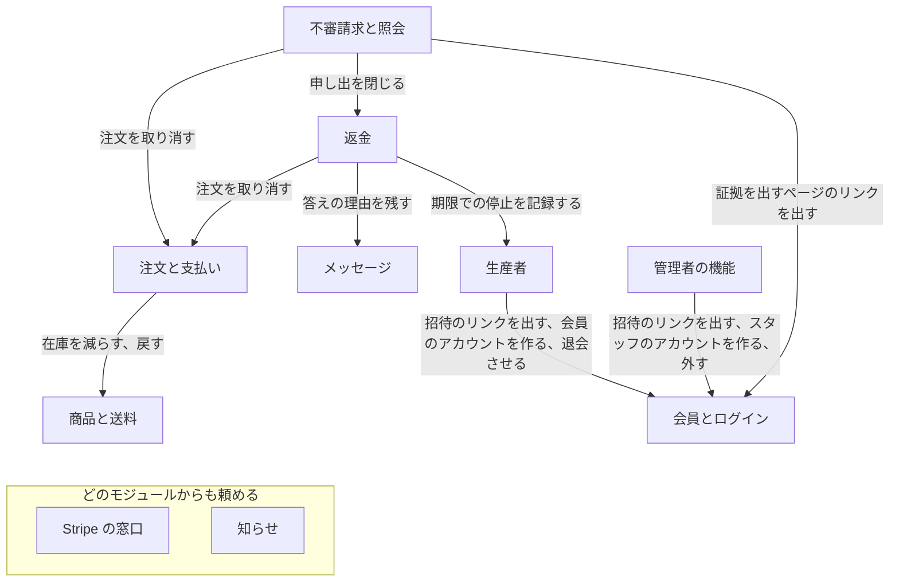

「知らせ」と「Stripe の窓口」は、どのモジュールからも頼めるため、図では線を省いた。この2つは、ほかのモジュールに頼まない。

| ID | 決まり | 理由 |
|---|---|---|
| SYS-043 | データベースのデータを書くのは、そのデータを持つモジュールだけである。ほかのモジュールは、持つモジュールが用意した処理を呼んで頼む。読むときも、持つモジュールが用意した読み取りを使う | 状態を変える条件(基本設計書の「状態遷移と、決済と送金の流れ」)を、1か所で確かめるため。別のモジュールが直接書くと、条件を確かめずに状態が変わる |
| SYS-044 | 状態を変えるよう頼む向きは、上の図の向きだけにする。逆の向きには頼まない。読み取りは、どの向きでもよい | 頼む向きが輪になると、1つの直しが、どこまで影響するかを追えなくなるため |
| SYS-045 | 2つのモジュールの書き込みを、同時に行うとき(返金して、注文を取り消し、在庫を戻すなど)は、1つのデータベースの関数にまとめる(SYS-022) | 片方だけが行われて、記録がずれることを防ぐため |
| SYS-046 | Stripe を呼ぶのは、「Stripe の窓口」だけである。「Stripe の窓口」は、データベースを書かず、Stripe の返事を、頼んだモジュールに返す。データベースの状態の確かめ(SYS-028)と、結果の記録(SYS-030)は、頼んだモジュールが行う | Stripe の秘密鍵を使うコードを1か所に集め(SYS-020、NFR-014)、鍵の付け方(SYS-029)をそろえるため。「Stripe の窓口」が状態を持つと、状態を変える場所が2つになる |
| SYS-047 | メールと、管理者の画面の知らせを送るのは、「知らせ」だけである。いつ、だれに、何を知らせるかは、出来事が起きたモジュールが決める | 送る手段(FR-116)と、二重に送らない仕組み(SYS-030)を、1か所に置くため |
| SYS-048 | 管理者の操作も、データを持つモジュールが受け持つ。生産者の停止(FR-018)は「生産者」、商品の非公開(FR-177)と運賃表(FR-029)は「商品と送料」、2段階認証の手段の登録を消すこと(FR-234、FR-235)は「会員とログイン」が受け持つ | 管理者の停止と、答える期限での停止のように、同じ状態を変える操作を、同じモジュールに置くため |
| SYS-049 | 期限のあるリンク(NFR-002)は、「会員とログイン」が出し、確かめる。そのうち、一度だけ使えるリンク(FR-150、FR-171、FR-217)は、使われたことも、「会員とログイン」が確かめる。いつ、だれに送るかは、使うモジュールが決める(生産者の招待は「生産者」、スタッフの招待は「管理者の機能」、証拠を出すページは「不審請求と照会」) | リンクの期限と、一度だけ使える仕組みを、リンクごとに別々に作らないため |
| SYS-050 | 画面と、求めを受ける入口(ブラウザの求め、Stripe の知らせ、メールを送るサービスの知らせ、期限で動く処理)は、モジュールに入れない。入口は、だれの求めかを確かめ(SYS-018)、モジュールを呼ぶだけにし、状態を変える条件を持たない。Stripe の知らせは、「Stripe の窓口」で署名を確かめてから、知らせの種類で決まるモジュールに渡す | 同じ操作が、画面、Stripe の知らせ、期限で動く処理のどこから来ても、同じ条件で処理するため(SYS-030) |

モジュールに割り当てない要件は、システムの全体に関わるものである。使われ方の計測(FR-259、NFR-015、NFR-016)は「外部連携と知らせ」、表示の速さと使いやすさ(NFR-017〜NFR-019)は、この章の「技術の分担」(SYS-016)、データの保全と復旧、期限で動く処理の運用(NFR-020〜NFR-023)は「非機能と運用の方式」で扱う。権限の確かめ(NFR-011)は、入口(SYS-018)と、すべてのモジュールが受け持つ。

## 状態遷移と、決済と送金の流れ

### 状態の持ち方

注文の状態を1つの値にまとめず、次の5つを別々に持つ。発送済みの注文が、同時に、返金した注文で、不審請求で負けた注文であることがあるように、5つは互いに独立に変わるためである。1つの値にまとめると、組み合わせの数だけ状態が要る。

| 状態を持つもの | 状態 | 書く節 |
|---|---|---|
| 注文と支払い | 確定待ち、確かめ中、発送待ち、発送済み、取り消し | 「注文と支払い」 |
| 返金 | なし、結果待ち、成功、失敗に変わった | 「返金」 |
| 返金の申し出 | なし、開いている、閉じた | 「返金の申し出」 |
| 不審請求と照会 | なし、照会、照会が閉じた、結果待ち、勝ち、負け | 「不審請求と照会」 |
| 生産者 | 生産者の役割、Stripe の支払いの受け付け、管理者の停止、答える期限での停止の4つを、別々に持つ | 「生産者のアカウント」 |

期限や期間で決まる扱いは、状態として保存せず、記録した日時から、そのつど求める。処理が遅れて動いても、期限どおりに動いたときと同じ結果にするためである(NFR-023)。

| ID | 求めるもの | もとにする日時 | 要件 |
|---|---|---|---|
| TRN-056 | 返金の申し出のボタンが使える期間 | 「発送を知らせる」が押された日時、代金を確定した日時 | FR-079 |
| TRN-057 | メッセージを送れる期間 | 注文、取り消し、申し出が閉じたこと、「返金しない」の答え、返金が失敗に変わったこと、不審請求と照会の結果の日時 | FR-121〜FR-123、FR-222、FR-269、FR-274 |
| TRN-058 | 答える期限での停止 | 返金の申し出があった日時と、申し出が閉じた日時 | FR-115 |
| TRN-059 | 生産者が退会できるか | 最後の発送と、最後の返金の日時 | FR-159、NFR-003 |
| TRN-060 | 注文が終わった日 | 発送を知らせた日、取り消した日、返金した日、不審請求の結果が出た日 | NFR-004 |

期限がきっかけの遷移(下の表で、きっかけが「期限」のもの)は、Stripe に行う操作、在庫の増減、知らせを伴うものだけである。

### 注文と支払い

注文は、仮押さえが成功したときに作る。購入手続きの途中は、注文の状態にしない。

購入手続きは、次のどれかで終わる。終わった購入手続きは、続きから進められない。注文にならずに終わったときは、購入者は、商品ページからやり直す。

| 終わり方 | 遷移 |
|---|---|
| 注文になった | TRN-002 |
| 仮押さえを取り消して、注文にしなかった | TRN-003 |
| 購入手続きの期限(購入手続きを作ってから1時間)を過ぎた | TRN-061 |

仮押さえに失敗したとき(TRN-001)は、購入手続きは終わらない。購入者は、期限までの間、同じ購入手続きのまま、カードを替えてやり直せる。本人認証の途中で画面を閉じたときも、同じである。購入者は、もう一度「購入を確定する」を押すだけでよい。やり直しの「購入を確定する」でも、サイトは、額と率を計算し直し、変わっていれば、Checkout Session を作り直して、新しい額を示す(SYS-019)。期限を過ぎた購入手続きでは、期限の処理がまだ動いていなくても、「購入を確定する」を受け付けない(NFR-023)。TRN-002 と TRN-003 は、購入者の「購入を確定する」で始まり、ブラウザが戻らないときは、Stripe の知らせと、購入手続きの期限の処理が、続きを行う(SYS-032)。

| 状態 | 意味 | Stripe の支払い |
|---|---|---|
| 確定待ち | 注文を受け付け、生産者が「代金を確定する」を押すのを待っている | 仮押さえ |
| 確かめ中 | 「代金を確定する」が押されたが、結果が分からず、Stripe で確かめている | 仮押さえか、確定 |
| 発送待ち | 代金を確定し、「発送を知らせる」が押されるのを待っている | 確定 |
| 発送済み | 「発送を知らせる」が押された | 確定 |
| 取り消し | 注文を取り消した。理由は、生産者の取り消し、仮押さえの期限、確定の失敗、発送の前の返金、発送の前の不審請求の負けの5つ | 仮押さえの取り消しか、確定 |

発送済みと取り消しからは、ほかの状態に変わらない。発送済みの注文の返金と不審請求は、注文の状態を変えず、「返金」と「不審請求と照会」の状態を変える。

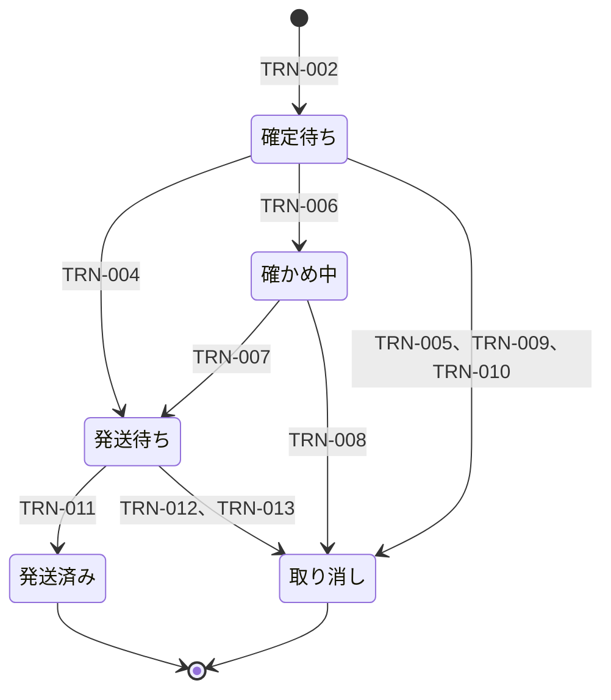

| ID | 遷移 | きっかけ | 条件 | Stripe に行う操作 | 在庫 | 知らせ | 要件 |
|---|---|---|---|---|---|---|---|
| TRN-001 | 購入手続き → 購入手続き(終わらない。やり直せる) | 購入者の「購入を確定する」 | 仮押さえに失敗した(カードが通らない。本人認証に失敗した、途中でやめた) | なし(失敗した回に、仮押さえは残らない) | 変えない | なし(購入手続きの画面に示す) | FR-053 |
| TRN-002 | 購入手続き → 確定待ち(購入手続きは終わる) | 購入者の「購入を確定する」(続きは、Stripe の知らせか、購入手続きの期限の処理が行うことがある) | 仮押さえに成功し、「注文を受け付ける条件」を満たし、在庫が数量以上ある | なし(仮押さえは済んでいる)。仮押さえの期限、代金、アプリケーション手数料の率と額、商品の名前と税率を、注文に記録する | 数量だけ減らす | 購入者に注文の確認、生産者に注文の知らせ | FR-006、FR-026、FR-042、FR-043、FR-047、FR-049〜FR-051、FR-063、FR-124、FR-130、FR-261 |
| TRN-003 | 購入手続き → 終わり(注文にしない) | 購入者の「購入を確定する」(続きは、Stripe の知らせか、購入手続きの期限の処理が行うことがある)。復旧の突き合わせ(OPS-022) | 仮押さえに成功したが、注文にできない(TRN-002 の条件を、仮押さえのあとで満たさなくなった。カードのブランドが、受け付けるものでなかった。仮押さえに成功したのが、購入手続きの期限のあとだった。注文を作る処理が終わらなかった。本番のデータベースを戻したあとに、注文の記録のない仮押さえが見つかった(OPS-022)) | 仮押さえを取り消す(すでに取り消されていれば、何もしない) | 変えない | 購入者に、注文できなかった知らせ(復旧の突き合わせでは、生産者にも、注文の取り消しの知らせ。OPS-022) | FR-225、FR-257、FR-258 |
| TRN-004 | 確定待ち → 発送待ち | 生産者の「代金を確定する」 | 確定に成功した | 仮押さえした全額で、代金を確定する。Stripe が記録した決済手数料を、注文に記録する | 変えない | なし(生産者の画面に、発送を促す表示) | FR-054、FR-055、FR-064 |
| TRN-005 | 確定待ち → 取り消し(確定の失敗) | 生産者の「代金を確定する」 | 確定に失敗した | 代金の確定(失敗)。仮押さえが残っていれば、取り消す | 数量だけ戻す | 購入者に、取り消しの知らせ(生産者の画面に、発送しないよう促す表示) | FR-011、FR-052、FR-056、FR-057、FR-128 |
| TRN-006 | 確定待ち → 確かめ中 | 生産者の「代金を確定する」 | 確定の結果が分からない | 代金の確定(結果が届かない) | 変えない | なし | FR-069 |
| TRN-007 | 確かめ中 → 発送待ち | システムが Stripe で結果を確かめた | Stripe で、確定している | なし(確かめるだけ)。決済手数料を、注文に記録する | 変えない | なし(生産者の画面に、発送を促す表示) | FR-055、FR-064、FR-069 |
| TRN-008 | 確かめ中 → 取り消し(確定の失敗) | システムが Stripe で結果を確かめた | Stripe で、確定していない | 仮押さえが残っていれば、取り消す | 数量だけ戻す | 購入者に、取り消しの知らせ(生産者の画面に、発送しないよう促す表示) | FR-052、FR-056、FR-057、FR-069、FR-128 |
| TRN-009 | 確定待ち → 取り消し(生産者の取り消し) | 生産者の取り消しの操作 | 確定待ちである | 仮押さえを取り消す | 数量だけ戻す | 購入者に、取り消しの知らせ | FR-052、FR-072、FR-075、FR-076、FR-208 |
| TRN-010 | 確定待ち → 取り消し(仮押さえの期限) | 期限(仮押さえの期限) | 確定待ちのまま、期限を過ぎた | 仮押さえを取り消す(Stripe がすでに解いていれば、何もしない) | 数量だけ戻す | 購入者と生産者に、取り消しの知らせ | FR-052、FR-062、FR-129 |
| TRN-011 | 発送待ち → 発送済み | 生産者の「発送を知らせる」 | 伝票番号が入り、運送会社が選ばれている(SCR-005) | なし。伝票番号と運送会社を、注文に記録する | 変えない | 購入者に、発送の知らせ | FR-061、FR-070、FR-071、FR-125 |
| TRN-012 | 発送待ち → 取り消し(発送の前の返金) | 返金した注文になった(TRN-014、TRN-015、TRN-017) | 発送待ちである | 「返金」の節のとおり | 数量だけ戻す | 「返金」の節のとおり | FR-052、FR-092、FR-095、FR-101 |
| TRN-013 | 発送待ち → 取り消し(発送の前の不審請求の負け) | 不審請求で負けた(TRN-032) | 発送待ちである | なし | 数量だけ戻す | 購入者に、取り消しの知らせ | FR-052、FR-265、FR-277 |
| TRN-061 | 購入手続き → 終わり(購入手続きの期限) | 期限(購入手続きを作ってから1時間) | 購入手続きが終わっておらず、仮押さえに成功していない(Checkout Session がない。Stripe が、終わらせる求めを受け付けた。または、Checkout Session が、すでに終わっていた) | Checkout Session があれば、終わらせるよう頼む(その支払いは、Stripe が取り消す) | 変えない | なし(お金を押さえていないため) | NFR-023 |
| TRN-062 | 注文の記録のない支払い → 発送待ち(復旧した注文) | 復旧の突き合わせ(OPS-023) | 本番のデータベースを戻したあと、Stripe に、代金を確定した支払いがあり、その支払いに付けた、購入手続きを見分ける ID の注文が、サイトの記録になく、商品の ID の商品の記録が、サイトにある | なし(代金の確定は済んでいる)。Stripe から読んだ値と、その支払いの返金、不審請求と照会を、注文に記録する(OPS-023、OPS-026) | 数量だけ減らす(0 より小さくしない) | 購入者に注文の確認、生産者に注文の知らせ(返金と不審請求を記録したあとの状態が、取り消しでないとき。OPS-026) | NFR-020、NFR-021 |

- 確かめ中の間は、生産者の取り消し(TRN-009)と、期限での取り消し(TRN-010)を行わない。確定できていた注文を取り消すと、代金を受け取ったまま注文がなくなるためである(FR-069)。確かめ中に仮押さえの期限を過ぎたときも、Stripe で確かめた結果で、TRN-007 か TRN-008 に進む。
- 確定に失敗したとき(TRN-005、TRN-008)に、仮押さえが残っていれば取り消すのは、取り消した注文の代金が、購入者のカードの利用枠に押さえられたまま残らないようにするためである(FR-128 の「代金は請求されない」)。
- 確定待ちの注文の仮押さえが、サイトの操作によらずに Stripe の側で取り消されていたときは、「代金を確定する」が押されたときの確定の失敗(TRN-005)か、仮押さえの期限(TRN-010)で、取り消しになる。
- 仮押さえの期限が近い知らせ(FR-132)と、「発送を知らせる」が押されていない知らせ(FR-133)は、状態を変えない。
- 購入者が注文を取り消す遷移はない(FR-072)。購入者は、取り消しをメッセージで生産者に頼み(FR-073)、生産者が、取り消す(TRN-009)か、返金する(TRN-012)。購入者の会員の退会は、進んでいる注文を変えない(FR-158)。

購入手続きで起きる出来事と、その扱い。仮押さえは、Stripe の Checkout Session(購入手続きの支払いを受ける、Stripe の入れ物。SYS-027)で行う。購入手続きが持つ、終わっていない Checkout Session は、いつも1つまでで、1つの Checkout Session が持つ支払いは1つである。Checkout Session を作った購入手続きは、その結末(注文にした、仮押さえを取り消した、または、Checkout Session が終わったことを Stripe で確かめた)を記録するときにだけ、終わらせる。終わった購入手続きに、仮押さえは残らない(FR-257)。購入者がすることは、うまくいかなかったら、カードを替えて、もう一度「購入を確定する」を押すことだけである。

| 出来事 | Checkout Session がないとき | Checkout Session があるとき | 購入手続きが終わっているとき |
|---|---|---|---|
| 購入手続きの画面で、送り先が入り、額が決まる(送り先を変えたときを含む) | 期限の前なら、額を計算して(SYS-019)、Checkout Session を作る(SYS-027)。期限を過ぎていれば、作らない | 額と、アプリケーション手数料の率が、Checkout Session を作ったときと同じなら、そのまま使う。違えば、作り直す(下の注記) | 受け付けない |
| 購入者が「購入を確定する」を押す(ブラウザは、Stripe に支払いを送る前に、サイトに確かめを求める) | —(カードの入力欄が出ておらず、押せない) | 期限を過ぎていれば、受け付けない(期限の処理が扱う)。期限の前なら、額と率を計算し直し(SYS-019)、「注文を受け付ける条件」のうち、仮押さえの前に確かめられるものを見る。条件を満たさなければ、画面に示し、支払いを送らせない。額か率が変わっていれば、作り直して、新しい額を画面に示す(購入者は、確かめてから、もう一度押す)。どちらでもなければ、ブラウザが、Stripe に支払いを送る | 受け付けない |
| 仮押さえに成功した(サーバーが、Stripe の Checkout Session と支払いを読んで確かめる。きっかけは、支払いを送ったブラウザからの求め、Stripe の知らせ、終わらせる求めが断られたとき) | — | 「注文を受け付ける条件」を満たせば、注文を作る(TRN-002)。満たさなければ、仮押さえを取り消して、購入者に知らせる(TRN-003)。どちらでも、購入手続きは終わる | 何もしない(同じ知らせが、もう一度届いたとき)。その支払いの扱いと、購入者への知らせは、購入手続きを終わらせたときに済んでいる |
| 仮押さえに失敗した(カードが通らない。本人認証に失敗した、途中でやめた) | — | サイトの記録は変えない(TRN-001)。理由は、Stripe がブラウザに返し、購入手続きの画面に示す。Checkout Session は終わらず、失敗した回に仮押さえは残らない。購入者は、同じ画面でカードを替えて、やり直せる | 何もしない |
| 期限の処理が動く(購入手続きの期限を過ぎている) | 購入手続きを終わらせる(TRN-061) | Stripe に、Checkout Session を終わらせるよう頼む。受け付けられたら、仮押さえはなく、このあとも起きないため、購入手続きを終わらせる(TRN-061。知らせはない)。断られたら、Checkout Session を読む。仮押さえに成功していれば、上の行の「仮押さえに成功した」の扱いに進む(期限のあとの成功は、「注文を受け付ける条件」を満たさないため、TRN-003 になる)。すでに終わっていれば、購入手続きを終わらせる(TRN-061) | 何もしない |

- 作り直しは、前の Checkout Session を終わらせるよう Stripe に頼んでから行う。受け付けられたら、新しい Checkout Session を作り、購入手続きが持つ ID と値(SYS-019)を書き換える。断られたら、Checkout Session を読み、仮押さえに成功していれば、作り直さず、上の表の「仮押さえに成功した」の扱いに進む。すでに終わっていれば、新しく作る。終わらせた Checkout Session の支払いは、Stripe が取り消すため、サイトは、支払いを別に取り消さない。額だけを書き換える形は、採らない。アプリケーション手数料の額は、Checkout Session を作ったあとに変えられないためである。
- 終わった Checkout Session では、支払えない。そのため、仮押さえに成功するのは、いつも、購入手続きが持つ ID の Checkout Session であり、その額は、購入手続きが持つ値と同じである。購入手続きが持つ ID の書き換えは、ID が前のままのときにだけ行い、書き換えられなかったときは、作った Checkout Session を終わらせる。Stripe の知らせが、どの購入手続きのものかは、知らせの Checkout Session の ID を、購入手続きが持つ ID(ENT-013)と比べて見分ける。違う ID の知らせでは、注文を作らない。
- Checkout Session の期限は、購入手続きの期限に合わせる。Stripe は、作ってから30分より短い期限を受け付けないため、購入手続きの期限まで30分より短いときは、30分にする。その場合も、購入手続きの期限を過ぎた「購入を確定する」は受け付けず、期限の処理が、Checkout Session を終わらせる。期限の前に成功した仮押さえは、処理が期限のあとになっても、注文に進む。どちらになるかは、処理が動いた時刻ではなく、仮押さえに成功した時刻で決まる(NFR-023)。
- 終わらせる求めと、仮押さえの取り消し(TRN-003)の結果が分からないときは、購入手続きを終わらせず、Stripe の Checkout Session と支払いを読んで確かめる(SYS-031)。購入者への知らせ(TRN-003)は、購入手続きを終わらせるときに、1回だけ送る(SYS-030)。購入手続きの個人情報を消すのは、その知らせを送れたときか、届かなかったと分かったとき(IF-107)である(「残す期間と消し方」の節)。
- ブラウザが、サイトの確かめを通さずに支払いを送っても、払える額は、サーバーが Checkout Session を作ったときに決めた額だけである(SYS-027)。注文にするかどうかは、仮押さえのあとに、サーバーが「注文を受け付ける条件」で決める。
- ボタンの二度押しや、2つのタブからの求めが重なっても、1つの Checkout Session が持つ支払いは1つのため、仮押さえが二重になることはない。

### 返金

| 状態 | 意味 |
|---|---|
| なし | その注文に、返金がない |
| 結果待ち | Stripe が受け付け、結果が出ていない返金がある |
| 成功 | 結果待ちの返金がなく、成功した返金がある(Stripe に返金を出さない0円の返金を含む) |
| 失敗に変わった | Stripe が受け付けた返金が、すべて失敗に変わった。お金は購入者に届かず、生産者の Stripe の残高に戻る |

「なし」以外の注文が、返金した注文(FR-087)である。

サイトから行える返金は、1つの注文に1回だけである(FR-087)。ただし、Stripe の側で返金が行われると(FR-095)、1つの支払いに、2件以上の返金があることになる。そのため、Stripe の返金1件ごとに、結果待ち、成功、失敗に変わった、を記録し、注文の返金の状態は、上の表のとおり、その注文の返金の全体から決める。

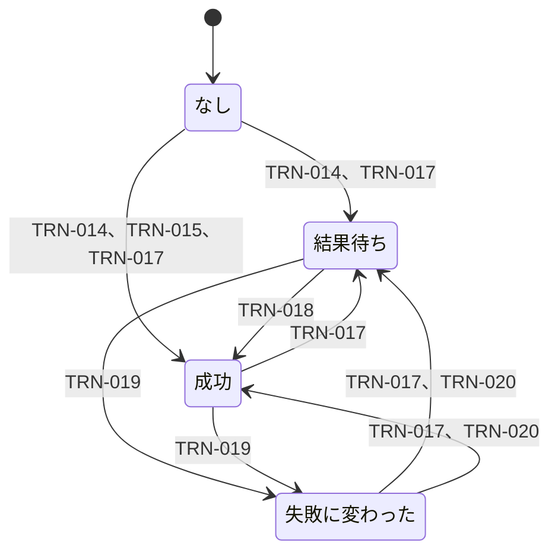

| ID | 遷移 | きっかけ | 条件 | Stripe に行う操作 | 知らせ | 要件 |
|---|---|---|---|---|---|---|
| TRN-014 | なし → 結果待ちか成功 | 生産者の返金の操作 | 「返金できる条件」を満たし、返金の額が1円以上で、Stripe が返金を受け付けた | 返金を作る(アプリケーション手数料の返金は指示しない) | 購入者に、返金の額 | FR-077、FR-084、FR-086、FR-087、FR-089〜FR-091、FR-093、FR-094、FR-103、FR-104、FR-111、FR-126 |
| TRN-015 | なし → 成功 | 生産者の返金の操作 | 「返金できる条件」を満たし、区分が購入者の都合で、求めた額が0円以下である | なし | 購入者に、返金の額(0円) | FR-092、FR-111、FR-126 |
| TRN-016 | なし → なし | 生産者の返金の操作 | Stripe が返金を受け付けなかった | 返金を作る(受け付けられない) | なし(生産者の画面に示し、やり直せる) | FR-011、FR-087、FR-088 |
| TRN-017 | どの状態からも → 結果待ちか成功 | Stripe の知らせ(サイトの操作によらずに、Stripe の側で行われた返金) | — | なし | 購入者と生産者に、返金の額 | FR-095、FR-111、FR-126、FR-264 |
| TRN-018 | 結果待ち → 成功 | Stripe の知らせ(返金の成功) | 結果待ちの返金がなくなった | なし | なし | FR-095 |
| TRN-019 | 結果待ちか成功 → 失敗に変わった | Stripe の知らせ(返金の失敗。Stripe の側での返金の取り消しを含む) | 結果待ちの返金も、成功した返金も、なくなった | なし | 購入者と生産者に、返金が届かなかった知らせ | FR-088、FR-095、FR-268、FR-269 |
| TRN-020 | 失敗に変わった → 結果待ちか成功 | 生産者の、返金のやり直しの操作 | 不審請求の状態が、結果待ちでも負けでもなく、Stripe が返金を受け付けた。額は、サイトから行った返金があれば、その返金と同じ。なければ、最後に失敗に変わった返金と同じ | 同じ額の返金を作る | 購入者に、返金の額 | FR-088、FR-100、FR-126 |
| TRN-021 | 失敗に変わった → 失敗に変わった | 生産者の、返金のやり直しの操作 | Stripe が返金を受け付けなかった | 返金を作る(受け付けられない) | なし(生産者の画面に示し、やり直せる) | FR-088 |

返金できる条件(TRN-014、TRN-015):

- 代金を確定した注文である(発送待ち、発送済み、発送の前の不審請求の負けで取り消した注文)(FR-084)。
- 返金の状態が「なし」である(FR-087)。
- 不審請求の状態が、結果待ちでも負けでもない(FR-100)。照会は、返金を妨げない(FR-270)。
- 返金の申し出の期限、生産者の停止、Stripe の支払いの受け付けが無効であることは、返金を妨げない(FR-011、FR-018、FR-086)。

返金した注文になったとき(TRN-014、TRN-015 と、返金の状態が「なし」だったときの TRN-017)に、あわせて行うこと:

- 注文が発送待ちなら、取り消しにする(TRN-012)。
- 開いている返金の申し出を閉じる(「返金の申し出」の節)。
- 返金を、注文に記録する(FR-111)。返金した日は、Stripe が返金を受け付けた日とする。0円の返金(TRN-015)は、生産者が退会できるまでの期間(FR-159)に数えない。

失敗に変わったとき(TRN-019)は、注文の状態、戻した在庫、閉じた返金の申し出を、元に戻さない(FR-088)。

- 結果待ちの間に、その支払いに不審請求が起きると、Stripe は、その返金を失敗にする(Stripe の公式ページ「Refund and cancel payments」)。このときは TRN-019 になり、やり直し(TRN-020)は、不審請求で勝つまでできない(FR-100)。
- 返金した注文に、Stripe の側でさらに返金が行われたときも、TRN-017 のとおり、その返金を注文の記録に足し、注文の返金の状態を、上の表のとおりに決め直し、購入者と生産者に、返金の額を知らせる(FR-095)。失敗に変わった注文で、Stripe の側の返金が受け付けられると、状態は結果待ちか成功になり(TRN-017)、やり直し(TRN-020)はできなくなる。同じ注文に、二重に返金しないためである。
- 返金の1件が失敗に変わっても、ほかに結果待ちか成功の返金があるときは、注文の返金の状態を変えず、やり直しもできない。このときも、返金が届かなかった知らせ(FR-268)を行い、メッセージを送れるようにする(TRN-054)。

### 返金の申し出

| 状態 | 意味 |
|---|---|
| なし | 申し出がない |
| 開いている | 購入者が申し出て、まだ閉じていない |
| 閉じた | 申し出が終わった。理由は、返金、「返金しない」の答え、購入者の取り下げ、不審請求の4つ |

申し出は、1つの注文に1回だけである(FR-080)。閉じた申し出は、開いている状態に戻らず、閉じた注文では、もう一度申し出られない。

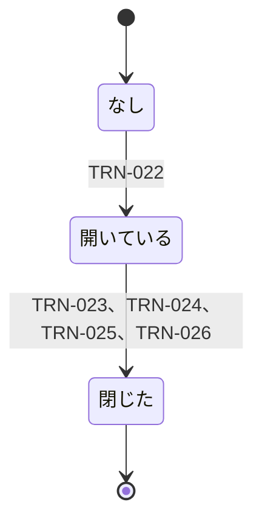

| ID | 遷移 | きっかけ | 条件 | 知らせ | 要件 |
|---|---|---|---|---|---|
| TRN-022 | なし → 開いている | 購入者の申し出 | 「申し出られる条件」を満たし、理由を選んでいる。理由が「商品の不具合」なら、写真が付いている | 生産者に、申し出の知らせ | FR-078〜FR-083、FR-131 |
| TRN-023 | 開いている → 閉じた(返金) | 返金した注文になった(TRN-014、TRN-015、TRN-017) | — | 「返金」の節のとおり | FR-114 |
| TRN-024 | 開いている → 閉じた(「返金しない」の答え) | 生産者の「返金しない」の答え | 理由が入っている | なし(理由を、生産者のメッセージとして注文に残す。購入者には、メッセージの知らせで届く) | FR-113、FR-114、FR-127、FR-275 |
| TRN-025 | 開いている → 閉じた(購入者の取り下げ) | 購入者の取り下げの操作 | — | 生産者に、取り下げの知らせ | FR-102、FR-114、FR-262 |
| TRN-026 | 開いている → 閉じた(不審請求) | その注文に不審請求が起きた(照会が不審請求に進んだときを含む。照会だけでは閉じない) | — | 購入者に、申し出を閉じたことと理由 | FR-096、FR-114、FR-270〜FR-272 |

どの遷移も、Stripe に行う操作と、在庫の増減はない。申し出を受けても、返金は自動では行わない(FR-081)。

申し出られる条件(TRN-022):

- 申し出のボタンが使える期間である。期間は、「発送を知らせる」が押された時点と、代金を確定してから48時間たった時点の、早いほうで始まり、その日の翌日から数えて14日目の日本時間23時59分(申し出の期限)で終わる(FR-079)。
- 返金の状態が「なし」である(FR-079)。
- 不審請求の状態が、なし、照会、照会が閉じた、のどれかである。不審請求が起きた注文では、結果が出たあとも申し出られない(FR-079、FR-270)。
- 返金の申し出の状態が「なし」である(FR-080)。

閉じたあとも、生産者は、「返金できる条件」(「返金」の節)を満たせば返金できる(FR-086)。「返金しない」と答えたあとと、取り下げられたあとも同じである。

答える期限:

- 答える期限は、申し出があった日の翌日から数えて14日目の日本時間23時59分である(FR-115)。
- 答える期限を過ぎても開いている申し出が、その生産者に1つでもある間、その生産者は、答える期限で停止されている。停止は状態として保存せず、申し出の日時と、閉じた日時から求める(「状態の持ち方」)。停止と解除で行う知らせと記録は、「生産者のアカウント」の節に書く。

メッセージを送れる期間:

次のどれかに当たる間、購入者と生産者は、その注文のメッセージを送れる。どれにも当たらなくなると、履歴を見るだけになる。

| ID | 当たる間 | もとにする状態と日時 | 要件 |
|---|---|---|---|
| TRN-050 | 注文が取り消しでなく、申し出の期限を過ぎていない(申し出の期限がまだ決まっていない間を含む) | 注文の状態、「発送を知らせる」が押された日時、代金を確定した日時 | FR-121 |
| TRN-051 | 注文が取り消しで、取り消した日の翌日から数えて14日目の日本時間23時59分を過ぎていない | 注文の状態、取り消した日時 | FR-123 |
| TRN-052 | 返金の申し出が開いている | 返金の申し出の状態 | FR-122 |
| TRN-053 | 「返金しない」と答えた日の翌日から数えて14日目の日本時間23時59分を過ぎていない | 返金の申し出の状態(閉じた理由)、答えた日時 | FR-222 |
| TRN-054 | 返金が失敗に変わった日の翌日から数えて14日目の日本時間23時59分を過ぎていない(生産者の役割が外れた生産者の注文を除く) | 返金1件ごとの記録の、失敗に変わった日時(最後のもの) | FR-269 |
| TRN-055 | 不審請求か照会が起きていて、結果が出ていない(生産者の役割が外れた生産者の注文を除く) | 不審請求と照会の状態 | FR-274 |

### 不審請求と照会

| 状態 | 意味 |
|---|---|
| なし | 不審請求も照会も起きていない |
| 照会 | カード会社が、不審請求の前に、支払いについて説明を求めている |
| 照会が閉じた | 照会が、不審請求に進まずに閉じた(勝ちでも負けでもない結果) |
| 結果待ち | 不審請求が起き、結果が出ていない |
| 勝ち | 不審請求で勝った |
| 負け | 不審請求で負けた |

状態は、不審請求(照会を含む)ごとに持つ。1つの支払いに、2つ以上の不審請求が起きることが、まれにある(Stripe の公式ページ「How disputes work」)。ほかの節の条件は、次のように読む。

- 「不審請求の状態が、結果待ちでも負けでもない」(「返金」の節)は、その注文のどの不審請求も、結果待ちでも負けでもないことをいう。
- 「不審請求が起きた注文」(「返金の申し出」の節)は、照会を除く不審請求が、1つでも起きた注文をいう。
- 「不審請求か照会が起きていて、結果が出ていない」(「返金の申し出」の節)は、照会か結果待ちの状態のものが、1つでもあることをいう。

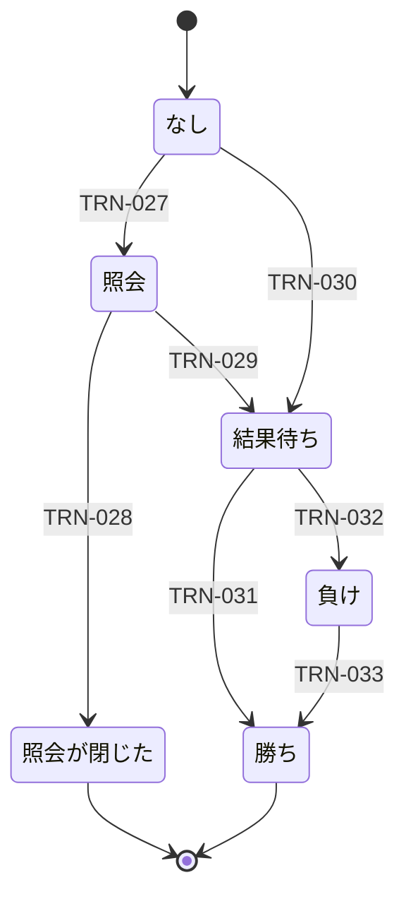

きっかけは、どの遷移も、生産者の Stripe のアカウントからの Stripe の知らせである。サイトの中から Stripe に行う操作は、証拠を出すことと、争わずに負けを認めることである。ログインした生産者は、どちらも、不審請求の部品から行う。生産者の役割が外れた生産者の証拠のページでは、証拠を出すことだけができる(FR-239、ADR-0009)。

| ID | 遷移 | きっかけ | あわせて行うこと | 知らせ | 要件 |
|---|---|---|---|---|---|
| TRN-027 | なし → 照会 | 照会が起きた | 注文に記録する。証拠を出す期限を記録する | 生産者と管理者に、照会が起きた知らせ | FR-096、FR-097、FR-136、FR-238、FR-266、FR-270 |
| TRN-028 | 照会 → 照会が閉じた | 照会が、不審請求に進まずに閉じた | 注文に記録する | 生産者に、結果 | FR-099、FR-242、FR-267、FR-271 |
| TRN-029 | 照会 → 結果待ち | 照会が、不審請求に進んだ | 注文に記録する。証拠を出す期限を記録し直す。開いている返金の申し出を閉じる(TRN-026) | 生産者と管理者に、不審請求が起きた知らせ | FR-096、FR-097、FR-136、FR-238、FR-266、FR-271 |
| TRN-030 | なし → 結果待ち | 不審請求が起きた | 注文に記録する。証拠を出す期限を記録する。開いている返金の申し出を閉じる(TRN-026) | 生産者と管理者に、不審請求が起きた知らせ | FR-096、FR-097、FR-136、FR-238、FR-266 |
| TRN-031 | 結果待ち → 勝ち | 不審請求で勝った | 注文に記録する。返金できる状態に戻る | 生産者に、結果 | FR-099、FR-100、FR-242、FR-267 |
| TRN-032 | 結果待ち → 負け | 不審請求で負けた(証拠を出して負けた、争わずに負けを認めた、証拠を出す期限を過ぎた、のどれも同じ) | 注文に記録する。注文が発送待ちなら、取り消しにする(TRN-013) | 生産者に、結果 | FR-099、FR-100、FR-242、FR-265、FR-267 |
| TRN-033 | 負け → 勝ち | 負けた不審請求が、あとで勝ちに変わった | 注文に記録する。返金できる状態に戻る。TRN-013 で取り消した注文は、取り消しのままとし、在庫を変えない | 生産者に、結果。TRN-013 で取り消した注文では、注文は取り消してあることと、商品を送っていなければ返金することを入れる | FR-099、FR-100、FR-242、FR-267 |

- 生産者の役割が外れた生産者には、不審請求と照会が起きた知らせを、証拠を出すページへのリンクを入れて、登録したメールアドレスに送り(FR-238)、結果も、登録したメールアドレスに知らせる(FR-242)。
- 証拠を出すこと(FR-098、FR-239)は、状態を変えない。照会か結果待ちの間で、証拠を出す期限を過ぎていないときに限り、受け付ける(FR-241、FR-266)。
- 照会の間は、返金と返金の申し出の扱いを変えない(FR-270)。照会の間にお金は動かず、不審請求に進んだとき(TRN-029)に、額と不審請求の手数料が、生産者の残高から引かれる(「決済と送金の流れ」の節)。
- 照会は、不審請求に進まないまま120日たつと、Stripe が閉じる(Stripe の公式ページ「How disputes work」)。それまでは、照会の状態が続く。
- カード会社が証拠を受け付けない不審請求は、起きたときに、すでに負けで閉じている(同じ公式ページ)。このときは、TRN-030 に続けて TRN-032 を行う。
- 負けた不審請求が勝ちに変わること(TRN-033)は、カード会社が、通常の流れの外でお金を動かしたときに、まれに起きる(同じ公式ページ)。返金するかどうかは、ほかの返金と同じく、生産者が決める(FR-084)。システムは、自動では返金しない。「発送を知らせる」を押し忘れたまま、商品を送っている場合があるためである。勝ちに変わっても、メッセージを送れる期間は変えない。TRN-013 で取り消した注文で、生産者が返金しないときの購入者の手段は、注文の画面にある生産者の連絡先(FR-164)と、カード会社である。管理者は関わらない。

### 生産者のアカウント

生産者について、次の4つを別々に持つ。互いに独立に変わるためである。

| 持つもの | 値 | 変えるもの |
|---|---|---|
| 生産者の役割 | なし、あり、外れた | 本人の同意、本人の退会 |
| Stripe の支払いの受け付け | 無効、有効 | Stripe の知らせ |
| 管理者の停止 | なし、あり | 管理者の操作 |
| 答える期限での停止 | なし、あり | 答える期限と、返金の申し出が閉じること(保存せずに求める。「返金の申し出」の節) |

管理者の停止か、答える期限での停止の、どちらかが「あり」の間、その生産者は停止されている(FR-115)。2つの停止は、互いを変えない。生産者の役割が付いたときは、Stripe の支払いの受け付けは無効、2つの停止は「なし」である。

| ID | 持つもの | 遷移 | きっかけ | 条件 | Stripe に行う操作 | あわせて行うこと | 知らせ | 要件 |
|---|---|---|---|---|---|---|---|---|
| TRN-034 | 生産者の役割 | なし → あり | 招待された本人の、生産者向けの利用規約への同意 | 招待が使える(期限の前で、取り消されておらず、まだ使われていない)。招待されたメールアドレスが、管理者のアカウントのものでない | 生産者の Stripe のアカウントを作る(設定は ADR-0009) | 会員のアカウントがなければ作る。その会員のログインの状態を、すべて終わらせる | なし | FR-002、FR-003、FR-005、FR-007〜FR-009、FR-206、FR-217、FR-218、FR-233、FR-243、FR-253、FR-255 |
| TRN-035 | Stripe の支払いの受け付け | 無効 → 有効 | Stripe の知らせ(生産者のアカウントの状態が変わった) | Stripe から取得したアカウントの状態で、支払いの受け付けが有効である | なし(状態を取得するだけ) | なし | なし | FR-010、FR-011 |
| TRN-036 | Stripe の支払いの受け付け | 有効 → 無効 | Stripe の知らせ(生産者のアカウントの状態が変わった) | Stripe から取得したアカウントの状態で、支払いの受け付けが無効である | なし(状態を取得するだけ) | なし | 生産者に、受け付けが止まった知らせ(情報を出す期限があれば、期限とともに) | FR-011、FR-260 |
| TRN-037 | 管理者の停止 | なし → あり | 管理者の停止の操作 | 理由が入っている | なし | 操作した管理者、日時、理由を記録する | 生産者に、理由とともに知らせる | FR-018、FR-209、FR-214、FR-215 |
| TRN-038 | 管理者の停止 | あり → なし | 管理者の、停止を解く操作 | 理由が入っている | なし | 操作した管理者、日時、理由を記録する | 生産者に、理由と、答える期限での停止が残っていれば、まだ停止されていることを知らせる(生産者の役割が外れた生産者には知らせない) | FR-019、FR-214、FR-215、FR-223 |
| TRN-039 | 答える期限での停止 | なし → あり | 期限(答える期限) | 答える期限を過ぎても、返金の申し出が開いている | なし | どの申し出で停止したかを記録する。管理者の画面に、まだ確かめていないものとして示す | 生産者に、停止のもとになった申し出の注文とともに知らせる。購入者に、期限までに答えがなかったことを知らせる | FR-115、FR-135〜FR-138、FR-276 |
| TRN-040 | 答える期限での停止 | あり → なし | 返金の申し出が閉じた(TRN-023〜TRN-026) | 答える期限を過ぎて開いている申し出が、その生産者に1つもなくなった | なし | 停止が解けた日時を記録する | 生産者に、この停止が解けたことと、管理者の停止が残っていれば、まだ停止されていることを知らせる | FR-115、FR-137、FR-273 |
| TRN-041 | 生産者の役割 | あり → 外れた | 本人の退会の操作 | 「退会できる条件」を満たす | なし(Stripe のアカウントは閉じない) | そのアカウントでログインできないようにする。特定商取引法に基づく表記は、その時点のまま残す(ENT-005)。登録したメールアドレスを、生産者(ENT-005)に写す | なし | FR-159〜FR-161、FR-166、FR-237、NFR-003、NFR-008 |

- 生産者の役割を付けたのに、Stripe のアカウントを作る処理が終わらなかったときは、作る処理をやり直す。Stripe のアカウントができるまで、支払いの受け付けは無効のままで、その生産者の商品は注文できないため(「注文を受け付ける条件」の節)、お金は動かない。
- Stripe が生産者に情報を求めているときと、入金を止めたときは、状態を変えず、生産者に知らせる(FR-260)。
- すでに答える期限で停止されている生産者で、別の申し出が答える期限を過ぎたときは、状態は変わらないが、その申し出について、TRN-039 と同じ記録と知らせを行う。停止が解けるには、その申し出も閉じる必要があるためである。
- 管理者は、答える期限での停止を解けない(FR-019)。

退会できる条件(TRN-041。FR-159):

| 条件 | もとにする状態と日時 |
|---|---|
| 発送も取り消しもしていない注文がない | 注文の状態が、確定待ち、確かめ中、発送待ちの注文がない |
| 閉じていない返金の申し出がない | 返金の申し出の状態が「開いている」の注文がない |
| 結果が出ていない不審請求がない | 不審請求の状態が「結果待ち」のものがない |
| メッセージを送れる期間が終わっていない注文がない | 「返金の申し出」の節の「メッセージを送れる期間」の表の、どれにも当たらない(照会の間は、退会できない) |
| 最後の発送からの期間がたった | 最後に「発送を知らせる」が押された日時(NFR-003) |
| 最後の返金からの期間がたった | 最後に Stripe が返金を受け付けた日時 |

生産者の役割が外れたあと:

| 項目 | 扱い | 要件、ADR |
|---|---|---|
| その生産者の商品 | 商品の一覧に出さず、商品ページと生産者のページを開けないようにする。注文を受け付けない | FR-163、FR-165 |
| 新しい支払い | 作らない。支払いを作るのはサイトだけのため、Stripe の側で止める操作は行わない | FR-165 |
| Stripe の部品を使う許可 | 出さない | ADR-0009 |
| Stripe の知らせ | 受け続け、不審請求、Stripe の側で行われた返金、返金の失敗を、役割がある生産者と同じ遷移で処理する。知らせは、登録したメールアドレスに送る | FR-238〜FR-242、FR-264、FR-268 |
| Stripe の残高の入金 | Stripe が、登録済みの銀行口座へ続ける。サイトは操作しない | FR-237 |
| Stripe のアカウントを閉じる操作 | 作らない | FR-237 |
| 同じ人が、もう一度生産者になるとき | 新しい会員のアカウントに、新しい Stripe のアカウントを作る | FR-005、FR-206 |
| 管理者の停止 | 役割が外れても、値は変えない。管理者は解けるが、生産者には知らせない | FR-223 |

### 注文を受け付ける条件

システムは、次のすべてを満たすときに限り、注文を受け付ける(TRN-002)。

- 生産者の役割が「あり」で、Stripe の支払いの受け付けが有効で、管理者の停止も、答える期限での停止も「なし」である。
- 商品が、出品されていて、生産者が販売を止めておらず、管理者が非公開にしていない。
- 在庫が数量以上あり、数量が、その商品の数量の上限以下である(FR-026、FR-050)。
- 仮押さえに成功したのが、購入手続きの期限(購入手続きを作ってから1時間)の前である。
- Stripe が仮押さえした額が、購入手続きに持つ支払いの総額と同じである(SYS-019)。
- 仮押さえされたカードのブランドが、Visa、Mastercard、American Express のどれかである(FR-044、FR-225)。ブランドは、Stripe の支払いから読み、読めないときは、満たさないものとする。

条件は、「購入を確定する」が押されたときに、仮押さえの前に確かめられるものを確かめ、仮押さえのあと、注文を作る時点で、すべてを確かめる。商品ページを開いたあとで条件を満たさなくなったときは、仮押さえの前なら購入手続きの画面に示し、仮押さえのあとなら、注文にせずに仮押さえを取り消す(TRN-003)。

条件を満たさない状態ごとの扱いは、次のとおりである。どの状態も、すでにある注文を変えない。

| ID | 状態 | 新しい出品 | 注文の受け付け | 商品の表示 | すでにある注文 | その状態になったときの知らせ | 要件 |
|---|---|---|---|---|---|---|---|
| TRN-042 | 生産者: Stripe の支払いの受け付けが無効 | できる | 受け付けない | 商品の一覧と商品ページに出し、商品ページに「販売停止中」と表示する | 対応を続けられる。Stripe が代金の確定か返金を受け付けなかったときは、TRN-005、TRN-016 になる | 有効から無効に変わったとき、生産者に知らせる(TRN-036) | FR-011、FR-034、FR-035、FR-260 |
| TRN-043 | 生産者: 管理者の停止 | できない | 受け付けない | 商品の一覧と商品ページに出し、商品ページに「販売停止中」と表示する | 対応を続けられる | 生産者に、理由とともに知らせる(TRN-037) | FR-018、FR-034、FR-035、FR-209 |
| TRN-044 | 生産者: 答える期限での停止 | できない | 受け付けない | 商品の一覧と商品ページに出し、商品ページに「販売停止中」と表示する | 対応を続けられる | 生産者と購入者に知らせ、管理者の画面に示す(TRN-039) | FR-018、FR-034、FR-035、FR-115、FR-135、FR-136、FR-276 |
| TRN-045 | 生産者: 生産者の役割が外れた | できない(ログインできない) | 受け付けない | 商品の一覧に出さず、商品ページと生産者のページを開けない | 「生産者のアカウント」の節の「生産者の役割が外れたあと」のとおり | なし | FR-161、FR-163、FR-165 |
| TRN-046 | 商品: 出品の条件が足りない(箱のサイズ、数量の上限、発送元の都道府県、消費税の税率のどれかがない) | —(出品できない) | 受け付けない | 出さない | — | なし | FR-036 |
| TRN-047 | 商品: 生産者が販売を止めた | — | 受け付けない | 商品の一覧と商品ページに出し、商品ページに「販売停止中」と表示する | 変えない | なし | FR-033〜FR-035、FR-216 |
| TRN-048 | 商品: 管理者が非公開にした | —(生産者は、その商品を更新できる) | 受け付けない | 商品の一覧に出さず、商品ページを開けない | 変えない | 生産者に、理由とともに知らせる | FR-177〜FR-184、FR-203、FR-221、FR-224 |
| TRN-049 | 商品: 在庫が0 | — | 受け付けない | 商品の一覧と商品ページに出し、商品ページに「在庫切れ」と表示する | 変えない | なし | FR-034、FR-035、FR-050 |

- 2つ以上の状態が重なるときの商品の表示は、出さない(TRN-045、TRN-046、TRN-048)、「販売停止中」(TRN-042〜TRN-044、TRN-047)、「在庫切れ」(TRN-049)の順に、先に当たるものにする(FR-034 の「それ以外で在庫が0」)。
- 状態を解いたときは、解いた状態だけがなくなり、重なっているほかの状態は残る。非公開を解けるのは管理者だけで、理由を入れて解き、解いたことを記録し、生産者に理由とともに知らせる(FR-184、FR-203、FR-221、FR-224)。管理者が非公開を解いても、生産者の役割が外れた生産者の商品は公開に戻らず、非公開の間に生産者が変えた中身(販売を止めたかどうか、在庫を含む)は、変えたあとのままである(FR-183)。
- 停止されている生産者は、新しい出品はできないが、すでにある商品の更新、すでにある注文の対応、会員としての買い物はできる(FR-018)。
- 「対応を続けられる」は、代金の確定、発送、メッセージ、返金、返金の申し出への答え、不審請求の証拠を出すことをいう(FR-011、FR-018)。

### 決済と送金の流れ

お金は、状態が変わるときにだけ動く。場面ごとに、だれのお金がどう動くかを、遷移の ID で示す。

- 支払いは、生産者の Stripe のアカウントの上に作る(ダイレクト支払い。FR-006、ADR-0004)。代金は、管理者(プラットフォームのアカウント)を通らない。
- サイトが Stripe に行うお金の操作は、Checkout Session を作ること(終わらせることを含む)、代金の確定、仮押さえの取り消し、返金の4つだけである。仮押さえは、購入者のブラウザが、Checkout Session に支払いを送って行う(SYS-027)。アプリケーション手数料の返金、送金、入金の操作は行わない。
- 表の「総額」は支払いの総額(商品の小計と送料の合計)、「決済手数料」は Stripe が記録した実際の決済手数料(FR-064)、「アプリケーション手数料」は注文に記録した額(FR-063)である。

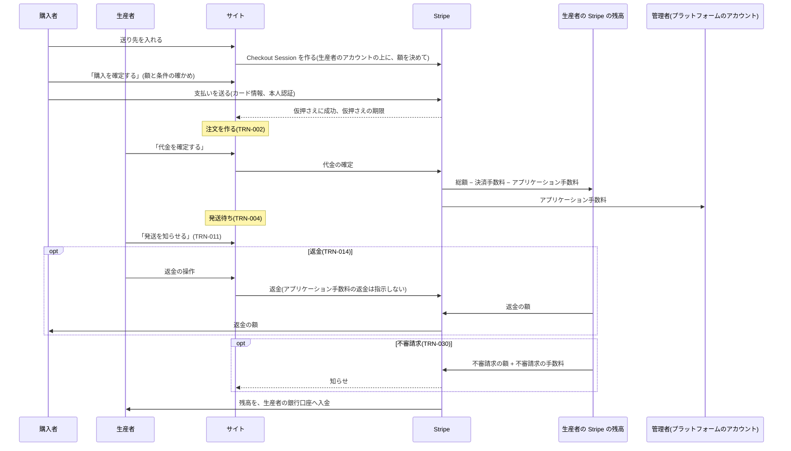

| 場面 | 遷移 | 購入者 | 生産者の Stripe の残高 | 管理者(プラットフォームのアカウント) | 要件、確かめた事実 |
|---|---|---|---|---|---|
| 仮押さえ | TRN-002 | カードの利用枠から、総額を押さえる。請求はしない | 動かない | 動かない | FR-047、ADR-0005 |
| 仮押さえの取り消し | TRN-003、TRN-005、TRN-008〜TRN-010 | 押さえた利用枠が戻る。請求はない | 動かない | 動かない(アプリケーション手数料は生まれない) | FR-076、ADR-0005 |
| 代金の確定 | TRN-004、TRN-007 | 総額を請求する | 総額 − 決済手数料 − アプリケーション手数料が入る | アプリケーション手数料が入る | FR-054、FR-063、FR-064、ADR-0005 |
| 返金(生産者の都合、発送の前) | TRN-014 | 総額が戻る | 総額が出る。確定からの差し引きは、−(決済手数料 + アプリケーション手数料) | 動かない | FR-077、FR-094、ADR-0005、ADR-0009 |
| 返金(生産者の都合、発送のあと) | TRN-014 | 生産者が入力した額(1円以上、総額まで)が戻る | 入力した額が出る | 動かない | FR-093、FR-094、ADR-0005 |
| 返金(購入者の都合、発送の前) | TRN-014 | 総額 − 決済手数料 − アプリケーション手数料が戻る | 同じ額が出る。確定からの差し引きは、0円 | 動かない | FR-090、FR-094、ADR-0005 |
| 返金(購入者の都合、発送のあと) | TRN-014 | 総額 − 決済手数料 − アプリケーション手数料 − 送料が戻る | 同じ額が出る。確定からの差し引きは、送料の額(生産者が払った送料に当たる) | 動かない | FR-090、FR-094 |
| 0円の返金 | TRN-015 | 動かない | 動かない | 動かない | FR-092 |
| Stripe の側で行われた返金 | TRN-017 | 返金の額が戻る | 返金の額が出る | 動かない | FR-094、FR-095 |
| 返金が失敗に変わった | TRN-019 | 返金が届かない | 返金の額が戻る | 動かない | FR-088、Stripe の公式ページ「Refund and cancel payments」 |
| 返金のやり直し | TRN-020 | 同じ額が戻る | 同じ額が出る | 動かない | FR-088 |
| 照会 | TRN-027、TRN-028 | 動かない | 動かない | 動かない | FR-270、ADR-0009 |
| 不審請求が起きた | TRN-029、TRN-030 | カード会社が決める | 不審請求の額と、不審請求の手数料が出る | 動かない | FR-094、ADR-0009、Stripe の公式ページ「Disputes on Connect platforms」 |
| 不審請求で勝った | TRN-031、TRN-033 | カード会社が決める | 不審請求の額が戻る。不審請求の手数料は戻らない | 動かない | ADR-0009 |
| 不審請求で負けた | TRN-032 | カード会社が決める | 動かない(起きたときに出ている) | 動かない | ADR-0009、Stripe の公式ページ「How disputes work」 |
| 入金 | —(状態を変えない) | — | 残高が、生産者の銀行口座へ出る。残高がマイナスの間は止まる | 動かない | FR-207、ADR-0005 |

- 不審請求の額は、支払いの総額と違うことがある(一部だけの不審請求など。Stripe の公式ページ「How disputes work」)。
- 返金と不審請求で、生産者の残高が足りないときは、残高がマイナスになるか、返金が結果待ちになる(TRN-014 の「結果待ち」。ADR-0009 の「影響とリスク」)。マイナスの分は、その生産者のその後の売上から引かれ、回収できない分は Stripe が負う(FR-009、ADR-0005)。管理者は負担しない。

管理者の残高から出るお金がないこと(FR-094):

| 確かめること | 根拠 |
|---|---|
| 管理者のお金が動くのは、代金の確定でアプリケーション手数料が入るときだけである | 上の表の「管理者」の列 |
| 返金で、アプリケーション手数料は戻らない | サイトは、アプリケーション手数料の返金を指示しない。指示しなければ、全額の返金でも一部の返金でも戻らなかった(ADR-0005) |
| 返金のお金は、生産者の残高から出る | ADR-0005、ADR-0009 |
| 不審請求の額は、生産者の残高から出る | ADR-0009。ダイレクト支払いでは、不審請求の額は生産者のアカウントの残高から引かれる(Stripe の公式ページ「Disputes on Connect platforms」) |
| 不審請求の手数料は、生産者が持つ | ADR-0009。Stripe の手数料を生産者が負担する設定(FR-008)では、不審請求の手数料も生産者のアカウントから引かれる(同じ公式ページ) |
| 不審請求で、アプリケーション手数料は戻らない | Stripe は、不審請求の結果に関わらず、アプリケーション手数料を自動では返さない(同じ公式ページ)。サイトも返さない |
| 生産者の残高がマイナスになっても、管理者は負担しない | 回収できない損失を Stripe が負う設定(FR-009、ADR-0009) |

管理者のアカウントの残高そのものは、方式検証では読んでいない(ADR-0009 の「影響とリスク」)。実装のテストで、返金と不審請求のあとも、その支払いのアプリケーション手数料が、返されていないことを確かめる(TST-033)。

## 論理データ

データベースが持つ実体と、そのつながりを決める。テーブルの列の定義と RLS は、詳細設計のマイグレーションで書く。カード情報、本人確認の書類、銀行口座、パスワード、2段階認証の手段、写真そのものは、データベースに持たない(SYS-013〜SYS-015)。

### 実体の一覧

実体ごとに、データを書くモジュールは1つである(SYS-043)。「状態」の列は、「状態の持ち方」の5つと、購入手続きの終わり方(「注文と支払い」の節)のうち、その実体に保存するものである。「個人情報」の列が「あり」の実体の、残す期間と消し方は、「残す期間と消し方」の節に書く。

| ID | 実体 | 持つもの | 持つモジュール | 状態 | 個人情報 | 要件 |
|---|---|---|---|---|---|---|
| ENT-001 | 会員 | 会員のアカウント1つにつき1件。購入者向けの利用規約とプライバシーポリシーに同意した日時、退会した日時。メールアドレスとパスワードは、Supabase の認証が持つ(SYS-014) | 会員とログイン(SYS-033) | — | あり | FR-141、FR-161、FR-212 |
| ENT-002 | 送り先の住所 | 会員が保存した送り先(氏名、住所、電話番号)と、いつもの送り先の印 | 会員とログイン(SYS-033) | — | あり | FR-153、FR-154 |
| ENT-003 | 期限のあるリンク | 用途(登録の確認、パスワードの再設定、生産者の招待、スタッフの招待、証拠を出すページ、2段階認証の手段の登録)、指す先、リンクの乱数から求めた値(AUTH-015)、期限、使われた日時、使えなくした日時 | 会員とログイン(SYS-033) | — | — | NFR-002、FR-150、FR-151、FR-171、FR-217、FR-220、FR-240、FR-247、FR-249 |
| ENT-004 | 2段階認証の手段を消した記録 | 消された人、操作した管理者、日時 | 会員とログイン(SYS-033) | — | — | FR-254 |
| ENT-005 | 生産者 | 会員1人につき1件まで。生産者向けの利用規約に同意した日時、Stripe のアカウントの ID、アプリケーション手数料の率、発送元の都道府県、特定商取引法に基づく表記、生産者のページの情報、役割が外れた日時、役割が外れるときに写す、登録したメールアドレス | 生産者(SYS-034) | 生産者の役割、Stripe の支払いの受け付け、管理者の停止 | あり | FR-002、FR-005、FR-012、FR-014、FR-015、FR-028、FR-160、FR-196 |
| ENT-006 | 生産者の招待 | 招待されたメールアドレス、招待した管理者、受けられた日時、取り消された日時 | 生産者(SYS-034) | — | あり | FR-001、FR-230、FR-231 |
| ENT-007 | 管理者の停止の記録 | 停止と、停止を解いたことの、1回ごと。操作した管理者、日時、理由 | 生産者(SYS-034) | — | — | FR-215 |
| ENT-008 | 答える期限での停止の記録 | 返金の申し出1つにつき1件まで。もとになった返金の申し出、停止した日時、解けた日時。停止されているかどうかは、この記録からではなく、返金の申し出から求める(TRN-058) | 生産者(SYS-034) | — | — | FR-137 |
| ENT-009 | 商品 | 名前、説明、写真の場所、価格、在庫の数、商品の表示、箱のサイズ、数量の上限、消費税の税率、生産者が販売を止めているか、管理者が非公開にしているか | 商品と送料(SYS-035) | — | — | FR-020、FR-022、FR-024、FR-025、FR-033、FR-037、FR-177 |
| ENT-010 | 運賃表の地域 | 地域と、その地域の都道府県 | 商品と送料(SYS-035) | — | — | FR-029 |
| ENT-011 | 運賃表の送料 | 箱のサイズ、発送元の地域、送り先の地域ごとの送料 | 商品と送料(SYS-035) | — | — | FR-029 |
| ENT-012 | 商品の非公開の記録 | 非公開にしたことと、非公開を解いたことの、1回ごと。操作した管理者、日時、理由 | 商品と送料(SYS-035) | — | — | FR-184 |
| ENT-013 | 購入手続き | 作った日時、商品、数量、購入者と送り先(氏名、住所、電話番号。メールアドレスは、購入者が Stripe の入力欄に入れ、仮押さえに成功したあと、Checkout Session から読んで入れる)、ログインしていた会員、購入手続きの画面に最後に示した額、Checkout Session を作ったときに決めた値(額、アプリケーション手数料の率、商品の名前、消費税の税率)、Checkout Session の ID と、その支払いの ID(作り直したときは、新しいもの)、終わり方(終わっていない、注文になった、注文にならずに終わった)。復旧の突き合わせで作り直した購入手続きでは、空の値がある(OPS-022、OPS-023) | 注文と支払い(SYS-036) | 購入手続きの終わり方 | あり | FR-039、FR-040、FR-156、FR-257 |
| ENT-014 | 注文 | 購入手続き1つにつき1件まで。「注文に記録し、あとで変えない値」の節の値、購入者と送り先、ログインしていた会員、仮押さえの期限、伝票番号と運送会社、注文の画面を開くリンクの値、代金を確定した日時、「発送を知らせる」が押された日時、取り消した日時と理由、復旧した注文かどうか(復旧した注文では、空の値がある。OPS-026) | 注文と支払い(SYS-036) | 注文と支払い | あり | FR-042、FR-043、FR-049、FR-066、FR-071、FR-156、FR-261 |
| ENT-015 | 支払いの操作の試み | 購入手続きか注文、操作(Checkout Session を作ること、代金の確定、仮押さえの取り消し)、何回目の試みか、結果。Checkout Session を作る試みは、その Checkout Session の ID | 注文と支払い(SYS-036) | — | — | FR-257(SYS-029) |
| ENT-016 | 返金 | 返金1件ごと(Stripe の返金か、Stripe に返金を出さない0円の返金)。注文、Stripe の返金の ID、額、区分、返金した人(サイトの操作によらない返金では、その印)、Stripe が受け付けた日時、失敗に変わった日時、どの試みによるか。返金した人、区分、額、Stripe が受け付けた日時は、書き換えない(FR-112)。状態と、失敗に変わった日時は、Stripe の知らせで書く | 返金(SYS-037) | 返金(1件ごとに、結果待ち、成功、失敗に変わった。注文の返金の状態は、その注文の返金の全体から求める) | — | FR-087、FR-088、FR-092、FR-095、FR-111、FR-112 |
| ENT-017 | 返金の試み | 注文、何回目の試みか、額、区分、結果 | 返金(SYS-037) | — | — | FR-088(SYS-029) |
| ENT-018 | 返金の申し出 | 注文1つにつき1件まで。理由、本文、申し出た日時、閉じた日時と理由、「返金しない」と答えた日時。申し出たあとは、理由と本文を変えられない | 返金(SYS-037) | 返金の申し出 | あり | FR-080、FR-082、FR-083、FR-113、FR-114 |
| ENT-019 | 返金の申し出の写真 | 写真1枚ごと。返金の申し出、写真の場所、送った日時、システムが消した日時。送ったあとは、差し替えも削除もできない | 返金(SYS-037) | — | あり | FR-083、NFR-005 |
| ENT-020 | 不審請求と照会 | 不審請求(照会を含む)1件ごと。注文、Stripe の不審請求の ID、額、証拠を出す期限、起きた日時、結果が出た日時 | 不審請求と照会(SYS-038) | 不審請求と照会 | — | FR-096、FR-099、FR-266 |
| ENT-021 | メッセージ | 注文、送った人、日時、本文。送ったあとは、本文を変えられず、消せない | メッセージ(SYS-039) | — | あり | FR-118、FR-119、FR-275 |
| ENT-022 | メッセージの写真 | 写真1枚ごと。メッセージ、写真の場所、送った日時、システムが消した日時。送ったあとは、差し替えも削除もできない | メッセージ(SYS-039) | — | あり | FR-118、NFR-005 |
| ENT-023 | 送った知らせ | 知らせの種類、もとになった出来事、宛先(会員、管理者、生産者、購入手続き、注文、招待、問い合わせ、期限のあるリンクのどれかを指す。メールアドレスは写さない。IF-057)、記録した日時、送った日時(送る前は、空)、届かなかったことが分かった日時(IF-105、IF-107) | 知らせ(SYS-040) | — | — | FR-116、NFR-023 |
| ENT-024 | 管理者の画面の知らせ | 種類(問い合わせ、不審請求と照会、答える期限での停止)、指す先、管理者が確かめた日時 | 知らせ(SYS-040) | — | — | FR-136 |
| ENT-025 | 管理者 | 管理者のアカウント1つにつき1件。オーナーかスタッフか、外された日時。メールアドレスとパスワードは、Supabase の認証が持つ(SYS-014)。外したスタッフでは、写したメールアドレスを持つ(AUTH-035) | 管理者の機能(SYS-041) | — | あり | FR-167、FR-170、FR-173、FR-175、FR-204 |
| ENT-026 | スタッフの招待 | 招待されたメールアドレス、受けられた日時、取り消された日時 | 管理者の機能(SYS-041) | — | あり | FR-168、FR-230、FR-232 |
| ENT-027 | 問い合わせ | 結び付く注文(注文の画面と、生産者の画面の注文から送られたものだけ)、送った人(注文に結び付く問い合わせでは、その注文の購入者か生産者で示し、氏名とメールアドレスは持たない。結び付かない問い合わせでは、会員か、氏名とメールアドレス)、本文、届いた日時。開示の請求では、請求の理由、開示を求める項目、不正に使わない誓約 | 管理者の機能(SYS-041) | — | あり | FR-185〜FR-189、FR-194、FR-195 |
| ENT-028 | 問い合わせの返事 | 問い合わせ、返事をした管理者、日時、本文 | 管理者の機能(SYS-041) | — | あり | FR-193 |
| ENT-029 | 措置のページの中身 | 措置のページに示す文 | 管理者の機能(SYS-041) | — | — | FR-197、FR-198 |
| ENT-030 | ログインの状態 | Supabase の認証のログインの状態を見分ける ID、アカウント、2段階目を終えたか、作った日時(AUTH-029)。終わらせるときは、記録を消す(AUTH-031) | 会員とログイン(SYS-033) | — | — | FR-161、FR-174、FR-245、FR-246、FR-250、FR-253 |
| ENT-031 | ログインの制限の記録 | メールアドレスから求めた、元に戻せない値。パスワードの間違いが続いた数と、最後の間違いの日時。2段階目のコードの間違いが続いた数と、最後の間違いの日時。再設定のあとの印から求めた値と、印を出した日時(AUTH-026〜AUTH-028) | 会員とログイン(SYS-033) | — | — | NFR-013 |

- 「Stripe の窓口」(SYS-042)は、実体を持たない(SYS-046)。
- 答える期限での停止は、保存せず、返金の申し出(ENT-018)の日時から求める(TRN-058)。ENT-008 は、管理者が見るための記録である(FR-137)。
- 注文の返金の状態は、保存せず、その注文の返金(ENT-016)の全体から求める。返金が1件もない注文が、「なし」である。
- 生産者の役割が外れた時点の表記(FR-166)は、写しを作らず、生産者(ENT-005)の表記を使う。役割が外れた生産者は、ログインできず(FR-161)、表記を変えられないため、役割が外れた時点のまま残る。
- 写真そのものは、Supabase のファイルの保存に置く(SYS-015)。商品の写真は、生産者がいつでも差し替えられるため、商品(ENT-009)が場所だけを持つ。返金の申し出とメッセージの写真は、購入者と生産者が問題を解決するときと、生産者が不審請求の証拠を出すときの証拠になるため、1枚ごとの実体にし(ENT-019、ENT-022)、送ったあとは、送った人も、相手も、管理者も、差し替えと削除ができないようにする。残す期間を過ぎてシステムが写真を消したあとも(NFR-005)、だれがいつ送ったかの記録は残す。メッセージの本文と、返金の申し出の理由と本文も、同じ理由で、送ったあとは変えられない。
- 購入者向けの利用規約、生産者向けの利用規約、プライバシーポリシーのページ(FR-211)の中身は、データベースに持たず、リポジトリに置く。管理者が画面から変える要件がないためである。
- 使われ方の計測(FR-259)の記録は、アクセス解析(SYS-008)が持ち、データベースに持たない。
- 受けた Stripe の知らせを記録する実体は、持たない(IF-046)。

### ER 図

実体のつながりを、4つの図に分けて示す。線の端の記号は、相手の側から見た数である。縦の線2本は「ちょうど1つ」、丸と縦の線は「0か1つ」、丸と3本の線は「0以上」を表す。実体の持つものは、「実体の一覧」に書き、図には書かない。

注文と、注文に付く記録:

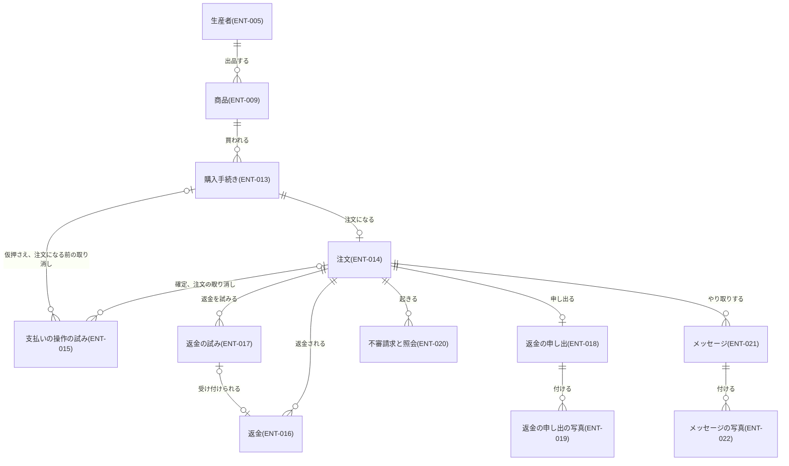

- 注文(ENT-014)は、購入手続き(ENT-013)から作る。購入手続き1つから、注文は1つまでである(TRN-002)。注文の商品と生産者は、購入手続きを通してたどる。1回の注文は、1人の生産者の1つの商品のため(FR-038)、注文の明細の実体は持たない。
- 支払いの操作の試み(ENT-015)は、Checkout Session を作ることと、注文になる前の仮押さえの取り消し(TRN-003)では購入手続きに、代金の確定と、注文の仮押さえの取り消し(TRN-005、TRN-008〜TRN-010)では注文に付く(SYS-029)。
- 返金の試み(ENT-017)のうち、Stripe が受け付けたものと、0円の返金(TRN-015)が、返金(ENT-016)になる。Stripe の側で行われた返金(TRN-017)は、試みを持たない返金である。

会員、生産者、管理者のアカウントと、招待:

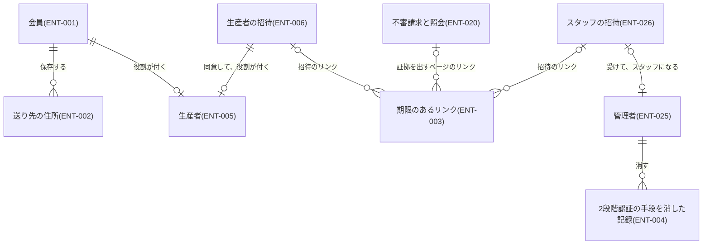

- 生産者(ENT-005)は、会員(ENT-001)に付く役割である。招待(ENT-006)への同意で付く(TRN-034)。
- 招待(ENT-006、ENT-026)は、受けられるか取り消されるまで残り(FR-230)、期限のあるリンク(ENT-003)は、送り直すたびに新しく作る(FR-229、FR-249)。そのため、1つの招待に、リンクは2つ以上あることがある。

生産者、商品、運賃表:

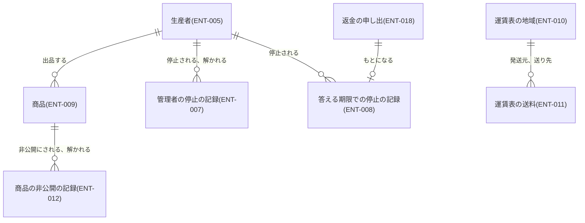

- 運賃表の送料(ENT-011)は、発送元と送り先の2つの地域(ENT-010)を指す。

問い合わせ:

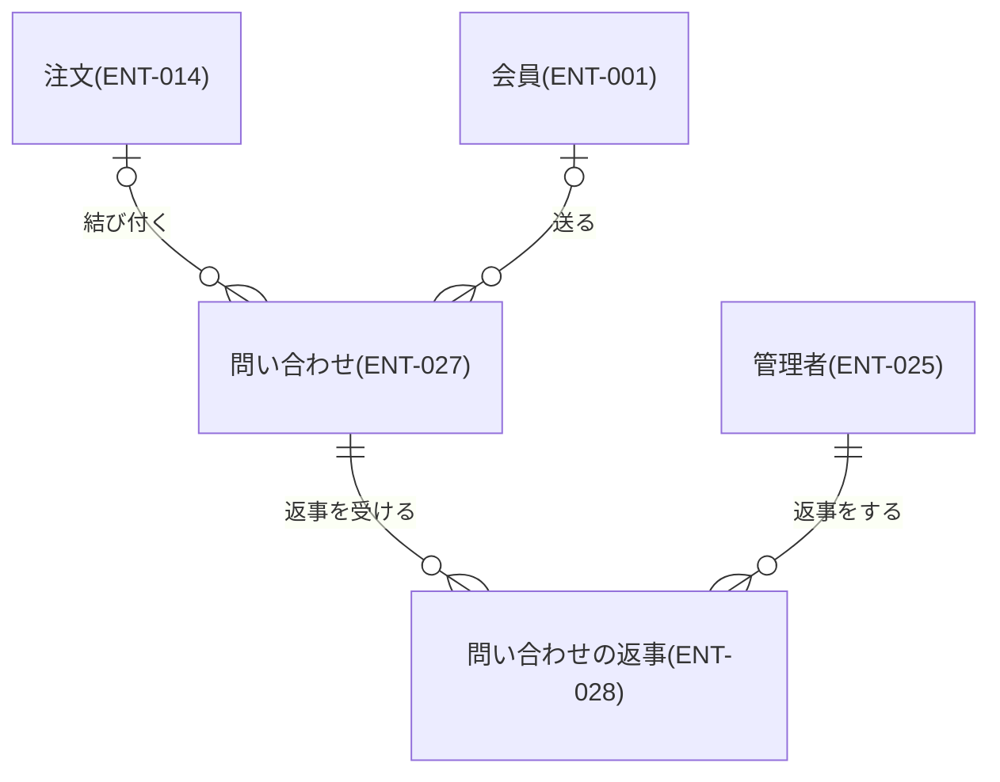

- 問い合わせ(ENT-027)は、注文に結び付くものと、結び付かないものがある(FR-189)。注文に結び付く問い合わせは、送った人を、その注文の購入者か生産者で示し、氏名とメールアドレスを持たない。結び付かない問い合わせで、送った人が会員でないときは、氏名とメールアドレスを持つ(FR-188)。

図に線を引いていないつながり:

| 実体 | 指す先 |
|---|---|
| 購入手続き(ENT-013)、注文(ENT-014) | ログインしていた会員(ENT-001)。登録せずに買った人の注文では、指さない(FR-156) |
| 2段階認証の手段を消した記録(ENT-004) | 消された人(会員(ENT-001)か、管理者(ENT-025)) |
| 期限のあるリンク(ENT-003)のうち、パスワードの再設定のリンクと、2段階認証の手段の登録のリンク | そのアカウントの人(会員(ENT-001)か、管理者(ENT-025)) |
| 期限のあるリンク(ENT-003)のうち、登録の確認のリンク | 申し込みで作った、Supabase の認証のアカウント(AUTH-019)。会員(ENT-001)は、まだない |
| ログインの状態(ENT-030) | そのアカウントの人(会員(ENT-001)か、管理者(ENT-025)) |
| 生産者の招待(ENT-006)、管理者の停止の記録(ENT-007)、商品の非公開の記録(ENT-012) | 操作した管理者(ENT-025) |
| 返金(ENT-016) | 返金した人のアカウント(会員(ENT-001))。Stripe の側で行われた返金では、指さない(FR-111) |
| メッセージ(ENT-021) | 送った人(購入者か、生産者(ENT-005)) |
| 送った知らせ(ENT-023) | 宛先(会員(ENT-001)、管理者(ENT-025)、生産者(ENT-005)、購入手続き(ENT-013)、注文(ENT-014)、招待(ENT-006、ENT-026)、問い合わせ(ENT-027)、期限のあるリンク(ENT-003)のどれか)と、もとになった出来事の実体 |
| 管理者の画面の知らせ(ENT-024) | 問い合わせ(ENT-027)、不審請求と照会(ENT-020)、答える期限での停止の記録(ENT-008)のどれか |

措置のページの中身(ENT-029)は、ほかの実体とつながらない。

### 注文に記録し、あとで変えない値

次の値は、注文(ENT-014)に記録し、そのあとは変えない。注文のあとに、生産者が商品の名前、価格、税率を変えても、管理者が運賃表やアプリケーション手数料の率を変えても、会員が保存した送り先の住所を変えても、その注文の額と中身を変えないためである(FR-042、FR-043、FR-261)。

| 値 | 記録する時点 | もとにする値 | 使うところ | 要件 |
|---|---|---|---|---|
| 商品の名前 | 注文を作るとき(TRN-002) | 商品(ENT-009)の名前 | 注文の画面、注文の確認、領収書 | FR-261 |
| 消費税の税率 | 注文を作るとき(TRN-002) | 商品(ENT-009)の消費税の税率 | 税率ごとの消費税(FR-067、FR-068) | FR-261 |
| 価格(消費税を含む総額)と数量 | 注文を作るとき(TRN-002) | 商品(ENT-009)の価格と、購入者が選んだ数量 | 商品の小計 | FR-042 |
| 商品の小計 | 注文を作るとき(TRN-002) | 価格と数量の積 | アプリケーション手数料の額、購入手続きの画面と注文の画面の表示(FR-041) | FR-042、FR-063 |
| 送料 | 注文を作るとき(TRN-002) | 運賃表(ENT-010、ENT-011)、商品の箱のサイズ、生産者の発送元の都道府県、送り先の住所 | 購入者の都合の返金の額(FR-090) | FR-040、FR-042 |
| 支払いの総額 | 注文を作るとき(TRN-002) | 商品の小計と送料の合計 | 仮押さえと代金の確定の額(FR-047、FR-054)、返金の額(FR-077、FR-090、FR-093) | FR-042 |
| アプリケーション手数料の率 | 注文を作るとき(TRN-002) | 生産者(ENT-005)の率 | アプリケーション手数料の額 | FR-043 |
| アプリケーション手数料の額 | 注文を作るとき(TRN-002) | 商品の小計に率をかけ、円未満を切り捨てた額 | 代金の確定で管理者が受け取る額、購入者の都合の返金の額(FR-090) | FR-063 |
| 購入者と送り先(氏名、住所、メールアドレス、電話番号) | 注文を作るとき(TRN-002) | 購入手続きで入力された値(メールアドレスは、Stripe の入力欄に入力され、Checkout Session から読んだ値)。会員が保存した送り先(ENT-002)を選んだときは、その時点の値の写し | 発送、購入者への知らせ | FR-155 |
| 仮押さえの期限 | 注文を作るとき(TRN-002) | Stripe が、その支払いに示した期限 | 期限での取り消し(TRN-010)、期限が近い知らせ(FR-132) | FR-049 |
| 決済手数料 | 代金を確定したとき(TRN-004、TRN-007) | Stripe が記録した実際の額(処理手数料と、その消費税) | 購入者の都合の返金の額(FR-090)、返金の前に示す内訳(FR-104) | FR-064 |
| 伝票番号と運送会社 | 「発送を知らせる」が押されたとき(TRN-011) | 生産者が入力した伝票番号と、選んだ運送会社(「そのほか」のときは、入れた名前。SCR-005) | 購入者への発送の知らせ(FR-125)、注文の画面の、追跡のページを開くリンク(SCR-005)、不審請求の証拠(ADR-0009) | FR-071 |

- 注文を作るときに記録する値は、仮押さえの期限を除き、購入者が「購入を確定する」を押したときの値である(FR-257)。押されたときに、サーバーが額と率を計算し直し、購入手続き(ENT-013)が持つ値と違えば、Checkout Session を作り直して、値を書き換えるため、支払いが送られる Checkout Session の値は、押したときの値と同じである(SYS-019)。注文を作るときに、その値をそのまま注文に記録し、商品、運賃表、生産者の率を読み直さない。仮押さえした額と、注文に記録する額、商品の名前、税率が、ずれないようにするためである。
- 代金の確定と返金では、ここに記録した値を使い、商品、運賃表、生産者の率を読み直さない(SYS-019)。
- 残す期間を過ぎたときに、購入者と送り先の氏名、住所、メールアドレス、電話番号を消すこと(NFR-005)は、この節の「変えない」の例外である。金額と日付は、消さない。
- 伝票番号と運送会社は、荷物を見分ける値であり、「発送を知らせる」で記録したあとは変えない。要件に、伝票番号を直す操作はない。
- 復旧した注文(TRN-062)は、この表の「記録する時点」と「もとにする値」によらず、作り直すときに、Stripe から読んだ値を記録し、読めない値は空にする(OPS-026)。記録したあとは、ほかの注文と同じく、変えない。
- これらの値を、あとから変えられないようにする方法は、詳細設計のマイグレーションで決める。

### 残す期間と消し方

個人情報を持つ実体(「実体の一覧」の「個人情報」の列が「あり」のもの)ごとに、残す期間と、消すものを決める。消すのは、個人を特定できる項目と、本文と写真であり、金額、日付、状態、だれがいつ送ったかの記録は残す(NFR-005)。

| 実体 | 消すもの | 消す時期 | 要件 |
|---|---|---|---|
| 会員(ENT-001) | アカウントのメールアドレス(Supabase の認証が持つ) | 退会したとき。生産者の役割を持っていた会員のメールアドレスは、役割が外れるときに、生産者(ENT-005)に写し(TRN-041)、登録の情報として残す | NFR-008 |
| 送り先の住所(ENT-002) | すべて | 会員が消したとき(FR-153)と、退会したとき | NFR-008 |
| 生産者(ENT-005) | 登録の情報(メールアドレスを含む)と、特定商取引法に基づく表記 | 役割が外れた生産者の、最後の注文が終わった日の翌日から数えて5年を過ぎたとき。役割が外れたときに、注文が1件もないか、最後の注文が終わった日の翌日から数えて5年を過ぎていれば、役割が外れたときに消す | NFR-006 |
| 生産者の招待(ENT-006)、スタッフの招待(ENT-026) | 招待されたメールアドレス | 招待が受けられたときと、取り消されたとき | FR-230 |
| 購入手続き(ENT-013) | 購入者と送り先の氏名、住所、メールアドレス、電話番号 | 購入手続きが終わったとき(「注文と支払い」の節の、購入手続きの終わり方)。注文になったときは、注文(ENT-014)に写したあと。仮押さえを取り消して、注文にしなかったときは、購入者への知らせ(IF-060)を送れたときか、届かなかったと分かったとき(IF-107)。送り直しを待っている間(IF-105)は、消さない(FR-258) | —(下の説明) |
| 注文(ENT-014) | 購入者と送り先の氏名、住所、メールアドレス、電話番号 | 退会した会員の注文と、登録せずに買った人の注文で、注文が終わった日(TRN-060)の翌日から数えて5年を過ぎたとき | NFR-004、NFR-005 |
| 返金の申し出(ENT-018)、返金の申し出の写真(ENT-019)、メッセージ(ENT-021)、メッセージの写真(ENT-022) | 本文と、写真そのもの | その注文の個人情報を消すとき | NFR-005 |
| 管理者(ENT-025) | アカウントのメールアドレス(Supabase の認証が持つ)と、外したスタッフの、写したメールアドレス | アカウントのメールアドレスは、スタッフを外したとき(管理者(ENT-025)に写したあと。AUTH-035)。写したメールアドレスは、外した日の翌日から数えて5年を過ぎたとき(AUTH-037) | FR-204、FR-205 |
| 問い合わせ(ENT-027)、問い合わせの返事(ENT-028)のうち、注文に結び付くもの | 本文(開示の請求では、請求の理由、開示を求める項目、誓約を含む) | その注文の個人情報を消すとき | NFR-005 |
| 問い合わせ(ENT-027)、問い合わせの返事(ENT-028)のうち、注文に結び付かないもの | 本文(開示の請求では、請求の理由、開示を求める項目、誓約を含む)と、送った人の氏名とメールアドレス | 届いた日の翌日から数えて5年を過ぎたとき | NFR-007 |

- 会員である間は、その会員の注文の個人情報を消さない。注文の履歴から注文の画面を開けるようにするためである(FR-065)。会員が退会したときに、注文が終わった日の翌日から数えて5年を過ぎている注文は、退会のときに消す。
- 購入者と送り先の個人情報は、注文になったあとは、注文(ENT-014)だけが持つ。同じ個人情報を2か所に持つと、片方を消し忘れるためである。注文に結び付く問い合わせ(ENT-027)が、送った人の氏名とメールアドレスを持たないのも、同じ理由である。返事のメール(FR-192)は、注文が持つ購入者のメールアドレスか、生産者のアカウントのメールアドレスに送る。
- 購入手続き(ENT-013)と招待(ENT-006、ENT-026)の消す時期と、注文が1件もない生産者(ENT-005)の消す時期は、要件定義書が決めていないため、この章で決めた。目的を終えた個人情報を、持ち続けないためである。注文が1件もない生産者の登録の情報は、開示の請求(FR-194)にも、不審請求と返金の知らせにも使わないため(NFR-006)、役割が外れたときに消す。購入手続きの期限(作ってから1時間)は、メールのリンクの期限(NFR-002)と同じ長さである。在庫は、注文ができるまで減らさないため(TRN-002)、期限でやり直しになっても、だれの在庫も押さえない。仮押さえに失敗した購入手続きは、期限までやり直せるため(TRN-001)、期限で終わったときに消す。購入手続きの終わり方と、期限を過ぎた購入手続きの支払いの扱いは、「注文と支払い」の節のとおりである。仮押さえを取り消して、注文にしなかったとき(TRN-003)は、購入者への知らせを送ったあとに消す。メールアドレスを先に消すと、知らせを送れないためである。
- 消す処理は、期限で動く処理(SYS-024)が、実体を持つモジュールを呼んで行う(SYS-043)。消す時期は、処理が動いた時刻ではなく、もとにする日時から求める(NFR-023)。
- 写真は、Supabase のファイルの保存から、写真そのものを消し、実体(ENT-019、ENT-022)に、システムが消した日時を記録する。
- 消したデータは、データベースのバックアップに、直近7日の間は残る(NFR-020)。
- この節が扱うのは、データベースが持つ情報である。サイトが自分で Stripe に入れる個人情報は、ログインしている会員の、登録のメールアドレスだけである(購入手続きで、Stripe の入力欄に前もって入れて示す。購入者は、書き換えられる。IF-026)。サイトは、不審請求の証拠に、何も入れない(IF-035)。ただし、証拠のページ(IF-031)で生産者が入れた証拠(購入者の氏名と送り先の住所を含む)とファイルは、Next.js のアプリが、中身を変えずに Stripe に渡す。入力された文は保存せず、ファイルは Stripe に渡したあとに消す(IF-039)。Checkout Session と、その支払いには、ほかに、購入手続きを見分ける ID と、商品の ID だけを付ける(SYS-012)。どちらも、個人情報ではない。カード情報とメールアドレスは購入者が、本人確認の情報と銀行口座は生産者が、Stripe の入力欄と埋め込みの部品に、自分で直接入れる(SYS-021)。その情報は、Stripe が、Stripe の決まりで持つ。

## 認証と認可

だれが、どう本人を確かめてログインし、どのデータを読めて変えられるかの方式を決める。RLS の決まりは、詳細設計のマイグレーションとテストで書く。

### Supabase の認証の使い方

Supabase の認証(SYS-004)を、どこから呼び、何を任せるかを決める。

| ID | 決まり | 理由 |
|---|---|---|
| AUTH-001 | 会員の登録、ログイン、パスワードの再設定、2段階認証、ログアウトの求めは、すべて Next.js のアプリの「会員とログイン」(SYS-033)が受け、Next.js のアプリのサーバーの処理から、Supabase の認証を呼ぶ。ブラウザは、Supabase の認証を直接呼ばず、Supabase の鍵を持たない(SYS-001)。Supabase の認証は、秘密の鍵で呼び、利用者の IP アドレスを、Supabase の認証に渡す(IP アドレスの転送の設定を有効にする) | パスワードの間違いを数えて、ログインを止めること(NFR-013)を、Next.js のアプリで行うためである。間違いを Supabase の認証の中で数える仕組み(Password Verification Attempt Hook)は、このサイトの Supabase では使えない(Supabase の公式ページ「Auth Hooks」)。パスワードを確かめたあと、ログインを終えずに、手段を登録するためのリンクを送る流れ(FR-247、FR-248)も、ブラウザが直接ログインする形では作れない。Supabase の認証は、ログイン、確認、2段階目の確認の回数を、送り元の IP アドレスごとに制限する。サーバーからだけ呼ぶと、すべての利用者が、サイトのサーバーの IP アドレスから来たように見え、制限が全員に一度にかかる。利用者の IP アドレスを渡せるのは、秘密の鍵で呼んだときだけである(Supabase の公式ページ「Rate limits」) |
| AUTH-002 | ログインの状態は、Next.js のアプリが、Cookie に持たせる。Cookie は、ブラウザのスクリプトから読めず、HTTPS でだけ送られ、ほかのサイトから送られた求めには付かない設定にする | 画面に入り込んだスクリプトに、ログインの状態を読み取られないようにするためと、ほかのサイトに置かれた仕掛けから、ログインしている人の操作として求めを送られないようにするためである |
| AUTH-003 | 認証のメール(登録の確認(FR-140)、登録できない知らせ(FR-143)、すでに登録されている知らせ(FR-144)、パスワードの再設定(FR-149)、手段を登録するためのリンク(FR-248)、手段の登録と削除の知らせ(FR-228))は、すべて「知らせ」(SYS-040)が送る。Supabase の認証には、メールを送らせない | 申し込まれたメールアドレスが、管理者のものか、会員のものか、新しいものかで、送るメールを変える(FR-142〜FR-144)。見分けるのは、データベースの記録である(AUTH-004)。送る手段と、送った記録を、1か所に置くためでもある(SYS-047) |
| AUTH-004 | Supabase の認証に任せるのは、アカウント、パスワード、2段階認証の手段、ログインの状態を保存し、確かめることだけである(SYS-004、SYS-014)。会員か管理者か、生産者の役割、オーナーかスタッフか、停止、退会、外されたことは、データベースの実体(ENT-001、ENT-005、ENT-025)が持ち、Supabase の認証には持たせない | 会員と役割の正本は、データベースである(SYS-012)。同じ事実を2か所に持つと、片方だけが変わって、外された人が使い続けられるためである |
| AUTH-005 | Supabase の認証とデータベースの口は、サイトのサーバーからだけ呼ぶ。Supabase の鍵は、公開してよい鍵も含めて、ブラウザに渡さず、Vercel の環境変数にだけ置く(SYS-002)。旧来の鍵(anon、service_role)は、無効にする。鍵が漏れたときの備えとして、Supabase の認証の、新しい登録を受け付ける設定は、切る(登録は、管理用の操作で作る。AUTH-020)。鍵が漏れたときは、その鍵を消して、作り直す。写真は、Next.js のアプリが出す URL で、ブラウザから Supabase のファイルの保存に直接送り、見る(SYS-025)。この URL に、Supabase の鍵は入れない | Supabase の認証の口(登録、ログイン、パスワードの変更、2段階認証)と、データの口は、インターネットに公開されており、鍵があれば、サイトを通さずに呼べる。鍵のない求めは、Supabase の窓口が通さない(Supabase の公式ページ「JWT Signing Keys」)。サイトを通さずに呼ばれると、ログインの制限(AUTH-026)を通らずにパスワードを試され、本人に知らせずにパスワードを変えられ、確認のリンクのないアカウントで、メールアドレスをふさがれる。公開してよい鍵は、ブラウザに渡すことを前提にした鍵であるため、渡さずに、秘密の鍵と同じに扱う。写真を送るための、署名の付いた URL は、ほかの認証なしで使える(Supabase の公式ページ「createSignedUploadUrl」) |

### アカウントの種類と入口

利用者ごとに、入口と、本人の確かめ方を決める。ログインせずに、メールのリンクから入る利用者(AUTH-009、AUTH-010)も、あわせて示す。リンクの作りは、「メールのリンク」の節で決める(AUTH-014〜AUTH-021)。

| ID | 利用者 | 入口 | 本人の確かめ方 | 使える範囲 | 要件 |
|---|---|---|---|---|---|
| AUTH-006 | 生産者の役割を持たない会員 | 会員の入口 | メールアドレスとパスワード | 購入者の画面 | FR-145 |
| AUTH-007 | 生産者の役割を持つ会員 | 会員の入口(AUTH-006 と同じ入口) | メールアドレスとパスワードのあと、2段階認証 | 購入者の画面と、生産者の画面。ログインし直さずに移れる | FR-145、FR-147、FR-148 |
| AUTH-008 | 管理者(オーナー、スタッフ) | 管理者の入口 | メールアドレスとパスワードのあと、2段階認証 | 管理者の画面だけ。買うことも、出品することもできない | FR-146、FR-147 |
| AUTH-009 | 登録していない人、退会した会員、ログインせずに注文した会員 | 注文の確認のメールのリンク | ログインしない。リンクを持っていること | その注文の画面と、そこから開く、その注文の返金の申し出と、問い合わせだけ(SCR-020、SCR-021、SCR-017) | FR-066 |
| AUTH-010 | 役割が外れた生産者 | 証拠を出すページのリンク | ログインしない。リンクを持っていること | その1件の不審請求の証拠を出すことだけ | FR-238、FR-239 |

| ID | 決まり | 理由 |
|---|---|---|
| AUTH-011 | アカウントの種類は、会員(ENT-001)と管理者(ENT-025)のどちらが、その Supabase の認証のアカウントを指しているかで決まる。両方が指すアカウントは作らない | 管理者のアカウントは、会員のアカウントとは別のメールアドレスで作る(要件定義書の「アカウントと役割」)。種類の正本は、データベースである(AUTH-004) |
| AUTH-012 | 入口は、種類の合わないアカウント、退会した会員、外されたスタッフに、ログインの状態を作らない。画面には、パスワードの間違いと同じ表示を出す | 会員のアカウントは、管理者の入口からログインできず、退会した会員と外されたスタッフは、ログインできない(FR-146、FR-161、FR-174)。表示を変えると、そのメールアドレスのアカウントの種類が、他人に分かる(FR-142 と同じ理由) |
| AUTH-013 | 2段階認証を求めるかは、ログインのたびに、データベースの役割で決める。生産者の役割を持つ会員と管理者は、2段階目を終えるまで、購入者の画面を含め、どの画面も使えない | 役割は、アカウントを作ったあとに付くことがある(FR-253)。2段階目の前に一部の画面を使えると、パスワードだけを知る他人が、注文の履歴と保存した住所を見られる |

最初のオーナーの管理者のアカウント(FR-167)を作る手順は、操作手順書に書く(要件定義書の「管理者、オーナー、スタッフ」)。

### メールのリンク

メールで送るリンクの作りを決める。期限のあるリンクは、登録の確認(FR-220)、パスワードの再設定(FR-151)、スタッフの招待(FR-172)、生産者の招待(FR-218)、証拠を出すページ(FR-240)、2段階認証の手段の登録(FR-247)の6つである(NFR-002)。

| ID | 決まり | 理由 |
|---|---|---|
| AUTH-014 | 期限のあるリンクは、6つとも、「会員とログイン」が作り、確かめる(SYS-049)。Supabase の認証が作るリンクは、使わない | Supabase の認証の招待のリンクは、作った時点でアカウントができ(Supabase の公式ページ「generateLink」)、パスワードを決める前や、同意の前にはアカウントがない、という要件(FR-170、FR-003)と合わない。前のリンクを使えなくすること(FR-202、FR-219、FR-249)と、招待の取り消し(FR-233)には、サイトの記録が要る。6つのうち一部だけを Supabase の認証に任せると、同じ仕組みが2つになる |
| AUTH-015 | リンクには、推測できない乱数を入れる。期限のあるリンク(ENT-003)には、乱数そのものではなく、乱数から求めた、元に戻せない値を持つ。注文の確認のメールのリンク(FR-066。注文(ENT-014)が持ち、期限はない)にも、推測できない乱数を使う | リンクを知っていることが、本人の確かめになるため(AUTH-009、AUTH-010)。元に戻せない値で持つのは、データベースの中身が漏れても、リンクとして使えないようにするためである |
| AUTH-016 | 期限は、リンクを出した日時から1時間とする。使えるかどうかは、確かめるときに、期限そのもので決める | NFR-002、NFR-023 |
| AUTH-017 | リンクを開いただけでは、何も変えず、リンクを使ったことにもしない。開いたページで、本人が操作したとき(新しいパスワードを決める、パスワードを入れる、規約に同意する、証拠を出す)にだけ、行う。登録の確認のリンクは、開いたページに「登録を完了する」のボタンを置き、押したときに、会員にする(FR-141) | メールの安全確認の機能は、届いたメールのリンクを、本人より先に自動で開くことがある(Supabase の公式ページ「Production Checklist」の「Email link validity」)。開いただけで使われると、一度だけ使えるリンクは、本人が開いたときに使えない。登録の確認では、他人のメールアドレスで申し込まれたときに、本人が何もしないまま会員になる。FR-141 の受入条件の「開く」は、開いたページで「登録を完了する」を押すところまでを指し、受入のテストは、この操作で行う |
| AUTH-018 | 一度だけ使えるリンク(FR-150、FR-171、FR-217)は、操作が終わったときに、使われた日時を記録する。新しいリンクを出すとき(FR-202、FR-219、FR-249)は、前のリンクに、使えなくした日時を記録する。招待と、証拠を出すページのリンクの記録は、指す先(その招待、その不審請求)が残っている間、期限を過ぎても、使えなくしても残し、開かれたときに、どの招待、どの不審請求のものかが分かるようにする。新しいリンクを送れるかは、指す先の状態で決める(FR-229、FR-233、FR-240、FR-241、FR-256)。ほかの3つのリンク(登録の確認、パスワードの再設定、2段階認証の手段の登録)の記録は、期限を過ぎたとき、使われたとき、使えなくしたときに、期限で動く処理(SYS-024)が消す | 期限が過ぎたリンクを開いた本人が、管理者に頼まずに、新しいリンクを送らせられるようにするため(FR-229、FR-240)。ほかの3つは、期限が過ぎたら、本人が、もとの画面から申し込み直す。記録が消えたリンクは、開かれても使えない |
| AUTH-019 | 会員の登録の申し込み(FR-139)では、Supabase の認証に、アカウントを作り、パスワードを持たせる。管理者のメールアドレスと、すでに会員のメールアドレスでの申し込み(FR-143、FR-144)では、アカウントを作らない。会員(ENT-001)は、登録の確認のとき(AUTH-017)に作る。会員も管理者も指していないアカウント(確認を待っている申し込み)では、ログインできない(AUTH-011、AUTH-012)。確認を待っている申し込みと同じメールアドレスで、もう一度の申し込み、スタッフの招待でパスワードを決めること(FR-170)、生産者の招待への同意(FR-003)があったときは、前のアカウントと、前の登録の確認のリンクを消してから、新しいアカウントを作る。確認されないまま、リンクの期限を過ぎたアカウントは、期限で動く処理(SYS-024)が、メールアドレスごと消す | 確認の期限を逃した本人が、申し込み直せるようにするため。招待を受けた人が、確認を待っている申し込みがあるために、止まらないようにするためでもある。確認を待っている申し込みは、まだ会員ではないため(FR-141)、置き換えても、だれの会員の記録も失わない。申し込みのときに入れたパスワードを持てるのは、Supabase の認証だけである(SYS-014)。確認されなかった申し込みのメールアドレスを消す時期は、要件定義書が決めていないため、この章で決めた。目的を終えた個人情報を、持ち続けないためである |
| AUTH-020 | パスワードを決める操作と、変える操作(会員の登録の申し込み、パスワードの再設定(FR-149)、スタッフの招待(FR-170)、生産者の招待(FR-255))は、Next.js のアプリが、Supabase の認証の管理用の操作で行う。パスワードは、データベースにも、ログにも残さない | SYS-014 |
| AUTH-021 | Supabase の認証が、自分でメールを送ることがないようにする。Supabase の認証がメールを送ろうとしたときの送り先を、Next.js のアプリに置き換え(Send Email Hook)、Next.js のアプリは、そのメールを送らない | サイトを通さない求め(AUTH-005)で、サイトが出していないリンクのメールが、利用者に届かないようにするため。認証のメールを送るのは、「知らせ」だけである(AUTH-003) |

### 2段階認証

生産者の役割を持つ会員と管理者に求める、2段階認証(FR-147)の方式を決める。手段をなくしたときの扱い(手段を複数登録すること、管理者が登録を消すこと、消されたあとの登録)は、要件(FR-226、FR-234〜FR-236、FR-247、FR-248)のとおりであり、この節では、作りだけを決める。

| ID | 決まり | 理由 |
|---|---|---|
| AUTH-022 | 2段階目は、認証アプリが出す、時間で変わるコード(TOTP)で確かめる。Supabase の認証の、2段階認証の機能を使う。メールと SMS は使わない(NFR-001)。この章のほかの決まりは、「2段階認証の手段」と書き、認証アプリに限らない | Supabase の認証が、2段階目として備えるのは、認証アプリと、電話に届くコードの2つである(Supabase の公式ページ「Multi-Factor Authentication」)。電話に届くコードは、NFR-001 で使わないと決めている。Supabase の認証のパスキーは、実験的な機能で、API が予告なく変わることがあり、パスワードの代わりにログインする方法であって、2段階目ではない(Supabase の公式ページ「Passkey authentication」)。代金を受け取るアカウントのログインを、予告なく変わる機能の上に作らない。パスキーが正式な機能になり、2段階目として使えるようになったときは、手段の種類を足す |
| AUTH-023 | パスワードを確かめたあと、2段階目を終えるまでは、ログインの途中として扱う。この間にできるのは、2段階目の確認と、手段を1つも登録していない人の手段の登録(FR-236、FR-247)だけである。ログインの途中は、2段階目を終えていないログインの状態(ENT-030)として持ち、パスワードを確かめてから1時間を過ぎたら、受け付けない | 2段階目を終えるまで、どの画面も使わせないため(AUTH-013)。1時間は、手段を登録するためのリンク(FR-247)の期限(NFR-002)と同じ長さである。途中の状態を、そのリンクを使い終えるまで保つためである |
| AUTH-024 | 手段の登録、確認、削除は、Next.js のアプリを通して行う(AUTH-001)。管理者が、手段の登録をすべて消す操作(FR-234、FR-235)は、Next.js のアプリが、Supabase の認証の管理用の操作で行い、消した記録(ENT-004)を残す(FR-254) | 登録と削除の直前に、本人をもう一度確かめること(FR-251)と、登録と削除を本人に知らせること(FR-228)を、Next.js のアプリで行うため |
| AUTH-025 | 2段階目のコードの間違いが続いたら、一定の時間、そのアカウントの2段階目の確認を受け付けない。数え方は、「ログインの制限」の節で決める(AUTH-028) | コードは6桁であり、パスワードを知った他人が、何度でも試せると、当てられるため。要件定義書が決めているのは、パスワードの間違いの制限(NFR-013)だけであるため、この章で決めた |

### ログインの制限

パスワードと、2段階目のコードを、何度も試すログインを止める方法と、他人の間違いで、本人がログインできなくならない方法を決める(NFR-013)。

| ID | 決まり | 理由 |
|---|---|---|
| AUTH-026 | パスワードの間違いを、入れられたメールアドレスごとに数える。10回続いたら、最後の間違いから30分、そのメールアドレスでのログインを、正しいパスワードでも受け付けない。ログインに成功したとき、または、最後の間違いから30分たったときに、数を0に戻す。数が0で、使える印(AUTH-027)のない記録(ENT-031)は、期限で動く処理(SYS-024)が消す。数えるのは、Next.js のアプリである(AUTH-001) | 回数と時間は、PCI DSS が認証の試行の制限に求める値(10回以内の間違いで止め、止める時間は30分以上か、本人を確かめるまで)に合わせた。アカウントがあるかどうかで動きを変えないのは、制限がかかるかどうかで、そのメールアドレスが登録されているかが、他人に分かるためである(FR-152 と同じ理由)。アカウントのないメールアドレスの記録も増えるため、止める時間と同じ30分で、数を0に戻す |
| AUTH-027 | 本人がパスワードの再設定(FR-149)を終えたら、数を0に戻し、再設定を終えたブラウザに、そのアカウントだけに効く印を渡す。印のあるブラウザからのログインは、制限中でも受け付ける。パスワードと2段階認証は、いつもどおり確かめる。印は、ログインに1回成功するか、1時間たつと、使えなくなる | 再設定のリンクを開けるのは、メールを受け取れる本人だけである。他人は印を持たないため、再設定のあとに、間違えたパスワードを送り続けても、本人のログインを止められない。数を0に戻すだけでは、本人がログインする前に、また制限がかかる(NFR-013) |
| AUTH-028 | 2段階目のコードの間違い(AUTH-025)も、アカウントごとに、AUTH-026 と同じ回数と時間で数える。本人がパスワードの再設定を終えたら、この数も0に戻す | 2段階目まで進めるのは、パスワードを知っている人だけである。他人がコードを間違え続けて、本人を止めたときは、本人がパスワードを再設定すれば、他人は2段階目に進めなくなる |

### ログインの状態と、求めのたびの確かめ

ログインの状態を、どこに持ち、求めのたびに何を確かめ、いつ終わらせるかを決める。Supabase の認証のアクセストークンには、ログインの状態を見分ける ID が入っている(Supabase の公式ページ「User sessions」)。

| ID | 決まり | 理由 |
|---|---|---|
| AUTH-029 | Next.js のアプリは、パスワードを確かめたときに、ログインの状態(ENT-030)を記録する。2段階認証が要る人は、2段階目を終えたときに、終えたことを記録する。記録にあるログインの状態だけを受け付け、2段階目を終えていないものは、ログインの途中(AUTH-023)として扱う | ログインの状態を、それを終わらせる出来事と同じ書き込みで終わらせ(AUTH-031)、終わらせたログインの状態のアクセストークンを、期限の前でも受け付けないためである(AUTH-030) |
| AUTH-030 | 求めのたびに、次の4つを、データベースで確かめる。(1) ログインの状態(ENT-030)が記録にあり、2段階認証が要る人は、2段階目を終えていること(ログインの途中(AUTH-023)にできる操作を除く)。(2) 会員が退会しておらず、管理者が外されていないこと。(3) 今の役割(生産者の役割、オーナーかスタッフか)。アクセストークンに入っている値は、役割の確かめに使わない。(4) その注文や商品の持ち主であること(SYS-018) | Supabase の認証でログアウトさせても、発行済みのアクセストークンは、期限まで有効である(Supabase の公式ページ「Signing out」)。アクセストークンだけを信じると、外された人が、期限まで使い続けられる。役割は、ログインのあとに変わることがある(FR-176) |
| AUTH-031 | ログインの状態を終わらせる出来事と、その範囲は、下の表のとおりである。終わらせるときは、ログインの状態(ENT-030)の記録を、その出来事の書き込みと同じデータベースの関数で、消す(SYS-045)。あわせて、Supabase の認証のログインの状態も終わらせる。途中のまま期限を過ぎた記録(AUTH-023)は、期限で動く処理(SYS-024)が消す | 出来事だけが記録されて、ログインの状態が残ることを防ぐため |
| AUTH-032 | ログインしない入口(AUTH-009、AUTH-010)は、求めのたびに、リンクの値を確かめ、その注文、その不審請求だけを扱う | FR-066、FR-239 |
| AUTH-033 | ログインの状態に、期限は設けない。ログアウトするか、下の表の出来事が起きるまで続く | 生産者は、発送の現場で、スマートフォンから毎日操作する(NFR-019)。そのたびに2段階認証を求めると、手間が大きい。2段階認証の手段の登録と削除の前には、本人をもう一度確かめる(FR-251)。要件定義書は、ログインが続く期間を決めていないため、この章で決めた |

ログインの状態を終わらせる出来事(AUTH-031):

| 出来事 | 終わらせる範囲 | 要件 |
|---|---|---|
| 会員の退会 | その会員のすべて | FR-161 |
| スタッフを外す | そのスタッフのすべて | FR-174 |
| 管理者が、2段階認証の手段の登録をすべて消す | その人のすべて | FR-245 |
| パスワードの再設定 | その人のすべて | FR-246 |
| 本人が、2段階認証の手段を消す | 操作をした画面のものを除く、すべて | FR-250 |
| 生産者の役割が付く | その会員のすべて | FR-253 |
| オーナーの引き継ぎ | 終わらせない。前のオーナーは、次の求めから、役割の確かめ(AUTH-030)で、オーナーだけができることを行えない | FR-176 |
| ログアウト | 操作をした画面のもの | — |

### アカウントがなくなるときのメールアドレス

会員が退会したときと、スタッフを外したときの、Supabase の認証のアカウントと、メールアドレスの扱いを決める。生産者の役割を持っていた会員のメールアドレスは、役割が外れるときに、生産者(ENT-005)に写す(TRN-041)。確認されなかった申し込みは、AUTH-019 のとおりである。

| ID | 決まり | 理由 |
|---|---|---|
| AUTH-034 | 会員が退会したら、退会の書き込み(ログインの状態を終わらせること(AUTH-031)と、その会員の、パスワードの再設定のリンク、2段階認証の手段の登録のリンク(AUTH-018)、再設定のあとの印(AUTH-027)を使えなくすることを含む)のあと、Supabase の認証のアカウントを消す。会員(ENT-001)の1件は残し、注文(ENT-014)が指し続ける | アカウントのメールアドレスを消し(NFR-008)、同じメールアドレスで、新しく登録できるようにするため(FR-162)。Supabase の認証は、登録済みのメールアドレスでは、新しいアカウントを作れない。リンクと印を使えなくするのは、退会の前に出したものが、同じメールアドレスで新しく登録したアカウントに効かないようにするためである |
| AUTH-035 | スタッフを外したら、登録したメールアドレスを、管理者(ENT-025)に写し、その人のリンクと印を、退会と同じように使えなくして(AUTH-034)、Supabase の認証のアカウントを消す。管理者(ENT-025)の1件は残す。外した管理者は、「管理者のアカウント」として扱わない(FR-205)。もう一度招待したときは、新しい1件を作る | FR-204 が残すと決めているのは、操作の記録が指す先である。FR-205 は、同じメールアドレスで、もう一度の招待と、会員の登録ができることを求めている。両方を満たすため、記録が指す1件を残し、メールアドレスをふさいでいる Supabase の認証のアカウントを消す |
| AUTH-036 | 操作の記録(2段階認証の手段を消した記録(ENT-004)、生産者の招待(ENT-006)、管理者の停止の記録(ENT-007)、商品の非公開の記録(ENT-012)、問い合わせの返事(ENT-028))は、メールアドレスではなく、管理者(ENT-025)の1件を指す。写したメールアドレスは、管理者の画面の操作の記録にだけ示し、購入者と生産者には示さない | 外した人と、もう一度招待した人は、別の1件になり、操作が混ざらないようにするため |
| AUTH-037 | 写したメールアドレスは、外した日の翌日から数えて5年を過ぎたら、消す。消したあとの操作の記録には、外したスタッフであることだけを示す | 残す期間は、要件定義書が決めていないため、この章で決めた。5年は、注文の記録と、問い合わせを残す期間(NFR-004、NFR-007)にそろえた。問い合わせの返事が消えたあとに、返事をした人のメールアドレスだけを持ち続ける理由がない |
| AUTH-038 | Supabase の認証のアカウントを消す操作が失敗したときは、期限で動く処理(SYS-024)が、やり直す。データベースの書き込みが先に済んでいるため、その間も、ログインはできない(AUTH-030) | データベースと、Supabase の認証の2か所への書き込みを、片方だけで止めないため |

### 読み書きできる範囲

どの利用者が、どの実体の、どの行を読めて、変えられるかの方針を決める(NFR-011)。項目ごとの細部と、データベースの行ごとの決まり(RLS)は、詳細設計のマイグレーションとテストで書く。

| ID | 決まり | 理由 |
|---|---|---|
| AUTH-039 | 読める人と、変えられる人を、下の表の範囲に限る。Next.js のアプリは、求めのたびに確かめ(AUTH-030)、データベースも、行ごとの決まりで、同じ範囲に限る(SYS-003、SYS-018) | 画面を通さない求めに対しても、決まりを守るため(NFR-011)。Next.js のアプリの確かめに誤りがあっても、データベースが、ほかの人の行を返さないようにする |
| AUTH-040 | ログインしている人の求めでは、Next.js のアプリは、その人のログインの状態で、データベースを呼ぶ。データベースの行ごとの決まりは、その人が読み書きできる行だけを通し、ログインの状態(ENT-030)が記録にあることも確かめる。ログインしていない人の求めでは、だれでも読める行だけを読める立場で、データベースを呼ぶ | Next.js のアプリの確かめに誤りがあっても、データベースが、その人の読み書きできる行のほかを返さないようにするためである(AUTH-039) |
| AUTH-041 | データベースを、行ごとの決まりを通り抜ける管理用の鍵で呼ぶのは、ログインしている人がいない処理(登録、ログイン、メールのリンクの処理、登録せずに買う人の購入手続き、ログインしない入口(AUTH-032)、Stripe の知らせ、期限で動く処理)だけにする。これらの処理は、扱う行を、リンクの値、購入手続き、知らせの中身、期限から決め、ブラウザから届いたほかの値で広げない。Supabase の認証は、ログインしている人の操作でも、同じ鍵で呼ぶ(AUTH-001)。このとき、扱うアカウントは、本人の操作(ログアウト、2段階認証の手段の登録・確認・削除、退会)では、その人のログインの状態(ENT-030)が指すアカウントに限り、管理者の操作(2段階認証の手段の登録をすべて消す、スタッフを外す)では、求めのたびの確かめ(AUTH-030)を通った、その操作の相手に限る | 管理用の鍵を使う場所を限り、使う場所ごとに、扱える行とアカウントを決めておくため。Supabase の認証を、この鍵で呼ぶ理由は、AUTH-001 のとおりである |

| 行のまとまり | 実体 | 読める人 | 変えられる人 |
|---|---|---|---|
| 会員のもの | 会員(ENT-001)、送り先の住所(ENT-002) | その会員 | その会員 |
| 生産者と商品 | 生産者(ENT-005)、商品(ENT-009) | 公開している項目(生産者のページ、特定商取引法に基づく表記、商品ページ)は、だれでも。非公開の商品と、役割が外れた生産者のものは、公開しない(FR-163、FR-178)。役割が外れた生産者の表記は、その生産者の注文の購入者だけ(FR-166)。そのほかの項目は、その生産者と、管理者 | その生産者。生産者の停止と、商品の非公開は、管理者。アプリケーション手数料の率は、オーナーだけ(FR-015) |
| 注文と、注文に付く記録 | 注文(ENT-014)、返金(ENT-016)、返金の申し出と、その写真(ENT-018、ENT-019)、メッセージと、その写真(ENT-021、ENT-022) | その注文の購入者(会員は、ログインして行った注文(FR-156)。そのほかは、注文の確認のメールのリンク(AUTH-009))と、その注文の生産者。管理者は、問い合わせか不審請求がある注文のメッセージ(FR-199)と、管理者の画面に示すと要件が決めた注文(FR-137、FR-138) | 「状態遷移と、決済と送金の流れ」の、遷移の「きっかけ」の人だけ。管理者は、変えられない(FR-200) |
| 不審請求と照会 | 不審請求と照会(ENT-020) | その注文の生産者(役割が外れた生産者は、証拠を出すページのリンク(AUTH-010))と、管理者 | 証拠を出すのは、その注文の生産者だけ(FR-098)。記録は、Stripe の知らせで変わる |
| 管理の記録 | 2段階認証の手段を消した記録(ENT-004)、生産者の招待(ENT-006)、管理者の停止の記録(ENT-007)、答える期限での停止の記録(ENT-008)、商品の非公開の記録(ENT-012)、管理者の画面の知らせ(ENT-024)、管理者(ENT-025)、スタッフの招待(ENT-026)、問い合わせ(ENT-027)、問い合わせの返事(ENT-028) | 管理者 | 管理者。スタッフの招待、スタッフを外すこと、オーナーの引き継ぎは、オーナーだけ。問い合わせ(ENT-027)は、送る人が作る(FR-185〜FR-188) |
| だれでも読めるもの | 運賃表の地域(ENT-010)、運賃表の送料(ENT-011)、措置のページの中身(ENT-029) | だれでも | 管理者(FR-029、FR-198) |
| 仕組みの記録 | 期限のあるリンク(ENT-003)、購入手続き(ENT-013)、支払いの操作の試み(ENT-015)、返金の試み(ENT-017)、送った知らせ(ENT-023)、ログインの状態(ENT-030)、ログインの制限の記録(ENT-031) | 利用者は、直接は読めない。Next.js のアプリが、処理の中で使う | 利用者は、直接は変えられない。Next.js のアプリが、処理の中で変える |

### 迷惑な送信を減らす作り

ログインせずに送れる求めを、機械や、同じ送り元からの続けての送信から守る作りを決める。利用者に見える操作(画像を選ぶ、文字を読む)は、足さない。

| ID | 決まり | 理由 |
|---|---|---|
| AUTH-042 | 問い合わせフォーム(FR-188)の送信を受ける処理で、人のブラウザからの送信かどうかを、利用者に見えない方法で確かめる(Vercel の BotID)。機械の送信と判定したものは、受け付けない | 利用者の操作を増やさずに、機械による迷惑な問い合わせを減らすため。管理者の仕事を、迷惑な問い合わせで増やさない |
| AUTH-043 | 同じ送り元から続けて届く送信を、回数で止める(Vercel のファイアウォールの、回数の制限) | 人の手による続けての送信と、AUTH-042 を通り抜けた送信を止めるため |
| AUTH-044 | AUTH-042 と AUTH-043 を、ログインせずに送れて、メールが出る求め(会員の登録の申し込み(FR-139)、パスワードの再設定の申し込み(FR-149)、新しいリンクを送らせる求め(FR-229、FR-240))と、ログインにもかける | 他人のメールアドレスを次々に入れられると、サイトから大量のメールが出る。受け取った人に迷惑がかかり、サイトのメールが迷惑メールとして扱われると、注文と返金の知らせも届きにくくなる。要件定義書が決めていないため、この章で決めた |

## 外部連携と知らせ

外部のサービス(Stripe、メールを送るサービス、アクセス解析)とのやり取りと、利用者に送る知らせの一覧を決める。Stripe の知らせ(Webhook)の処理の中身(正常の場合と失敗の場合の動き)は、詳細設計のテストで書く。

### 外部のサービスの一覧

サイトの外にあり、サイトがやり取りするサービスと、やり取りするものを決める。サイトを動かす土台(Vercel、Supabase)は、「システム構成と技術の分担」の章で決めてある。監視のサービスは、「非機能と運用の方式」の章で決める(OPS-044)。

| ID | サービス | 使うもの | サイトから渡すもの | サイトが受け取るもの | やり取りする場所 | 渡る個人情報 | 要件 |
|---|---|---|---|---|---|---|---|
| IF-001 | Stripe(SYS-006) | 生産者のアカウント(Connect)、Checkout Session、埋め込みの部品、知らせ(Webhook) | 購入手続きの額と明細(商品の名前、消費税の税率)、アプリケーション手数料、購入手続きを見分ける ID。代金の確定、仮押さえの取り消し、返金の求め。生産者のアカウントを作る求め。ログインしている会員のメールアドレス(IF-026)。証拠のページで生産者が入れた証拠とファイル(IF-031、IF-039) | 支払い、返金、不審請求と照会、生産者のアカウントの状態。仮押さえの期限、決済手数料、カードのブランド、購入者のメールアドレス | Next.js のアプリ(Stripe の窓口)。カード情報と、生産者が登録する情報は、ブラウザから Stripe に直接(SYS-021) | 購入者が Stripe の入力欄に入れるもの(カード情報、メールアドレス)。生産者が埋め込みの部品に入れるもの(本人確認の情報、銀行口座)。サイトが自分で入れるのは、ログインしている会員のメールアドレス(入力欄に前もって入れる。IF-026)だけである。不審請求の証拠は、生産者が部品と証拠のページに入れる(IF-035)。証拠のページで入れた証拠(購入者の氏名と送り先の住所を含む)とファイルは、Next.js のアプリが、中身を変えずに Stripe に渡す(IF-031、IF-039) | FR-006、FR-046、NFR-012 |
| IF-002 | メールを送るサービス(SYS-007)。Resend を使う | メールを送る API、届かなかったことの知らせ | 宛先のメールアドレス、件名、本文 | 受け付けた結果、届かなかったことの知らせ | Next.js のアプリだけ(SYS-026) | 宛先のメールアドレスと、本文に入れる中身(「利用者に送る知らせ」の節) | FR-116、NFR-022 |
| IF-003 | アクセス解析(SYS-008)。Vercel の Web Analytics と Speed Insights を使う | ページの閲覧の記録、サイトが送る出来事の記録、表示の速さの記録 | ページの URL(IF-004 のとおりに削ったもの)、参照元、出来事の名前、表示の速さの値 | なし(Vercel の画面で見る) | ブラウザ(閲覧、表示の速さ)と、Next.js のアプリ(出来事) | なし(IF-004、IF-005) | FR-259、NFR-015〜NFR-017 |

アクセス解析の決まり:

| ID | 決まり | 理由 |
|---|---|---|
| IF-004 | 解析に送る前に、ブラウザで、送る中身を削る。メールで送るリンクから開くページ(期限のあるリンク(ENT-003)のページ、注文の確認のリンク(FR-066)のページ)は、記録を送らない。そのほかのページは、URL のうち、Stripe の側から戻るときに付く値を削ってから送る。表示の速さの記録も、同じに扱う | メールで送るリンクは、知っている人がログインせずに開けるため、解析に残さない(NFR-015)。送る前に中身を変えるか、送らないかを決める指定は、Web Analytics と Speed Insights の両方にある(Vercel の公式ページ「Redacting Sensitive Data from Web Analytics Events」「Speed Insights Configuration」) |
| IF-005 | サイトが送る出来事には、名前だけを付ける。個人情報も、会員、注文、購入手続きを見分ける ID も付けない | 出来事から、人や注文をたどれないようにするため(NFR-015) |
| IF-006 | 端末に識別子を残す設定と、ほかの解析のツールを足さない | Web Analytics は、Cookie を使わず、訪問者を、届いた求めから作るハッシュで見分ける(Vercel の公式ページ「Vercel Web Analytics」)。利用者の端末に識別子を残さないためである(NFR-016) |
| IF-007 | 購入までの進み具合は、3つの段の数で測る。商品ページの閲覧、購入手続きの画面の閲覧、注文の完了である。注文の完了は、注文を作ったとき(TRN-002)に、Next.js のアプリが出来事として送る | 注文は、ブラウザが戻らなくても作られるため(SYS-032)、完了のページの閲覧では、数が足りなくなる。流入元は、閲覧の記録の参照元で見る(FR-259) |
| IF-008 | 管理者(オーナー)は、Vercel の画面で、解析を見る。管理者には、読むだけの役割を渡し、設定の変更と、本番への反映ができる役割は渡さない | 解析の画面は、Vercel の画面の中にある。Vercel の画面は、秘密の鍵の設定と、本番への反映も扱うため、管理者ができることを、見ることに限る(FR-259) |

### Stripe の画面部品と API の使い分け

Stripe とのやり取りを、サイトのページに組み込む Stripe の部品で行うところと、Next.js のアプリが API で行うところに分ける。カード情報と、生産者が Stripe に登録する情報は、部品から Stripe に直接送る(SYS-021、NFR-012)。お金の操作は、Next.js のアプリが API で行う(SYS-020)。生産者は、Stripe のダッシュボードを使わない(FR-007)。

| ID | 場面 | 手段 | 決まり | 要件 |
|---|---|---|---|---|
| IF-009 | 生産者の Stripe のアカウントを作る | API | 生産者の役割を付けたときに、ADR-0009 の「1. 生産者のアカウントの設定」の設定で作る。作るときに、ウェブサイトの項目に、サイトの中の、その生産者のページの URL を入れる。生産者の多くは、自分のウェブサイトを持たず、登録のこの項目で手が止まるためである | FR-005、FR-007〜FR-009 |
| IF-010 | 生産者の登録(本人確認、銀行口座) | 部品(登録) | 生産者の画面に組み込む。入力が終わったかどうかは、部品からの合図ではなく、Stripe から読んだアカウントの状態で決める(「生産者のアカウント」の節) | FR-010 |
| IF-011 | 登録した情報を見ることと、直すこと | 部品(アカウントの管理) | 生産者の画面に組み込む | FR-010 |
| IF-012 | Stripe が生産者に求めていることの表示 | 部品(お知らせのバナー) | 生産者の画面に、いつも置く。求めがないときは、何も表示されない | FR-010、FR-011 |
| IF-013 | Stripe が生産者に出す書類 | 部品(書類) | 生産者の画面に組み込む | ADR-0009 |
| IF-014 | 売上の確かめ | サイトの注文の記録 | 部品も API も使わない。注文ごとに、注文に記録した代金、決済手数料、アプリケーション手数料、返金の額を示す。注文と並べて確かめられるようにするためである | FR-207 |
| IF-015 | Stripe から銀行口座への入金の確かめ | 部品(残高) | 生産者の画面に組み込む。入金の記録は、Stripe が正本である(SYS-011)。残高にお金を足す操作は、使わない(ADR-0009) | FR-207 |
| IF-016 | 購入手続き(カード情報とメールアドレスの入力、本人認証、仮押さえ) | 部品(Checkout Session の入力欄)と API | Next.js のアプリが、API で Checkout Session を作り、終わらせ、読む。購入者は、購入手続きの画面に組み込んだ入力欄に入れ、サイトの「購入を確定する」を押す。指定は、下の「購入手続きの Checkout Session」のとおり | FR-044〜FR-047、NFR-012 |
| IF-017 | 代金の確定、仮押さえの取り消し、返金 | API | サイトの操作だけで起きる(「Stripe に頼むお金の操作」) | FR-054、FR-087 |
| IF-018 | 領収書 | Stripe の領収書のページ | 注文の画面に、「領収書を開く」を置く。開けるのは、代金を確定したあとである(TRN-004。領収書は、代金の確定で Stripe が作る)。領収書の URL は、保存せず、注文の画面を開くたびに、Stripe の支払いから読む。領収書のリンクは、30日で切れるためである(Stripe の公式ページ「Receipts and paid invoices」)。ログインせずに注文した人は、注文の確認のメールのリンク(FR-066)から、注文の画面を開く。Stripe が領収書をメールで送ることには、頼らない | FR-067、FR-068 |
| IF-019 | 不審請求の証拠 | 部品(不審請求)と API | 「不審請求の証拠」の節のとおり | FR-098、FR-238、FR-239 |
| IF-020 | 部品を使う許可 | API | Next.js のアプリが、ログインしている生産者本人の求めにだけ、その画面で使う部品に限って出す。生産者の役割が外れた生産者には、出さない(「生産者のアカウント」の節)。登録の部品とアカウントの管理の部品は、生産者に、Stripe のログイン(電話番号と、SMS で届く確認コード)を求める(ADR-0009) | FR-010、NFR-014 |

購入手続きの Checkout Session(IF-016):

| ID | 決まり | 理由 |
|---|---|---|
| IF-021 | 生産者の Stripe のアカウントの上に、仮押さえの指定で作る。アプリケーション手数料の額、購入手続きを見分ける ID、商品の ID を付ける(SYS-012) | 代金を、生産者のアカウントに直接入れるため(FR-006)。商品を送る前に取り消せるようにするため(FR-047) |
| IF-022 | 明細は、商品と送料を別の行にし、行ごとに、税込みの税率を付ける(商品は、その商品の税率。送料は、標準税率。税率が対象外の商品のときは、どちらにも付けない) | Stripe の領収書に、税率ごとの消費税を出すため(FR-067、FR-068、ADR-0009) |
| IF-023 | 支払い方法は、カードにする。Apple Pay と Google Pay は、カードの支払い方法の中で受け付ける。分割払いの指定は、付けない | FR-044、FR-045 |
| IF-024 | Link は、MVP では使わない指定にする。MVP の完了のあとに、Link を足す | 初めての購入者に、入力欄が増えて見えるため。Link に保存されたカードで、IF-025 の指定が働くことと、サーバーがブランドを読めること(「注文を受け付ける条件」)を、確かめられなかったため |
| IF-025 | JCB、ダイナースクラブ、ディスカバーのカードを、支払いの前に止める指定を付ける。サーバーも、注文を作る前に、カードのブランドを確かめる(「注文を受け付ける条件」) | FR-225、ADR-0008。画面の指定をすり抜けた仮押さえを、注文にしないため |
| IF-026 | メールアドレスは、Stripe の入力欄で入れてもらう。サイトの購入手続きには、メールアドレスの欄を置かない。ログインしている会員には、登録のメールアドレスを前もって入れて示す(購入者は、書き換えられる)。サイトは、仮押さえに成功したあと、Checkout Session から読む(ENT-013) | 購入者が入れるのを、1回にするため |
| IF-027 | 期限は、購入手続きの期限に合わせる(「注文と支払い」の節の注記) | NFR-023 |
| IF-028 | Stripe の入力欄のスクリプトは、Stripe から読み込む。カード番号、有効期限、セキュリティコードは、Next.js のアプリを通らない | NFR-012 |
| IF-029 | Stripe の側から購入手続きの画面に戻るときに URL に付く値は、解析に送らない(IF-004) | NFR-015 |

### 不審請求の証拠

生産者が、不審請求と照会の証拠を、サイトの中から Stripe に出すときの、画面の中身を決める。証拠の正本は、Stripe である。サイトは、証拠の中身を保存しない。証拠の中身を Stripe から読んで示すのは、ログインした生産者の部品(IF-030)だけである。

| ID | 開く人 | 手段 | できること | 要件 |
|---|---|---|---|---|
| IF-030 | ログインした生産者(注文の画面から開く) | 不審請求の部品。返金の操作は、無効にする(ADR-0009) | 証拠を入力して出すこと。争わずに負けを認めること | FR-098、FR-266 |
| IF-031 | 生産者の役割が外れた生産者(メールのリンクから、ログインせずに開く) | サイトが作る画面と、API。Next.js のアプリは、リンクが指す1件の不審請求だけを、Stripe から読み、Stripe に出す。部品を使う許可は、出さない(IF-020) | その1件の証拠を入力して出すことだけ。ほかの不審請求、注文、生産者の画面は、開けない | FR-238〜FR-240、FR-266 |

2つの画面で、入力する項目は、同じである(FR-239)。示す項目は、証拠の中身だけが違う(IF-032、IF-038)。

| ID | 項目 | 中身 | 出どころ |
|---|---|---|---|
| IF-032 | 示す項目 | 不審請求の額、カード会社が示した理由、証拠を出す期限、今の状態(照会、結果待ち、勝ち、負け)、すでに出した証拠(証拠のページ(IF-031)では、出したかどうかだけ) | Stripe |
| IF-033 | 生産者が入力する項目(注文の記録にあるもの) | 購入者の氏名、送り先の住所、運送会社、伝票番号、「発送を知らせる」が押された日、商品の名前 | 生産者。ログインした生産者は、注文の画面の記録を見て入れる。役割が外れた生産者は、手元の発送の控えから入れる |
| IF-034 | 生産者が入力する項目 | 経緯の説明の文、ファイル(発送の控え、購入者とのやり取りの写しなど) | 生産者 |

| ID | 決まり | 理由 |
|---|---|---|
| IF-035 | サイトは、不審請求の証拠に、何も入れない。証拠の項目(IF-033、IF-034)は、すべて生産者が入力して出す | 管理者は、購入者と生産者の紛争に関わらない(要件定義書の「範囲」)。サイトが証拠を入れると、サイトが証拠を出した当事者になり、不審請求の結果の問い合わせが、管理者に向く。生産者が出す操作をしないまま、サイトが入れた購入者の氏名と住所が、カード会社に出ることもない |
| IF-036 | 購入者のメールアドレスは、生産者に示さない。証拠のメールアドレスの欄は、空のままでよい | 生産者は、購入者のメールアドレスを知らない(FR-117)。サイトが示すと、生産者に購入者のメールアドレスが渡るためである |
| IF-037 | 注文ごとのメッセージは、サイトが自動では入れない。生産者が、要るものを選んで、写しをファイルで足す | やり取りには、不審請求に関わらない中身も入るため、何を出すかは、争う本人である生産者が決める(「範囲」。管理者は、争いを判断しない) |
| IF-038 | 証拠のページ(IF-031)は、証拠の中身(部品で入れかけたもの、すでに出したもの)を、Stripe から読んで示さない。そのページで入力した中身だけを出す | このページは、メールのリンクだけで、ログインせずに開けるため。証拠には、生産者が入れた購入者の氏名と住所が入る。メールが乗っ取られても、できることを1件の操作に絞る(FR-239)のと同じく、購入者の氏名と住所が他人に見えないようにする |
| IF-039 | 証拠のページ(IF-031)のファイルは、写真と同じ道(SYS-025)で、Supabase のファイルの保存に送る。Next.js のアプリが、そこから Stripe に渡し、渡したあとに消す | Next.js のアプリは、大きな本文を受け取れないため(SYS-025)。証拠を、サイトに残さないため |
| IF-040 | 証拠を出す期限は、Stripe が不審請求ごとに示す値を、記録して示す(TRN-027、TRN-029、TRN-030)。期限を過ぎたら、不審請求の画面には、部品を使う許可を出さず、証拠のページは、入力を受け付けない。期限の前に開いた証拠のページから届いた求めは、Next.js のアプリが、期限で確かめて断る。期限の前に開いた部品からの操作は、Next.js のアプリを通らないため、Stripe が期限で断る | FR-241、FR-266 |
| IF-041 | 証拠を出すことと、負けを認めることの結果は、画面の返事では決めず、Stripe の知らせで記録する(「不審請求と照会」の節) | 記録の正本が Stripe であるため(SYS-011)。部品の中の操作は、Next.js のアプリを通らない |

### Stripe の知らせ

Stripe から届く知らせ(Webhook)の受け方と、記録を Stripe と一致させる方式を決める(SYS-023)。処理の中身(正常の場合と失敗の場合の動き)は、詳細設計のテストで書く。

| ID | 決まり | 理由 |
|---|---|---|
| IF-042 | 知らせは、Next.js のアプリの入口で受け(SYS-050)、署名は、「Stripe の窓口」が確かめる(SYS-042)。受けるのは、生産者の Stripe のアカウントで起きた出来事の知らせである。署名を確かめられない知らせは、受け付けない | 支払い、返金、不審請求は、生産者のアカウントの上で起きるため(ADR-0004、ADR-0005)。NFR-010 |
| IF-043 | 知らせは、合図として使う。知らせに入っている中身では、状態を決めない。知らせが指すもの(Checkout Session、支払い、返金、不審請求、生産者のアカウント)を、Stripe から読み直し、読んだ今の状態に、データベースを合わせる | 知らせの中身は、出来事が起きた時点の写しである。知らせは、2回以上届くことがあり、起きた順に届くとも限らない。今の状態を読み直せば、どの順で何回届いても、同じ結果になる(NFR-009) |
| IF-044 | データベースの状態は、「状態遷移と、決済と送金の流れ」の遷移の条件を満たすときにだけ変える。在庫の増減と、利用者への知らせは、状態を変えたときにだけ行う(SYS-030) | 同じ知らせが重なって届いても、操作の返事と知らせの両方から同じ結果が届いても、二重に行わないため |
| IF-045 | 処理を終えてから、Stripe に、受け取ったと返す。処理に失敗したときは、受け取れなかったと返す | 受け取れなかった知らせは、Stripe が、あとで送り直す(Stripe の公式ページ「Process undelivered webhook events」)。処理の前に受け取ったと返すと、失敗した知らせが、送り直されない |
| IF-046 | 受けた知らせを記録する実体は、持たない | 重なりと順番の入れ替わりは、IF-043 と IF-044 で、結果が変わらない。失敗は、Stripe の送り直し(IF-045)と、突き合わせ(IF-047)で拾う。知らせを保存すると、購入者の個人情報が入った写しを、サイトが持つことになる |
| IF-047 | 決まった間隔で、突き合わせを行う。進んでいるものを、サイトの記録から選び、Stripe から読んで、データベースを合わせる(IF-043、IF-044 と同じ扱い)。対象は、終わっていない購入手続き、確定待ちと確かめ中の注文、結果待ちの返金、照会と結果待ちの不審請求、代金を確定した日から120日を過ぎていない注文の支払い(サイトの外で起きた返金と、新しい不審請求を見つけるため)、生産者の役割が「あり」の生産者のアカウントである。間隔は、OPS-040 と OPS-041 のとおりである。サイトに記録のない支払いは、対象にならない。本番のデータベースを戻したあとは、復旧の突き合わせ(OPS-020)を、先に行う | 知らせが届かないことがあるため(NFR-009)。120日は、カード会社が不審請求を受け付ける通常の期間で、NFR-003 と同じ長さである |
| IF-048 | 知らせの処理が失敗し続けたときと、突き合わせで直せないずれが見つかったときは、保守を担う開発者に知らせる | NFR-022 |

受ける知らせと、起こす遷移。知らせの種類は、Stripe の名前で書く。どの種類が、どの順で届くかは、検証の環境で確かめる(TST-020)。IF-043 のとおり、種類が増えても減っても、読み直した状態で決まるため、遷移は変わらない。

| ID | 読み直すもの | 知らせの種類 | 起こす遷移 |
|---|---|---|---|
| IF-049 | Checkout Session と、その支払い | checkout.session.completed、checkout.session.expired、payment_intent.amount_capturable_updated | 購入手続きが持つ ID の Checkout Session のときだけ、扱う(作り直す前の Checkout Session の知らせでは、何もしない)。仮押さえに成功していれば、TRN-002 か TRN-003。Checkout Session が終わっていて、購入手続きの期限を過ぎていれば、TRN-061(「注文と支払い」の節の表) |
| IF-050 | 注文の支払い | payment_intent.succeeded、payment_intent.canceled | 確かめ中の注文は、TRN-007 か TRN-008。確定待ちの注文の仮押さえが、Stripe の側で取り消されていたときは、状態を変えず、TRN-005 か TRN-010 で扱う(「注文と支払い」の節の注記) |
| IF-051 | 返金 | refund.created、refund.updated、refund.failed、charge.refunded | TRN-017〜TRN-019 |
| IF-052 | 不審請求と照会 | charge.dispute.created、charge.dispute.updated、charge.dispute.closed、charge.dispute.funds_withdrawn、charge.dispute.funds_reinstated | TRN-027〜TRN-033 |
| IF-053 | 生産者のアカウントの状態 | account.updated、v2.core.account[configuration.merchant].capability_status_updated、v2.core.account[requirements].updated | TRN-035、TRN-036 |

### 利用者に送る知らせ

システムが送る知らせの一覧を決める。文面は、詳細設計で書く。送るのは、「知らせ」(SYS-040)だけである(SYS-047)。

| ID | 決まり | 理由 |
|---|---|---|
| IF-054 | 購入者、生産者、招待された人、問い合わせた人への知らせは、メールで送る(IF-002)。管理者への知らせは、管理者の画面に示す(ENT-024)。保守を担う開発者への知らせ(NFR-022)は、メールで送り、監視のサービスにも合図を送る(OPS-046) | FR-116 |
| IF-055 | メールは、日本語で書く。入れるのは、下の一覧の「入れる中身」と、どの注文や商品の知らせかが分かる名前、サイトのページへのリンクである。住所、電話番号、メッセージの本文と写真、問い合わせの返事を除く本文は、入れない | メールは、届くまでの道と、受け取った人の端末で、ほかの人に読まれることがあるため。くわしい中身は、サイトの画面で見てもらう |
| IF-056 | 購入者への、注文についての知らせには、注文の画面へのリンク(FR-066)を入れる。生産者への、注文についての知らせには、生産者の画面のその注文へのリンクを入れる(開くには、ログインが要る) | 登録せずに買った人は、このリンクでだけ、注文の画面を開けるため(AUTH-009) |
| IF-057 | 宛先のメールアドレスは、送った知らせ(ENT-023)に写さず、送るときに、宛先が指す記録から読む。宛先が指すのは、会員、管理者、生産者、購入手続き、注文、招待、問い合わせ、期限のあるリンク(登録の確認のメールの宛先である、確認を待っている申し込み)のどれかである | 個人情報を、2か所に持たないため。まだ会員ではない人と、管理者への認証のメールにも、宛先が決まるようにするため |
| IF-058 | 期限で送る知らせは、処理が遅れて、意味がなくなっていたら、送らない(例: 仮押さえの期限を過ぎた注文の、期限が近い知らせ) | NFR-023 |

購入者への知らせ(メール):

| ID | 知らせ | きっかけ | 入れる中身 | 宛先が指すもの | 要件 |
|---|---|---|---|---|---|
| IF-059 | 注文の確認 | 注文を受け付けた(TRN-002)、復旧した注文を作った(TRN-062。取り消しになっていないとき) | 注文の中身、税率ごとの消費税、請求は代金の確定のときであること、注文の画面へのリンク(復旧した注文では、請求の時期の代わりに、注文を作り直したことと、送り先の記録がないこと) | 注文 | FR-048、FR-066、FR-067、FR-124 |
| IF-060 | 注文できなかった知らせ | 注文にせずに、仮押さえを取り消した(TRN-003) | 注文できなかったこと、代金は請求されないこと、商品ページへのリンク(復旧の突き合わせ(OPS-022)では、障害のために、受け付けた注文を取り消したことがあること) | 購入手続き | FR-258 |
| IF-061 | 注文の取り消し | 代金の確定の失敗(TRN-005、TRN-008)、生産者の取り消し(TRN-009)、仮押さえの期限(TRN-010) | 注文を取り消したこと、代金は請求されないこと、商品ページへのリンク | 注文 | FR-128、FR-129、FR-208 |
| IF-062 | 注文の取り消し(発送の前の不審請求の負け) | TRN-013 | 注文を取り消したこと、商品は発送されないこと | 注文 | FR-277 |
| IF-063 | 発送の知らせ | 「発送を知らせる」が押された(TRN-011) | 運送会社の名前、伝票番号、追跡のページを開くリンク(SCR-005)、返金の申し出に進むリンク | 注文 | FR-125 |
| IF-064 | 返金の知らせ | 返金した注文になった(TRN-014、TRN-015、TRN-017)、返金のやり直しを Stripe が受け付けた(TRN-020) | 返金の額 | 注文 | FR-126 |
| IF-065 | 返金が届かなかった知らせ | 返金が失敗に変わった(TRN-019) | 返金が届かなかったこと、生産者の連絡先が、注文の画面の特定商取引法に基づく表記にあること | 注文 | FR-268 |
| IF-066 | 返金の申し出を閉じた知らせ | 不審請求が起きて、申し出を閉じた(TRN-026) | 申し出を閉じたことと、その理由 | 注文 | FR-272 |
| IF-067 | 生産者から答えがなかった知らせ | 答える期限を過ぎても、申し出が閉じていない(TRN-039) | 期限までに答えがなかったこと、生産者の連絡先が、注文の画面の特定商取引法に基づく表記にあること | 注文 | FR-276 |
| IF-068 | メッセージが届いた知らせ | 生産者が、その注文にメッセージを送った(「返金しない」の答えの理由を含む。TRN-024) | メッセージが届いたこと(本文は入れない) | 注文 | FR-127、FR-275 |

生産者への知らせ(メール)。生産者の役割が外れた生産者には、「役割が外れたあと」の欄のとおりに送る。送るときは、登録したメールアドレスに送る(NFR-006)。「—」は、役割が外れたあとには起きない出来事である(進んでいる注文と、閉じていない返金の申し出が残っている間は、退会できないため。FR-159)。「送らない」は、要件が、役割が外れた生産者には知らせないとしているものである(FR-223、FR-224)。

| ID | 知らせ | きっかけ | 入れる中身 | 宛先が指すもの | 役割が外れたあと | 要件 |
|---|---|---|---|---|---|---|
| IF-069 | 注文の知らせ | 注文を受け付けた(TRN-002)、復旧した注文を作った(TRN-062。取り消しになっていないとき) | 注文が入ったこと、仮押さえの期限(復旧した注文では、仮押さえの期限の代わりに、注文を作り直したことと、送り先の記録がないこと) | 生産者 | — | FR-130 |
| IF-070 | 仮押さえの期限が近い知らせ | 仮押さえの期限の3日前と1日前に、代金を確定していない | 期限 | 生産者 | — | FR-132 |
| IF-071 | 発送を知らせていない知らせ | 代金を確定してから48時間たっても、「発送を知らせる」が押されていない(注文ごとに1回) | 発送を知らせていないこと | 生産者 | — | FR-133 |
| IF-072 | 注文の取り消し(仮押さえの期限) | TRN-010。復旧の突き合わせで、仮押さえを取り消した(OPS-022) | 注文を自動で取り消したこと(復旧の突き合わせでは、障害のために、受け付けた注文を取り消したことがあること) | 生産者 | — | FR-129 |
| IF-073 | 返金の申し出の知らせ | 購入者が申し出た(TRN-022) | 申し出があったこと、答える期限 | 生産者 | — | FR-131 |
| IF-074 | 申し出の取り下げの知らせ | 購入者が取り下げた(TRN-025) | 取り下げたこと | 生産者 | — | FR-262 |
| IF-075 | メッセージが届いた知らせ | 購入者が、その注文にメッセージを送った | メッセージが届いたこと(本文は入れない) | 生産者 | — | FR-127 |
| IF-076 | Stripe の側で行われた返金の知らせ | TRN-017 | 返金の額 | 生産者 | 送る | FR-264 |
| IF-077 | 返金が届かなかった知らせ | 返金が失敗に変わった(TRN-019) | 返金が届かなかったこと | 生産者 | 送る | FR-268 |
| IF-078 | 不審請求と照会が起きた知らせ | TRN-027、TRN-029、TRN-030 | 不審請求か照会が起きたこと、証拠を出す期限 | 生産者 | 送る。証拠を出すページへのリンクを入れる | FR-097、FR-238、FR-266、FR-270 |
| IF-079 | 不審請求と照会の結果 | TRN-028、TRN-031〜TRN-033 | 結果(勝ち、負け、照会が閉じた)。TRN-033 で、取り消してある注文のときは、「不審請求と照会」の節の中身 | 生産者 | 送る | FR-242、FR-267 |
| IF-080 | 答える期限での停止と、解けた知らせ | TRN-039、TRN-040 | 停止のもとになった申し出の注文。解けたときは、解けたことと、管理者の停止が残っていれば、まだ停止されていること | 生産者 | — | FR-135、FR-273 |
| IF-081 | 管理者の停止と、解いた知らせ | TRN-037、TRN-038 | 理由。解いたときは、答える期限での停止が残っていれば、まだ停止されていること | 生産者 | 送らない | FR-209、FR-223 |
| IF-082 | 商品の非公開と、解いた知らせ | 管理者が商品を非公開にした、非公開を解いた(TRN-048) | 商品の名前、理由 | 生産者 | 送らない | FR-180、FR-224 |
| IF-083 | Stripe の求めと、受け付けが止まった知らせ | Stripe が情報を求めている。Stripe が、支払いの受け付けか入金を止めた(TRN-036) | 求めがあること、止まったこと、情報を出す期限(あるとき) | 生産者 | 送る | FR-260 |

アカウントと、招待、問い合わせの知らせ(メール):

| ID | 知らせ | 送る相手 | きっかけ | 入れる中身 | 宛先が指すもの | 要件 |
|---|---|---|---|---|---|---|
| IF-084 | 登録の確認 | 会員の登録を申し込んだ人 | 会員の登録の申し込み(退会した会員のメールアドレスでの申し込みを含む) | 会員にするためのリンク | 期限のあるリンク | FR-140、FR-162 |
| IF-085 | 会員に登録できない知らせ | 管理者 | 管理者のアカウントのメールアドレスでの、会員の登録の申し込み | 会員に登録できないこと | 管理者 | FR-143 |
| IF-086 | すでに登録されている知らせ | 会員 | すでに会員のメールアドレスでの、会員の登録の申し込み | すでに登録されていること | 会員 | FR-144 |
| IF-087 | パスワードの再設定 | 会員、管理者 | パスワードの再設定の申し込み | 再設定のリンク | 会員か、管理者 | FR-149 |
| IF-088 | 2段階認証の手段を登録するためのリンク | 生産者の役割を持つ会員、管理者 | 手段を1つも登録していない人のパスワードを確かめた | 手段を登録するためのリンク、ログインした覚えがなければ、リンクを開かずにパスワードを再設定すること | 会員か、管理者 | FR-248、FR-252 |
| IF-089 | 2段階認証の手段の登録と削除の知らせ | 生産者の役割を持つ会員、管理者 | 手段が登録された、消された | 登録されたこと、消されたこと | 会員か、管理者 | FR-228 |
| IF-090 | 生産者の招待 | 招待された人 | 管理者がメールアドレスを指定した。本人が、期限の過ぎたリンクのページから、新しいリンクを送らせた | 生産者として登録するためのリンク | 招待 | FR-001、FR-229 |
| IF-091 | スタッフの招待 | 招待された人 | オーナーがメールアドレスを指定した。本人が、期限の過ぎたリンクのページから、新しいリンクを送らせた | スタッフとして登録するためのリンク | 招待 | FR-168、FR-229 |
| IF-092 | 証拠を出すページの新しいリンク | 生産者の役割が外れた生産者 | 本人が、期限の過ぎたリンクのページから、新しいリンクを送らせた | 証拠を出すページへのリンク | 生産者 | FR-240 |
| IF-093 | 問い合わせの返事 | 問い合わせた人 | 管理者が、問い合わせに返事を送った | 返事の本文 | 問い合わせ | FR-192 |

管理者の画面の知らせ(ENT-024)と、保守を担う開発者への知らせ:

| ID | 知らせ | 送る相手 | きっかけ | 示す中身 | 要件 |
|---|---|---|---|---|---|
| IF-094 | 問い合わせ | 管理者(管理者の画面) | 問い合わせが届いた | 問い合わせ | FR-136、FR-137 |
| IF-095 | 不審請求と照会 | 管理者(管理者の画面) | TRN-027、TRN-029、TRN-030 | その注文と、不審請求か照会 | FR-097、FR-136、FR-137 |
| IF-096 | 答える期限での停止 | 管理者(管理者の画面) | TRN-039 | 停止した生産者と、もとになった申し出 | FR-136、FR-137 |
| IF-097 | 処理が止まった、失敗した、直せないずれが見つかった知らせ | 保守を担う開発者(メール。宛先は、設定に置き、送った知らせ(ENT-023)には記録しない。同時に、監視のサービスにも、失敗の合図を送る(OPS-046)) | 人の操作を待たずに動かす処理が止まるか失敗した。突き合わせで直せないずれが見つかった(IF-048) | 処理の名前、起きたこと。個人情報は入れない | NFR-022 |

### 外部のサービスが止まったときの扱い

外部のサービスが止まったとき、返事が届かないとき、断られたときの扱いを決める。どの場合も、サイトの記録を、確かめていない結果で変えない。

Stripe:

| ID | 起きること | 扱い | 要件 |
|---|---|---|---|
| IF-098 | お金の操作(代金の確定、仮押さえの取り消し、返金)の結果が分からない(返事が届かない、Stripe がエラーを返した) | 成功とも失敗とも決めず、Stripe から読んで確かめる(SYS-031)。代金の確定は、確かめ中にする(TRN-006)。返金は、状態を変えない。画面には、確かめていることを示し、同じ操作を、同じ鍵でやり直せるようにする(SYS-029) | FR-069 |
| IF-099 | Checkout Session を作れない、読めない | 購入手続きの画面に、いまは購入できないことを示す。注文は作られず、仮押さえもない。購入者は、あとで、同じ画面からやり直せる(購入手続きの期限まで) | FR-053 |
| IF-100 | Stripe の入力欄が読み込めない | 「購入を確定する」を押せない。IF-099 と同じに示す | FR-053 |
| IF-101 | 仮押さえに成功したあと、サーバーが Stripe から読めない | 注文にも、取り消しにもせず、購入手続きを終わらせない。Stripe の知らせ、期限の処理、突き合わせが、続きを行う(SYS-032、IF-047)。画面には、確かめていることを示す | FR-257 |
| IF-102 | 生産者の画面の部品が読み込めない | その部品の場所に、読み込めないことを示す。部品を使わない操作(注文の対応、メッセージ)は、続けられる | FR-010 |
| IF-103 | Stripe の知らせが届かない、処理に失敗した | Stripe の送り直し(IF-045)と、突き合わせ(IF-047)で、記録を合わせる | NFR-009 |
| IF-104 | Stripe が止まっている間に、期限(仮押さえの期限、購入手続きの期限)が来た | 期限の処理は、Stripe が戻ってから動いても、期限どおりに動いたときと同じ結果にする(成功した時刻と、期限そのもので決める) | NFR-023 |

メールを送るサービス:

| ID | 起きること | 扱い | 要件 |
|---|---|---|---|
| IF-105 | メールを送るサービスが止まっている、返事が届かない | 知らせは、もとになった出来事の書き込みと同じ書き込みで、送った知らせ(ENT-023)に、送る前のものとして記録してある。送れたときに、送った日時を入れる。送れなかったものは、期限で動く処理が、送り直す。同じ知らせには、送り直しでも同じ鍵を付け、二重に届かないようにする。メールを送るサービスが鍵を覚えているのは、24時間である(Resend の公式ページ「Idempotency Keys」)。結果が分からなかった送信を、24時間を過ぎてから送り直すと、同じメールが2通届くことがある。届かないよりも害が小さいため、送り直しは続ける。もとになった操作(注文、返金など)は、メールを送れなくても、成り立つ | FR-116、NFR-022 |
| IF-106 | 送り直しが遅れて、知らせの意味がなくなった | 送らない(IF-058)。期限のあるリンクのメールは、リンクの期限を過ぎたら送らない。本人は、画面から、もう一度申し込める | NFR-023 |
| IF-107 | 宛先のメールアドレスに届かなかった(メールを送るサービスが、送るときに宛先を受け付けなかった。または、あとから、届かなかったことの知らせが来た。知らせは、署名を確かめる) | 送った知らせに、届かなかったことを記録する。送り直さない。購入者への、注文についての知らせが届かなかったときは、生産者の画面のその注文に、購入者にメールが届いていないことを示す | FR-116 |
| IF-108 | メールを送れない状態が続く | 保守を担う開発者に知らせる(IF-097)。この知らせは、メールを送るサービスが止まっていても届くように、メールを使わない道でも行う。道は、監視のサービスである(OPS-046) | NFR-022 |

アクセス解析:

| ID | 起きること | 扱い | 要件 |
|---|---|---|---|
| IF-109 | アクセス解析に送れない、読み込めない | サイトの画面と操作に、影響させない。その間の記録は、欠ける。あとから送り直さない | FR-259 |

- 注文の確認のメールが届かなくても、購入者が注文の画面を開けるように、仮押さえに成功したあとの画面(ブラウザが戻ったとき)に、注文の画面へのリンクを示す(FR-066)。
- サイトを動かす土台(Vercel、Supabase)については、「非機能と運用の方式」の章で、バックアップと復旧(OPS-014〜OPS-028)と、止まったときの知らせ(OPS-044〜OPS-049)を決める。元に戻す手順は、運用設計書に書く(NFR-021)。

## 画面一覧と画面遷移

MVP の画面と、画面の移り変わりを決める。画面は、要件定義書の「MVP」の利用者ごとにできることと、この文書のこれまでの章(状態を変える操作、入口、メールのリンク、Stripe の部品を置く場面、知らせのリンクが開く先)から導いた。画面の配置と、画面ごとの項目は書かず、実装した画面で確かめる。画面が受け持つ要件は、対応表([04-test.md](04-test.md))にだけ書く。

### 画面の決まり

| ID | 決まり | 理由 |
|---|---|---|
| SCR-001 | 購入者が使う画面と、生産者が使う画面は、スマートフォンの幅を基準に作る | 購入者は、スマートフォンで、商品ページから注文の完了まで操作する(NFR-018)。生産者は、発送の現場で、スマートフォンから注文に対応する(NFR-019) |
| SCR-002 | 生産者の注文の操作は、注文の画面(生産者)(SCR-034)にまとめる。この画面に置くのは、「代金を確定する」、取り消し、メッセージ、返金の申し出への答え、不審請求の部品(IF-030)である。別の画面にするのは、入力のある2つだけである。発送を知らせる(SCR-035)と、返金(SCR-036) | 生産者が、1つの注文の対応を、画面を移らずに行えるようにするため(NFR-019)。返金は、確定する前に、区分、額、内訳を確かめる画面が要る(FR-103、FR-104) |
| SCR-003 | 不審請求の部品(IF-030)は、注文の画面(生産者)(SCR-034)の、注文の記録(購入者の氏名、送り先の住所、運送会社、伝票番号、「発送を知らせる」が押された日、商品の名前)と同じ画面に置く。証拠を入力するためのボタンや画面は、足さない | サイトは、証拠に何も入れない(IF-035)。生産者が、注文の記録を見ながら、証拠の項目(IF-033)を自分で入力できるようにするため |
| SCR-004 | 2段階認証の手段の、最初の登録(FR-247)と、追加と削除(FR-226、FR-244)は、同じ画面(SCR-028)で行う。この画面に、認証アプリの入れ方、QR コードの読み方、QR コードを読めないときに認証アプリに手で入れる文字を示す。最初の手段を登録したあと、同じ画面で、2つ目の登録を勧める(FR-227) | 生産者が、だれの手も借りずに、自分で登録できるようにするため(ADR-0010 の技術を選ぶ基準)。認証アプリは、一般の無料のアプリを使ってもらう(AUTH-022) |
| SCR-005 | 生産者は、発送を知らせる画面(SCR-035)で、伝票番号と一緒に、運送会社を一覧から選ぶ。前に選んだ運送会社を、初めから選んだ状態にする。一覧にない運送会社のときは、「そのほか」を選び、運送会社の名前を入れる。注文には、運送会社の名前と、一覧のどの項目かを見分ける値を記録する。発送の知らせ(IF-063)と、注文の画面(購入者)(SCR-020)に、運送会社の名前、伝票番号、その運送会社の追跡のページを開くリンクを示す。リンクは、示すときの設定の値で作る。「そのほか」のときと、一覧から外した運送会社のときは、名前と伝票番号だけを示す。運送会社の一覧と、会社ごとの追跡のページの URL の形は、設定の値とし、操作手順書(05-operations.md)に置く | 伝票番号だけでは、購入者は、どの運送会社の番号かが分からず、荷物を追えない(FR-071 の理由)。リンクを、示すときの設定の値で作るのは、運送会社が追跡のページの URL を変えたときに、設定を直せば、前の注文のリンクも開けるようにするためである。送ったメールのリンクは、変わらない。運送会社の一覧は、運用の値である(要件定義書の「書くもの、書かないもの」) |
| SCR-006 | 管理者への問い合わせは、1つの画面(SCR-017)で送る。この画面は、問い合わせフォーム(だれでも開ける)、注文の画面(購入者)、注文の画面(生産者)、生産者の画面の、4か所から開く。注文の画面から開いたときだけ、問い合わせをその注文に結び付ける(FR-189)。返事を受け取るメールアドレスは、問い合わせフォームから開いたときだけ、入れさせる(FR-188)。開示の請求(FR-194)は、この画面で選ぶ、問い合わせの種類の1つとし、問い合わせフォームと、注文の画面(購入者)から開いたときにだけ、選べる | 送る前に示す案内(FR-190)を、どこから開いても同じに示すため |
| SCR-007 | 使われ方を確かめる画面(FR-259)は、サイトに作らない。オーナーは、アクセス解析の画面で確かめる(「外部連携と知らせ」の章)。管理者の操作の記録(生産者の停止と、停止を解いたこと、商品の非公開と、非公開を解いたこと、2段階認証の手段の登録を消したこと)は、専用の画面を作らず、生産者の詳細(SCR-048)、商品(管理者)(SCR-049)、スタッフの管理(SCR-057)に示す | 記録は、その操作をする画面で、前の操作の理由を確かめるために使うため |

### 画面一覧

「開き方」は、その画面を開く前の画面か、開くのに要るものを示す。「状態を変える操作」は、その画面で行う、「状態遷移と、決済と送金の流れ」の章の遷移を示す。

だれでも開けるページ(ログインは要らない)

| ID | 画面 | 使う利用者 | 開き方 | 状態を変える操作 |
|---|---|---|---|---|
| SCR-008 | 商品の一覧 | だれでも | サイトの最初のページ | — |
| SCR-009 | 商品ページ | だれでも | 商品の一覧、生産者のページから | — |
| SCR-010 | 生産者のページ | だれでも | 商品ページから | — |
| SCR-011 | 特定商取引法に基づく表記(生産者ごと) | だれでも | 商品ページ、生産者のページ、購入手続き、注文の画面(購入者)から。生産者の役割が外れた生産者の表記は、注文の画面(購入者)からだけ開ける(FR-166) | — |
| SCR-012 | 運賃表 | だれでも | 商品ページから | — |
| SCR-013 | 利用規約(購入者向け) | だれでも | どのページからも(ページの下のリンク)。購入手続き、会員の登録の申し込みから | — |
| SCR-014 | 利用規約(生産者向け) | だれでも | どのページからも(ページの下のリンク)。生産者の招待を受ける画面から | — |
| SCR-015 | プライバシーポリシー | だれでも | どのページからも(ページの下のリンク)。購入手続き、会員の登録の申し込みから | — |
| SCR-016 | 措置のページ | だれでも | どのページからも(ページの下のリンク) | — |
| SCR-017 | 問い合わせ | だれでも、購入者、生産者 | SCR-006 の4か所から | — |

購入

| ID | 画面 | 使う利用者 | 開き方 | 状態を変える操作 |
|---|---|---|---|---|
| SCR-018 | 購入手続き | 会員、登録していない人 | 商品ページから | 「購入を確定する」(TRN-001〜TRN-003) |
| SCR-019 | 注文の完了 | 会員、登録していない人 | 購入手続きで、仮押さえに成功したあと。注文の画面(購入者)へのリンクを示す | — |
| SCR-020 | 注文の画面(購入者) | 会員、登録していない人 | 会員は、注文の履歴から。ログインしていない人は、注文の確認のメールのリンクから(AUTH-009)。購入者への知らせのリンクから | 返金の申し出の取り下げ(TRN-025) |
| SCR-021 | 返金の申し出 | 会員、登録していない人 | 注文の画面(購入者)、発送の知らせのリンクから | 返金の申し出(TRN-022) |

会員とログイン

| ID | 画面 | 使う利用者 | 開き方 | 状態を変える操作 |
|---|---|---|---|---|
| SCR-022 | 会員の登録の申し込み | 登録していない人 | ログイン(会員の入口)から | — |
| SCR-023 | 登録の確認 | 会員の登録を申し込んだ人 | 登録の確認のメールのリンクから。「登録を完了する」を置く(AUTH-017) | — |
| SCR-024 | ログイン(会員の入口) | 会員 | どのページからも | — |
| SCR-025 | 2段階認証の確認 | 生産者の役割を持つ会員、管理者 | ログインで、パスワードを確かめたあと(AUTH-023) | — |
| SCR-026 | パスワードの再設定の申し込み | 会員、管理者 | ログイン(会員の入口)、管理者のログインから | — |
| SCR-027 | 新しいパスワードを決める | 会員、管理者 | パスワードの再設定のメールのリンクから | — |
| SCR-028 | 2段階認証の手段 | 生産者の役割を持つ会員、管理者 | 最初の登録は、手段の登録のメールのリンクを開き、パスワードを確かめたあと(FR-247)。追加と削除は、ログインして、本人をもう一度確かめたあと(FR-251) | — |
| SCR-029 | 注文の履歴 | 会員 | ログインしたあと | — |
| SCR-030 | 送り先の住所 | 会員 | ログインしたあと。購入手続きから | — |
| SCR-031 | 退会 | 会員 | ログインしたあと | 生産者の役割を持つ会員の退会(TRN-041) |

生産者

| ID | 画面 | 使う利用者 | 開き方 | 状態を変える操作 |
|---|---|---|---|---|
| SCR-032 | 生産者の招待を受ける | 招待された人 | 生産者の招待のメールのリンクから | 生産者向けの利用規約への同意(TRN-034) |
| SCR-033 | 注文の一覧(生産者の画面の最初の画面) | 生産者 | ログインしたあと、購入者の画面から移る(FR-148)。生産者への知らせのリンクから | — |
| SCR-034 | 注文の画面(生産者) | 生産者 | 注文の一覧(生産者)、生産者への知らせのリンクから | 「代金を確定する」(TRN-004〜TRN-006)、取り消し(TRN-009)、「返金しない」の答え(TRN-024) |
| SCR-035 | 発送を知らせる | 生産者 | 注文の画面(生産者)から。返金の画面で、商品を送ったと答えたとき(FR-103) | 「発送を知らせる」(TRN-011) |
| SCR-036 | 返金 | 生産者 | 注文の画面(生産者)から。返金の画面から進んだ、発送を知らせる画面で、「発送を知らせる」を押したあと | 返金(TRN-014〜TRN-016)、返金のやり直し(TRN-020、TRN-021) |
| SCR-037 | 商品の一覧(生産者) | 生産者 | 生産者の画面から | — |
| SCR-038 | 商品の登録と更新 | 生産者 | 商品の一覧(生産者)から | — |
| SCR-039 | 生産者の情報(生産者のページの情報、特定商取引法に基づく表記、発送元の都道府県) | 生産者 | 生産者の画面から | — |
| SCR-040 | 受け取りの登録(登録の部品。IF-010) | 生産者 | 生産者の役割が付いたあと、生産者の画面から | — |
| SCR-041 | 受け取りの設定(アカウントの管理の部品と、書類の部品。IF-011、IF-013) | 生産者 | 生産者の画面から | — |
| SCR-042 | 売上と入金(IF-014、IF-015) | 生産者 | 生産者の画面から | — |
| SCR-043 | 証拠を出すページ(IF-031) | 生産者の役割が外れた生産者 | 証拠を出すページのメールのリンクから(AUTH-010) | — |

管理者

| ID | 画面 | 使う利用者 | 開き方 | 状態を変える操作 |
|---|---|---|---|---|
| SCR-044 | 管理者のログイン(管理者の入口) | 管理者 | 管理者の入口の URL から。会員が使うページからは、リンクしない | — |
| SCR-045 | スタッフの招待を受ける | 招待された人 | スタッフの招待のメールのリンクから | — |
| SCR-046 | 管理者の画面の最初の画面(まだ確かめていないもの) | 管理者 | ログインしたあと | — |
| SCR-047 | 生産者の一覧(招待と、招待の取り消しを含む) | 管理者 | 管理者の画面から | — |
| SCR-048 | 生産者の詳細(登録の情報、アプリケーション手数料の率、2段階認証の手段の登録を消す) | 管理者。アプリケーション手数料の率を変えるのは、オーナーだけ | 生産者の一覧から | 停止(TRN-037)、停止を解く(TRN-038) |
| SCR-049 | 商品(管理者)(非公開と、非公開を解く) | 管理者 | 管理者の画面から | — |
| SCR-050 | 運賃表の管理 | 管理者 | 管理者の画面から | — |
| SCR-051 | 問い合わせの一覧 | 管理者 | 管理者の画面から | — |
| SCR-052 | 問い合わせの詳細(返事を送る) | 管理者 | 問い合わせの一覧から | — |
| SCR-053 | 不審請求の一覧 | 管理者 | 管理者の画面から | — |
| SCR-054 | 答える期限を過ぎた返金の申し出の一覧(答える期限での停止の記録を含む) | 管理者 | 管理者の画面から | — |
| SCR-055 | 注文の画面(管理者) | 管理者 | 問い合わせの詳細、不審請求の一覧、答える期限を過ぎた返金の申し出の一覧から。読むだけで、何も変えられない。メッセージを読めるのは、問い合わせか不審請求がある注文だけである(FR-199、FR-200) | — |
| SCR-056 | 措置のページの更新 | 管理者 | 管理者の画面から | — |
| SCR-057 | スタッフの管理(招待、招待の取り消し、外す、2段階認証の手段の登録を消す、オーナーの引き継ぎ) | オーナー | 管理者の画面から | — |

- 生産者の役割を持つ会員と管理者は、2段階認証の確認(SCR-025)か、手段を1つも登録していない人の手段の登録(SCR-028)を終えるまで、ログインが要るほかの画面を、どれも開けない(AUTH-013、AUTH-023)。
- 上の「生産者」の表の画面のうち、ログインせずに開くのは、生産者の招待を受ける画面(SCR-032)と、証拠を出すページ(SCR-043)だけである。
- 返金の画面(SCR-036)で、商品を送ったと答えて、発送を知らせる画面(SCR-035)に進んだとき(FR-103)は、「発送を知らせる」を押したあと、返金の画面に戻る。返金は、確定するまで始まらない。戻った返金の画面は、発送済みの注文として、区分、額、内訳を示し直す(FR-090、FR-093、FR-104。「お金の額の計算」)。
- 画面の操作によらずに変わる状態(TRN-007、TRN-008、TRN-010、TRN-012、TRN-013、TRN-017〜TRN-019、TRN-023、TRN-026〜TRN-033、TRN-035、TRN-036、TRN-039、TRN-040、TRN-061、TRN-062)は、Stripe の知らせ、期限、ほかの遷移の結果、復旧の突き合わせ(OPS-020)で変わる。変わったあとの状態は、注文の画面(購入者、生産者、管理者)と、生産者の画面に示す。

### 画面遷移図

矢印は、画面から画面へ移れることを示す。丸い枠は、メールのリンクから入る入口である。点線は、サイトがメールを送ることを示す。どのページからも開けるページ(利用規約、プライバシーポリシー、措置のページ、問い合わせフォーム、ログイン)への矢印は、省いた。

購入者(買う流れと、注文のあと)

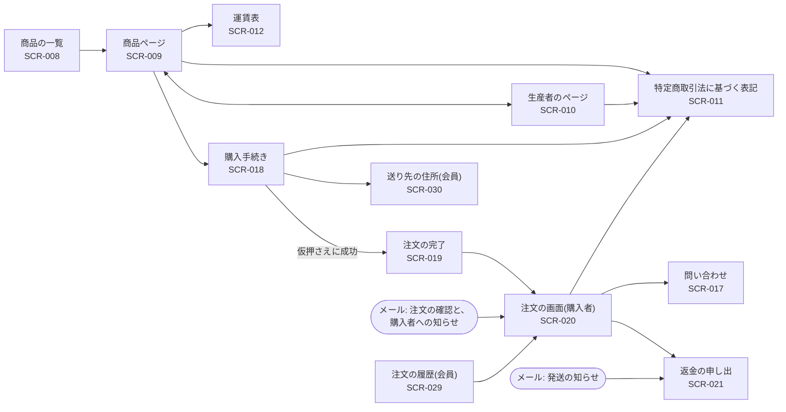

会員の登録とログイン(購入者と生産者が使う)

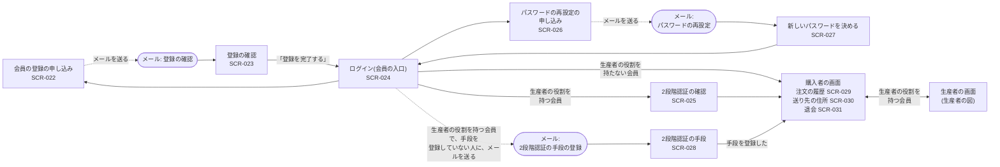

生産者

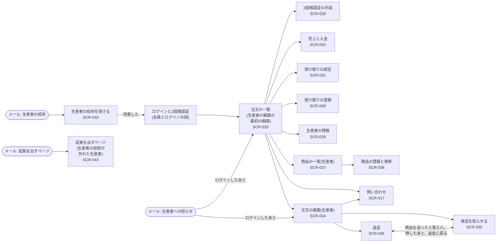

管理者のログイン

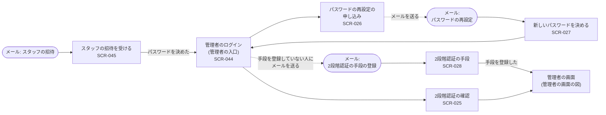

管理者の画面

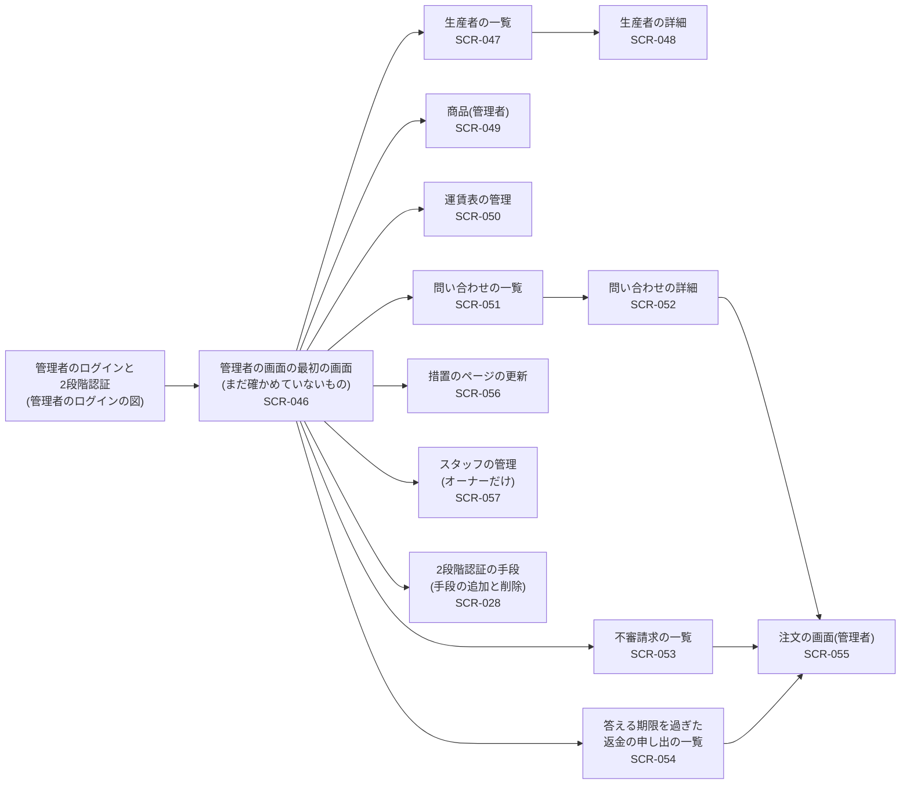

- 購入者へのメールのリンク(注文の確認、発送の知らせなど)は、注文の画面を開くリンクの値(AUTH-015)を持つ。このリンクから、ログインせずに開ける画面は、だれでも開けるページのほかには、その注文の画面(SCR-020)と、そこから開く、その注文の返金の申し出(SCR-021)と問い合わせ(SCR-017)だけである(AUTH-009)。会員の画面(注文の履歴、送り先の住所、退会)には、移れない。
- 生産者への知らせのメールのリンクは、ログインと2段階認証を終えたあとに、指す画面を開く。メールのリンクだけでは、生産者の画面は開けない。画面一覧の「生産者」の表の画面のうち、ログインせずに開けるのは、生産者の招待を受ける画面(SCR-032)と、証拠を出すページ(SCR-043)だけであり、証拠を出すページからは、ほかの画面に移れない(FR-239)。
- 管理者への知らせは、メールではなく、管理者の画面の最初の画面(SCR-046)に示す(FR-116、FR-136)。管理者の画面と、購入者の画面、生産者の画面の間を、移ることはできない(AUTH-008)。
- 生産者の役割を持つ会員と管理者のうち、2段階認証の手段を登録していない人は、パスワードを確かめたあと、メールのリンクから2段階認証の手段の画面(SCR-028)を開き、手段を登録してから、ログインを終える(FR-236、FR-247、FR-248)。

## 非機能と運用の方式

要件定義書の「品質」の非機能要件のうち、ほかの章で決めていないもの(表示の速さ、環境ごとの鍵、バックアップと復旧、人の操作を待たずに動く処理、止まったときの知らせ)を、どの仕組みで満たすかを決める。人がする作業の手順は、運用設計書に書く。計測の値と、外部のサービスの実際の動きは、テストで確かめる。

### 表示の速さ

商品の一覧(SCR-008)、商品ページ(SCR-009)、購入手続き(SCR-018)の画面の、表示の速さ(NFR-017)を満たす作りを決める。サーバーで作って送ること(SYS-016)と、サーバーの処理とデータベースを同じ地域に置くこと(SYS-010)は、「システム構成と技術の分担」の章で決めてある。基準を満たすことは、公開の前の計測で確かめる(NFR-017)。

| ID | 決まり | 理由 |
|---|---|---|
| OPS-001 | 商品の一覧と商品ページは、求めのたびに、サーバーで作る。作ったページを、あとの求めに使い回さない | 使い回すと、非公開にした商品(FR-177)、停止した生産者の商品で、注文を受け付けないことの表示(FR-018)、売り切れたことの表示が、古いページのまま残る。サーバーの処理とデータベースは同じ地域にあり(SYS-010)、表示の時間を決めるのは、写真である。使い回しは、計測で基準を満たせないと分かったときに足す |
| OPS-002 | 商品の写真は、Next.js の画像の部品で、Vercel の画像の変換を通して出す。画面の幅に合う大きさと、軽い形式に変える。変換する元は、設定で、Supabase のファイルの保存の、商品の写真の置き場所に限る | 生産者がスマートフォンで撮った写真は、数 MB ある(SYS-025)。そのまま出すと、LCP の基準を満たせない。元を限るのは、ほかの場所の画像を、このサイトの変換に通されないようにするためである(Vercel の公式ページ「Image Optimization」) |
| OPS-003 | 商品の写真を出す枠は、縦横の比を決めておき、写真が届く前から、その大きさを取る | 写真が出たときに、画面がずれないようにするため(CLS の基準) |
| OPS-004 | メッセージの写真と、返金の申し出の写真は、画像の変換を通さない | 変換した写真は、Vercel の側にも置かれる。証拠の写真を置く場所を、Supabase のファイルの保存の1か所に限り、期限のある URL(SYS-025)のほかの道で開けないようにするため(NFR-011) |
| OPS-005 | 購入手続きの画面は、注文の内容(商品の名前、数量、額)を、サーバーで作って先に出す。Stripe の入力欄(IF-028)を置く場所は、高さを先に取る | Stripe の入力欄は、ブラウザが Stripe から読み込むため、遅れて出る。先に出すものを決め(LCP の基準)、入力欄が出たときに、画面がずれないようにするため(CLS の基準) |

### 環境と鍵

開発、検証、本番の3つの環境で、鍵と、つなぐ先を分ける決まりを決める。鍵の置き場所と、ブラウザに渡さないことは、「システム構成と技術の分担」の章(SYS-001、SYS-002)と、「認証と認可」の章(AUTH-005)で決めてある(NFR-014)。

| ID | 環境 | 動かす場所 | Stripe | Supabase | メールを送るサービス | 期限で動く処理のきっかけ(SYS-009) |
|---|---|---|---|---|---|---|
| OPS-006 | 開発 | 開発者の手元 | サンドボックス | 手元で動かす Supabase | 検証の鍵(OPS-011) | 動かさない。確かめるときに、手で呼ぶ |
| OPS-007 | 検証 | Vercel(本番と別の URL。OPS-012) | サンドボックス | 検証のプロジェクト | 検証の鍵(OPS-011) | 動かさない。確かめるときに、手で呼ぶ |
| OPS-008 | 本番 | Vercel | 本番 | 本番のプロジェクト | 本番の鍵 | 動かす |

| ID | 決まり | 理由 |
|---|---|---|
| OPS-009 | 環境ごとに、鍵を1組ずつ持ち(Stripe の秘密鍵と知らせの署名の鍵、Supabase の鍵、メールを送るサービスの鍵と知らせの署名の鍵)、ほかの環境の鍵と混ぜない。Vercel で動かす環境の鍵は、Vercel の環境変数に、環境ごとに置く(SYS-002) | 検証の操作が、本番のお金と、本番の記録を動かさないようにするため。Vercel の環境変数は、環境ごとに別の値を置ける(Vercel の公式ページ「Managing environment variables across environments」) |
| OPS-010 | Next.js のアプリは、本番でない環境で、Stripe の本番の鍵が置かれているとき、Stripe を呼ばない。本番の環境で、サンドボックスの鍵が置かれているときも、呼ばない | 環境変数の置き間違いで、試しの操作が本物のお金を動かさず、本番の注文がサンドボックスに作られないようにするため。Stripe の鍵は、初めの文字で、本番の鍵かサンドボックスの鍵かを見分けられる(Stripe の公式ページ「API keys」) |
| OPS-011 | 開発と検証の環境からは、設定で決めた宛先のほかに、メールを送らない | 開発と検証の記録に、実在の人のメールアドレスが入っていても、その人にメールが届かないようにするため |
| OPS-012 | 検証の環境は、だれでも開ける形にしない。URL の変わらないものを、1つ持つ | 検証の環境は、作りかけの画面と、試しの記録を持つ。変わらない URL は、Stripe のサンドボックスの知らせの届け先にする。作り方は、開発基盤の準備の工程で決める |
| OPS-013 | 本番のデータベースの記録と写真を、開発と検証の環境に写さない | 本番の記録は、購入者と生産者の個人情報を持つ。開発と検証の環境は、試しの操作のための場所であり、個人情報を置かない |

### バックアップと復旧

データベースを、直近7日のどの日の状態にも戻し(NFR-020)、本番のデータベースを失ったときに、24時間以内にサイトを使える状態に戻す(NFR-021)仕組みを決める。戻す操作をするのは、保守を担う開発者である(NFR-022)。操作の手順は、運用設計書に書く。

| ID | 決まり | 理由 |
|---|---|---|
| OPS-014 | バックアップは、Supabase が毎日取るデータベースのバックアップを使い、直近7日分のどれかに戻す。同じプロジェクトに、全体を戻したとき(OPS-015)の、失う間(戻したバックアップの時点から、戻す操作までの間)は、いちばん新しいバックアップに戻したときで、最大で24時間と、戻す操作にかかる時間である。古いバックアップに戻したときは、その分だけ長くなり、最大で7日と、戻す操作にかかる時間である | NFR-020 の、直近7日と、目標復旧時点24時間に足りる。毎日のバックアップと、残る日数は、Supabase の有料の契約で使える(Supabase の公式ページ「Database Backups」)。Supabase の認証のアカウントも、同じデータベースにあり、一緒に戻る |
| OPS-015 | 戻し方は、2つである。(a) 記録の一部が壊れ、本番のデータベースが動いているときは、本番のデータベースを上書きせず、バックアップを別のプロジェクトに戻して、壊れた記録だけを本番に写す。写した記録は、バックアップの時点の値に戻る。写した記録のほかには、失う間は生じない。写したあと、定期の突き合わせ(IF-047)を1回行う。写した記録に関わる利用者への知らせは、運用設計書に書く。(b) 本番のデータベースの全体を失ったとき、または、全体を戻すほかないときは、同じプロジェクトに、バックアップを戻す。戻した時点よりあとの記録を失うため、OPS-018〜OPS-028 のとおりに扱う。別のプロジェクトに戻す機能は、(a) のほか、バックアップの中身の確かめ、受入の確かめ(NFR-021)、同じプロジェクトに戻せないときに使う | 同じプロジェクトに戻すと、戻した時点よりあとの記録を、すべて失う(Supabase の公式ページ「Database Backups」)。(a) は、一部が壊れただけのときに、動いている本番の記録を失わないためである。別のプロジェクトに戻す機能は、有料の契約で、もとのプロジェクトが、データベースを丸ごと写す形のバックアップ(physical backups)を使っているときに使える。ファイルの保存の中身、認証の設定、鍵は、写さない(Supabase の公式ページ「Restore to a new project」)。(b) で、同じプロジェクトを選ぶのは、これらが残り、Vercel の環境変数も変えずに済むためである |
| OPS-016 | 別のプロジェクトを、本番の代わりに使うときは、下の「別のプロジェクトに戻したときに、作り直すもの」の表のものを作り直す。Supabase の設定は、リポジトリに置いた設定から作り直せるようにする。記録を写すためと、確かめのために作ったプロジェクトは、本番と同じ守りで扱い、Next.js のアプリをつながず、使い終わったら消す | 設定を手で入れ直すと、守りの設定(AUTH-001、AUTH-005)が漏れる。記録を写すためと、確かめのためのプロジェクトは、本番の個人情報を持つ(OPS-013)。アプリをつながないのは、期限で動く処理、メール、Stripe への操作を、そのプロジェクトの記録で動かさないためである |
| OPS-017 | Supabase の外に、データベースの写しは持たない | 外の写しは、すべての個人情報を持つ場所を、もう1つ増やす。その鍵と、消した情報がバックアップから7日で消えること(NFR-020)を、そこでも守る仕組みが要る。Supabase のプロジェクトそのものを消すと、バックアップも消える(Supabase の公式ページ「Database Backups」)。この場合に戻せないことは、受け入れる |
| OPS-018 | 同じプロジェクトに戻すとき(OPS-015 の (b))は、戻す操作の前から、戻したあとに行うこと(OPS-019〜OPS-021)が終わるまで、サイトをメンテナンス中にする。メンテナンス中は、Next.js のアプリは、すべての画面の代わりに、メンテナンス中であることを示し、利用者の操作を受け付けない。Stripe の知らせと、メールを送るサービスの知らせには、受け取れなかったと返す。期限で動く処理は、動かさない。切り替えは、保守を担う開発者が、設定で行う | 戻している間は、データベースが使えない。戻した直後の記録は、Stripe とずれており、失った間に終わらせたログインの状態も残っている。受け取れなかった Stripe の知らせは、Stripe が送り直す(IF-045) |
| OPS-019 | 戻したあと、メンテナンス中のまま、すべてのログインの状態(ENT-030)を終わらせる | 戻すと、失った間に終わらせたログインの状態(退会、外したスタッフ、パスワードの再設定。AUTH-031)が、記録の上で生き返る。全員が、ログインし直す |
| OPS-020 | 戻したあと、メンテナンス中のまま、メンテナンス中にしてから1時間を過ぎてから、復旧の突き合わせを1回行う。Stripe から、生産者のアカウントごとに、戻したバックアップの時点の1日前よりあとに作られた支払いを読み、支払いに付けた、購入手続きを見分ける ID(SYS-012)の注文が、サイトの記録にないものを、下の「復旧の突き合わせで見つかった支払いの扱い」の表のとおりに扱う。その ID の購入手続き(ENT-013)の記録が、あっても、なくても、同じに扱う。記録があるときは、作り直さずに、その記録を使い、Checkout Session の ID と支払いの ID を、Stripe の値に合わせる。その記録の送り先と額は、使わない。対象は、サイトの記録から選ばない。動かせるのは、保守を担う開発者だけである。何度動かしても、同じ結果になるようにする(購入手続きを見分ける ID で、購入手続きも注文も、二重に作らない) | 失った間にできた注文は、サイトの記録から消えるが、Stripe には、仮押さえと代金が残る。定期の突き合わせ(IF-047)は、対象をサイトの記録から選ぶため、注文の記録のない支払いを拾えない。放っておくと、購入者のカードの利用枠が押さえられたまま、または、代金が生産者に渡ったまま、注文がなくなる。支払いの ID ではなく、購入手続きを見分ける ID で選ぶのは、Checkout Session を作り直すと、支払いの ID が変わるためである(ENT-013)。戻した時点で終わっていなかった購入手続きの、送り先と額を使わないのは、失った間に、購入者が変えていることがあるためである。1時間を過ぎてから行うのは、メンテナンス中にする前に作られた Checkout Session が、すべて期限を過ぎ、仮押さえの結果が決まってから読むためである。Checkout Session の期限は、作ってから長くて1時間であり(「注文と支払い」の節の注記)、メンテナンス中は、新しい Checkout Session は作られない。戻したバックアップの時点の1日前から読むのは、その時点の前に作られ、あとで仮押さえに成功した支払いを、読み落とさないためである |
| OPS-021 | 復旧の突き合わせのあと、メンテナンス中のまま、定期の突き合わせ(IF-047)を1回行ってから、メンテナンス中を解く | サイトに記録が残っている注文と、作り直した注文の、失った間の代金の確定、返金、不審請求を、Stripe に合わせるため |

復旧の突き合わせで見つかった支払いの扱い。先に、支払いの状態を見る。仮押さえに成功していないか、取り消されている支払いは、OPS-024 である。そのほかの支払いは、支払いに付けた商品の ID(SYS-012)の商品(ENT-009)の記録が、サイトにあるかで分ける。あるときは、OPS-022 か OPS-023 であり、ないときは、OPS-025 である。

| ID | Stripe で見つかった、注文の記録のない支払い | 扱い | 理由 |
|---|---|---|---|
| OPS-022 | 仮押さえに成功し、代金を確定していない。商品の記録がある | 購入手続き(ENT-013)の記録がなければ、Stripe の記録から作り直す(購入手続きを見分ける ID、商品、購入者のメールアドレス、Checkout Session の ID と支払いの ID)。注文にせずに終わらせ(TRN-003)、仮押さえを取り消す。購入者に、注文できなかった知らせ(IF-060)、生産者に、注文の取り消しの知らせ(IF-072)を送る。どちらの知らせにも、障害のために、受け付けた注文を取り消したことがあると書く | 送り先の氏名と住所は、サイトだけが持っていて、失われた。発送できない注文を残さない。お金は、動いていない。購入者は、商品ページから注文し直せる。失った間に、注文の確認と注文の知らせが届いていることがあるため、購入者と生産者の両方に知らせる |
| OPS-023 | 代金を確定した。商品の記録がある | Stripe の記録から、注文を作り直す(TRN-062。復旧した注文)。購入手続きの記録がなければ、それも作り直す。値は、OPS-026 のとおり。同じ書き込みで、Stripe から読んだ、その支払いの返金と、不審請求と照会も記録し(Stripe の側で行われた返金(TRN-017)、TRN-027〜TRN-033 と同じ形)、注文の状態を、今ある遷移のとおりに進める(TRN-012、TRN-013)。この記録では、返金と不審請求の知らせは送らない | 代金は、生産者に渡っており、発送済みのことがある。注文がないと、購入者には、注文の画面も、返金の申し出もなく、生産者は、サイトから返金できない。返金と不審請求を同じ書き込みで記録するのは、終わった取引に、注文を作り直した知らせと、返金の知らせが、続けて届かないようにするためである。失った間の返金と不審請求の知らせは、そのときに届いている。返金のある支払いも作り直すのは、返金の記録(FR-112)を残し、そのあとの返金の失敗と不審請求を、注文に記録できるようにするためである |
| OPS-024 | 仮押さえに成功していない。または、取り消されている | 何もしない | お金は、動いていない |
| OPS-025 | 仮押さえに成功したか、代金を確定した。商品の記録がない(失った間に登録した商品。失った間に登録した生産者の商品を含む) | 状態を変えず、直せないずれとして、保守を担う開発者に知らせる(IF-048)。仮押さえの取り消しと、購入者と生産者への連絡は、保守を担う開発者が行う。手順は、運用設計書に書く | 購入手続き(ENT-013)は、商品の記録を指し、注文(ENT-014)は、購入手続きから作る(「論理データ」の章)。商品の記録がないと、購入手続きも、注文も、購入者への知らせ(宛先は、購入手続きか注文である。IF-057)も、作れない |

| ID | 決まり | 理由 |
|---|---|---|
| OPS-026 | 復旧した注文は、発送待ちの状態で作る。商品の名前、数量、価格、商品の小計、送料、支払いの総額、消費税の税率、アプリケーション手数料の額、決済手数料、購入者のメールアドレス、代金を確定した日時は、Stripe の Checkout Session と支払いから読んで記録する。注文の画面を開くリンクの値(AUTH-015)は、新しく作る。購入者と送り先の氏名、住所、電話番号、アプリケーション手数料の率、ログインしていた会員、伝票番号と運送会社は、空にする。在庫は、数量だけ減らす(0 より小さくしない)。知らせは、返金と不審請求を記録したあと(OPS-023)の注文の状態が、取り消しでないときに、1回だけ送る(購入者に注文の確認(IF-059)、生産者に注文の知らせ(IF-069))。注文の画面(SCR-020、SCR-034)に、復旧した注文であることと、送り先の記録がないことを示す | 明細、税率、アプリケーション手数料の額は、Checkout Session と支払いに残っている(IF-021、IF-022)。送り先は、Stripe に渡していない(IF-001)。発送の前であれば、購入者と生産者は、注文ごとのメッセージで送り先を伝え合うか、生産者が返金する。発送済みであれば、生産者が、もう一度「発送を知らせる」を押す。どれも、今ある操作である。返金のある注文と、不審請求で負けた注文は、発送待ちからの今ある遷移(TRN-012、TRN-013)で取り消しになり、減らした在庫は、その遷移で戻る |
| OPS-027 | 戻したあと、ファイルの保存にあって、データベースに記録のない写真(失った間に送られた写真)は、期限で動く処理が消す。データベースに記録があって、ファイルのない商品の写真は、欠けたまま表示し、生産者が入れ直す | データベースのバックアップは、ファイルの保存の中身を含まない(Supabase の公式ページ「Database Backups」)。メッセージと返金の申し出の写真は、送ったあとに消せないため(「論理データ」の章)、同じプロジェクトに戻すかぎり、欠けない |
| OPS-028 | メンテナンス中を解いたあと、失った間の日時と、その間の操作をやり直す必要があることを、すべての画面に示す。示す期間と文は、設定に持つ | 失った間の、サイトだけが持つ記録(商品と在庫の変更、メッセージ、返金の申し出、「発送を知らせる」、会員の登録と退会、管理者の操作など)は、戻らない。目標復旧時点(NFR-020)の範囲として、受け入れる。利用者が、自分でやり直せるようにするため。生産者が止めた販売が戻っている間に入った注文は、生産者が取り消せる(TRN-009)。期限や期間で決まる扱い(取り消し、停止、消すこと)は、記録した日時から求めるため(NFR-023)、戻したあとに、期限で動く処理が、もう一度行う |

別のプロジェクトに戻したときに、作り直すもの。

| 作り直すもの | 作り直し方 |
|---|---|
| ファイルの保存の中身(商品の写真、メッセージと返金の申し出の写真) | もとのプロジェクトのファイルの保存から写す。もとのプロジェクトが失われているときは、戻らない |
| ファイルの保存の置き場所と、読み書きの決まり | リポジトリに置いた設定から作る |
| Supabase の認証の設定(利用者の IP アドレスを渡す設定(AUTH-001)、新しい登録を受け付けない設定と、旧来の鍵を無効にする設定(AUTH-005)、認証のメールを送らせない設定(AUTH-003)) | リポジトリに置いた設定から作る |
| Supabase の鍵 | 新しく作り、Vercel の環境変数を置き換える(SYS-002) |

### 人の操作を待たずに動く処理

人の操作を待たずに動く処理(NFR-022)を、何がきっかけで、どの間隔で動かすかを決める。処理の中身は、Next.js のアプリにあり、期限で動く処理の入口(SYS-024)から、受け持つモジュールを呼ぶ。処理が遅れて動いても、期限どおりに動いたときと同じ結果にする方式(NFR-023)は、ほかの章で決めてある。下の表の「期限の扱い」の列は、その方式を決めている箇所を指す。Stripe の知らせを受ける処理と、メールを送るサービスの知らせを受ける処理は、知らせが届いたときに動くため、この表には入れない(「外部連携と知らせ」の章)。

| ID | 決まり | 理由 |
|---|---|---|
| OPS-029 | 期限で動く処理のきっかけ(SYS-009)は、Vercel の、決まった時刻にアプリの決まった入口を呼ぶ機能を使う。本番の環境だけで動かす(OPS-008)。呼び出しには、Vercel が秘密の値を付け、Next.js のアプリは、その値が合う呼び出しだけを受け付ける(SYS-024)。設定の書き方は、開発基盤の準備の工程で決める | アプリと同じ置き場所で動き(ADR-0010)、外部のサービスを増やさない。秘密の値を確かめる作りは、Vercel の公式ページ「Managing Cron Jobs」による。Vercel の文書では、この機能は、今の書き方(Cron Jobs)から、新しい書き方(Schedules)へ移る途中であり、どちらも、時刻、入口、秘密の値の形は同じである |
| OPS-030 | 間隔は、5分ごと、1時間ごと、1日1回の3つにする。処理ごとの間隔は、下の「処理の一覧」のとおりである | 5分ごとは、購入者が待っている処理と、メールの送り直しである。1時間ごとは、時間や日の単位の期限で決まる処理であり、結果は期限そのもので決まるため(NFR-023)、1時間の遅れは結果を変えない。1日1回は、件数が多く、急がない処理である。間隔をまとめると、きっかけと、監視の合図(OPS-045)が3つで済む |
| OPS-031 | 1回の呼び出しで扱う件数に上限を置き、残りは、次の回に回す | Vercel で動かすサーバーの処理には、時間の上限がある。残りを次の回に回しても、結果は期限そのもので決まる(NFR-023) |
| OPS-032 | きっかけが、同じ回を2度呼ぶことも、回を抜かすこともあるものとして作る。同じ処理が重なって動いても、同じ記録を二重に扱わない | きっかけがやり直すか、2度呼ぶかを、公式の文書で確かめていない。抜けた回の分は、次の回が拾う(SYS-024) |
| OPS-033 | 処理を終えるたびに、監視のサービスに合図を送る(OPS-045) | きっかけが止まったことに、アプリの外から気づくため |

処理の一覧。

| ID | 処理 | 間隔 | 受け持つモジュール | 期限の扱い |
|---|---|---|---|---|
| OPS-034 | 購入手続きの続きと期限(仮押さえに成功した支払いを、注文にするか取り消す。期限を過ぎた購入手続きを終わらせる) | 5分ごと | 注文と支払い(SYS-036) | TRN-002、TRN-003、TRN-061、SYS-032、IF-104 |
| OPS-035 | メールの送り直し | 5分ごと | 知らせ(SYS-040) | IF-058、IF-105、IF-106 |
| OPS-036 | 仮押さえの期限での取り消し(TRN-010) | 1時間ごと | 注文と支払い(SYS-036) | 「状態の持ち方」、IF-104 |
| OPS-037 | 仮押さえの期限が近い知らせ(IF-070)と、発送を知らせていない知らせ(IF-071) | 1時間ごと | 注文と支払い(SYS-036) | IF-058 |
| OPS-038 | 答える期限での停止(TRN-039)と、生産者から答えがなかった知らせ(IF-067) | 1時間ごと | 生産者(SYS-034)。答える期限は、返金(SYS-037)から読む | 「状態の持ち方」、IF-058 |
| OPS-039 | 期限を過ぎたリンク、確認されなかった登録の申し込み、ログインの途中の記録、ログインの制限の記録を消す | 1時間ごと | 会員とログイン(SYS-033) | AUTH-016、AUTH-018、AUTH-019、AUTH-026、AUTH-031 |
| OPS-040 | 進んでいるものの、Stripe との突き合わせ(IF-047 の対象のうち、終わっていない購入手続き、確定待ちと確かめ中の注文、結果待ちの返金、照会と結果待ちの不審請求) | 1時間ごと | 記録を持つモジュール(SYS-036〜SYS-038)。Stripe は、「Stripe の窓口」(SYS-042)を通して読む | IF-043、IF-044 |
| OPS-041 | 代金を確定した日から120日を過ぎていない注文の支払いと、生産者のアカウントの、Stripe との突き合わせ(IF-047) | 1日1回 | 記録を持つモジュール(SYS-034、SYS-036〜SYS-038)。Stripe は、「Stripe の窓口」(SYS-042)を通して読む | IF-043、IF-044 |
| OPS-042 | 残す期間を過ぎた個人情報を消す | 1日1回 | 実体を持つモジュール | 「残す期間と消し方」 |
| OPS-043 | データベースに記録のない写真を消す(送る URL を出したが、記録されなかった写真と、戻したあとの写真(OPS-027))。ファイルの保存に置かれてから1日を過ぎたものに限る | 1日1回 | 写真の記録を持つモジュール(商品と送料、メッセージ、返金) | この行(ファイルの保存に置かれた日時から求める) |

### 止まったときの知らせ

人の操作を待たずに動く処理が止まるか失敗したことと、突き合わせで直せないずれを、保守を担う開発者に知らせる仕組みを決める(NFR-022)。知らせの中身は、「外部連携と知らせ」の章(IF-048、IF-097、IF-108)で決めてある。

| ID | 決まり | 理由 |
|---|---|---|
| OPS-044 | 外部の監視のサービスを1つ使う。要る働きは、3つである。決めた時間、合図が来なければ知らせる。失敗の合図を受けて知らせる。保守を担う開発者に、メールでない手段で知らせる。本番の環境だけで使う。製品は、開発基盤の準備の工程で決める | アプリは、自分が呼ばれなかったことを、自分では知らせられない。メールを送るサービスが止まっていても、知らせが届くようにするため(IF-108) |
| OPS-045 | 3つの間隔(OPS-030)ごとに、処理を終えたことを合図する。合図が、間隔の2倍の時間来なければ、監視のサービスが知らせる。メンテナンス中(OPS-018)は、保守を担う開発者が、監視のサービスの知らせを止める | きっかけが止まったとき、アプリが動いていないとき、本番への反映に失敗したときを、1つの仕組みで捉えるため。2倍は、1回の遅れで知らせないためである |
| OPS-046 | 処理の失敗、突き合わせで直せないずれ(IF-048)、メールを送れない状態が続くこと(IF-108)は、保守を担う開発者へのメール(IF-097)と同時に、監視のサービスに失敗の合図を送る | メールが届かないときも、知らせが届くようにするため |
| OPS-047 | 合図に入れるのは、処理の名前と、成功か失敗かだけにする | 監視のサービスに、個人情報を渡さないため |
| OPS-048 | 同じ失敗が続く間は、知らせを繰り返さない。始まったときと、戻ったときに知らせる | 同じ知らせが続くと、新しい知らせを見落とすため |
| OPS-049 | 監視のサービスに合図を送れないときも、処理は止めない | 監視は、処理を見守るためのものであり、サイトの動きを、監視のサービスに頼らせないため(IF-109 と同じ考え方) |

## 結合テストの方針

モジュールどうしと、外部のサービス(Supabase、Stripe、メールを送るサービス)をつないだときに、何を、どの環境で、何につないで確かめるかを決める。テストの1件ごとの中身は、詳細設計のテストと、テスト・品質確認の工程のテスト仕様書で書く。方式を選んだ理由は、ADR-0014([0014-test-approach.md](adr/0014-test-approach.md))に記録した。

### テストの段と、動かす場所

テストの段と、それぞれを、いつ、どこで動かすかを決める。CI は、開発の環境(OPS-006)と同じつなぎ方で動かす(手元で動かす Supabase を、CI の中で動かす)。Stripe のサンドボックスは、CI のものを使い(TST-022)、鍵は、CI に置いたものを使う(TST-009)。

| ID | 段 | 確かめるもの | つなぐもの | 使う道具 | 書く工程 | 動かす場所 |
|---|---|---|---|---|---|---|
| TST-001 | 単体テスト | 1つのモジュールの処理、データベースの関数(SYS-022)、データベースの行ごとの決まり(RLS) | 「つなぐ相手と、テストの記録」の表(TST-013〜TST-017)の、単体テストの列のとおり | pgTAP(データベースの関数と、行ごとの決まり)、Vitest(Next.js のアプリの処理) | 詳細設計、実装・単体テスト(機能の PR) | 開発の環境(OPS-006)、CI |
| TST-002 | 結合テスト | モジュールをまたぐ遷移の流れと、サイトの記録と Stripe の一致 | 「つなぐ相手と、テストの記録」の表(TST-013〜TST-017)の、結合テストの列のとおり | Vitest。仮押さえには、Playwright も使う(TST-018) | 流れがつながった機能の PR で書く。テスト・品質確認の工程で、すべてを通し、結果を記録する | 開発の環境(OPS-006)、CI |
| TST-003 | E2E テスト | 利用者の画面の流れ(「画面一覧と画面遷移」の画面遷移図) | 「つなぐ相手と、テストの記録」の表(TST-013〜TST-017)の、E2E テストの列のとおり | Playwright | 画面の流れがつながった機能の PR で書く。テスト・品質確認の工程で、すべてを通し、結果を記録する | 開発の環境(OPS-006)、CI |

開発の進め方([CONTRIBUTING.md](../CONTRIBUTING.md#工程とゲート))の「工程とゲート」が、テスト・品質確認の工程に挙げるテストは、次のとおりに当たる。

| テスト | 当たるもの |
|---|---|
| 結合テスト | TST-002 |
| システムテスト、E2E テスト | TST-003 |
| セキュリティテスト | 単体テスト(TST-001)と結合テスト(TST-002)の中で確かめる。確かめる範囲は、TST-036 と TST-037 で決める。ブラウザに届くファイルに、鍵がないことは、CI で調べる(TST-037)。「迷惑な送信を減らす作り」(AUTH-042〜AUTH-044)は、人が確かめる(TST-042) |
| 非機能テスト | 表示の速さの計測(NFR-017。テスト・品質確認の工程で、検証の環境で、人が測る。TST-042)と、復旧の確かめ(NFR-020、NFR-021。TST-043) |
| 受入テスト | 主催者が、検証の環境(OPS-007)で、受入条件を確かめる。人が行う |
| 回帰テスト | 別のテストを作らない。すべての単体テスト、結合テスト、E2E テストを、毎回動かすこと(TST-008)が、回帰テストである |

| ID | 決まり | 理由 |
|---|---|---|
| TST-004 | 単体テストも、データベースは置き換えず、手元で動かす Supabase を使う | 詳細設計の正本は、マイグレーションと、そのテストである(開発の進め方の「工程とゲート」)。データベースを置き換えると、データベースの関数と、行ごとの決まりを、確かめられない |
| TST-005 | 同時に起きる書き込み(同じ在庫への2つの注文、同じ注文への2つの代金の確定と返金、2人の管理者による同じ相手への操作)は、Vitest から、2つの接続で同時に呼んで確かめる | pgTAP のテストは、1つの接続の中で動き、同時の書き込みを起こせない。在庫と、二重の確定と返金(開発の進め方の「重大な不具合」)は、同時の書き込みで起きる |
| TST-006 | 結合テストと E2E テストは、テスト・品質確認の工程を待たず、流れがつながった機能の PR で書く | サイトの記録と Stripe の食い違い(開発の進め方の「重大な不具合」)を、MVP のすべての機能を作り終える前に見つけるため。通らないテストは、main に入れない(開発の進め方の「工程とゲート」) |
| TST-007 | 結合テストは、検証の環境(OPS-007)では動かさない | 結合テストは、データベースの記録を直接作って確かめる。検証の環境の記録を、テストが直接書き換えないようにするため |
| TST-008 | コードを変える PR のたびに、すべての単体テスト、結合テスト、E2E テストを、CI で自動で動かす。通らない PR は、マージできなくする | 前に動いていたものが、変更で壊れていないことを、毎回確かめるため。マージできなくする設定は、開発基盤の準備の工程で行う |
| TST-009 | CI に置く鍵(Stripe のサンドボックスの鍵と、メールを送るサービスの検証の鍵)は、このリポジトリのブランチからの PR にだけ渡す。このリポジトリの外からの PR には、渡さない。外からの PR は、メンバーが PR の中身を確かめ、このリポジトリのブランチに取り込んでから、結合テストと E2E テストを動かす | このリポジトリは公開されており、外からの PR は、鍵を読むコードを入れられる。外のコードが、鍵を持った状態で動くことがないようにするため |
| TST-010 | E2E テストも、検証の環境(OPS-007)では、自動で動かさない。BotID と回数の制限(AUTH-042〜AUTH-044)、検証の環境を開ける人を限る仕組み(OPS-012)に、テストの求めを通す設定は、どの環境にも置かない | 検証の環境で、自動のブラウザ操作を通すには、守りの仕組みに、通り抜ける口が要る。その口が本番で働くと、パスワードを当てる試みと、大量のメールを送らせる求めを、止められなくなる(AUTH-044)。守りに関わる口を、テストのために作らない(TST-026 と同じ考え方) |
| TST-011 | 検証の環境は、人が確かめるために使う。主催者の受入テストと、人が確かめる項目(TST-020、TST-021、TST-040、TST-042)である。自動のテストは、検証の環境の記録を、作らず、変えない(TST-007、TST-010) | 検証の環境は1つであり、主催者が受入テストで確かめている途中の記録を、自動のテストが変えないようにするため |
| TST-012 | 要件から設計、テストへの対応表([04-test.md](04-test.md))に、テストの列を、次のとおりに足す。「単体テスト」「結合テスト」「E2E テスト」の列は、最初のテストを書く PR で足し、機能の PR で、その要件を確かめるテストの名前を書く。「受入テスト」の列は、テスト・品質確認の工程で足し、その要件の受入条件を確かめた、テスト仕様書と結果の項目の名前を書く | 要件から、それを確かめるテストまでを、たどれるようにするため。列を埋める工程は、開発の進め方の「工程とゲート」のとおりである(詳細設計、実装・単体テスト、テスト・品質確認の工程で、テストの列を埋める) |

### つなぐ相手と、テストの記録

単体テスト、結合テスト、E2E テスト(TST-001〜TST-003)で、外部のサービスごとに、本物につなぐか、置き換えるかと、テストの記録の作り方を決める。E2E テストは、動いているアプリを、ブラウザから操作するため、つなぎ方は、開発の環境(OPS-006)と同じになる。

| ID | つなぐ相手 | 単体テスト | 結合テスト | E2E テスト |
|---|---|---|---|---|
| TST-013 | Supabase(データベース、認証、ファイルの保存。SYS-003〜SYS-005) | 手元で動かす Supabase | 手元で動かす Supabase | 手元で動かす Supabase |
| TST-014 | Stripe(SYS-006) | 「Stripe の窓口」(SYS-042)で、置き換える | Stripe のサンドボックス。止まった状態を起こすときは、「Stripe の窓口」(SYS-042)に、仕掛けを挟む(TST-039) | Stripe のサンドボックス |
| TST-015 | メールを送るサービス(SYS-007) | 置き換える | 置き換える | メールを送るサービスに、検証の鍵でつなぐ(OPS-006)。決めた宛先にだけ、送られる(OPS-011)。E2E テストは、メールの中身を読まない(TST-021) |
| TST-016 | アクセス解析(SYS-008)、監視のサービス(OPS-044)、Vercel の BotID(AUTH-042) | 置き換える | 置き換える | アクセス解析と、監視のサービスには、つながない。BotID は、開発のときの動きで、すべての求めを通す。回数の制限(AUTH-043)は、Vercel の上でだけ働き、かからない |
| TST-017 | 期限で動く処理のきっかけ(SYS-009) | 動かさない。テストが、期限で動く処理の入口の処理を、テストの中から直接呼ぶ | 動かさない。テストが、期限で動く処理の入口の処理を、テストの中から直接呼ぶ(TST-018) | 動かさない。テストが、動いているアプリの、期限で動く処理の入口を呼ぶ |

| ID | 決まり | 理由 |
|---|---|---|
| TST-018 | 結合テストの仮押さえは、Playwright で、アプリの購入手続きの画面(SCR-018)を開き、Stripe のテスト用のカードで払って起こす。この手順は、共通のものを1つだけ持つ。支払いを、Checkout Session を通さずに、直接作ることはしない。結合テストが、動いているアプリを使うのは、この手順だけである。この手順で動かすアプリは、つなぐ相手の表(TST-013〜TST-017)の、E2E テストの列と同じつなぎ方で動かす。この手順は、仮押さえに成功するところまでとし、支払いを送ったあとの、ブラウザからアプリへの求めは、Playwright で止める。仮押さえのあとの続き(Checkout Session を読んで、注文にするか、取り消すか。TRN-002、TRN-003)は、テストが、Stripe の知らせの入口の処理(TST-019)か、期限で動く処理の入口の処理(TST-017)を、テストの中から直接呼んで起こす。ほかも、入口の処理(SYS-050)を含めて、アプリの処理を、テストの中から直接呼ぶ | Checkout Session の支払いは、サーバーからは送れず、ブラウザから送る(Stripe の公式ページ「The Checkout Session object」)。直接作った支払いは、本番が通らない道であり、カードのブランドの確かめ(TRN-003)と、Checkout Session から読む値(IF-026)を、確かめられない。アプリの処理を、テストの中から直接呼ぶのは、メールを送るサービスを置き換え(TST-015)、「Stripe の窓口」に仕掛けを挟む(TST-039)ためである。動いているアプリには、どちらもできない。仮押さえのあとの続きは、ブラウザが戻ってこなくても、Stripe の知らせと、期限で動く処理が行う作りである(SYS-032)。ブラウザからの求めを止めても、本番にある道を通る。続きを、テストの中から呼ぶため、仮押さえのあとに Stripe から読めない状態(IF-101)も、仕掛けで起こせる。ブラウザからの求めで続きが行われる道は、E2E テストで確かめる |
| TST-019 | 結合テストと E2E テストは、Stripe からの知らせの配信を待たない。テストが、テストの環境の署名の鍵で署名を付けた知らせを、Stripe の知らせの入口(SYS-050)に渡す。結合テストは、入口の処理を、テストの中から直接呼び(TST-018)、E2E テストは、動いているアプリの入口に送る | 知らせは、合図として使い、中身は、Stripe から読み直す(IF-043)。合図をテストが送っても、読み直す中身は、サンドボックスの本物である。知らせが重なること、順が入れ替わること、届かないことを、毎回同じ形で起こせる。同じサンドボックスを使うほかの人のテストの知らせが、届かない |
| TST-020 | Stripe が実際に送る知らせ(届くことと、種類と順)は、検証の環境(OPS-007)で、人が確かめる。確かめるのは、検証の環境を作ったとき、Stripe の知らせの届け先の設定を変えたとき、テスト・品質確認の工程である。本番の環境では、リリースのときに確かめる(開発の進め方の「工程とゲート」の、リリース・運用のゲート) | TST-019 の形では、Stripe が実際に送る知らせを、確かめられない。検証の環境は、Stripe のサンドボックスの知らせの届け先を持つ(OPS-012)。知らせの中身と順が変わっても、結果は変わらず(IF-043)、届かない知らせは、突き合わせが拾う(IF-047)。確かめるのは、環境ごとの設定であり、コードの変更では、変わらない |
| TST-021 | メールは、単体テストと結合テストでは、送った知らせ(ENT-023)の記録と、置き換えたメールを送るサービスが受け取った中身で確かめる。メールのリンクの働き(AUTH-014〜AUTH-021)は、結合テストで、置き換えたメールを送るサービスが受け取ったリンクで確かめる。E2E テストは、メールの中身を読まず、メールのリンクを開く流れを、扱わない。リンクを開いたページの画面と、メールが実際に届くことは、検証の環境(OPS-007)で、人が確かめる(TST-042) | テストから、決めた宛先のほかに、メールを送らないため(OPS-011)。リンクは、元に戻せない値で持つため(AUTH-015)、E2E テストは、データベースからリンクを読めない。メールを受け取って記録する口を、アプリに足すことは、しない(TST-026 と同じ考え方)。メールを送るサービスが止まったときの扱い(IF-105、IF-107)は、置き換えたもので起こせる |
| TST-022 | Stripe のサンドボックスは、開発、CI、検証の3つを持ち、鍵を分ける(OPS-009)。開発者は、開発のサンドボックスを共有する | サンドボックスは、1つのアカウントで5つまでであり(Stripe の公式ページ「Manage sandboxes」)、開発者ごとには持てない。検証のサンドボックスを分けるのは、検証の環境の届け先(OPS-012)に、開発と CI のテストの知らせが届かないようにするためである |
| TST-023 | テストは、そのテストが作ったもの(データベースの記録、Checkout Session、支払い)だけを使う。ほかのテストが作ったものと、動かす順に頼らない。要る記録は、テストごとに、コードで作る。支払いを受け付けられる生産者の Stripe のアカウント(TST-024)は、除く。期限で動く処理の入口(TST-017)は、データベースのすべての記録を扱うため、入口を呼ぶテストは、ほかのテストと同時に動かさない。本番の記録は、写さない(OPS-013) | だれの手元でも、CI でも、同じ結果にするため。サンドボックスを共有しても、ほかの人のテストとぶつからないようにするため |
| TST-024 | 支払いを受け付けられる生産者の Stripe のアカウントは、サンドボックスごとに、人が1回登録し、その ID を、テストの設定に置く。テストは、このアカウントの状態(支払いの受け付けなど)を、変えない。支払いを受け付けられないアカウントは、テストが、コードで作る | 生産者のアカウントの登録は、本人が入力する項目があり、コードだけでは終えられない(ADR-0009 の「確認できた事実」)。登録の手順は、開発基盤の準備の工程で、開発の進め方の「開発環境の作り方」に書く |

### 期限の確かめ方

期限で決まる扱い(「状態遷移と、決済と送金の流れ」の「状態の持ち方」、「論理データ」の「残す期間と消し方」)と、期限で動く処理(「人の操作を待たずに動く処理」の処理の一覧(OPS-034〜OPS-043)と、復旧の突き合わせを始める時刻(OPS-020))を、時間がたつのを待たずに確かめる方法を決める。

| ID | 決まり | 理由 |
|---|---|---|
| TST-025 | 結合テストは、記録した日時(仮押さえの日時、返金の申し出があった日時など)を、過去の日時にして記録を作り、期限で動く処理の入口を呼ぶ(TST-017) | 期限で決まる扱いは、記録した日時から、そのつど求める(「状態の持ち方」)。日時を過去にするだけで、本番と同じコードが、本番と同じ道を通る |
| TST-026 | 今の時刻を、外から変える口を、Next.js のアプリにも、データベースの関数にも、作らない | 本番で誤って使われると、すべての仮押さえが、期限を過ぎたものとして取り消される。お金が動く危険を、テストのために足さない |
| TST-027 | 期限の計算は、今の時刻を引数に取る関数にまとめ、期限の境目(期限のちょうどの時刻、日本時間の日の変わり目)を、単体テストで、時刻を決めて確かめる。テストは、動かす機械の時刻と、時刻の地域の設定に頼らない | 「翌日から数えて14日目」のような期限は、日本時間の日の変わり目で決まる。CI の機械は、日本時間で動くとは限らない |
| TST-028 | 遅れて動いたときは、期限を何日も過ぎた記録を作り、入口を1回呼んで確かめる。期限どおりに動いたときと、同じ結果になること。期限を過ぎてから、入口を呼ぶ前に、人が操作したとき(期限を過ぎた注文の「代金を確定する」、答える期限を過ぎた申し出を閉じることなど)も、期限どおりに動いたときと、同じ状態、記録、知らせになること。遅れて意味のなくなった知らせは、送られないこと(IF-058) | NFR-023(処理が遅れて動いても、その間に人が操作しても、期限どおりに動いたときと同じ結果にする) |
| TST-029 | 同じ回が2度動いたときは、入口を、続けて2回呼ぶことと、同時に2回呼ぶことで確かめる。Stripe に行う操作、在庫の増減、送った知らせ(ENT-023)が、1回分であること | OPS-032。二重の取り消しと、二重の知らせを防ぐため |
| TST-030 | 回が抜けたときと、件数が上限を超えたときは、1回の呼び出しで扱う上限(OPS-031)より多い記録を作り、入口を呼んで確かめる。残りが、次の回で扱われること | OPS-031、OPS-032 |
| TST-031 | Stripe が、Stripe の側の日時で起こす出来事(仮押さえの失効、返金が失敗に変わること、不審請求と照会の結果)は、待たない。サンドボックスで起こせるものは、Stripe の操作と、Stripe のテスト用のカードで起こし、結合テストで確かめる。起こせないものは、単体テストで、置き換えた Stripe(TST-014)で起こす | Stripe の側の日時は、テストから過去にできない |

### 必ず確かめる範囲

テストで必ず確かめる範囲を、基本設計書の ID で決める。開発の進め方([CONTRIBUTING.md](../CONTRIBUTING.md#重大な不具合))の「重大な不具合」の6つを、どの範囲のテストで防ぐかを示す。テストの1件ごとの中身は、書かない。

| ID | 確かめる範囲 | 確かめること | 段 |
|---|---|---|---|
| TST-032 | すべての遷移(「状態遷移と、決済と送金の流れ」の「注文と支払い」「返金」「返金の申し出」「不審請求と照会」「生産者のアカウント」の節の遷移と、「注文を受け付ける条件」) | 遷移ごとに、条件を満たすときに遷移し、Stripe に行う操作、在庫の増減、送った知らせ(ENT-023)の種類と宛先(「利用者に送る知らせ」の一覧)が、決めたとおりであること。条件を1つずつ外したときに、遷移せず、何も変わらないこと。操作を始めたあと、終わる前に、条件を満たさなくなったときに、決めた遷移(TRN-003 など)になること | 結合テスト。サンドボックスで起こせない遷移(TST-031 の出来事のうち、サンドボックスで起こせないものと、生産者の Stripe の支払いの受け付けが変わること(TRN-035、TRN-036))は、単体テストで、置き換えた Stripe(TST-014)で起こす |
| TST-033 | お金の額が間違う(重大な不具合) | お金の額の計算(SYS-019)の、端数、税率、アプリケーション手数料、返金の区分。Stripe の Checkout Session の額、アプリケーション手数料、返金の額が、サイトの記録(「注文に記録し、あとで変えない値」)と同じであること。画面を通さずに、書き換えた額を送っても、サーバーが計算した額だけを使うこと(NFR-011、SYS-019)。返金と不審請求のあとも、その支払いのアプリケーション手数料が、返されていないこと(「決済と送金の流れ」の注記) | 単体テスト(計算)、結合テスト |
| TST-034 | 代金が確定されない、二重に確定・返金される(重大な不具合) | 同じ操作を、続けて2回、同時に2回頼んでも、Stripe に行う操作が1回であること(SYS-028〜SYS-031、TST-005)。結果が分からないときに、成功とも失敗とも決めないこと(IF-098) | 結合テスト |
| TST-035 | Stripe とデータベースで、状態が食い違う(重大な不具合) | Stripe の知らせが、重なる、順が入れ替わる、届かないときに、同じ結果になること(IF-043〜IF-047、TST-019)。定期の突き合わせ(IF-047)が、ずれを直すこと。復旧の突き合わせで見つかった支払いの扱い(OPS-022〜OPS-026、TRN-062)が、決めたとおりであること(そのテストが作った支払いで確かめる)。復旧の突き合わせが、Stripe から支払いを拾うこと(OPS-020) | 結合テスト。Stripe から支払いを拾うこと(OPS-020)は、単体テストで、置き換えた Stripe(TST-014)で確かめる。サンドボックスで動かすと、ほかのテストの支払いも拾い、その仮押さえを取り消すためである(OPS-022、TST-023) |
| TST-036 | ほかの生産者や購入者のデータが見える、変えられる(重大な不具合) | 「認証と認可」の「読み書きできる範囲」の表の、行のまとまりごとに、読める人のほかは読めず、変えられる人のほかは変えられないこと。Next.js のアプリの確かめ(AUTH-030)と、データベースの行ごとの決まり(AUTH-040)の、両方で確かめる。メールのリンクで開ける範囲(AUTH-009、AUTH-010) | 単体テスト(pgTAP)、結合テスト |
| TST-037 | 個人情報や秘密情報が漏れる(重大な不具合) | 署名を確かめられない Stripe の知らせ(SYS-023)、署名を確かめられない、メールを送るサービスの知らせ(IF-107)、秘密の値のない、期限で動く処理の呼び出し(SYS-024)を、受け付けないこと。ブラウザに届くファイルに、鍵がないこと(AUTH-005)。メールに、入れないと決めた中身がないこと(IF-055)。アカウントの種類ごとの入口、メールのリンク(期限、一度だけ使えること、開いただけでは何も変えないこと)、2段階認証、ログインの制限、ログインの状態を終わらせること、アカウントがなくなるときのメールアドレス(AUTH-006〜AUTH-038)。残す期間を過ぎた個人情報が、消えること(OPS-042) | 単体テスト、結合テスト。ブラウザに届くファイルに、鍵がないことは、CI で、ブラウザに送るファイルを作って調べる |
| TST-038 | 購入、発送、返金のどれかが行えない(重大な不具合) | 購入から、代金の確定、「発送を知らせる」、返金までを、1本の流れで通すこと | 結合テスト、E2E テスト |
| TST-039 | 外部のサービスが止まったときの扱い(IF-098〜IF-109) | 止まっている間に、記録が食い違わないこと。戻ったあとに、続きが行われること。止まった状態は、次のとおりに起こす。Stripe の返事が届かない、Stripe がエラーを返す(IF-098、IF-099、IF-101、IF-104)は、「Stripe の窓口」(SYS-042)に、求めを Stripe に送らずにエラーを返す仕掛けと、求めを Stripe に送ったあとに返事を捨てる仕掛けを挟んで起こす。仕掛けは、テストのコードが、テストの中で「Stripe の窓口」を作るときにだけ挟む。動いているアプリ(開発、検証、本番の環境)には、環境変数でも、外からの求めでも、挟めない(TST-026 と同じ考え方)。結合テストは、アプリの処理を、テストの中から直接呼ぶため(TST-018)、仕掛けを挟める。Stripe の知らせが届かない、処理に失敗した(IF-103)は、テストが、知らせを送らないことと、同じ仕掛けで処理を失敗させたあとに、知らせを送り直すことで起こす(TST-019)。メールを送るサービス(IF-105〜IF-108)と、サーバーからアクセス解析に送れないこと(IF-109)は、置き換えたもの(TST-015、TST-016)で起こす。あとから届く、届かなかったことの知らせ(IF-107)は、テストが、署名を付けて送る。ブラウザが、Stripe の入力欄、生産者の画面の部品、アクセス解析を読み込めないこと(IF-100、IF-102、IF-109)は、Playwright で、ブラウザの読み込みを止めて起こす | 結合テスト。ブラウザの読み込みを止めるものは、E2E テスト |

### あとで確かめる項目の割り当て

ADR-0009、ADR-0011、ADR-0012、ADR-0013、ADR-0014 の「影響とリスク」にある、あとで確かめる項目と、「決済と送金の流れ」の注記、「迷惑な送信を減らす作り」(AUTH-042〜AUTH-044)を、いつ確かめるかに分ける。項目の中身は、それぞれの ADR に書いてあり、ここには写さない。

| ID | いつ確かめるか | 項目 | 理由 |
|---|---|---|---|
| TST-040 | その機能を作り始める前に、検証の環境の Supabase のプロジェクトと、Stripe のサンドボックスで確かめる。違っていたときは、基本設計書を直してから作る | ADR-0011 の「実装のテストで確かめること」のうち、鍵のない求め、利用者のアクセストークンと行ごとの決まり、新しい登録を受け付ける設定、Supabase の認証のメール、アカウントを消したあとのメールアドレスの5つ。ADR-0013 の「実装のテストで確かめること」のうち、生産者のアカウントの一覧を読む操作と、復旧した注文の値(OPS-026)の2つ。ADR-0012 の「実装のテストで確かめること」のうち、残高の部品(IF-015)、Stripe が証拠を自動で出すことと、証拠のページから出したときに、部品で入れかけた中身が残らないこと(IF-035、IF-038)、期限を過ぎた部品の操作(IF-040)、生産者のアカウントの状態の知らせを、v1 の形と v2 の形のどちらで受けるか(IF-053)の4つ | 違っていたら、設計が変わる項目である。機能を作ったあとに分かると、作ったコードを使えなくなる |
| TST-041 | 単体テスト、結合テスト、E2E テスト(TST-001〜TST-003)として書き、TST-008 のとおりに動かす | ADR-0012 の「実装のテストで確かめること」のうち、ボタンを続けて押したとき、終わらせる求めと仮押さえの成功が同時のとき、Link を使わない指定の3つ。ADR-0011 の、鍵を持たないブラウザからの写真(SYS-025)。ADR-0013 の、鍵の置き間違いで Stripe を呼ばないこと(OPS-010。本番の鍵は、テストに置かないため、単体テストで、鍵の形だけを変えて確かめる)。ADR-0009 の「影響とリスク」の、支払いの受け付けが無効の間の、代金の確定と返金の失敗(FR-011。サンドボックスでは、受け付けを無効に戻せないため、単体テストで、置き換えた Stripe(TST-014)で起こす)。「決済と送金の流れ」の注記の、アプリケーション手数料が返されていないこと(TST-033)。ADR-0014 の「実装のテストで確かめること」の5つ(テストを書くときに確かめる) | サイトのコードの動きであり、テストとして残して、確かめ直す。ADR-0014 の5つは、テストの書き方に関わるため、テストを書くときに分かる |
| TST-042 | テスト・品質確認の工程で、検証の環境(OPS-007)で、人が確かめる | ADR-0012 の「実装のテストで確かめること」のうち、領収書の見出し、Speed Insights とサーバーから送る出来事、Vercel の読むだけの役割(IF-008)、運送会社の追跡のページのリンク(SCR-005)、Stripe の知らせの種類と順(確かめる時期は、TST-020)の5つ。ADR-0013 の「実装のテストで確かめること」の、変換した商品の写真が残る期間。「迷惑な送信を減らす作り」(AUTH-042〜AUTH-044)。メールのリンクを開いたページの画面と、メールが実際に届くこと(TST-021)。表示の速さの計測(NFR-017) | ADR の項目は、外部のサービスの実際の動きであり、設計は、どちらの結果でも成り立つ。AUTH-042〜AUTH-044 は、Vercel の機能であり、開発の環境と CI では動かない。メールのリンクを開く流れは、E2E テストで扱わない(TST-021)。表示の速さは、スマートフォンを想定して、人が画面を操作して測る(NFR-017 の受入条件) |
| TST-043 | リリースの前に、人が行う | ADR-0013 の「リリースの前に確かめること」 | NFR-020 と NFR-021 の検証方法である。手順は、運用設計書に書く |
| TST-044 | 本番で確かめる(開発の進め方の「工程とゲート」の、リリース・運用のゲート) | ADR-0009 の「影響とリスク」の「本番で確かめる」のうち、残高が足りないときの返金、部品のログイン、日本のカード会社の照会の3つ。ADR-0012 の「本番で確かめること」の3つ。ADR-0013 の「実装のテストで確かめること」の、きっかけが、同じ回を2度呼ぶことと、失敗した回をやり直すこと(OPS-032) | サンドボックスでは、確かめられない。期限で動く処理のきっかけは、本番の環境だけで動く(OPS-029) |
