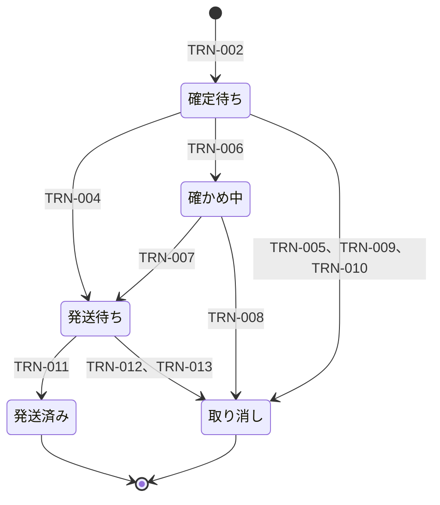
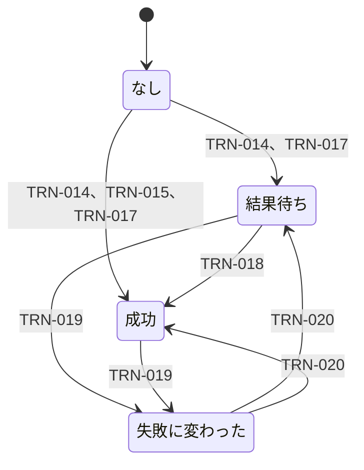

# 基本設計書

| 項目 | 内容 |
|---|---|
| 版 | v0.1 |
| 状態 | **作成中** |
| 合意の記録 | 会議の議事録に記録する。どの議事録に記録したかは、下の改訂履歴に記載する |

### 改訂履歴

| 版 | 状態 | 内容 | 合意の記録 |
|---|---|---|---|
| v0.1 | 作成中 | 「状態遷移と、決済と送金の流れ」を書いた | 議事録_2026_1121 |

この文書は、個人情報や秘密情報を含まない。

## この文書の書き方

書くものと書かないものは、開発の進め方([CONTRIBUTING.md](../CONTRIBUTING.md#工程とゲート))の「工程とゲート」のとおりにする。要件は、要件定義書([01-requirements.md](01-requirements.md))の ID で指す。

## 状態遷移と、決済と送金の流れ

### 状態の持ち方

注文の状態を1つの値にまとめず、次の5つを別々に持つ。発送済みの注文が、同時に、返金した注文で、不審請求で負けた注文であることがあるように、5つは互いに独立に変わるためである。1つの値にまとめると、組み合わせの数だけ状態が要る。

| 状態を持つもの | 状態 | 書く節 |
|---|---|---|
| 注文と支払い | 確定待ち、確かめ中、発送待ち、発送済み、取り消し | 「注文と支払い」 |
| 返金 | なし、結果待ち、成功、失敗に変わった | 「返金」 |
| 返金の申し出 | なし、開いている、閉じた | 「返金の申し出」 |
| 不審請求と照会 | なし、照会、照会が閉じた、結果待ち、勝ち、負け | 「不審請求と照会」 |
| 生産者 | 生産者の役割、Stripe の支払いの受け付け、管理者の停止、答える期限での停止の4つを、別々に持つ | 「生産者のアカウント」 |

期限や期間で決まる扱いは、状態として保存せず、記録した日時から、そのつど求める。処理が遅れて動いても、期限どおりに動いたときと同じ結果にするためである(NFR-023)。

| 求めるもの | もとにする日時 | 要件 |
|---|---|---|
| 返金の申し出のボタンが使える期間 | 「発送を知らせる」が押された日時、代金を確定した日時 | FR-079 |
| メッセージを送れる期間 | 注文、取り消し、申し出が閉じたこと、「返金しない」の答え、返金が失敗に変わったこと、不審請求と照会の結果の日時 | FR-121〜FR-123、FR-222、FR-269、FR-274 |
| 答える期限での停止 | 返金の申し出があった日時と、申し出が閉じた日時 | FR-115 |
| 生産者が退会できるか | 最後の発送と、最後の返金の日時 | FR-159、NFR-003 |
| 注文が終わった日 | 発送を知らせた日、取り消した日、返金した日、不審請求の結果が出た日 | NFR-004 |

期限がきっかけの遷移(下の表で、きっかけが「期限」のもの)は、Stripe に行う操作、在庫の増減、知らせを伴うものだけである。

### 注文と支払い

注文は、仮押さえが成功したときに作る。購入手続きの途中は、注文の状態にしない。

| 状態 | 意味 | Stripe の支払い |
|---|---|---|
| 確定待ち | 注文を受け付け、生産者が「代金を確定する」を押すのを待っている | 仮押さえ |
| 確かめ中 | 「代金を確定する」が押されたが、結果が分からず、Stripe で確かめている | 仮押さえか、確定 |
| 発送待ち | 代金を確定し、「発送を知らせる」が押されるのを待っている | 確定 |
| 発送済み | 「発送を知らせる」が押された | 確定 |
| 取り消し | 注文を取り消した。理由は、生産者の取り消し、仮押さえの期限、確定の失敗、発送の前の返金、発送の前の不審請求の負けの5つ | 仮押さえの取り消しか、確定 |

発送済みと取り消しからは、ほかの状態に変わらない。発送済みの注文の返金と不審請求は、注文の状態を変えず、「返金」と「不審請求と照会」の状態を変える。

| ID | 遷移 | きっかけ | 条件 | Stripe に行う操作 | 在庫 | 知らせ | 要件 |
|---|---|---|---|---|---|---|---|
| TRN-001 | 購入手続き → 注文なし | 購入者の「購入を確定する」 | 仮押さえに失敗した | なし | 変えない | なし(購入手続きの画面に示す) | FR-053 |
| TRN-002 | 購入手続き → 確定待ち | 購入者の「購入を確定する」 | 仮押さえに成功し、「注文を受け付ける条件」を満たし、在庫が数量以上ある | なし(仮押さえは済んでいる)。仮押さえの期限、代金、アプリケーション手数料の率と額、商品の名前と税率を、注文に記録する | 数量だけ減らす | 購入者に注文の確認、生産者に注文の知らせ | FR-026、FR-042、FR-043、FR-047、FR-049〜FR-051、FR-063、FR-124、FR-130、FR-261 |
| TRN-003 | 購入手続き → 注文なし | 購入者の「購入を確定する」 | 仮押さえに成功したが、注文にできない(TRN-002 の条件を、仮押さえのあとで満たさなくなった。注文を作る処理が終わらなかった) | 仮押さえを取り消す | 変えない | 購入者に、注文できなかった知らせ | FR-257、FR-258 |
| TRN-004 | 確定待ち → 発送待ち | 生産者の「代金を確定する」 | 確定に成功した | 仮押さえした全額で、代金を確定する。Stripe が記録した決済手数料を、注文に記録する | 変えない | なし(生産者の画面に、発送を促す表示) | FR-054、FR-055、FR-064 |
| TRN-005 | 確定待ち → 取り消し(確定の失敗) | 生産者の「代金を確定する」 | 確定に失敗した | 代金の確定(失敗)。仮押さえが残っていれば、取り消す | 数量だけ戻す | 購入者に、取り消しの知らせ(生産者の画面に、発送しないよう促す表示) | FR-011、FR-052、FR-056、FR-057、FR-128 |
| TRN-006 | 確定待ち → 確かめ中 | 生産者の「代金を確定する」 | 確定の結果が分からない | 代金の確定(結果が届かない) | 変えない | なし | FR-069 |
| TRN-007 | 確かめ中 → 発送待ち | システムが Stripe で結果を確かめた | Stripe で、確定している | なし(確かめるだけ)。決済手数料を、注文に記録する | 変えない | なし(生産者の画面に、発送を促す表示) | FR-055、FR-064、FR-069 |
| TRN-008 | 確かめ中 → 取り消し(確定の失敗) | システムが Stripe で結果を確かめた | Stripe で、確定していない | 仮押さえが残っていれば、取り消す | 数量だけ戻す | 購入者に、取り消しの知らせ(生産者の画面に、発送しないよう促す表示) | FR-052、FR-056、FR-057、FR-069、FR-128 |
| TRN-009 | 確定待ち → 取り消し(生産者の取り消し) | 生産者の取り消しの操作 | 確定待ちである | 仮押さえを取り消す | 数量だけ戻す | 購入者に、取り消しの知らせ | FR-052、FR-075、FR-076、FR-208 |
| TRN-010 | 確定待ち → 取り消し(仮押さえの期限) | 期限(仮押さえの期限) | 確定待ちのまま、期限を過ぎた | 仮押さえを取り消す(Stripe がすでに解いていれば、何もしない) | 数量だけ戻す | 購入者と生産者に、取り消しの知らせ | FR-052、FR-062、FR-129 |
| TRN-011 | 発送待ち → 発送済み | 生産者の「発送を知らせる」 | 伝票番号が入っている | なし。伝票番号を、注文に記録する | 変えない | 購入者に、発送の知らせ | FR-061、FR-070、FR-071、FR-125 |
| TRN-012 | 発送待ち → 取り消し(発送の前の返金) | 返金した注文になった(「返金」の遷移) | 発送待ちである | 「返金」の節のとおり | 数量だけ戻す | 「返金」の節のとおり | FR-052、FR-092、FR-095、FR-101 |
| TRN-013 | 発送待ち → 取り消し(発送の前の不審請求の負け) | 不審請求で負けた(「不審請求と照会」の遷移) | 発送待ちである | なし | 数量だけ戻す | 購入者に、取り消しの知らせ | FR-052、FR-265、FR-277 |

- 確かめ中の間は、生産者の取り消し(TRN-009)と、期限での取り消し(TRN-010)を行わない。確定できていた注文を取り消すと、代金を受け取ったまま注文がなくなるためである(FR-069)。確かめ中に仮押さえの期限を過ぎたときも、Stripe で確かめた結果で、TRN-007 か TRN-008 に進む。
- 確定に失敗したとき(TRN-005、TRN-008)に、仮押さえが残っていれば取り消すのは、取り消した注文の代金が、購入者のカードの利用枠に押さえられたまま残らないようにするためである(FR-128 の「代金は請求されない」)。
- 確定待ちの注文の仮押さえが、サイトの操作によらずに Stripe の側で取り消されていたときは、「代金を確定する」が押されたときの確定の失敗(TRN-005)か、仮押さえの期限(TRN-010)で、取り消しになる。
- 仮押さえの期限が近い知らせ(FR-132)と、「発送を知らせる」が押されていない知らせ(FR-133)は、状態を変えない。

### 返金

| 状態 | 意味 |
|---|---|
| なし | 返金していない |
| 結果待ち | Stripe が返金を受け付け、結果が出るのを待っている |
| 成功 | 返金が成功した(Stripe に返金を出さない0円の返金を含む) |
| 失敗に変わった | Stripe が受け付けた返金が、失敗に変わった。お金は購入者に届かず、生産者の Stripe の残高に戻る |

「なし」以外の注文が、返金した注文(FR-087)である。

| ID | 遷移 | きっかけ | 条件 | Stripe に行う操作 | 知らせ | 要件 |
|---|---|---|---|---|---|---|
| TRN-014 | なし → 結果待ちか成功 | 生産者の返金の操作 | 「返金できる条件」を満たし、返金の額が1円以上で、Stripe が返金を受け付けた | 返金を作る(アプリケーション手数料の返金は指示しない) | 購入者に、返金の額 | FR-077、FR-084、FR-086、FR-087、FR-089〜FR-091、FR-093、FR-094、FR-103、FR-104、FR-111、FR-126 |
| TRN-015 | なし → 成功 | 生産者の返金の操作 | 「返金できる条件」を満たし、区分が購入者の都合で、求めた額が0円以下である | なし | 購入者に、返金の額(0円) | FR-092、FR-111、FR-126 |
| TRN-016 | なし → なし | 生産者の返金の操作 | Stripe が返金を受け付けなかった | 返金を作る(受け付けられない) | なし(生産者の画面に示し、やり直せる) | FR-011、FR-087、FR-088 |
| TRN-017 | なし → 結果待ちか成功 | Stripe の知らせ(サイトの操作によらずに、Stripe の側で行われた返金) | 返金の状態が「なし」である | なし | 購入者と生産者に、返金の額 | FR-095、FR-111、FR-126、FR-264 |
| TRN-018 | 結果待ち → 成功 | Stripe の知らせ(返金の成功) | — | なし | なし | FR-095 |
| TRN-019 | 結果待ちか成功 → 失敗に変わった | Stripe の知らせ(返金の失敗。Stripe の側での返金の取り消しを含む) | — | なし | 購入者と生産者に、返金が届かなかった知らせ | FR-088、FR-095、FR-268、FR-269 |
| TRN-020 | 失敗に変わった → 結果待ちか成功 | 生産者の、返金のやり直しの操作 | 不審請求の状態が、結果待ちでも負けでもなく、Stripe が返金を受け付けた。額は、失敗に変わった返金と同じ | 同じ額の返金を作る | 購入者に、返金の額 | FR-088、FR-100、FR-126 |
| TRN-021 | 失敗に変わった → 失敗に変わった | 生産者の、返金のやり直しの操作 | Stripe が返金を受け付けなかった | 返金を作る(受け付けられない) | なし(生産者の画面に示し、やり直せる) | FR-088 |

返金できる条件(TRN-014、TRN-015):

- 代金を確定した注文である(発送待ち、発送済み、発送の前の不審請求の負けで取り消した注文)(FR-084)。
- 返金の状態が「なし」である(FR-087)。
- 不審請求の状態が、結果待ちでも負けでもない(FR-100)。照会は、返金を妨げない(FR-270)。
- 返金の申し出の期限、生産者の停止、Stripe の支払いの受け付けが無効であることは、返金を妨げない(FR-011、FR-018、FR-086)。

返金した注文になったとき(TRN-014、TRN-015、TRN-017)に、あわせて行うこと:

- 注文が発送待ちなら、取り消しにする(TRN-012)。
- 開いている返金の申し出を閉じる(「返金の申し出」の節)。
- 返金を、注文に記録する(FR-111)。返金した日は、Stripe が返金を受け付けた日とする。0円の返金(TRN-015)は、生産者が退会できるまでの期間(FR-159)に数えない。

失敗に変わったとき(TRN-019)は、注文の状態、戻した在庫、閉じた返金の申し出を、元に戻さない(FR-088)。

- 結果待ちの間に、その支払いに不審請求が起きると、Stripe は、その返金を失敗にする(Stripe の公式ページ「Refund and cancel payments」)。このときは TRN-019 になり、やり直し(TRN-020)は、不審請求で勝つまでできない(FR-100)。
- 返金した注文に、Stripe の側でさらに返金が行われたときは、返金の状態を変えず、注文の記録に反映する(FR-095)。
