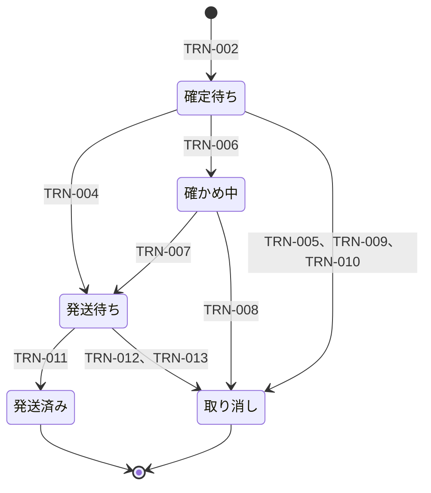
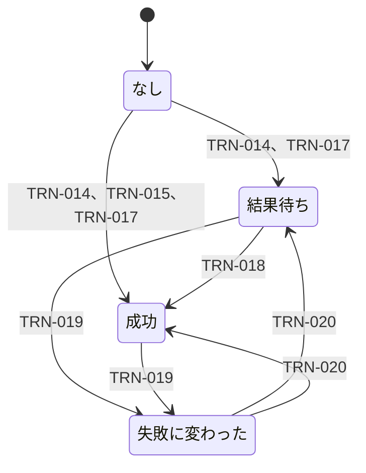
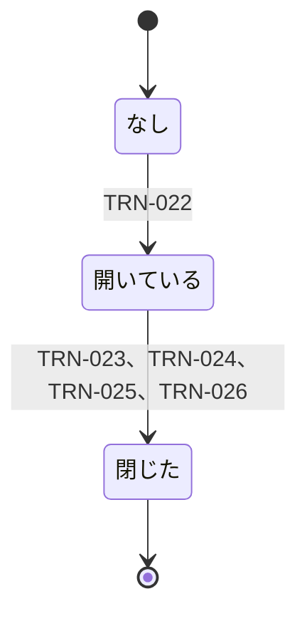
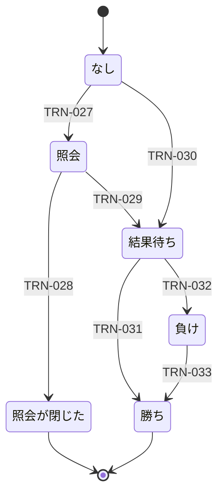
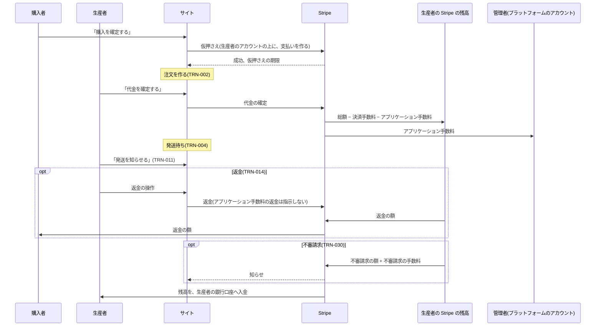

# 基本設計書

| 項目 | 内容 |
|---|---|
| 版 | v0.1 |
| 状態 | **作成中** |
| 合意の記録 | 会議の議事録に記録する。どの議事録に記録したかは、下の改訂履歴に記載する |

### 改訂履歴

| 版 | 状態 | 内容 | 合意の記録 |
|---|---|---|---|
| v0.1 | 作成中 | 「状態遷移と、決済と送金の流れ」を書いた | 議事録_2026_1121 |

この文書は、個人情報や秘密情報を含まない。

## この文書の書き方

書くものと書かないものは、開発の進め方([CONTRIBUTING.md](../CONTRIBUTING.md#工程とゲート))の「工程とゲート」のとおりにする。要件は、要件定義書([01-requirements.md](01-requirements.md))の ID で指す。

## 状態遷移と、決済と送金の流れ

### 状態の持ち方

注文の状態を1つの値にまとめず、次の5つを別々に持つ。発送済みの注文が、同時に、返金した注文で、不審請求で負けた注文であることがあるように、5つは互いに独立に変わるためである。1つの値にまとめると、組み合わせの数だけ状態が要る。

| 状態を持つもの | 状態 | 書く節 |
|---|---|---|
| 注文と支払い | 確定待ち、確かめ中、発送待ち、発送済み、取り消し | 「注文と支払い」 |
| 返金 | なし、結果待ち、成功、失敗に変わった | 「返金」 |
| 返金の申し出 | なし、開いている、閉じた | 「返金の申し出」 |
| 不審請求と照会 | なし、照会、照会が閉じた、結果待ち、勝ち、負け | 「不審請求と照会」 |
| 生産者 | 生産者の役割、Stripe の支払いの受け付け、管理者の停止、答える期限での停止の4つを、別々に持つ | 「生産者のアカウント」 |

期限や期間で決まる扱いは、状態として保存せず、記録した日時から、そのつど求める。処理が遅れて動いても、期限どおりに動いたときと同じ結果にするためである(NFR-023)。

| 求めるもの | もとにする日時 | 要件 |
|---|---|---|
| 返金の申し出のボタンが使える期間 | 「発送を知らせる」が押された日時、代金を確定した日時 | FR-079 |
| メッセージを送れる期間 | 注文、取り消し、申し出が閉じたこと、「返金しない」の答え、返金が失敗に変わったこと、不審請求と照会の結果の日時 | FR-121〜FR-123、FR-222、FR-269、FR-274 |
| 答える期限での停止 | 返金の申し出があった日時と、申し出が閉じた日時 | FR-115 |
| 生産者が退会できるか | 最後の発送と、最後の返金の日時 | FR-159、NFR-003 |
| 注文が終わった日 | 発送を知らせた日、取り消した日、返金した日、不審請求の結果が出た日 | NFR-004 |

期限がきっかけの遷移(下の表で、きっかけが「期限」のもの)は、Stripe に行う操作、在庫の増減、知らせを伴うものだけである。

### 注文と支払い

注文は、仮押さえが成功したときに作る。購入手続きの途中は、注文の状態にしない。

| 状態 | 意味 | Stripe の支払い |
|---|---|---|
| 確定待ち | 注文を受け付け、生産者が「代金を確定する」を押すのを待っている | 仮押さえ |
| 確かめ中 | 「代金を確定する」が押されたが、結果が分からず、Stripe で確かめている | 仮押さえか、確定 |
| 発送待ち | 代金を確定し、「発送を知らせる」が押されるのを待っている | 確定 |
| 発送済み | 「発送を知らせる」が押された | 確定 |
| 取り消し | 注文を取り消した。理由は、生産者の取り消し、仮押さえの期限、確定の失敗、発送の前の返金、発送の前の不審請求の負けの5つ | 仮押さえの取り消しか、確定 |

発送済みと取り消しからは、ほかの状態に変わらない。発送済みの注文の返金と不審請求は、注文の状態を変えず、「返金」と「不審請求と照会」の状態を変える。

| ID | 遷移 | きっかけ | 条件 | Stripe に行う操作 | 在庫 | 知らせ | 要件 |
|---|---|---|---|---|---|---|---|
| TRN-001 | 購入手続き → 注文なし | 購入者の「購入を確定する」 | 仮押さえに失敗した | なし | 変えない | なし(購入手続きの画面に示す) | FR-053 |
| TRN-002 | 購入手続き → 確定待ち | 購入者の「購入を確定する」 | 仮押さえに成功し、「注文を受け付ける条件」を満たし、在庫が数量以上ある | なし(仮押さえは済んでいる)。仮押さえの期限、代金、アプリケーション手数料の率と額、商品の名前と税率を、注文に記録する | 数量だけ減らす | 購入者に注文の確認、生産者に注文の知らせ | FR-006、FR-026、FR-042、FR-043、FR-047、FR-049〜FR-051、FR-063、FR-124、FR-130、FR-261 |
| TRN-003 | 購入手続き → 注文なし | 購入者の「購入を確定する」 | 仮押さえに成功したが、注文にできない(TRN-002 の条件を、仮押さえのあとで満たさなくなった。注文を作る処理が終わらなかった) | 仮押さえを取り消す | 変えない | 購入者に、注文できなかった知らせ | FR-257、FR-258 |
| TRN-004 | 確定待ち → 発送待ち | 生産者の「代金を確定する」 | 確定に成功した | 仮押さえした全額で、代金を確定する。Stripe が記録した決済手数料を、注文に記録する | 変えない | なし(生産者の画面に、発送を促す表示) | FR-054、FR-055、FR-064 |
| TRN-005 | 確定待ち → 取り消し(確定の失敗) | 生産者の「代金を確定する」 | 確定に失敗した | 代金の確定(失敗)。仮押さえが残っていれば、取り消す | 数量だけ戻す | 購入者に、取り消しの知らせ(生産者の画面に、発送しないよう促す表示) | FR-011、FR-052、FR-056、FR-057、FR-128 |
| TRN-006 | 確定待ち → 確かめ中 | 生産者の「代金を確定する」 | 確定の結果が分からない | 代金の確定(結果が届かない) | 変えない | なし | FR-069 |
| TRN-007 | 確かめ中 → 発送待ち | システムが Stripe で結果を確かめた | Stripe で、確定している | なし(確かめるだけ)。決済手数料を、注文に記録する | 変えない | なし(生産者の画面に、発送を促す表示) | FR-055、FR-064、FR-069 |
| TRN-008 | 確かめ中 → 取り消し(確定の失敗) | システムが Stripe で結果を確かめた | Stripe で、確定していない | 仮押さえが残っていれば、取り消す | 数量だけ戻す | 購入者に、取り消しの知らせ(生産者の画面に、発送しないよう促す表示) | FR-052、FR-056、FR-057、FR-069、FR-128 |
| TRN-009 | 確定待ち → 取り消し(生産者の取り消し) | 生産者の取り消しの操作 | 確定待ちである | 仮押さえを取り消す | 数量だけ戻す | 購入者に、取り消しの知らせ | FR-052、FR-072、FR-075、FR-076、FR-208 |
| TRN-010 | 確定待ち → 取り消し(仮押さえの期限) | 期限(仮押さえの期限) | 確定待ちのまま、期限を過ぎた | 仮押さえを取り消す(Stripe がすでに解いていれば、何もしない) | 数量だけ戻す | 購入者と生産者に、取り消しの知らせ | FR-052、FR-062、FR-129 |
| TRN-011 | 発送待ち → 発送済み | 生産者の「発送を知らせる」 | 伝票番号が入っている | なし。伝票番号を、注文に記録する | 変えない | 購入者に、発送の知らせ | FR-061、FR-070、FR-071、FR-125 |
| TRN-012 | 発送待ち → 取り消し(発送の前の返金) | 返金した注文になった(「返金」の遷移) | 発送待ちである | 「返金」の節のとおり | 数量だけ戻す | 「返金」の節のとおり | FR-052、FR-092、FR-095、FR-101 |
| TRN-013 | 発送待ち → 取り消し(発送の前の不審請求の負け) | 不審請求で負けた(「不審請求と照会」の遷移) | 発送待ちである | なし | 数量だけ戻す | 購入者に、取り消しの知らせ | FR-052、FR-265、FR-277 |

- 確かめ中の間は、生産者の取り消し(TRN-009)と、期限での取り消し(TRN-010)を行わない。確定できていた注文を取り消すと、代金を受け取ったまま注文がなくなるためである(FR-069)。確かめ中に仮押さえの期限を過ぎたときも、Stripe で確かめた結果で、TRN-007 か TRN-008 に進む。
- 確定に失敗したとき(TRN-005、TRN-008)に、仮押さえが残っていれば取り消すのは、取り消した注文の代金が、購入者のカードの利用枠に押さえられたまま残らないようにするためである(FR-128 の「代金は請求されない」)。
- 確定待ちの注文の仮押さえが、サイトの操作によらずに Stripe の側で取り消されていたときは、「代金を確定する」が押されたときの確定の失敗(TRN-005)か、仮押さえの期限(TRN-010)で、取り消しになる。
- 仮押さえの期限が近い知らせ(FR-132)と、「発送を知らせる」が押されていない知らせ(FR-133)は、状態を変えない。
- 購入者が注文を取り消す遷移はない(FR-072)。購入者は、取り消しをメッセージで生産者に頼み(FR-073)、生産者が、取り消す(TRN-009)か、返金する(TRN-012)。購入者の会員の退会は、進んでいる注文を変えない(FR-158)。

### 返金

| 状態 | 意味 |
|---|---|
| なし | 返金していない |
| 結果待ち | Stripe が返金を受け付け、結果が出るのを待っている |
| 成功 | 返金が成功した(Stripe に返金を出さない0円の返金を含む) |
| 失敗に変わった | Stripe が受け付けた返金が、失敗に変わった。お金は購入者に届かず、生産者の Stripe の残高に戻る |

「なし」以外の注文が、返金した注文(FR-087)である。

| ID | 遷移 | きっかけ | 条件 | Stripe に行う操作 | 知らせ | 要件 |
|---|---|---|---|---|---|---|
| TRN-014 | なし → 結果待ちか成功 | 生産者の返金の操作 | 「返金できる条件」を満たし、返金の額が1円以上で、Stripe が返金を受け付けた | 返金を作る(アプリケーション手数料の返金は指示しない) | 購入者に、返金の額 | FR-077、FR-084、FR-086、FR-087、FR-089〜FR-091、FR-093、FR-094、FR-103、FR-104、FR-111、FR-126 |
| TRN-015 | なし → 成功 | 生産者の返金の操作 | 「返金できる条件」を満たし、区分が購入者の都合で、求めた額が0円以下である | なし | 購入者に、返金の額(0円) | FR-092、FR-111、FR-126 |
| TRN-016 | なし → なし | 生産者の返金の操作 | Stripe が返金を受け付けなかった | 返金を作る(受け付けられない) | なし(生産者の画面に示し、やり直せる) | FR-011、FR-087、FR-088 |
| TRN-017 | なし → 結果待ちか成功 | Stripe の知らせ(サイトの操作によらずに、Stripe の側で行われた返金) | 返金の状態が「なし」である | なし | 購入者と生産者に、返金の額 | FR-095、FR-111、FR-126、FR-264 |
| TRN-018 | 結果待ち → 成功 | Stripe の知らせ(返金の成功) | — | なし | なし | FR-095 |
| TRN-019 | 結果待ちか成功 → 失敗に変わった | Stripe の知らせ(返金の失敗。Stripe の側での返金の取り消しを含む) | — | なし | 購入者と生産者に、返金が届かなかった知らせ | FR-088、FR-095、FR-268、FR-269 |
| TRN-020 | 失敗に変わった → 結果待ちか成功 | 生産者の、返金のやり直しの操作 | 不審請求の状態が、結果待ちでも負けでもなく、Stripe が返金を受け付けた。額は、失敗に変わった返金と同じ | 同じ額の返金を作る | 購入者に、返金の額 | FR-088、FR-100、FR-126 |
| TRN-021 | 失敗に変わった → 失敗に変わった | 生産者の、返金のやり直しの操作 | Stripe が返金を受け付けなかった | 返金を作る(受け付けられない) | なし(生産者の画面に示し、やり直せる) | FR-088 |

返金できる条件(TRN-014、TRN-015):

- 代金を確定した注文である(発送待ち、発送済み、発送の前の不審請求の負けで取り消した注文)(FR-084)。
- 返金の状態が「なし」である(FR-087)。
- 不審請求の状態が、結果待ちでも負けでもない(FR-100)。照会は、返金を妨げない(FR-270)。
- 返金の申し出の期限、生産者の停止、Stripe の支払いの受け付けが無効であることは、返金を妨げない(FR-011、FR-018、FR-086)。

返金した注文になったとき(TRN-014、TRN-015、TRN-017)に、あわせて行うこと:

- 注文が発送待ちなら、取り消しにする(TRN-012)。
- 開いている返金の申し出を閉じる(「返金の申し出」の節)。
- 返金を、注文に記録する(FR-111)。返金した日は、Stripe が返金を受け付けた日とする。0円の返金(TRN-015)は、生産者が退会できるまでの期間(FR-159)に数えない。

失敗に変わったとき(TRN-019)は、注文の状態、戻した在庫、閉じた返金の申し出を、元に戻さない(FR-088)。

- 結果待ちの間に、その支払いに不審請求が起きると、Stripe は、その返金を失敗にする(Stripe の公式ページ「Refund and cancel payments」)。このときは TRN-019 になり、やり直し(TRN-020)は、不審請求で勝つまでできない(FR-100)。
- 返金した注文に、Stripe の側でさらに返金が行われたときは、返金の状態を変えず、注文の記録に反映する(FR-095)。

### 返金の申し出

| 状態 | 意味 |
|---|---|
| なし | 申し出がない |
| 開いている | 購入者が申し出て、まだ閉じていない |
| 閉じた | 申し出が終わった。理由は、返金、「返金しない」の答え、購入者の取り下げ、不審請求の4つ |

申し出は、1つの注文に1回だけである(FR-080)。閉じた申し出は、開いている状態に戻らず、閉じた注文では、もう一度申し出られない。

| ID | 遷移 | きっかけ | 条件 | 知らせ | 要件 |
|---|---|---|---|---|---|
| TRN-022 | なし → 開いている | 購入者の申し出 | 「申し出られる条件」を満たし、理由を選んでいる。理由が「商品の不具合」なら、写真が付いている | 生産者に、申し出の知らせ | FR-078〜FR-083、FR-131 |
| TRN-023 | 開いている → 閉じた(返金) | 返金した注文になった(TRN-014、TRN-015、TRN-017) | — | 「返金」の節のとおり | FR-114 |
| TRN-024 | 開いている → 閉じた(「返金しない」の答え) | 生産者の「返金しない」の答え | 理由が入っている | なし(理由を、生産者のメッセージとして注文に残す。購入者には、メッセージの知らせで届く) | FR-113、FR-114、FR-127、FR-275 |
| TRN-025 | 開いている → 閉じた(購入者の取り下げ) | 購入者の取り下げの操作 | — | 生産者に、取り下げの知らせ | FR-102、FR-114、FR-262 |
| TRN-026 | 開いている → 閉じた(不審請求) | その注文に不審請求が起きた(照会が不審請求に進んだときを含む。照会だけでは閉じない) | — | 購入者に、申し出を閉じたことと理由 | FR-096、FR-114、FR-270〜FR-272 |

どの遷移も、Stripe に行う操作と、在庫の増減はない。申し出を受けても、返金は自動では行わない(FR-081)。

申し出られる条件(TRN-022):

- 申し出のボタンが使える期間である。期間は、「発送を知らせる」が押された時点と、代金を確定してから48時間たった時点の、早いほうで始まり、その日の翌日から数えて14日目の日本時間23時59分(申し出の期限)で終わる(FR-079)。
- 返金の状態が「なし」である(FR-079)。
- 不審請求の状態が、なし、照会、照会が閉じた、のどれかである。不審請求が起きた注文では、結果が出たあとも申し出られない(FR-079、FR-270)。
- 返金の申し出の状態が「なし」である(FR-080)。

閉じたあとも、生産者は、「返金できる条件」(「返金」の節)を満たせば返金できる(FR-086)。「返金しない」と答えたあとと、取り下げられたあとも同じである。

答える期限:

- 答える期限は、申し出があった日の翌日から数えて14日目の日本時間23時59分である(FR-115)。
- 答える期限を過ぎても開いている申し出が、その生産者に1つでもある間、その生産者は、答える期限で停止されている。停止は状態として保存せず、申し出の日時と、閉じた日時から求める(「状態の持ち方」)。停止と解除で行う知らせと記録は、「生産者のアカウント」の節に書く。

メッセージを送れる期間:

次のどれかに当たる間、購入者と生産者は、その注文のメッセージを送れる。どれにも当たらなくなると、履歴を見るだけになる。

| ID | 当たる間 | もとにする状態と日時 | 要件 |
|---|---|---|---|
| TRN-050 | 注文が取り消しでなく、申し出の期限を過ぎていない(申し出の期限がまだ決まっていない間を含む) | 注文の状態、「発送を知らせる」が押された日時、代金を確定した日時 | FR-121 |
| TRN-051 | 注文が取り消しで、取り消した日の翌日から数えて14日目の日本時間23時59分を過ぎていない | 注文の状態、取り消した日時 | FR-123 |
| TRN-052 | 返金の申し出が開いている | 返金の申し出の状態 | FR-122 |
| TRN-053 | 「返金しない」と答えた日の翌日から数えて14日目の日本時間23時59分を過ぎていない | 返金の申し出の状態(閉じた理由)、答えた日時 | FR-222 |
| TRN-054 | 返金が失敗に変わった日の翌日から数えて14日目の日本時間23時59分を過ぎていない(生産者の役割が外れた生産者の注文を除く) | 返金の状態、失敗に変わった日時 | FR-269 |
| TRN-055 | 不審請求か照会が起きていて、結果が出ていない(生産者の役割が外れた生産者の注文を除く) | 不審請求と照会の状態 | FR-274 |

### 不審請求と照会

| 状態 | 意味 |
|---|---|
| なし | 不審請求も照会も起きていない |
| 照会 | カード会社が、不審請求の前に、支払いについて説明を求めている |
| 照会が閉じた | 照会が、不審請求に進まずに閉じた(勝ちでも負けでもない結果) |
| 結果待ち | 不審請求が起き、結果が出ていない |
| 勝ち | 不審請求で勝った |
| 負け | 不審請求で負けた |

状態は、不審請求(照会を含む)ごとに持つ。1つの支払いに、2つ以上の不審請求が起きることが、まれにある(Stripe の公式ページ「How disputes work」)。ほかの節の条件は、次のように読む。

- 「不審請求の状態が、結果待ちでも負けでもない」(「返金」の節)は、その注文のどの不審請求も、結果待ちでも負けでもないことをいう。
- 「不審請求が起きた注文」(「返金の申し出」の節)は、照会を除く不審請求が、1つでも起きた注文をいう。
- 「不審請求か照会が起きていて、結果が出ていない」(「返金の申し出」の節)は、照会か結果待ちの状態のものが、1つでもあることをいう。

きっかけは、どの遷移も、生産者の Stripe のアカウントからの Stripe の知らせである。サイトが Stripe に行う操作は、証拠を出すことだけである。

| ID | 遷移 | きっかけ | あわせて行うこと | 知らせ | 要件 |
|---|---|---|---|---|---|
| TRN-027 | なし → 照会 | 照会が起きた | 注文に記録する。証拠を出す期限を記録する | 生産者と管理者に、照会が起きた知らせ | FR-096、FR-097、FR-136、FR-238、FR-266、FR-270 |
| TRN-028 | 照会 → 照会が閉じた | 照会が、不審請求に進まずに閉じた | 注文に記録する | 生産者に、結果 | FR-099、FR-242、FR-267、FR-271 |
| TRN-029 | 照会 → 結果待ち | 照会が、不審請求に進んだ | 注文に記録する。証拠を出す期限を記録し直す。開いている返金の申し出を閉じる(TRN-026) | 生産者と管理者に、不審請求が起きた知らせ | FR-096、FR-097、FR-136、FR-238、FR-266、FR-271 |
| TRN-030 | なし → 結果待ち | 不審請求が起きた | 注文に記録する。証拠を出す期限を記録する。開いている返金の申し出を閉じる(TRN-026) | 生産者と管理者に、不審請求が起きた知らせ | FR-096、FR-097、FR-136、FR-238、FR-266 |
| TRN-031 | 結果待ち → 勝ち | 不審請求で勝った | 注文に記録する。返金できる状態に戻る | 生産者に、結果 | FR-099、FR-100、FR-242、FR-267 |
| TRN-032 | 結果待ち → 負け | 不審請求で負けた(証拠を出して負けた、争わずに負けを認めた、証拠を出す期限を過ぎた、のどれも同じ) | 注文に記録する。注文が発送待ちなら、取り消しにする(TRN-013) | 生産者に、結果 | FR-099、FR-100、FR-242、FR-265、FR-267 |
| TRN-033 | 負け → 勝ち | 負けた不審請求が、あとで勝ちに変わった | 注文に記録する。返金できる状態に戻る。TRN-013 で取り消した注文は、取り消しのままとし、在庫を変えない | 生産者に、結果。TRN-013 で取り消した注文では、注文は取り消してあることと、商品を送っていなければ返金することを入れる | FR-099、FR-100、FR-242、FR-267 |

- 生産者の役割が外れた生産者には、不審請求と照会が起きた知らせを、証拠を出すページへのリンクを入れて、登録したメールアドレスに送り(FR-238)、結果も、登録したメールアドレスに知らせる(FR-242)。
- 証拠を出すこと(FR-098、FR-239)は、状態を変えない。照会か結果待ちの間で、証拠を出す期限を過ぎていないときに限り、受け付ける(FR-241、FR-266)。
- 照会の間は、返金と返金の申し出の扱いを変えない(FR-270)。照会の間にお金は動かず、不審請求に進んだとき(TRN-029)に、額と不審請求の手数料が、生産者の残高から引かれる(「決済と送金の流れ」の節)。
- 照会は、不審請求に進まないまま120日たつと、Stripe が閉じる(Stripe の公式ページ「How disputes work」)。それまでは、照会の状態が続く。
- カード会社が証拠を受け付けない不審請求は、起きたときに、すでに負けで閉じている(同じ公式ページ)。このときは、TRN-030 に続けて TRN-032 を行う。
- 負けた不審請求が勝ちに変わること(TRN-033)は、カード会社が、通常の流れの外でお金を動かしたときに、まれに起きる(同じ公式ページ)。返金するかどうかは、ほかの返金と同じく、生産者が決める(FR-084)。システムは、自動では返金しない。「発送を知らせる」を押し忘れたまま、商品を送っている場合があるためである。

### 生産者のアカウント

生産者について、次の4つを別々に持つ。互いに独立に変わるためである。

| 持つもの | 値 | 変えるもの |
|---|---|---|
| 生産者の役割 | なし、あり、外れた | 本人の同意、本人の退会 |
| Stripe の支払いの受け付け | 無効、有効 | Stripe の知らせ |
| 管理者の停止 | なし、あり | 管理者の操作 |
| 答える期限での停止 | なし、あり | 答える期限と、返金の申し出が閉じること(保存せずに求める。「返金の申し出」の節) |

管理者の停止か、答える期限での停止の、どちらかが「あり」の間、その生産者は停止されている(FR-115)。2つの停止は、互いを変えない。生産者の役割が付いたときは、Stripe の支払いの受け付けは無効、2つの停止は「なし」である。

| ID | 持つもの | 遷移 | きっかけ | 条件 | Stripe に行う操作 | あわせて行うこと | 知らせ | 要件 |
|---|---|---|---|---|---|---|---|---|
| TRN-034 | 生産者の役割 | なし → あり | 招待された本人の、生産者向けの利用規約への同意 | 招待が使える(期限の前で、取り消されておらず、まだ使われていない)。招待されたメールアドレスが、管理者のアカウントのものでない | 生産者の Stripe のアカウントを作る(設定は ADR-0009) | 会員のアカウントがなければ作る。その会員のログインの状態を、すべて終わらせる | なし | FR-002、FR-003、FR-005、FR-007〜FR-009、FR-206、FR-217、FR-218、FR-233、FR-243、FR-253、FR-255 |
| TRN-035 | Stripe の支払いの受け付け | 無効 → 有効 | Stripe の知らせ(生産者のアカウントの状態が変わった) | Stripe から取得したアカウントの状態で、支払いの受け付けが有効である | なし(状態を取得するだけ) | なし | なし | FR-010、FR-011 |
| TRN-036 | Stripe の支払いの受け付け | 有効 → 無効 | Stripe の知らせ(生産者のアカウントの状態が変わった) | Stripe から取得したアカウントの状態で、支払いの受け付けが無効である | なし(状態を取得するだけ) | なし | 生産者に、受け付けが止まった知らせ(情報を出す期限があれば、期限とともに) | FR-011、FR-260 |
| TRN-037 | 管理者の停止 | なし → あり | 管理者の停止の操作 | 理由が入っている | なし | 操作した管理者、日時、理由を記録する | 生産者に、理由とともに知らせる | FR-018、FR-209、FR-214、FR-215 |
| TRN-038 | 管理者の停止 | あり → なし | 管理者の、停止を解く操作 | 理由が入っている | なし | 操作した管理者、日時、理由を記録する | 生産者に、理由と、答える期限での停止が残っていれば、まだ停止されていることを知らせる(生産者の役割が外れた生産者には知らせない) | FR-019、FR-214、FR-215、FR-223 |
| TRN-039 | 答える期限での停止 | なし → あり | 期限(答える期限) | 答える期限を過ぎても、返金の申し出が開いている | なし | どの申し出で停止したかを記録する。管理者の画面に、まだ確かめていないものとして示す | 生産者に、停止のもとになった申し出の注文とともに知らせる。購入者に、期限までに答えがなかったことを知らせる | FR-115、FR-135〜FR-138、FR-276 |
| TRN-040 | 答える期限での停止 | あり → なし | 返金の申し出が閉じた(TRN-023〜TRN-026) | 答える期限を過ぎて開いている申し出が、その生産者に1つもなくなった | なし | 停止が解けた日時を記録する | 生産者に、この停止が解けたことと、管理者の停止が残っていれば、まだ停止されていることを知らせる | FR-115、FR-137、FR-273 |
| TRN-041 | 生産者の役割 | あり → 外れた | 本人の退会の操作 | 「退会できる条件」を満たす | なし(Stripe のアカウントは閉じない) | そのアカウントでログインできないようにする。その時点の特定商取引法に基づく表記を、注文に残す | なし | FR-159〜FR-161、FR-166、FR-237、NFR-003、NFR-008 |

- 生産者の役割を付けたのに、Stripe のアカウントを作る処理が終わらなかったときは、作る処理をやり直す。Stripe のアカウントができるまで、支払いの受け付けは無効のままで、その生産者の商品は注文できないため(「注文を受け付ける条件」の節)、お金は動かない。
- Stripe が生産者に情報を求めているときと、入金を止めたときは、状態を変えず、生産者に知らせる(FR-260)。
- すでに答える期限で停止されている生産者で、別の申し出が答える期限を過ぎたときは、状態は変わらないが、その申し出について、TRN-039 と同じ記録と知らせを行う。停止が解けるには、その申し出も閉じる必要があるためである。
- 管理者は、答える期限での停止を解けない(FR-019)。

退会できる条件(TRN-041。FR-159):

| 条件 | もとにする状態と日時 |
|---|---|
| 発送も取り消しもしていない注文がない | 注文の状態が、確定待ち、確かめ中、発送待ちの注文がない |
| 閉じていない返金の申し出がない | 返金の申し出の状態が「開いている」の注文がない |
| 結果が出ていない不審請求がない | 不審請求の状態が「結果待ち」のものがない |
| メッセージを送れる期間が終わっていない注文がない | 「返金の申し出」の節の「メッセージを送れる期間」の表の、どれにも当たらない(照会の間は、退会できない) |
| 最後の発送からの期間がたった | 最後に「発送を知らせる」が押された日時(NFR-003) |
| 最後の返金からの期間がたった | 最後に Stripe が返金を受け付けた日時 |

生産者の役割が外れたあと:

| 項目 | 扱い | 要件、ADR |
|---|---|---|
| その生産者の商品 | 商品の一覧に出さず、商品ページと生産者のページを開けないようにする。注文を受け付けない | FR-163、FR-165 |
| 新しい支払い | 作らない。支払いを作るのはサイトだけのため、Stripe の側で止める操作は行わない | FR-165 |
| Stripe の部品を使う許可 | 出さない | ADR-0009 |
| Stripe の知らせ | 受け続け、不審請求、Stripe の側で行われた返金、返金の失敗を、役割がある生産者と同じ遷移で処理する。知らせは、登録したメールアドレスに送る | FR-238〜FR-242、FR-264、FR-268 |
| Stripe の残高の入金 | Stripe が、登録済みの銀行口座へ続ける。サイトは操作しない | FR-237 |
| Stripe のアカウントを閉じる操作 | 作らない | FR-237 |
| 同じ人が、もう一度生産者になるとき | 新しい会員のアカウントに、新しい Stripe のアカウントを作る | FR-005、FR-206 |
| 管理者の停止 | 役割が外れても、値は変えない。管理者は解けるが、生産者には知らせない | FR-223 |

### 注文を受け付ける条件

システムは、次のすべてを満たすときに限り、注文を受け付ける(TRN-002)。

- 生産者の役割が「あり」で、Stripe の支払いの受け付けが有効で、管理者の停止も、答える期限での停止も「なし」である。
- 商品が、出品されていて、生産者が販売を止めておらず、管理者が非公開にしていない。
- 在庫が数量以上あり、数量が、その商品の数量の上限以下である(FR-026、FR-050)。

条件は、購入者が「購入を確定する」を押したあと、注文を作る時点で確かめる。商品ページを開いたあとで条件を満たさなくなったときは、仮押さえの前なら購入手続きの画面に示し、仮押さえのあとなら、注文にせずに仮押さえを取り消す(TRN-003)。

条件を満たさない状態ごとの扱いは、次のとおりである。どの状態も、すでにある注文を変えない。

| ID | 状態 | 新しい出品 | 注文の受け付け | 商品の表示 | すでにある注文 | その状態になったときの知らせ | 要件 |
|---|---|---|---|---|---|---|---|
| TRN-042 | 生産者: Stripe の支払いの受け付けが無効 | できる | 受け付けない | 商品の一覧と商品ページに出し、商品ページに「販売停止中」と表示する | 対応を続けられる。Stripe が代金の確定か返金を受け付けなかったときは、TRN-005、TRN-016 になる | 有効から無効に変わったとき、生産者に知らせる(TRN-036) | FR-011、FR-034、FR-035、FR-260 |
| TRN-043 | 生産者: 管理者の停止 | できない | 受け付けない | 商品の一覧と商品ページに出し、商品ページに「販売停止中」と表示する | 対応を続けられる | 生産者に、理由とともに知らせる(TRN-037) | FR-018、FR-034、FR-035、FR-209 |
| TRN-044 | 生産者: 答える期限での停止 | できない | 受け付けない | 商品の一覧と商品ページに出し、商品ページに「販売停止中」と表示する | 対応を続けられる | 生産者と購入者に知らせ、管理者の画面に示す(TRN-039) | FR-018、FR-034、FR-035、FR-115、FR-135、FR-136、FR-276 |
| TRN-045 | 生産者: 生産者の役割が外れた | できない(ログインできない) | 受け付けない | 商品の一覧に出さず、商品ページと生産者のページを開けない | 「生産者のアカウント」の節の「生産者の役割が外れたあと」のとおり | なし | FR-161、FR-163、FR-165 |
| TRN-046 | 商品: 出品の条件が足りない(箱のサイズ、数量の上限、発送元の都道府県、消費税の税率のどれかがない) | —(出品できない) | 受け付けない | 出さない | — | なし | FR-036 |
| TRN-047 | 商品: 生産者が販売を止めた | — | 受け付けない | 商品の一覧と商品ページに出し、商品ページに「販売停止中」と表示する | 変えない | なし | FR-033〜FR-035、FR-216 |
| TRN-048 | 商品: 管理者が非公開にした | —(生産者は、その商品を更新できる) | 受け付けない | 商品の一覧に出さず、商品ページを開けない | 変えない | 生産者に、理由とともに知らせる | FR-177〜FR-184、FR-203、FR-221、FR-224 |
| TRN-049 | 商品: 在庫が0 | — | 受け付けない | 商品の一覧と商品ページに出し、商品ページに「在庫切れ」と表示する | 変えない | なし | FR-034、FR-035、FR-050 |

- 2つ以上の状態が重なるときの商品の表示は、出さない(TRN-045、TRN-046、TRN-048)、「販売停止中」(TRN-042〜TRN-044、TRN-047)、「在庫切れ」(TRN-049)の順に、先に当たるものにする(FR-034 の「それ以外で在庫が0」)。
- 状態を解いたときは、解いた状態だけがなくなり、重なっているほかの状態は残る。非公開を解けるのは管理者だけで、理由を入れて解き、解いたことを記録し、生産者に理由とともに知らせる(FR-184、FR-203、FR-221、FR-224)。管理者が非公開を解いても、生産者の役割が外れた生産者の商品は公開に戻らず、非公開の間に生産者が変えた中身(販売を止めたかどうか、在庫を含む)は、変えたあとのままである(FR-183)。
- 停止されている生産者は、新しい出品はできないが、すでにある商品の更新、すでにある注文の対応、会員としての買い物はできる(FR-018)。
- 「対応を続けられる」は、代金の確定、発送、メッセージ、返金、返金の申し出への答え、不審請求の証拠を出すことをいう(FR-011、FR-018)。

### 決済と送金の流れ

お金は、状態が変わるときにだけ動く。場面ごとに、だれのお金がどう動くかを、遷移の ID で示す。

- 支払いは、生産者の Stripe のアカウントの上に作る(ダイレクト支払い。FR-006、ADR-0004)。代金は、管理者(プラットフォームのアカウント)を通らない。
- サイトが Stripe に行うお金の操作は、仮押さえ(支払いを作る)、代金の確定、仮押さえの取り消し、返金の4つだけである。アプリケーション手数料の返金、送金、入金の操作は行わない。
- 表の「総額」は支払いの総額(商品の小計と送料の合計)、「決済手数料」は Stripe が記録した実際の決済手数料(FR-064)、「アプリケーション手数料」は注文に記録した額(FR-063)である。

| 場面 | 遷移 | 購入者 | 生産者の Stripe の残高 | 管理者(プラットフォームのアカウント) | 要件、確かめた事実 |
|---|---|---|---|---|---|
| 仮押さえ | TRN-002 | カードの利用枠から、総額を押さえる。請求はしない | 動かない | 動かない | FR-047、ADR-0005 |
| 仮押さえの取り消し | TRN-003、TRN-005、TRN-008〜TRN-010 | 押さえた利用枠が戻る。請求はない | 動かない | 動かない(アプリケーション手数料は生まれない) | FR-076、ADR-0005 |
| 代金の確定 | TRN-004、TRN-007 | 総額を請求する | 総額 − 決済手数料 − アプリケーション手数料が入る | アプリケーション手数料が入る | FR-054、FR-063、FR-064、ADR-0005 |
| 返金(生産者の都合、発送の前) | TRN-014 | 総額が戻る | 総額が出る。確定からの差し引きは、−(決済手数料 + アプリケーション手数料) | 動かない | FR-077、FR-094、ADR-0005、ADR-0009 |
| 返金(生産者の都合、発送のあと) | TRN-014 | 生産者が入力した額(1円以上、総額まで)が戻る | 入力した額が出る | 動かない | FR-093、FR-094、ADR-0005 |
| 返金(購入者の都合、発送の前) | TRN-014 | 総額 − 決済手数料 − アプリケーション手数料が戻る | 同じ額が出る。確定からの差し引きは、0円 | 動かない | FR-090、FR-094、ADR-0005 |
| 返金(購入者の都合、発送のあと) | TRN-014 | 総額 − 決済手数料 − アプリケーション手数料 − 送料が戻る | 同じ額が出る。確定からの差し引きは、送料の額(生産者が払った送料に当たる) | 動かない | FR-090、FR-094 |
| 0円の返金 | TRN-015 | 動かない | 動かない | 動かない | FR-092 |
| Stripe の側で行われた返金 | TRN-017 | 返金の額が戻る | 返金の額が出る | 動かない | FR-094、FR-095 |
| 返金が失敗に変わった | TRN-019 | 返金が届かない | 返金の額が戻る | 動かない | FR-088、Stripe の公式ページ「Refund and cancel payments」 |
| 返金のやり直し | TRN-020 | 同じ額が戻る | 同じ額が出る | 動かない | FR-088 |
| 照会 | TRN-027、TRN-028 | 動かない | 動かない | 動かない | FR-270、ADR-0009 |
| 不審請求が起きた | TRN-029、TRN-030 | カード会社が決める | 不審請求の額と、不審請求の手数料が出る | 動かない | FR-094、ADR-0009、Stripe の公式ページ「Disputes on Connect platforms」 |
| 不審請求で勝った | TRN-031、TRN-033 | カード会社が決める | 不審請求の額が戻る。不審請求の手数料は戻らない | 動かない | ADR-0009 |
| 不審請求で負けた | TRN-032 | カード会社が決める | 動かない(起きたときに出ている) | 動かない | ADR-0009、Stripe の公式ページ「How disputes work」 |
| 入金 | —(状態を変えない) | — | 残高が、生産者の銀行口座へ出る。残高がマイナスの間は止まる | 動かない | FR-207、ADR-0005 |

- 不審請求の額は、支払いの総額と違うことがある(一部だけの不審請求など。Stripe の公式ページ「How disputes work」)。
- 返金と不審請求で、生産者の残高が足りないときは、残高がマイナスになるか、返金が結果待ちになる(TRN-014 の「結果待ち」。ADR-0009 の「影響とリスク」)。マイナスの分は、その生産者のその後の売上から引かれ、回収できない分は Stripe が負う(FR-009、ADR-0005)。管理者は負担しない。

管理者の残高から出るお金がないこと(FR-094):

| 確かめること | 根拠 |
|---|---|
| 管理者のお金が動くのは、代金の確定でアプリケーション手数料が入るときだけである | 上の表の「管理者」の列 |
| 返金で、アプリケーション手数料は戻らない | サイトは、アプリケーション手数料の返金を指示しない。指示しなければ、全額の返金でも一部の返金でも戻らなかった(ADR-0005) |
| 返金のお金は、生産者の残高から出る | ADR-0005、ADR-0009 |
| 不審請求の額は、生産者の残高から出る | ADR-0009。ダイレクト支払いでは、不審請求の額は生産者のアカウントの残高から引かれる(Stripe の公式ページ「Disputes on Connect platforms」) |
| 不審請求の手数料は、生産者が持つ | ADR-0009。Stripe の手数料を生産者が負担する設定(FR-008)では、不審請求の手数料も生産者のアカウントから引かれる(同じ公式ページ) |
| 不審請求で、アプリケーション手数料は戻らない | Stripe は、不審請求の結果に関わらず、アプリケーション手数料を自動では返さない(同じ公式ページ)。サイトも返さない |
| 生産者の残高がマイナスになっても、管理者は負担しない | 回収できない損失を Stripe が負う設定(FR-009、ADR-0009) |

管理者のアカウントの残高そのものは、方式検証では読んでいない(ADR-0009 の「影響とリスク」)。実装のテストで、返金と不審請求の前後に、管理者のアカウントの残高が変わらないことを確かめる。
