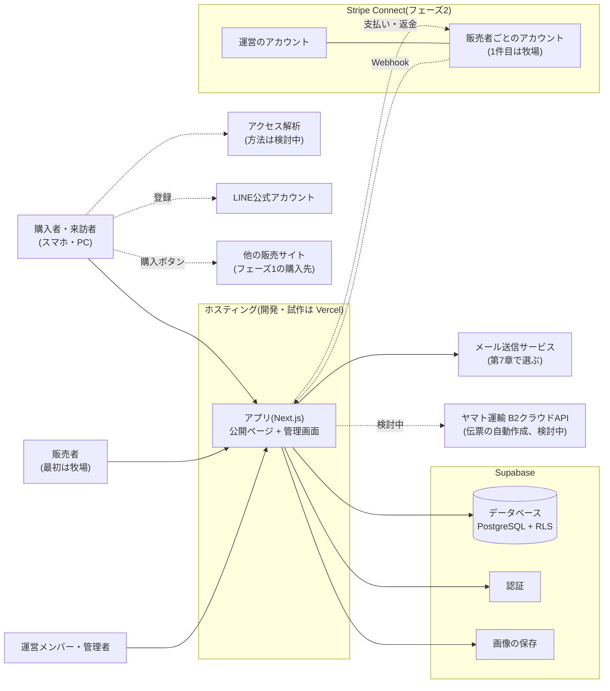
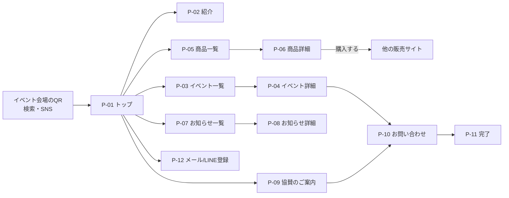
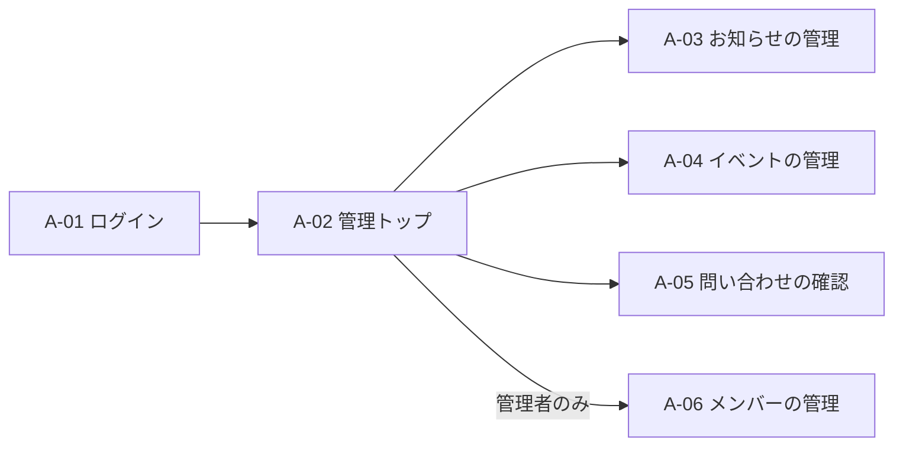
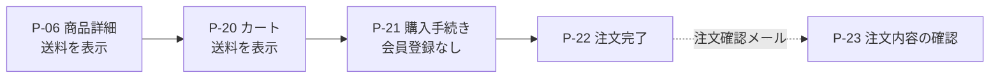

# 基本設計書

最終更新: 2026-10-30

| 項目 | 内容 |
|---|---|
| 版 | v0.1 |
| 状態 | **作成中** |
| もとにする要件 | 要件定義書 v1.2([01-requirements.md](01-requirements.md)) |
| 合意の記録 | 会議の議事録に記録する。版を上げたときは、下の改訂履歴に議事録の名前を書く。作成中の合意は、その変更のPRの説明文にある「合意の記録」の欄に書く |

注釈: 版は、文書ごとに付ける。作成中は v0.1、v0.2…とし、合意して確定した時点で v1.0 とする。確定した後に内容を変える場合は、v1.1、v1.2…と上げ、もう一度合意する。

### 改訂履歴

| 版 | 状態 | 内容 | 合意の記録 |
|---|---|---|---|
| v0.1 | 作成中 | 初版。目次と範囲、システム構成(第1章、作成中)、画面一覧と画面遷移(第4章、作成中) | なし(作成中のため) |

この文書は、個人情報や秘密情報を含まない。

## この文書の範囲

- フェーズ1は、実装できる程度まで詳しく設計する。
- フェーズ2は、画面と業務の流れの概要だけを示す。詳しい設計は、フェーズ2の前に行う。
- フェーズ3とフェーズ4は、この文書の対象外とする。それぞれのフェーズの前に設計する。
- 既存のシステムがないため、移行設計は対象外とする。

## 目次

1. システム構成(方式設計) — 作成中(Issue #7)
2. 業務フロー — 作成前(Issue #8)
3. 機能一覧と要件との対応 — 作成前(Issue #9)
4. 画面設計(画面一覧、画面遷移、画面レイアウト、画面項目) — 作成中(Issue #10、Issue #11)
5. データ設計(論理データモデル、テーブル一覧、CRUD図) — 作成前(Issue #12)
6. 権限・セキュリティ設計 — 作成前(Issue #13)
7. 外部インターフェースと通知の設計 — 作成前(Issue #14)
8. 非機能設計 — 作成前(Issue #15)
9. 未決事項

## 1. システム構成(方式設計)

この章は、要件定義書 v1.2([01-requirements.md](01-requirements.md))の第9章(前提・制約)、ADR-0001([adr/0001-tech-stack.md](adr/0001-tech-stack.md))、ADR-0002([adr/0002-hosting-and-ownership.md](adr/0002-hosting-and-ownership.md))、ADR-0004([adr/0004-stripe-connect-direct-charges.md](adr/0004-stripe-connect-direct-charges.md))と、議事録_2026_1029 の合意をもとにする。

### 1.1 システム構成図



| 構成要素 | 役割 | 使い始める段階 |
|---|---|---|
| アプリ(Next.js) | 公開ページと管理画面を、1つのアプリに入れる。管理画面は `/admin` の下に置き、ログインを必要とする | フェーズ1 |
| Supabase のデータベース | すべてのデータを置く。権限は、行レベルセキュリティ(RLS)で守る(NF-06(権限)) | フェーズ1 |
| Supabase の認証 | 運営メンバー・管理者・販売者のログイン。方式は BQ-01(管理画面のログイン方式)で決める | フェーズ1 |
| Supabase の画像の保存 | お知らせ・成長日記・商品の写真 | フェーズ1 |
| メール送信サービス | F-03(問い合わせフォーム)の通知、F-13(注文確認メール)、返金の申し出と返金の通知 | フェーズ1 |
| アクセス解析 | F-07(アクセス解析)。方法は BQ-05(アクセス解析の方法)で決める | フェーズ1 |
| LINE公式アカウント | F-04(メール/LINE登録)の LINE の登録先。アプリからは、登録のリンクを置くだけにする | フェーズ1 |
| 他の販売サイト | F-05(商品一覧・詳細)の購入ボタンの移動先(RQ-11(現在販売している他の販売サイトの名前とURL)) | フェーズ1 |
| Stripe Connect | F-10(カート・決済)と返金。運営のアカウントの下に、販売者ごとのアカウントをつなぐ。1件目の販売者は牧場 | フェーズ2 |
| ヤマト運輸 B2クラウドAPI | 送り状(伝票)の自動作成。使うかどうかは BQ-07(送り状(伝票)の自動作成)で決める | フェーズ2(検討中) |

#### 決済と返金の方式

- 支払いは、Stripe Connect の**ダイレクト支払い**にする。代金は、販売者のアカウントに直接入る。運営は代金を預からない(ADR-0004(最初から Stripe Connect のダイレクト支払いを使う))。
- 要件定義書 v1.2([01-requirements.md](01-requirements.md))との違い: Stripe Connect は F-31(売上の分配)としてフェーズ4に置かれ、ADR-0001 でも将来の拡張としている。返金の申し出・返金ボタン・送料の運賃表は、F-10(カート・決済)と F-12(注文管理・発送ステータス)に書かれていない。これらは要件の変更に当たるため、要件定義書の次の版で主催者の合意を得て加える(Issue #49)。合意までは、この節は案とする。
- F-10(カート・決済)のコンビニ払いも、販売者のアカウントで受けるダイレクト支払いにする。販売者のアカウントで使えるかどうかは、BQ-08(コンビニ払いの扱い)で確かめる。
- 1回の支払いの代金は、1人の販売者に入る。複数の販売者の商品を買う場合は、販売者ごとに支払いを分ける。
- 送料は、サイトが運賃表(大きさ・重さ × 発送元と送り先)から計算し、商品代金と合わせて1回の支払いにする。運賃表は、運送会社の料金の変更に合わせて、管理画面から直せるようにする。
- 販売手数料は、最初の売り手が牧場だけの間はいただかない。他の販売者が加わったときの率は、引き渡しの後に決めるため、設定で変えられるようにする。
- 返金は、販売者が、管理画面の返金ボタンから行う。アプリが、販売者のアカウントとして Stripe の返金機能を呼ぶ。返金は販売者の Stripe の残高から出て、残高が足りないと保留になる。販売手数料は、返金しても自動では戻らない。
- 購入者は、注文の画面の「返金の申し出」ボタンから申し出る。押しても、返金やキャンセルは自動では行われない。申し出があったら販売者にメールで知らせ、返金が済んだら購入者と販売者に知らせる。
- 注文ごとのメッセージ機能は、要件定義書の次の版で機能として加える(Issue #49)。メッセージの画面と項目は、第4章と第5章で設計する。
- 運営のアカウントは、引き渡しまでは開発者の名義で作り、引き渡しのときに牧場の名義にする(ADR-0002(ホスティング・ドメイン・引き渡し方針))。
- カード情報は、アプリのサーバーを通さない。入力は Stripe の画面で行う(NF-05(セキュリティ))。
- 秘密の鍵(Supabase の管理用の鍵、Stripe の秘密鍵など)は、サーバー側だけで使い、ホスティングの環境変数に置く。リポジトリには置かない。

### 1.2 ソフトウェア構成(モジュラーモノリスの境界)

1つのアプリを、次のモジュールに分ける。境界は、ADR-0001([adr/0001-tech-stack.md](adr/0001-tech-stack.md))の「商品・注文・会員・生産者」に、フェーズ1で必要な「紹介」「問い合わせ・登録」と、フェーズ2の「配送」を加えたものとする。

| モジュール | 扱うもの | 対応する機能 | 使い始める段階 |
|---|---|---|---|
| 紹介 | 牧場・取り組みの紹介、お知らせ・成長日記、イベント、協賛・応援のご案内 | F-01、F-02、F-06、F-08 | フェーズ1 |
| 問い合わせ・登録 | 問い合わせ、メールの登録 | F-03、F-04 | フェーズ1 |
| 会員・権限 | ログイン、役割、メンバーの招待・削除 | F-09 | フェーズ1 |
| 生産者 | 販売者の情報と、Stripe の販売者のアカウントとのつながり。フェーズ1では、牧場の1件だけを登録する | F-30 | フェーズ1 |
| 商品 | 商品の一覧・詳細、他の販売サイトへのリンク、商品の大きさ・重さ。フェーズ2から在庫 | F-05、F-11、F-14 | フェーズ1 |
| 配送 | 運賃表、送料の計算、発送ステータス、送り状(BQ-07(送り状(伝票)の自動作成)) | F-12 | フェーズ2 |
| 注文 | カート、支払い、注文、注文確認メール、返金の申し出と返金、注文ごとのメッセージ(写真を付けられ、履歴が残る) | F-10、F-12、F-13、F-14、F-31 | フェーズ2 |

F-07(アクセス解析)は、外部のサービスを使うため、モジュールには入れない(第1.1節、BQ-05(アクセス解析の方法))。

「生産者」モジュールは、F-30(生産者管理・生産者ごとの出品/注文管理)の一部を先取りする。フェーズ1では、牧場1件の販売者の情報と、Stripe の販売者のアカウントとのつながりだけを作る(ADR-0004(最初から Stripe Connect のダイレクト支払いを使う))。生産者ごとの出品・注文の管理は、フェーズ4で加える。先取りは要件の変更に当たるため、要件定義書の次の版で加える(Issue #49)。

境界のルール:

1. 各モジュールは、自分のテーブルだけを読み書きする。他のモジュールのデータは、そのモジュールが公開する関数を通して使う。
2. 画面(Next.js のルート)には処理を書かず、モジュールの関数を呼ぶだけにする。
3. 商品と注文は、最初から販売者に属する形にする。生産者が増えても、作り直さずに済むようにするため。
4. Stripe を呼ぶのは、注文モジュール(支払い・返金)と生産者モジュール(販売者のアカウントの登録)だけにする。
5. 複数のモジュールで使う部品(画面の部品、データベースへの接続、メールの送信)は、共通の場所に置く。共通の場所には、業務の処理を置かない。

フォルダの構成:

```
src/
  app/            画面(公開ページと /admin)
  modules/
    content/      紹介
    inquiry/      問い合わせ・登録
    account/      会員・権限
    producer/     生産者
    catalog/      商品
    shipping/     配送(フェーズ2)
    order/        注文(フェーズ2)
  shared/         共通の部品
supabase/
  migrations/     データベースの変更
```

### 1.3 環境の構成

| 環境 | 目的 | アプリの置き場所 | データベース | 決済 | URL |
|---|---|---|---|---|---|
| 開発 | 作業する人が、作って確かめる | 作業する人のPC | Supabase CLI で動かす、PCの中のデータベース | Stripe のテストモード | `localhost` |
| 試作 | 主催者に見てもらい、合意をいただく | 開発者の Vercel Pro チームの中の、別プロジェクト(ADR-0002(ホスティング・ドメイン・引き渡し方針)) | 試作用の Supabase プロジェクト(料金プランは BQ-06(試作の Supabase の料金プラン)) | Stripe のテストモード | `〇〇.vercel.app` |
| 本番 | 公開して運用する | 引き渡しの前に比較して選ぶ(ADR-0002(ホスティング・ドメイン・引き渡し方針)、NF-11(運用コスト)) | 本番用の Supabase プロジェクト | Stripe の本番モード | 独自ドメイン(RQ-06(ドメインの名前と名義)) |

- 環境ごとに、データと鍵を分ける。
- 試作の環境には、本物の個人情報を入れない。
- PR ごとに、Vercel のプレビューを作る。main に入った内容が、試作の環境になる。
- データベースの変更は、`supabase/migrations/` のファイルで管理し、開発、試作、本番の順に当てる。

### 1.4 採用する技術と版

版は、メジャー版で決める。細かい版は、`package.json` と lockfile で固定し、更新は PR で行う。下の表の「確認した版」は、2026-10-30 に npm で確かめた、採用する版の中の最新の版である。TypeScript は 7 が出ているが、表の根拠のとおり 6.0 を使う。

| 区分 | 技術 | 採用する版 | 確認した版 | 根拠 |
|---|---|---|---|---|
| 実行環境 | Node.js | 24(LTS) | — | Next.js 16 は Node.js 20.9 以上が必要 |
| 言語 | TypeScript | 6.0 | 6.0.3 | 今の書き方の最後の版で、Next.js と ESLint の両方が対応している。6.0 の非推奨の警告を直しておけば、7 へ上げやすい。7 へは、ESLint が対応してから上げる |
| フレームワーク | Next.js(App Router) | 16 | 16.4.3 | ADR-0001 |
| 画面 | React | 19 | 19.3.1 | Next.js 16 が対応する版 |
| 見た目 | Tailwind CSS | 4 | 4.3.3 | 画面の部品を、少ないファイルで保守できる |
| データベース・認証・画像 | Supabase(`@supabase/supabase-js`、`@supabase/ssr`) | 2、0.12 | 2.118.0、0.12.7 | ADR-0001 |
| データベースの管理 | Supabase CLI | 2 | 2.122.0 | 開発の環境と、`supabase/migrations/` の管理 |
| 決済 | Stripe(`stripe`)、Stripe Connect | 23 | 23.1.0 | ADR-0001、ADR-0004。フェーズ2から |
| 単体テスト | Vitest | 5 | 5.0.5 | NF-09(品質保証) |
| E2Eテスト | Playwright(`@playwright/test`) | 1 | 1.64.1 | NF-04(スマートフォン)、NF-09(品質保証) |
| CI | GitHub Actions | — | — | NF-01(表示速度)、NF-09(品質保証)の計測とテスト |
| ホスティング(開発・試作) | Vercel Pro | — | — | ADR-0002 |

## 2. 業務フロー

作成前。Issue #8 で作成する。

## 3. 機能一覧と要件との対応

作成前。Issue #9 で作成する。

## 4. 画面設計

### 4.1 画面一覧

画面IDの付け方: 来訪者向けは `P-`、管理画面は `A-` とする。番号の十の位は、フェーズに合わせる(1〜19: フェーズ1、20〜: フェーズ2)。
「見られる役割」は、要件定義書 v1.2([01-requirements.md](01-requirements.md#51-役割と権限))第5.1節の役割を使う。
「要件」の列は、要件定義書 v1.2([01-requirements.md](01-requirements.md))の要件ID(第6章の機能要件、第7章の非機能要件)を示す。

#### 4.1.1 来訪者向け(フェーズ1)

| ID | 画面 | 主な内容 | 要件 | 見られる役割 |
|---|---|---|---|---|
| P-01 | トップ | 牧場の紹介、次のイベント、商品、お知らせの新着、メール/LINE登録への入口 | F-01, F-02, F-04, F-05, F-06 | 全員 |
| P-02 | 牧場・取り組みの紹介 | 物語、地域の状況、エミューについて、報道・応援の紹介 | F-01 | 全員 |
| P-03 | イベント一覧 | 開催予定と、過去のイベント | F-02 | 全員 |
| P-04 | イベント詳細 | 日時、場所、行き方、問い合わせへの導線 | F-02 | 全員 |
| P-05 | 商品一覧 | 商品の写真、名前、価格 | F-05 | 全員 |
| P-06 | 商品詳細 | 写真(複数枚)、説明、価格。フェーズ1では「購入する」ボタンから、他の販売サイトへ移動する | F-05 | 全員 |
| P-07 | お知らせ・成長日記一覧 | 新しい順。種類(お知らせ/成長日記)で絞り込める | F-06 | 全員 |
| P-08 | お知らせ・成長日記詳細 | 本文、写真 | F-06 | 全員 |
| P-09 | 協賛・応援のご案内 | 協賛の内容、問い合わせへの導線 | F-08 | 全員 |
| P-10 | お問い合わせ | 種別(イベント/見学/取材/協賛/商品)、名前、メール、内容、プライバシーポリシーへの同意 | F-03 | 全員 |
| P-11 | お問い合わせ完了 | 受付の表示、返信までの目安 | F-03 | 全員 |
| P-12 | メール/LINE登録 | メールの登録フォーム、LINE公式アカウントの友だち追加 | F-04 | 全員 |
| P-13 | プライバシーポリシー | 個人情報の利用目的、問い合わせ先 | 要件定義書 v1.2([01-requirements.md](01-requirements.md))第4章(フェーズ1で必須) | 全員 |
| P-14 | エラー(404など) | トップや商品一覧への導線 | — | 全員 |

#### 4.1.2 管理画面(フェーズ1、F-09(管理画面の一部))

| ID | 画面 | 主な内容 | 運営メンバー | 管理者 |
|---|---|---|---|---|
| A-01 | ログイン | ログイン方式は未決(BQ-01(管理画面のログイン方式)) | ○ | ○ |
| A-02 | 管理トップ | 未対応の問い合わせ件数、最近の更新 | ○ | ○ |
| A-03 | お知らせ・成長日記の管理 | 一覧、作成、編集、公開/非公開、削除 | ○ | ○ |
| A-04 | イベントの管理 | 一覧、作成、編集、公開/非公開、削除 | ○ | ○ |
| A-05 | 問い合わせの確認 | 一覧、詳細、対応状況(未対応/対応中/完了) | ○ | ○ |
| A-06 | メンバーの管理 | 招待、削除、役割の変更 | — | ○ |

#### 4.1.3 フェーズ2で追加する画面(参考)

フェーズ2の設計で詳しくする。ここでは、画面の流れを先に決めるために、名前だけを挙げる。

| ID | 画面 | 要件 | 見られる役割 |
|---|---|---|---|
| P-20 | カート | F-10 | 全員(ゲスト購入) |
| P-21 | 購入手続き(お届け先、支払い) | F-10 | 全員(ゲスト購入) |
| P-22 | 注文完了 | F-10, F-13 | 購入者 |
| P-23 | 注文内容の確認(メールのリンクから開く) | F-12 | 購入者 |
| P-24 | 特定商取引法に基づく表記 | 要件定義書 v1.2([01-requirements.md](01-requirements.md))第8章 | 全員 |
| A-20 | 商品の管理 | F-14 | 管理者、生産者(自分の商品のみ) |
| A-21 | 在庫の管理 | F-11 | 管理者、生産者(自分の商品のみ) |
| A-22 | 注文・出荷の管理 | F-12 | 管理者、生産者(自分の出荷のみ) |

送料は、P-06(商品詳細)とP-20(カート)で表示する(F-10(カート・決済)、NF-17(使いやすさ))。

### 4.2 画面遷移

#### 4.2.1 来訪者(フェーズ1)



- お問い合わせ(P-10)とメール/LINE登録(P-12)へは、どの画面からも、共通のフッターで移動できる。
- イベント会場のQRは、P-01(トップ)ではなく、P-04(そのイベントの詳細)やP-12(登録)へ直接つなぐこともできる。どこへつなぐかは、イベントごとに決める。

#### 4.2.2 管理画面(フェーズ1)



#### 4.2.3 購入の流れ(フェーズ2、参考)



### 4.3 画面レイアウト

作成前。Issue #11 で作成する。

### 4.4 画面項目

作成前。Issue #11 で作成する。

## 5. データ設計

作成前。Issue #12 で作成する。

## 6. 権限・セキュリティ設計

作成前。Issue #13 で作成する。

## 7. 外部インターフェースと通知の設計

作成前。Issue #14 で作成する。

## 8. 非機能設計

作成前。Issue #15 で作成する。

## 9. 未決事項

| ID | 事項 | 選択肢 | 影響する箇所 |
|---|---|---|---|
| BQ-01 | 管理画面のログイン方式 | メールとパスワード / メールのリンク(マジックリンク) / Googleアカウント。メールのリンクは、メールの安全確認機能がリンクを先に開いてしまい、無効になることがある。運営メンバーの使いやすさと、この問題への対策を合わせて決める | A-01 |
| BQ-02 | 購入手続きの画面 | Stripeの決済ページ(Checkout)を使う / 自前の画面に組み込む(Elements) | P-21 |
| BQ-03 | お知らせ・成長日記の本文の書き方 | 見たままに編集できる形式 / 簡単な記法(Markdown)。非エンジニアが使うことを前提に決める | A-03 |
| BQ-04 | 問い合わせを受けたときの通知先 | 要件定義書 v1.2([01-requirements.md](01-requirements.md))の RQ-12(問い合わせ・登録の通知を受け取る人と、連絡の手段)の回答を待つ | A-05 |
| BQ-05 | アクセス解析の方法 | Google アナリティクス / Vercel の Web Analytics / その他。Cookie の同意の表示と、プライバシーポリシーの書き方が変わる | 第1章、F-07 |
| BQ-06 | 試作の Supabase の料金プラン | 無料プラン / 有料プラン(Pro)。無料プランは、使われない期間が続くと止まることがある。条件は、公式の情報で確認する | 第1章 |
| BQ-07 | 送り状(伝票)の自動作成 | ヤマト運輸の B2クラウドAPI を使う / 使わない。契約の名義(運営か販売者ごとか)と、API を使う条件を、ヤマト運輸に確認する | 第1章、F-12 |
| BQ-08 | コンビニ払いの扱い | 販売者のアカウントで有効にする / フェーズ2では使わない。Stripe のテストモードで、ダイレクト支払いで使えるかを確かめる | 第1章、F-10 |
