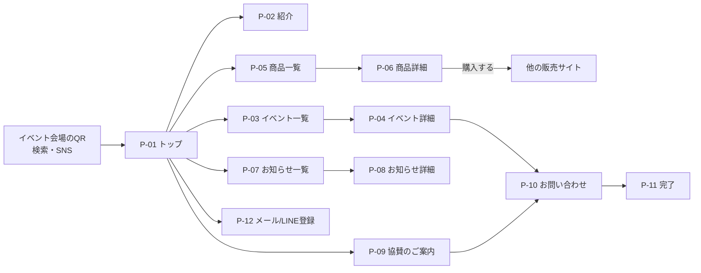
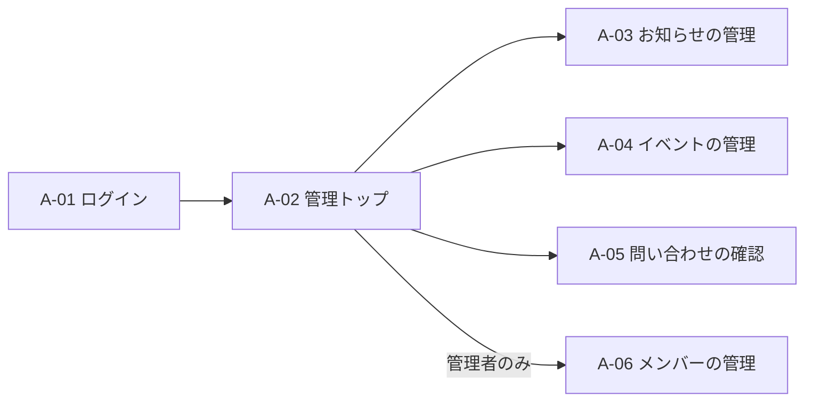
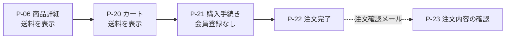

# 基本設計書

最終更新: 2026-10-25

| 項目 | 内容 |
|---|---|
| 版 | v0.1 |
| 状態 | **作成中** |
| もとにする要件 | 要件定義書 v1.1([01-requirements.md](01-requirements.md)) |
| 合意の記録 | 会議の議事録に記録する。どの議事録に記録したかは、[決定事項の記録](decisions.md)に記載する |

注釈: 版は、文書ごとに付ける。作成中は v0.1、v0.2…とし、合意して確定した時点で v1.0 とする。確定した後に内容を変える場合は、v1.1、v1.2…と上げ、もう一度合意する。

この文書は、個人情報や秘密情報を含まない。

## 目次

1. システム構成(方式設計) — 作成前(Issue #7)
2. 業務フロー — 作成前(Issue #8)
3. 機能一覧と要件との対応 — 作成前(Issue #9)
4. 画面設計(画面一覧、画面遷移、画面レイアウト、画面項目) — 作成中(Issue #10、#11)
5. データ設計(論理データモデル、テーブル一覧、CRUD図) — 作成前(Issue #12)
6. 権限・セキュリティ設計 — 作成前(Issue #13)
7. 外部インターフェースと通知の設計 — 作成前(Issue #14)
8. 非機能設計 — 作成前(Issue #15)
9. 未決事項

## 1. システム構成(方式設計)

作成前。Issue #7 で作成する。

## 2. 業務フロー

作成前。Issue #8 で作成する。

## 3. 機能一覧と要件との対応

作成前。Issue #9 で作成する。

## 4. 画面設計

### 4.1 画面一覧

画面IDの付け方: 来訪者向けは `P-`、管理画面は `A-` とする。番号の十の位は、フェーズに合わせる(1〜19: フェーズ1、20〜: フェーズ2)。
「見られる役割」は、[要件定義書 第5.1節](01-requirements.md#51-役割と権限)の役割を使う。

#### 4.1.1 来訪者向け(フェーズ1)

| ID | 画面 | 主な内容 | 要件 | 見られる役割 |
|---|---|---|---|---|
| P-01 | トップ | 牧場の紹介、次のイベント、商品、お知らせの新着、メール/LINE登録への入口 | F-01, F-02, F-04, F-05, F-06 | 全員 |
| P-02 | 牧場・取り組みの紹介 | 物語、地域の状況、エミューについて、報道・応援の紹介 | F-01 | 全員 |
| P-03 | イベント一覧 | 開催予定と、過去のイベント | F-02 | 全員 |
| P-04 | イベント詳細 | 日時、場所、行き方、問い合わせへの導線 | F-02 | 全員 |
| P-05 | 商品一覧 | 商品の写真、名前、価格 | F-05 | 全員 |
| P-06 | 商品詳細 | 写真(複数枚)、説明、価格。フェーズ1では「購入する」ボタンから、他の販売サイトへ移動する | F-05 | 全員 |
| P-07 | お知らせ・成長日記一覧 | 新しい順。種類(お知らせ/成長日記)で絞り込める | F-06 | 全員 |
| P-08 | お知らせ・成長日記詳細 | 本文、写真 | F-06 | 全員 |
| P-09 | 協賛・応援のご案内 | 協賛の内容、問い合わせへの導線 | F-08 | 全員 |
| P-10 | お問い合わせ | 種別(イベント/見学/取材/協賛/商品)、名前、メール、内容、プライバシーポリシーへの同意 | F-03 | 全員 |
| P-11 | お問い合わせ完了 | 受付の表示、返信までの目安 | F-03 | 全員 |
| P-12 | メール/LINE登録 | メールの登録フォーム、LINE公式アカウントの友だち追加 | F-04 | 全員 |
| P-13 | プライバシーポリシー | 個人情報の利用目的、問い合わせ先 | 第4章(フェーズ1で必須) | 全員 |
| P-14 | エラー(404など) | トップや商品一覧への導線 | — | 全員 |

#### 4.1.2 管理画面(フェーズ1、F-09)

| ID | 画面 | 主な内容 | 運営メンバー | 管理者 |
|---|---|---|---|---|
| A-01 | ログイン | ログイン方式は未決事項 #1 | ○ | ○ |
| A-02 | 管理トップ | 未対応の問い合わせ件数、最近の更新 | ○ | ○ |
| A-03 | お知らせ・成長日記の管理 | 一覧、作成、編集、公開/非公開、削除 | ○ | ○ |
| A-04 | イベントの管理 | 一覧、作成、編集、公開/非公開、削除 | ○ | ○ |
| A-05 | 問い合わせの確認 | 一覧、詳細、対応状況(未対応/対応中/完了) | ○ | ○ |
| A-06 | メンバーの管理 | 招待、削除、役割の変更 | — | ○ |

#### 4.1.3 フェーズ2で追加する画面(参考)

フェーズ2の設計で詳しくする。ここでは、画面の流れを先に決めるために、名前だけを挙げる。

| ID | 画面 | 要件 | 見られる役割 |
|---|---|---|---|
| P-20 | カート | F-10 | 全員(ゲスト購入) |
| P-21 | 購入手続き(お届け先、支払い) | F-10 | 全員(ゲスト購入) |
| P-22 | 注文完了 | F-10, F-13 | 購入者 |
| P-23 | 注文内容の確認(メールのリンクから開く) | F-12 | 購入者 |
| P-24 | 特定商取引法に基づく表記 | 第8章 | 全員 |
| A-20 | 商品の管理 | F-14 | 管理者、生産者(自分の商品のみ) |
| A-21 | 在庫の管理 | F-11 | 管理者、生産者(自分の商品のみ) |
| A-22 | 注文・出荷の管理 | F-12 | 管理者、生産者(自分の出荷のみ) |

送料は、P-06(商品詳細)とP-20(カート)で表示する(F-10、NF-17)。

### 4.2 画面遷移

#### 4.2.1 来訪者(フェーズ1)

- お問い合わせ(P-10)とメール/LINE登録(P-12)へは、どの画面からも、共通のフッターで移動できる。
- イベント会場のQRは、P-01ではなく、P-04(そのイベントの詳細)やP-12(登録)へ直接つなぐこともできる。どこへつなぐかは、イベントごとに決める。

#### 4.2.2 管理画面(フェーズ1)

#### 4.2.3 購入の流れ(フェーズ2、参考)

### 4.3 画面レイアウト

作成前。Issue #11 で作成する。

### 4.4 画面項目

作成前。Issue #11 で作成する。

## 5. データ設計

作成前。Issue #12 で作成する。

## 6. 権限・セキュリティ設計

作成前。Issue #13 で作成する。

## 7. 外部インターフェースと通知の設計

作成前。Issue #14 で作成する。

## 8. 非機能設計

作成前。Issue #15 で作成する。

## 9. 未決事項

| # | 事項 | 選択肢 | 影響する箇所 |
|---|---|---|---|
| 1 | 管理画面のログイン方式 | メールとパスワード / メールのリンク(マジックリンク) / Googleアカウント。メールのリンクは、メールの安全確認機能がリンクを先に開いてしまい、無効になることがある。運営メンバーの使いやすさと、この問題への対策を合わせて決める | A-01 |
| 2 | 購入手続きの画面 | Stripeの決済ページ(Checkout)を使う / 自前の画面に組み込む(Elements)。データ設計の未決事項と同じ | P-21 |
| 3 | お知らせ・成長日記の本文の書き方 | 見たままに編集できる形式 / 簡単な記法(Markdown)。非エンジニアが使うことを前提に決める | A-03 |
| 4 | 問い合わせを受けたときの通知先 | 要件定義書 第10章 #12 の回答を待つ | A-05 |
